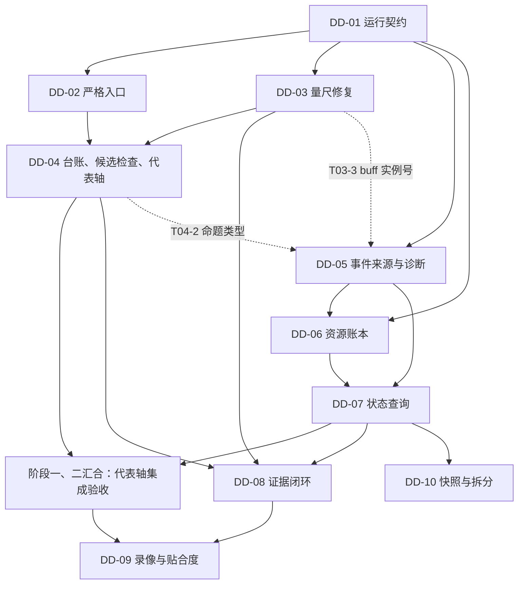

# 逐帧仿真底座：详细设计总览（v0.4 Final）

**版本**：v0.4，2026-11-14，Claude。v0.2 按第一轮协同评审（[意见文件](detailed-design-feedback.md)：Antigravity 的 DF-01～DF-09、Codex 的 DF-10～DF-24）修订，回应见意见文件 §10；v0.3 按 Codex 第二轮复核（DF-14、DF-16、DF-18 续与新增的 DF-25）修订，回应见 §13；v0.4 按第三轮复核统一 DF-16 的单候选分支、改正 `roundEnds` 的记法，回应见 §16。2026-11-15 定稿：正文与 v0.4 相同，只按意见文件 §17.2 在 DD-08 §4.1 作一处文字澄清。

**依据**：
- [路线图 v3.3 Final](../engine-foundation-roadmap.md)（下称"路线图"）；
- [架构设计 v0.3 Final](../engine-foundation-architecture-draft.md)（下称"架构"）。

**基线**：代码 `6eedc0b`（引擎代码与 `cb520f5` 相同，其间只改了文档）；装配数据 `20261019`。

**状态**：
- **v0.4 Final，三方审查通过。** Claude（意见文件 [§16](detailed-design-feedback.md)）、Codex（[§17](detailed-design-feedback.md)）、Antigravity（[§18](detailed-design-feedback.md#antigravity-round4-stamp)）均已签署 v0.4。
- **DF-01～DF-25 全部 `done`**；补充提案 S-01～S-15（§6）与各文档的 Q 项按合稿后的写法确认。
- **签署的文件版本**：本总览、DD-03、DD-08 为 v0.4；DD-01、DD-02、DD-07、DD-09 为 v0.3；DD-04、DD-05、DD-06、DD-10 为 v0.2。各文档的版本号不再统一抬高，开头都标了 Final。
- **实施进度**：DD-01（2026-11-15，验收清单见其 §6）与 DD-03（2026-11-15，验收清单见其 §11）已实现；DD-04 先交付了 T04-1、T04-2（2026-11-16：`forteKeepOnSwitchBy` 与台账 `src/engine/propositions.ts`、`PropositionId`，即 §2 虚线的小契约），T04-3～T04-10 随后也已实现（见 DD-04 开头的状态）；DD-05（2026-11-16，验收清单见其 §9，实施记录见其 §12）与 DD-06（2026-11-16，验收清单见其 §6，实施记录见其 §9）已实现；其余还没实现。签署的是设计与验收契约：实施时要兑现各 C 编号用例与验收清单；模型符不符合游戏，按 DD-08 的证据流程另行验证。DD-09、DD-10 动工前按当时的代码再复核一次。

**下一步**：按 §2 的先后与依赖进入实施；DD-01、DD-03、DD-04、DD-05、DD-06 已完成，可实施 DD-07（查询挂在 DD-05 的收集器与边界观察点上，`stateAt` / `terminalState` 带诊断时另带 DD-06 的账本上界），再到阶段一、二的汇合验收。

本目录定的是每个工作包改哪些文件、加哪些类型与函数、按什么顺序做、用哪些用例验收。

## 1. 怎么拆的

路线图 §0.4 说"每个阶段动工前写一份详细设计"。阶段一、二的内容多，而且路线图 §9.3 允许它们并行起步，所以按**能独立开工、独立验收的工作包**拆，一个工作包一份文档。阶段三、四、五各一份。

| 文档 | 工作包 | 阶段 | 落实架构的哪几节 | 关掉哪些已知问题 |
|---|---|---|---|---|
| [DD-01](dd-01-run-contract.md) | 运行输入、运行身份、完成状态、分层检查 | 一 | §1.2、§2.1–§2.4、§9 | R11 的数据部分 |
| [DD-02](dd-02-strict-entry.md) | 严格教学轴入口 | 一 | §11.1–§11.3；路线图 §3 | 意图未满足只记警告 |
| [DD-03](dd-03-measurement-fixes.md) | 量尺与报告修复 | 一 | §3.2、§10.1、§10.2、§10.4 | R01、R06、R09、R10、R11、R03 的"不可评估" |
| [DD-04](dd-04-ledger-candidates.md) | 规则台账、候选检查、代表轴与第一份有条件结论 | 一（台账结构延续到三） | §8、§11.4 | R13 的首批、RR-03 |
| [DD-05](dd-05-event-origin-diagnostics.md) | 事件来源、诊断旁路、规则使用、零干扰 | 二 | §3.3、§3.5、§4 | R02、R05 |
| [DD-06](dd-06-resource-ledger.md) | 资源只读账本 | 二 | §6 | R14、RR-02 |
| [DD-07](dd-07-state-query.md) | 状态查询、试算会话、"为什么没发生"、事件解释、跨运行比较、命令行 JSON | 二 | §2.5–§2.7、§3.4、§5、§7 | R04 |
| [DD-08](dd-08-evidence-loop.md) | 证据闭环与进游戏实验的做法 | 三 | §8.1 的证据部分、§10.1–§10.2 | R07、R12 |
| [DD-09](dd-09-replay-fit.md) | 录像输入与贴合度 | 四 | §10.3、§12 | R03 的一对一匹配、R15 |
| [DD-10](dd-10-snapshot-split.md) | 快照恢复、执行核心拆环、分析层切出 | 五 | §1.2 末段、§5.3 末段、§13.1 | R08 |

阶段四、五离动工还远，DD-09、DD-10 只写到"接口、任务与验收条件能评审"的程度，动工前按当时的代码再修订一次。

## 2. 先后与依赖

- **DD-01 是所有工作包的前提**：它定 `PreparedRun`、`RunCompletion` 与新的运行入口，其余工作包都往这个入口上挂东西。
- **DD-03 里的各项互相独立**，每项只阻塞依赖它的消费者（路线图 §9.1 第 1 条），可以拆给不同的执行者。
- **DD-05～DD-07 不等代表轴**：它们从微场景起步，和 DD-02～DD-04 并行（路线图 §9.4 开头）。
- **小契约先交付**（图里的虚线，Codex 的非阻塞意见）：DD-05 只依赖 DD-03 的 T03-3（`buffApply` / `buffExpire` 的提供者与实例号）与 DD-04 的 T04-2（命题 ID 的类型），不依赖代表轴报告。这两步排在各自工作包的最前面先交付，DD-05 就能开工。
- **汇合点**是代表轴 `m0-video-eq-不打谐破.yaml` 上的集成验收，判据写在 [DD-04 §8](dd-04-ledger-candidates.md) 与 [DD-07 §13](dd-07-state-query.md)。

## 3. 每份文档的结构

每份都按同一个顺序写，执行的 agent 从上往下做：

1. **范围与依据**：做什么、不做什么、对应路线图与架构的哪几条。
2. **现状**：基线上的代码怎么写的，用符号名定位，不靠行号。
3. **设计**：类型、函数签名、行为规则。签名里的字段名是建议，评审通过后就是契约。
4. **实施步骤**：编号 `T<文档号>-<序号>`，每步写明改哪些文件、做完的判据。步骤按能逐个提交的粒度排。
5. **用例**：编号 `C<文档号>-<序号>`，写明前提、操作与断言。帧数只在写明的前提下成立（CD-01）。
6. **验收清单**：全部打勾才算这个工作包完成。
7. **要同步的正式文档**：按路线图 §11 的路由。
8. **待评审的决定**：编号 `DD<文档号>-Q<序号>`，写清候选与我的建议。

## 4. 所有工作包共同遵守的

1. **不推翻总设计 §4 的取舍**，不改架构定稿的契约。实施中发现架构要改，按架构开头"以后怎么改"处理：提出来、改架构、在它的附录 C 记一条。本轮详细设计提出的补充集中列在 §6。
2. **新增字段先改 schema 与类型**，再改产出方与使用方（AGENTS.md）。
3. **改机制必须配用例**。本目录的"机制"包括调度器的等待与报错行为。
4. **业务行为不变的重构要能证明不变**：重构前后跑 `pnpm conformance`，逐个场景比较 `out/conformance/*.output.json`。有意的输出变化（新增业务字段）在提交说明里列出变化的字段，其余字段逐字节相同。
5. **快照变化要核对**（路线图 §12）：`tests/__snapshots__` 变了，说明哪些场景、哪些数、为什么，不因为快照变了就 `pnpm test -u`。
6. **每个任务结束**跑 `pnpm check && pnpm test && pnpm test:py`；改了 `src/engine/` 再跑 `pnpm conformance` 与 `pnpm fuzz`。输出写到文件并记退出码，不接 `tail`。
7. **技术断言要有非作者核对**（CL-04）。各文档"现状"一节的事实是我在基线上读代码得到的，评审时请实际打开对应符号核对。
8. **可移植写法**（总设计 §10.1）：新状态是纯数据；不留模块级可变状态；取整走 `num.ts`；输出顺序显式。
9. **纯库边界**：`src/engine/` 不 import `fs`、`path`、`child_process`、`node:crypto`、DOM 与 `src/data/load.ts`。引擎在网页的 Worker 里也要跑。读盘、跑 `git`、取文件哈希都在 `src/cli/` 做，把结果传进来。
10. **代码注释与提交说明引用章节号**，例如"DD-01 §3.2；架构 §2.3"。

## 5. 新增与改动的文件一览

| 文件 | 新 / 改 | 归属 | 文档 |
|---|---|---|---|
| `src/engine/run.ts` | 新 | ① 执行核心 | DD-01 |
| `src/engine/run-types.ts` | 新 | ① | DD-01 |
| `src/engine/basis.ts` | 新 | ① 汇总组 | DD-03、DD-07（比较口径与完成度的判定，分析层与查询层共用，DF-21） |
| `src/engine/digest.ts` | 新 | ① | DD-01 |
| `src/engine/wire.ts` | 新 | ①D | DD-07 |
| `src/engine/strict.ts` | 新 | ① | DD-02 |
| `src/engine/diagnostics.ts` | 新 | ①D | DD-05、DD-06 |
| `src/engine/query.ts` | 新 | ①D | DD-07 |
| `src/engine/probe.ts` | 新 | ①D | DD-07 |
| `src/engine/propositions.ts` | 新 | ② | DD-04、DD-08 |
| `src/engine/rule-points.ts` | 新 | ② | DD-05 |
| `src/data/evidence.schema.ts` | 新 | 数据 | DD-08 |
| `src/engine/compile.ts`、`src/engine/index.ts`、`src/analysis/` | 新 | ①、公开入口、④ | DD-10 |
| `src/engine/candidates.ts` | 新 | ④ | DD-04 |
| `src/engine/observations.ts` | 新 | ④ | DD-08、DD-09 |
| `src/cli/run-env.ts`、`src/cli/query.ts`、`src/cli/candidates.ts`、`src/cli/evidence.ts` | 新 | 外围 | DD-01、DD-07、DD-04、DD-08 |
| `src/engine/simulate.ts`、`scheduler.ts`、`kernel.ts`、`triggers.ts`、`resources.ts`、`switch.ts`、`buffs.ts`、`enemy.ts`、`types.ts`、`context.ts`、`summary.ts`、`invariants.ts` | 改 | ① | DD-01、02、03、05、06 |
| `src/engine/analysis.ts`、`calibration.ts`、`fit.ts`、`sensitivity.ts`、`insight.ts`、`search.ts`、`plan.ts`、`trace.ts` | 改 | ④ | DD-03、DD-04、DD-09 |
| `src/data/scenario.schema.ts`、`calibration.schema.ts`、`gamedata.ts` | 改 | 数据 | DD-01、02、03、04 |
| `tests/` 下的新测试文件 | 新 | — | 各文档"用例"一节。架构 §13.2 列的 12 个都在；另加 `candidates`、`propositions`、`observations`、`evidence`、`replay-input`、`snapshot` |
| `docs/proposition-ledger.md`、`docs/m0-strict-conclusion.md`、`docs/evidence/`、`docs/experiments/` | 新 | 文档 | DD-04、DD-08 |

## 6. 对架构文档的补充提案

写详细设计时发现架构有几处要补。它们不改已有契约，都是加字段或把没写明的地方写明。**评审已通过（2026-11-15），S-01～S-15 生效**：架构附录 C 已记一条指到本表；架构各节的正文暂时不逐处改写，与本表不一致的地方以本表为准，实施相应工作包时再把对应的几条写进架构正文。

| 编号 | 补什么 | 理由 | 出处 |
|---|---|---|---|
| S-01 | `RunCompletion` 加 `engineError?: { code: 'chainDepth' \| 'invariant' \| 'uncaught'; message: string }` | 架构 §2.4 有 `axisFailure` 与 `truncation` 的明细，没有引擎错误的明细；基线上非调度错误直接抛出，接住之后要有地方放消息 | DD-01 §3.4 |
| S-02 | `AxisFailureKind` 的 `intentUnmet` 对应一个新的调度错误码 `intentUnmet`；`ScheduleErrorCode` 相应加一项 | 架构 §2.2 的表只给了归类结果，没说运行期用哪个错误码 | DD-02 §3.3 |
| S-03 | `loopExitAt.phase` 的取值加 `'P1'` | 钩子不在 P1 跑，但 `computeRates` 理论上可以抛非调度错误；不加的话这类错误没有合法的取值 | DD-01 §3.5 |
| S-04 | 写明"是否跑 `checkLog`、`onHit` 回调属于观察选项，不进运行身份"；前提是观察回调只读收到的对象，回调自己抛的异常原样抛给调用方，不算运行状态 | 架构 §2.1 只列了诊断开关与过滤条件；这两项同样不改变执行。只读与异常的约束是 Codex 给的前提，零干扰测试覆盖它 | DD-01 §3.3、§3.4 |
| S-05 | `OriginContext` 加两种：`{ kind: 'finalization'; step: 'failClose' \| 'maxFramesWarning' }` 与 `{ kind: 'unattributed' }` | 失败收尾写的 `wait` 与帧数上限的警告不属于现有九种来源；后一种给漏插桩的事件兜底，出现即说明插桩有漏 | DD-05 §3.2 |
| S-06 | `ResourceLedgerEntry` 加 `causeKind`（十个固定取值），`cause` 保留原文 | 架构 §6.2 的 `cause: string` 没列取值，账本的使用者要靠它分类 | DD-06 §3.1 |
| S-07 | `CandidateOutcome` 加 `completion`、DPS 的实际差（`delta`、`ratio`、`withinWindowVariation`）；`StrictCandidateReport` 加"不适用"一类；架构 §11.4 的 `confirmedBottlenecks` 换成 `timingSensitive` 与 `timingAbsorbed`（只确认"指令时刻决定轮长"，不确认是哪项等待门槛） | 候选让轴失败时，报告要能机器读出是哪条意图；晚 6 帧的对照证明不了门槛级的因果，`spread` 内的变化也不等于数值相同（DF-20） | DD-04 §5.3、§5.4 |
| S-08 | `EventExplanation` 加 `businessRoot`；`EventMeta` 与规则明细各带一个内部的作用域号 | 把"算在谁名下"与"谁直接引出"分开给；按作用域把规则明细挂到事件上 | DD-07 §7 |
| S-09 | `StrictReport` 所有入口都有（非严格入口的编译检查为空），并加 `timeoutContext` | 按意图的等待与多余 `!` 的提示在非严格入口也有用；架构 §2.2 要求 `timeout` 带上被什么挡住 | DD-02 §3.4 |
| S-10 | 诊断选项加 `commandVerdicts`：调度器每一次真实求值都有 `evaluationIndex`，带结论与求值之后的上下文；检查点停在那次求值之后 | 同一帧里插队前后的两次求值要分得开；`q.extra`、`q.readyAt` 可能正是在这次求值里第一次写下；没有业务事件的指令也要知道执行帧（DF-11） | DD-07 §4.4 |
| S-11 | 场景加 `tuneBreakOmitted`；`PreparedRun.effective` 与 `SimResult` 加 `damageScope`（按 `tuneBreak` × 是否手写谐破的有效配置分类，含 `writtenPlusAuto`、`disabledByOption` 与 `gauge`）；严格入口加装配后的检查 `strict.tuneBreakUndeclared`；比较结果加 `scopeMismatch`（带两边完整的口径） | 用户 2026-11-14 定：原文没给谐破位置的轴按不打算，并显式标注未含谐度破坏；两种省略口径（量表累不累积）机制不同，要分开（DF-03、DF-24） | DD-02 §3.7、DD-03 §7.4、DD-04 §5.6 |
| S-12 | `EventMeta` 加 `subjectSeq`（它说的实体是哪条事件创建的），与 `directParentSeq`（谁直接引出了它）并列；`onSwitch` 里直接写的事件以那条 `switch` 为直接父事件 | `actionCancel` 同时涉及"谁发起了取消"与"取消的是哪个动作"，单父链会丢掉其中一个（DF-06） | DD-05 §3.3 |
| S-13 | 查询的公开签名收 `EventHandle` 而不是裸序号；中途停下的重放返回 `ReplayPrefix`，没有完成状态；`stateAt` 的边界取在 P7 之后、帧数上限检查之前 | 句柄校验要有入口；探针不能伪造 `completed` 或 `engineError`；`S[maxFrames]` 要取得到（DF-10、DF-14） | DD-05 §6.1、DD-07 §3.2、§6、§7 |
| S-14 | `CharacterHooks` 的 `canStart`、`introAction`、`forte` 改收 `ReadonlyHookContext`（深只读的 `state` 与 `vars`） | 架构 §7.1 要求这三个钩子用只读类型；浅的 `Readonly<SimState>` 挡不住嵌套写入（DF-13） | DD-07 §4.3 |
| S-15 | `RunCompletion.loops` 在架构的 `{ planned, completed }` 之外加 `started`、`openingCompleted`、`roundEnds`（各轮真实的结束战斗帧，不受 `endAt` 影响） | 执行轮数只认日志里的轮边界（DF-01）；统计窗口是否完整覆盖稳态的某一轮，要拿真实的轮边界与窗口终点比，汇总的 `perLoop` 已经按 `endAt` 裁过（DF-25） | DD-01 §3.6、DD-03 §7.1 |

## 7. 用户已定（2026-11-14）

- **没给谐度破坏位置的教学轴**：分析时按没打谐度破坏算，并在结果上显式标注"未含谐度破坏"，和别的轴比较时知道 DPS 打了折。`m0-video-eq.yaml` 的原文轴没写谐破，按这条处理，不再照视频读位置。这取代了路线图 §0.2 第 2 条与 §9.4 第 9 项里"由 Claude 照视频读出、用户确认"的做法；路线图是三方签过的定稿，正文不改，按路线图 §11 合入正式 TD 时一并更正。落在 [DD-02 §3.7](dd-02-strict-entry.md)、[DD-03 §7.4](dd-03-measurement-fixes.md)、[DD-04 §5.6、§7](dd-04-ledger-candidates.md)。
- **第一条新闭环**：做声骸起手优先级（`echo-input-priority`），见 [DD-08 §5.5](dd-08-evidence-loop.md)。

现在没有要用户先定的事，阶段一的工作包都不用视频、不用进游戏。

## 8. 评审方式

评审已结案（2026-11-15）。以后要改设计：直接改对应的文档，在本总览的修订记录里记一条，不再往意见文件里加讨论；实施中发现设计与代码对不上时也这样做，并在提交说明里引用章节号。S-01～S-15 的处理见 §6。

评审期间的做法（留档）：

- 意见写进同目录的 `detailed-design-feedback.md`（评审者新建），编号 `DF-<序号>`，标明针对哪份文档的哪一节。
- 每项意见写"问题、依据（代码符号或条款）、建议"；状态 `open → agreed / rejected → done`。
- 不改别人的回复；改正文由合稿人做，并在各文档末尾的修订记录里记一条。
- 各文档"待评审的决定"里的 Q 项，评审者可以直接按编号表态。

## 修订记录

- **v0.1（2026-11-14，Claude）**：初稿，10 份工作包文档与本总览。
- **v0.1.1（2026-11-14，Claude）**：按用户的两项决定修改（§7）：没给谐破位置的教学轴按不打算并标注口径（DD-02 §3.7、DD-03 §7.4、DD-04 §5.6 与 §7 重写，代表轴改为 `m0-video-eq-不打谐破.yaml`），补充提案加 S-11；第一条新闭环定为 `echo-input-priority`（DD-08）。
- **v0.2（2026-11-14，Claude）**：按第一轮协同评审修订，DF-01～DF-24 全部接受（个别子点按 Codex 的更正收口），逐条回应见意见文件 §10。主要改动：
  - **DD-01**：执行轮数只认日志里的轮边界，`endAt` 不参与；`pendingCommands` 分启动轴两支算；`ResolvedScenario` 带 `purpose`；摘要剥离 `notation`；探针信号不进完成状态；conformance 列准新增的键；观察回调的约束。
  - **DD-02**：谐破相关检查移到装配之后；`DamageScope` 按有效配置分类；`timeoutContext` 在 `closeSeg` 之前取现场并分清切出者与切入者；变奏动作的选择与 `onSwitch` 一致；`!@N` 的到达判定；两条帧断言改正，严格夹具补谐破声明。
  - **DD-03**：判定函数挪到 `src/engine/basis.ts`；完整性按执行边界与统计窗口两个条件；口径比较带 `gauge`。
  - **DD-04**：`forte-keep.*` 的采用候选写明 `true`，有效值经 `forteKept`；DPS 比较给实际的差；"确认瓶颈"改成"指令时刻敏感"，不做门槛级结论；谐破伤害占比同窗口计算。
  - **DD-05**：`command` 作用域从算出 `ref` 起；`subjectSeq` 与 `switch` 父事件；召唤尾部的登记挪到 `actionStart` 之后；边界观察点与 `ProbeStop`；一条帧断言改正。
  - **DD-06**：账本关联在 `resourceFull` 之前；任意帧闭合用边界观察点。
  - **DD-07**：停止点与 `ReplayPrefix`；`introReady`；真实求值记录与求值之后的检查点；深冻结的只读上下文；触发查询分清没进入、没执行到与没满足；查询收 `EventHandle`；伤害输入记真正的公式参数；跨运行比较先判覆盖、改轴要映射；`fromWire` 按 schema 解码。
  - **DD-08**：候选级判断与互斥的决策表，结论标明所指的候选与证据强度；预测登记冻结身份与摘要，`judge` 用冻结的预测；`rerun` 在同一份代码上对照前后两个采用值。
  - **DD-09**：三处资源重放都只应用静默同步；匹配在通道的完整序列里保序，歧义只认合法的替代对齐；报告身份含观测内容摘要；引擎错误在分组前排除。
  - **DD-10**：`S[0]` 的 `bus.spawned` 进快照；共享引用按实例恢复；快照编解码复用 `wire`。
  - **总览**：依赖图补两条小契约的虚线；文件表加 `basis.ts`；补充提案改 S-07、S-10、S-11，新增 S-12～S-14。
- **v0.3（2026-11-14，Claude）**：按 Codex 第二轮复核修订，回应见意见文件 §13。只动下面几处，其余与 v0.2 相同：
  - **DD-01**：`loops` 加 `roundEnds`；`goal.reached` 的稳态条件改用它。
  - **DD-02**：改正 §3.3 对变奏检查时序的说法（等待都在 `evaluate` 里面，检查放在最终条件全部满足的那一刻）。
  - **DD-03**：`usableBasis` 按目标种类分表，估计策略只用于击杀与前 N 秒；稳态的完整性用真实的轮边界与统计窗口终点比（DF-25）；C03-20 拆成执行截断与统计裁剪两支，另加 C03-21、C03-22。
  - **DD-07**：跨运行比较先对应、覆盖只用来判缺失，`coveredUntil` 换成两边各自的覆盖与只供状态比较的 `commonStateFrames`（DF-14），加 C07-31；假想触发查询单独一种返回类型；只读投影的类型去掉日志；只读求值失败不再一律说成"尝试写状态"。
  - **DD-08**：每条观测与候选的三种关系；"独立地排除"要求同一条独立观测相容 A、冲突 B；`strength` 换成 `basis`（起作用的观测，独立与否分开，反驳时也列出）；登记时按接受区间判可区分（DF-16），加 C08-19、C08-20。
  - **DD-09**：歧义改为逐个"强制配另一个事件"求最优，前后缀动态规划查表；加 `mayBeUnmatched` 说明标记（DF-18），加 C09-23。
  - **总览**：补充提案加 S-15。
- **v0.4（2026-11-14，Claude）**：按第三轮复核（意见文件 §14 Codex、§15 Antigravity）修订，回应见 §16。只动两份：
  - **DD-08**：决策表第 6 行（单候选）统一给 `provisional`，不再在 `candidatesExhaustive` 下升为 `supported`；`basis` 按行填、除 `unverified` 外不为空；写明只有第 4 行能给 `supported`，与 §4.3 的入账约束一致；C08-20 补明另有相容候选 B，新增 C08-21（单候选四种组合）、C08-22（单候选被独立观测反驳，第 8 行）。
  - **DD-03**：`roundEnds` 按 `loop` 找条目，不当数组下标。
- **v0.4 Final（2026-11-15，Claude）**：定稿。Codex（意见文件 §17）、Antigravity（§18）签署 v0.4，连同 Claude（§16）三方通过，DF-01～DF-25 全部 `done`。正文只动一处文字，判定表、用例与接口都不变：
  - **DD-08 §4.1**：`basis` 按行填的第二条去掉括注"它们对 A 是 `consistentWith`"，改成"各观测与候选的关系沿用前面的 P/C 规则，`basis` 只收集观测引用"，并附三个候选的例子（Codex §17.2 的非阻塞澄清，Antigravity §18.1 附议）。
  - **总览**：标题与状态改为 Final，列出签署的文件版本；§8 写明结案后怎么改。各工作包文档开头加一行状态。
- **实施改正（2026-11-16，DD-05 实施）**：按 §8 的做法直接改正文，DD-05 §12 逐条列出：`actionLifecycle` 作用域另包动作开始后的扣费与施放资源、延奏动作开始时的施放资源（§3.2 的表补两行）；`subjectSeq` 先按事件种类、再按作用域取，再次施加的 `buffApply` 也指向第一条；收集器的 `finish` 收日志与相位、另加 `markPost`，`EventMeta` / `RuleTraceEntry` 现在就带 S-08 的 `scope`；判定点的"读取"照业务表达式实际求值的时机记；T05-7 与 T05-8 一起做，出处函数的 `meta` 必填，旧算法只留在测试里作对照（C05-11 的"不给"一支相应改写）。
- **实施改正（2026-11-16，DD-06 实施）**：按 §8 的做法直接改正文，DD-06 §9 逐条列出：账本条目多一个 `battleFrame`，合计可按战斗帧开窗口（`clock`）；收集器另加 `ledgerRelateIntervention`（能量满的条目带干预记录的序号）与 `ledgerLength`（边界观察点的账本上界），期初由 `resources.ts` 的 `openingLedger` 在 `simulate.ts` 的 `execute` 里记；闭合检查收结构化的 `LedgerBalances`；合计都是带符号的变化量；交叉检查 `crossCheckLedger` 放在 `diagnostics.ts`；调试表的 `gainSteps` 给了账本时列出整次被截掉的请求，按日志重放改成每步取整到 1e-9（与账本逐点相同；改之前 7 个场景各有 1 个点在 `.xx5` 边界上少 0.01）。
