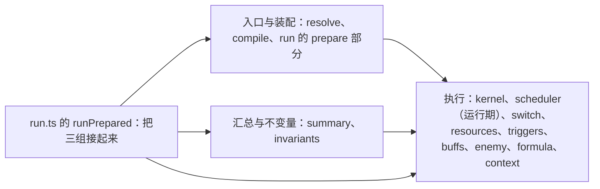

# DD-10 快照恢复、执行核心拆环与分析层切出

**版本**：v0.2，2026-11-14，Claude。按第一轮评审修订（[意见文件](detailed-design-feedback.md) §10；本文涉及 DF-21、DF-22 与 `fromWire` 的非阻塞意见）。
**状态**：Final（2026-11-15）。本文 v0.2 即签署版本，Claude、Codex、Antigravity 三方通过（[意见文件](detailed-design-feedback.md) §16–§18；整套见[总览](README.md)）。T10-1～T10-8 已落地，随 PR #136 合入；实际验收范围与本地产物见 [DD-10 快照审计](dd-10-snapshot-audit.md)。
**阶段**：五。**前置**：DD-01、DD-05、DD-07。执行与查询的契约稳定之后再动工。

动工时复核（历史记录，以下待拆项现已完成）：DD-01、DD-05、DD-07 已落地。运行汇总已在 `runCore` 调用，不再从执行体调用；待拆的是执行体/敌人对不变量的引用、编译与运行期调度混置、报告对调度常量/错误类的引用。分析层实际为原 14 个加 `candidates`、`observations`、`zero-interference` 共 17 个文件。运行状态审计单独记在 [DD-10 快照审计](dd-10-snapshot-audit.md)，以其中逐项核对结果补充 §3.1。

合入 DD-08 的 main 后复核：新增的 `evidence.ts` 也是④分析层，一并迁到 `src/analysis/`（现共 18 个文件）。保留 DD-08 观测比较与校准薄包装，全部分析运行经公开入口；不恢复已删除的生产兼容入口。

## 1. 范围与依据

做（路线图 §4.5 末段、§9.2 的 P4、§9.3 阶段五；架构 §1.2 末段、§5.3 末段、§13.1；R08）：
- **快照与恢复**：只在 tick 边界；恢复续跑与从头运行逐项一致。
- **查询缓存**：`stateAt` 用快照加速，键是 `runId`。
- **执行核心拆环**：让执行、入口与装配、汇总与不变量三组之间的依赖变成单向。
- **分析层切出**到 `src/analysis/`。
- **换实现对拍**：conformance 的样例覆盖新的必有字段。
- 删掉过渡用的 `prepareResolved` 与兼容外壳 `simulate`。

不做：
- 帧内任意位置的暂停与恢复（架构 §2.3）。
- 把运行结果做成存档系统（架构 §9）。
- 实际写 Rust 实现。

## 2. 现状（动工时要重新核对）

| 事实 | 位置 |
|---|---|
| `SimState` 注释说可 `structuredClone`；里面引用了定义对象（动作、判定、敌人预设、指令表） | `types.ts`、`context.ts` |
| 运行环境里不在 `SimState` 的东西：`sim.warned`、事件总线（`cursor`、`chain`、`spawned`）、运行体闭包里的 `lastBattle`、展示轨道的去重表 `shown` / `cdShown`、DD-01 加的相位与 `inFlight`、DD-02 加的 `unmetIntents` / `hints`、DD-05 的规则使用计数与诊断收集器、干预记录 | `simulate.ts` / `run.ts`、`context.ts` |
| `context.ts` 的注释："队列在每个 tick 结束前处理完，所以 tick 之间簿记总是空的" | `context.ts` |
| 三组互相引用：`simulate`、`enemy` 引用 `summary` / `invariants`；`invariants`、`summary` 引用 `scheduler` / `context`；`resolve` 引用 `kernel` / `scheduler`；`scheduler.ts` 里同时有编译与运行期调度 | 架构 §1.1 |
| 分析层 14 个文件在 `src/engine/` 下；`src/cli/`、`web/app/`、`tests/` 按这个路径 import | 架构附录 B |
| conformance 的样例：装配结果（去钩子表）与日志、汇总；DD-01、DD-03 之后多了 `completion` 与几个业务字段 | `src/cli/conformance.ts` |

## 3. 快照与恢复

### 3.1 先审计

恢复正确的判据只有一个：**从快照续跑到结束，与从头运行逐项一致**。"能 `structuredClone`"不算证明（架构 §5.3）。所以第一步是审计，产出一张表贴进本文的修订记录：运行体里每一个可变的东西，属于下面哪一类。

| 类 | 例子 | 快照里怎么办 |
|---|---|---|
| 业务状态 | `SimState` 的全部字段 | 进快照。定义对象换成标识，恢复时从 `PreparedRun` 接回去（用 DD-07 的 `StateView` 的反向函数）。`action`、`last`、`combo` 指向同一个动作实例时，按 `instance` 恢复成同一个对象；恢复成三个对象的话，同一个动作的局部帧会被推进不止一次（DF-22） |
| 走完 P7 的边界上恒为空的簿记 | `bus.chain`、`bus.current`、`bus.inFlight`、`k.settleQueue`；`bus.spawned` 只在 `f ≥ 1` 的边界上为空 | 不进快照；取快照时断言为空 |
| `S[0]` 上可能不为空的簿记 | `bus.spawned`：初始化的 `drain` 里，钩子经 `ctx.spawnJudgment` 生成的判定把业务链登记在这里，第 0 帧的 P4 结算时要读，第一次 P6 才清（DF-22） | `S[0]` 的快照带上它并在恢复时还原。不能为了让断言成立而提前清掉：它参与连锁深度与业务归属 |
| tick 边界上不为空、影响后续输出的簿记 | `bus.cursor`、`sim.warned`、`lastBattle`、展示轨道的去重表、规则使用计数、`unmetIntents`、`hints`、干预记录、`continuationFrom` | 进快照 |
| 输出的前缀 | 日志、`forte`、`cooldowns` | 进快照（或由调用方保存，恢复时传回） |
| 诊断 | 收集器里的各张表、作用域栈 | 进快照；tick 边界上作用域栈应为空，取快照时断言 |

审计的做法：`grep` 运行体与它建的闭包里所有 `let`、`new Map`、`new Set`、数组字面量，逐个归类。归不进任何一类的就是隐藏状态，先消掉。

### 3.2 接口

```ts
export interface Snapshot {
  readonly runId: string
  readonly frame: Frame                       // 这是 S[frame]
  readonly prefix: StatePrefix
  readonly diagOptions: DiagOptions | null    // 取快照时开着的诊断；恢复时必须相同
  readonly payload: unknown                   // 纯数据，能 JSON 往返（经 wire 的规则）
}
/** 重放到 f 并取快照 */
export function snapshotAt(p: PreparedRun, f: Frame, opts?: RunOptions): QueryResult<Snapshot>
/** 一次运行里在若干帧各取一个 */
export function snapshotsAt(p: PreparedRun, frames: readonly Frame[], opts?: RunOptions): QueryResult<Snapshot[]>
/** 从快照续跑到停止点 */
export function resumeFrom(p: PreparedRun, snap: Snapshot, stop: StopPoint, opts?: RunOptions): QueryResult<Replay>
```

- `snap.runId !== p.runId` 时返回 `runIdMismatch`。
- `opts.diag` 与 `snap.diagOptions` 不同时返回错误：诊断的前缀接不上。
- 快照只在 tick 边界取。`resumeFrom` 先补做该边界尚未执行的帧数上限检查；未到上限才进入那一帧的 P1（避免在 S[maxFrames] 恢复后多走一帧）。
- 抽样模式：`rng` 在 `SimState` 里，自然带上。
- `payload` 的 JSON 编解码复用 DD-07 §10.2 按 schema 的 `toWire` / `fromWire`，不另起一套规则。

### 3.3 缓存

- `query.ts` 加一个可选的缓存参数：`cache?: SnapshotCache`，接口是 `get(runId, f, diagOptions?)` 返回不晚于 `f` 的最近一个快照、`put(snapshot)`。`MemorySnapshotCache` 由调用方持有，按需存入 600 帧边界；跨到下一个间隔也从已保存的快照推进。
- `stateAt` 有缓存时从最近的快照续跑。
- 缺省的实现放内存，按固定间隔存（每 600 帧一个，数字按 DD-07 §3.5 的实测定）；命令行不落盘。
- **键只用 `runId`**。它是整份运行身份的摘要（架构 §9），输入、规则、代码、种子任何一项变了都会换键。诊断开关不在 `runId` 里，所以缓存条目另按 `diagOptions` 的摘要分开。

实施验收与完整可变状态审计见 [DD-10 快照审计](dd-10-snapshot-audit.md)。其中记录了两条长轴 100 次查询的缓存耗时、分析命令前后对照，以及 `panelDeltas` 的归一入口扩展。

## 4. 执行核心拆环

目标：三组之间只剩单向依赖，然后才搬目录（架构 §1.2 末段）。



要动的地方（每条一个提交，conformance 逐字节不变）：

| 编号 | 现在 | 改成 |
|---|---|---|
| ① | `scheduler.ts` 里同时有 `compileRotation` 与运行期调度 | 编译挪到 `src/engine/compile.ts`；`scheduler.ts` 只留运行期。旧的导出位置留一行转发，调用方迁完后删 |
| ② | 运行体里直接调 `summarize` | `runPrepared` 在运行体返回后调 |
| ③ | 运行体的 P6 里直接调 `checkTick`，`settle` 里调 `checkHit` | 经 `KernelHooks` 上的可选回调注入，`runPrepared` 接线 |
| ④ | `enemy.ts` 引用 `summary` / `invariants` 的地方 | 把用到的小函数（如 `hitValue`、`battleFrameOf` 这类纯函数）下沉到执行组里的 `num.ts` 或新的 `event-util.ts` |
| ⑤ | `invariants.ts`、`summary.ts` 引用 `scheduler` / `context` 取类型或常量 | 类型挪到 `types.ts`；常量（如 `INTENDED`）挪到 `types.ts` 旁的 `wait-codes.ts` |
| ⑥ | `resolve.ts` 引用 `kernel` / `scheduler` | 引用 `compile.ts` 与纯函数（如 `timelineOf`）；`timelineOf` 若仍在 `kernel.ts`，入口组对执行组的这条依赖是允许的方向 |

`tests/layering.test.ts` 加第三条规则：执行组的文件不 import 入口与装配组、汇总与不变量组的文件。每做完一条就把对应的文件从豁免名单里去掉，名单清空即完成。

## 5. 分析层切出

- 新目录 `src/analysis/`，把架构附录 B 的 14 个分析文件加上本目录各文档新增的 `candidates.ts`、`observations.ts` 搬过去。
- `src/engine/` 留下执行核心、①D 查询与诊断、② 规则与台账。
- 搬之前的前提：这些文件对引擎的 import 只经公开入口。先在 `src/engine/index.ts`（新）列出公开入口：`prepareRun`、`runPrepared`、`query.ts` 的全部导出、类型、`ASSUMPTIONS`、`PROPOSITIONS`、`RULE_POINTS`，以及分析层确实要用的少数纯函数（`hitValue`、`battleFrameOf`、`composeStat`、`basis.ts` 的 `basisOf` 与 `usableBasis` 等，逐个列出）。分析文件改成只从 `../engine` 引入。
  - 实现（2026-11-17 复核）：`query.ts` 的函数与结果类型除 `replayTo` 外都从 `index.ts` 导出；`replayTo` 交出的前缀 / 终态带着可变的运行体（`Sim`、`SimState` 本体），分析层要状态走 `stateAt` / `statesAt` / `terminalState` 的只读投影（`viewOf`）。`wire.ts` 的 `toWire` / `fromWire` / `WIRE_SCHEMA_VERSION` 一并导出。
  - 分析层的文件最终是 18 个：架构附录 B 的 14 个，加 `candidates`、`observations`、`zero-interference`（DD-05 的零干扰对拍）与合入 DD-08 后的 `evidence`。
- `tests/layering.test.ts` 的规则改成按目录判：`src/engine/` 不 import `src/analysis/`；`src/analysis/` 只 import `src/engine/index.ts` 与 `src/data/`。
- 搬目录本身用 `git mv`，一个提交只搬不改；`src/cli/`、`web/app/`、`tests/` 的 import 路径在同一个提交里改。
- 同时完成各分析文件从兼容外壳到 `prepareRun` + `runPrepared` 的迁移（DD-01 §3.7 留下的名单：`cards`、`optimize`、`matrix`、`sample`、`fuzz`、`scorecard` 等）。迁完后删 `simulate` 与 `prepareResolved`。
  - `adjusted(r, path, v)` 这类直接改装配结果的写法，统一换成 `RunOverrides`（DD-04 §4.2）。
  - 择优的快速重算（`onHit` 记录）保留，经 `RunOptions.onHit`。

## 6. 换实现对拍

- conformance 的样例加上全部必有的输出：`completion`、`interventions`、`strictReport`、`ruleUsage`，以及输入侧的 `effective` 与 `identity`（去掉 `gitCommit`、`contentFingerprint` 这两个随环境变的项）。
- 样例目录加一份 `MANIFEST.json`：`OUTPUT_SCHEMA_VERSION`、`WIRE_SCHEMA_VERSION`、每个场景的 `runId`、各文件的摘要。
- 加一组**边界样例**，专门给另一个实现对拍停止路径与相位：DD-01 的七条停止路径、DD-05 的相位边界用例，各导出成合成数据的输入与输出。
- 另加 `pnpm conformance --verify <目录>`：读一份别处产出的输出，与本实现的逐条比较，报告第一处不同的路径。另一个实现只要能产出同样格式的文件就能对拍。
- 诊断不进样例；零干扰对拍照旧。
- 总设计 §10.1 的写法约束做成能查的：`grep -n "^let \|Math\.round\|Math\.floor" src/engine/` 的结果逐条有说明（取整只许经 `num.ts`），写进 `tests/layering.test.ts` 的第四条规则。

## 7. 实施步骤

| 编号 | 做什么 | 做完的判据 |
|---|---|---|
| T10-1 | 运行体可变状态的审计表 | 表贴进修订记录；没有归不了类的项 |
| T10-2 | `snapshotAt` / `resumeFrom` | C10-1～C10-5 |
| T10-3 | 查询缓存 | C10-6；`stateAt` 在长场景上的耗时对比写进提交说明 |
| T10-4 | 拆环 ①～⑥ | 每条之后 conformance 逐字节不变；分层测试的豁免名单清空 |
| T10-5 | 公开入口 `index.ts`，分析文件只经它引入 | 分层测试的新规则通过 |
| T10-6 | 分析文件迁到 `runPrepared`；删兼容外壳 | 全部场景的各分析命令输出与迁移前相同（`pnpm sensitivity`、`insight`、`scorecard`、`matrix` 各存一份前后对比） |
| T10-7 | `git mv` 到 `src/analysis/` | `pnpm check && pnpm test` 通过；这个提交里没有逻辑改动 |
| T10-8 | conformance 的样例、清单、边界样例、`--verify` | C10-7、C10-8 |

顺序可以调：T10-4～T10-7 与 T10-1～T10-3 互不依赖。

## 8. 用例

`tests/snapshot.test.ts`（新）：

| 编号 | 前提与操作 | 断言 |
|---|---|---|
| C10-1 | 合成轴与（有数据时）`m0-video-eq.yaml`、`xin-tower4-video.yaml`。在首、尾与三个中间帧各取快照，各自续跑到结束 | 每次续跑的结果与从头运行的 `SimResult`（去掉 `diag`）经 `canonicalJson` 逐字节相同；终态的 `StateView` 相同 |
| C10-2 | 同上，带全部诊断 | `diag` 也逐字节相同（事件来源、账本、规则明细接得上） |
| C10-3 | 抽样模式 | 续跑的 `rng` 轨迹与从头运行相同（日志里每下的 `isCrit` 相同） |
| C10-4 | 快照经 JSON 序列化再读回后续跑 | 同 C10-1 |
| C10-5 | 快照拿给另一个 `runId`；`diag` 选项与快照不同 | 两种都返回错误，不续跑 |
| C10-6 | 带缓存与不带缓存各调 100 次 `stateAt` | 结果逐帧相同；带缓存的总耗时明显更短（数字记下来，不写死阈值） |
| C10-7 | 本实现导出的边界样例再用 `--verify` 读回 | 全部一致 |
| C10-8 | 把样例输出里某条事件的一个字段改掉再 `--verify` | 报出那条事件的路径，退出码非零 |
| C10-9 | 在 `f ≥ 1` 的快照点人为留一条没处理的事件（测试里构造） | 取快照时的断言失败：走完 P7 的边界上簿记必须为空 |
| C10-10 | DF-22：初始化里一个钩子在 `onEvent` 中生成第 0 帧结算的判定；`snapshotAt(0)` 后续跑 | 业务链、连锁深度的判断、日志与从头运行逐字节相同 |
| C10-11 | DF-22：同一个动作同时是 `action`、`last`、`combo` 时取快照再续跑 | 恢复后三者是同一个对象；局部帧的推进与从头运行一致 |

## 9. 验收清单（阶段五）

- [x] 路线图 P4 的完成标准：从头执行、重算查询、恢复续跑三者一致（C10-1、C10-2 与 DD-07 的 C07-2）；agent 经 `pnpm query` 拿到带单位与状态的 JSON，不用读网页。
- [x] `src/engine/` 里没有分析层的文件；`tests/layering.test.ts` 的四条规则全过，豁免名单为空。
- [x] `simulate` 与 `prepareResolved` 已删除，全库没有调用。
- [x] conformance 的样例含全部必有输出、清单与边界样例；`--verify` 可用。
- [x] 搬目录前后，全部场景的结果与各分析命令的输出相同。

## 10. 要同步的正式文档

- 总设计 §2、§10：目录结构（`src/analysis/`）、四层边界、公开入口。§10.1、§11：快照恢复的判据、对拍的样例格式。
- TD-02：`Snapshot`。
- TD-04 §1：只在 tick 边界恢复；边界上哪些簿记必须为空。
- AGENTS.md：目录一节与命令表。

## 11. 待评审的决定

| 编号 | 问题 | 候选 | 建议 |
|---|---|---|---|
| DD10-Q1 | 快照里的状态用什么形式 | A：`StateView`（标识）加反向接回；B：直接 `structuredClone(SimState)` | A。它能 JSON 往返，换实现时也能用；B 只能在同一个进程里用 |
| DD10-Q2 | 缓存要不要落盘 | 只放内存；可选落盘 | 只放内存。落盘牵涉失效与清理，等真的有跨进程的需求再做 |
| DD10-Q3 | 搬目录与拆环谁先 | 先拆环与收口到公开入口，再搬；先搬 | 先拆环。先搬会把一堆跨目录的内部引用固定下来 |
| DD10-Q4 | 兼容外壳什么时候删 | 阶段五末；更早 | 阶段五末。之前各分析文件按自己被改到的时机逐步迁，不单独为迁移开工 |
