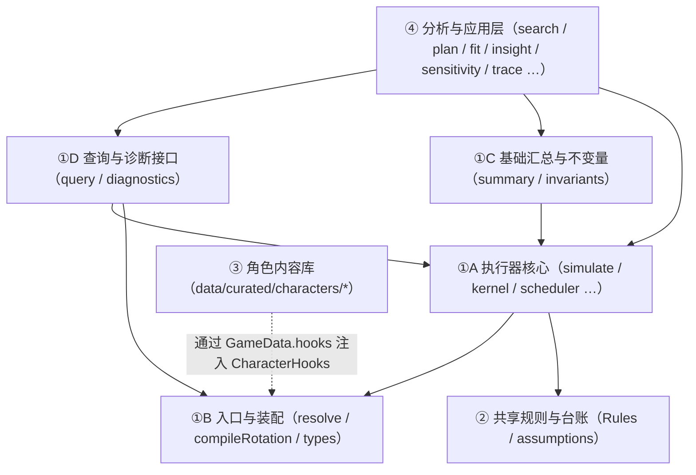

# 逐帧仿真底座：架构设计草案（v0.1）

日期：2026-11-11
作者：Antigravity（初稿，供 Claude、Codex 与用户 review）
状态：架构设计草案（对应 [路线图 Final 版 §0.4 第 2 步与 §13](engine-foundation-roadmap.md)）；三方 review 达成一致后，按路线图 §11 合入总设计与各 TD，再进入各阶段详细设计与编码。
代码核对基线：`2a5e20c`（与 `6b1d7ab` 相比仅文档变化）；装配数据：`20261019`。

---

## 0. 文档定位与遵循约束

1. **承接关系**：本文严格落实《[逐帧仿真底座：路线规划（v3.3 Final）](engine-foundation-roadmap.md)》§13 列出的 13 项架构待定内容及 §13.1 的核心承诺交付边界，把 §2–§6 的契约落成具体的模块划分、依赖方向、TypeScript 接口签名、数据结构与测试门禁。
2. **不推翻总设计 §4 的既定取舍**：保持固定 60 fps 世界步长、三种时钟（世界 / 战斗 / 动作局部与判定年龄）、缺省按期望值计算、纯库（`src/engine/` 不引入 DOM / `fs` / 网络 / `child_process`）、数据与钩子分离、只维护当前版本、单目标模型（[总设计 §4](../wuwa-dps-engine-tech-design-v0.2.4.md)）。
3. **遵守 CL-04 技术断言核对纪律**：本文所有涉及现有实现行为、文件规模、函数入口、行号与字段名之处，均在 `2a5e20c` 上逐一定位核对并附源码位置，供 Claude 与 Codex 复核。
4. **待决项显式单列**：存在多种合理实现形态的细节点（共 5 项，`AD-01～AD-05`），在对应小节及文末 §14 集中列出候选方案、利弊与推荐缺省，不暗中硬定。

---

## 1. 分层、模块归属与依赖方向（对应路线图 §13 第 1 项）

### 1.1 现有 `src/engine/` 32 个文件（6,977 行）的精确归属

在 `2a5e20c` 上核对 `src/engine/` 全部 32 个文件，按职责划分为底座内部子层（①A–①D）、共享规则层（②）、角色内容层（③）与上层分析应用层（④）：

| 层级 | 子模块与职责 | 包含文件与核对行数（`2a5e20c`） | 依赖约束 |
|---|---|---|---|
| **①A 执行器核心（Executor Core）** | 逐帧步进、动作/判定/尾部推进、切人、资源结算、buff 实例、触发队列、敌人量表、伤害公式、主循环、随机数与浮点取整 | `kernel.ts`（451）、`scheduler.ts`（489，其中运行期调度为 138–489 行）、`switch.ts`（83）、`resources.ts`（161）、`triggers.ts`（184）、`buffs.ts`（122）、`enemy.ts`（308）、`formula.ts`（248）、`simulate.ts`（322）、`context.ts`（49）、`num.ts`（15）、`rng.ts`（42）——**共 12 个文件，2,474 行**（路线图 §1.2 主表所列 10 个核心文件为 2,417 行） | 只依赖 `src/data/` 类型、`types.ts` 与层 ② 的规则定义；通过 `GameData.hooks` 接收层 ③ 注入的钩子，**禁止反向引用层 ④** |
| **①B 入口与装配层（Entry & Resolution）** | 场景校验后装配、排轴文本编译、严格入口静态检查、可移植剥离 | `resolve.ts`（369）、`scheduler.ts`（1–136 行的 `compileRotation`）、`portable.ts`（10）、`types.ts`（464）——**共 3 个独立文件 + 编译段，843 行** | 位于执行器入口；产出的 `ResolvedScenario` 在运行期只读 |
| **①C 基础汇总与不变量层（Core Summary & Invariants）** | 单次运行的基础汇总归约（`summarize`）与逐帧/全日志自洽检查（`checkTick`、`checkHit`、`checkLog`） | `summary.ts`（329）、`invariants.ts`（146）——**共 2 个文件，475 行** | **回答路线图 §13 #1**：`summary.ts` 归属底座第 ①C 层（因为 `simulate.ts:144` 直接调用 `summarize`，且 `invariants.ts:130` 校验 `res.summary`），不搬去 `src/analysis/` |
| **①D 状态查询与诊断层（Query & Diagnostics，新增）** | `stateAt`、`eventsBetween`、`explainEvent`、三类只读 `whyNot`、资源只读账本、诊断旁路收集器 | 拟新增 `src/engine/query.ts` 与 `src/engine/diagnostics.ts` | 纯只读或旁路模块；复用 ①A–①C，不改变 ①A 的业务执行结果 |
| **② 共享战斗规则与台账层（Shared Rules & Ledger）** | 全局规则类型与缺省值、命题/候选/证据台账 | `src/data/gamedata.ts`（`Rules` 在第 233–254 行）、`src/engine/assumptions.ts`（300 行，40 条假设，14 条含 `adjust.path`） | 被 ①A–①D 与 ④ 只读引用 |
| **③ 角色内容与特化钩子层（Content Library）** | 角色特化钩子、手写武器/声骸/判定关联 | `data/curated/characters/*.ts`（18 个文件，3,188 行）、`weapons.ts`、`echoes.ts`、`dmg-join.json` | 仅实现 `CharacterHooks` 接口（`types.ts:395`），通过 `HookContext` 受控方法读写状态 |
| **④ 分析与应用层（Analysis & Apps）** | 多轮对比、副词条边际、操作容错/卡帧点、单双项敏感度、轴搜索、套路卡、排轴、轴评分卡、声骸择优、矩阵、抽样封装、模糊测试、校准与录像拟合、调试表 | `analysis.ts`（71）、`calibration.ts`（44）、`cards.ts`（249）、`compare.ts`（175）、`fit.ts`（141）、`fuzz.ts`（131）、`insight.ts`（267）、`marginal.ts`（53）、`matrix.ts`（173）、`optimize.ts`（297）、`plan.ts`（381）、`sample.ts`（77）、`scorecard.ts`（161）、`search.ts`（268）、`sensitivity.ts`（58）、`trace.ts`（372）——**共 16 个文件，2,918 行** | **只许单向调用 ①A–①D 与 ②**；①A–①D 绝不 import 层 ④ 的任何文件 |

### 1.2 依赖方向与分析层切出策略



- **当前已满足的单向性核对**：在 `2a5e20c` 上核对，层 ①A/①B/①C 的 17 个文件**没有任何一处 import 层 ④ 的 16 个文件**（`calibration.ts` 调用 `trace.ts`，两者同属层 ④）。
- **门禁与目录拆分时机**：
  1. **阶段一即刻加门禁**：在 `tests/core-check.test.ts` 中增加一条静态 import 检查：禁止层 ①A–①D 与层 ② 的文件 import 层 ④ 的 16 个文件名；
  2. **阶段五再按需搬目录**：阶段一～四期间文件保持在 `src/engine/` 原位，避免无谓的 git 冲突；阶段五（P4）接口稳定后，若需物理拆分，将层 ④ 移至 `src/analysis/` 并保留 `src/engine/` 导出兼容。

---

## 2. 对外接口、完成状态模型与 CLI JSON 协议（对应路线图 §13 第 2 项）

### 2.1 完成状态与有效范围模型（解决 R11 与严格入口意图失败表示）

现有 `SimResult`（`src/engine/types.ts:372-381`）只有可选的 `error?: { code: string; message: string; frame: number; line?: number; loop?: number }`，存在两处缺口：
1. 到达 `options.maxFrames` 时，若指令已发完但场上仍有未结算完的判定或尾部（`src/engine/scheduler.ts:486`），仅写一条 `warning`（`code: 'maxFrames'`），没有把“窗口被截断”传给汇总与比较层（**R11**）；
2. 严格入口下变奏、空中入场、出场技等意图未达成时，需要与内部异常（如 `invariant`、`chainDepth`）区分开。

因此定义统一的运行完成状态 `RunCompletion`：

```ts
export type RunStatus =
  | 'completed'     // 全部指令执行完毕，且场上无在途动作/判定/尾部（tick 在 P2 返回 false）
  | 'truncated'     // 到达 options.maxFrames 停止（无论停止时是仍有未执行指令，还是仍有在途判定/尾部未走完）
  | 'intentUnmet'   // 严格入口下，轴声明的意图（变奏切入、空中入场、出场技、显式帧取消等）未达成
  | 'error'         // 运行期错误（comboBroken / timeout / notOnField / switchSelf / chainDepth / invariant）

export interface UnmetIntentDetail {
  readonly kind: 'introMissed' | 'airEntry' | 'entrySkill' | 'cancelFrameIllegal' | 'tuneBreakTimeout'
  readonly cmd: CommandRef
  readonly frame: Frame
  readonly battleFrame: number
  readonly expected: string               // 例："切出者散华协奏 >= 100"
  readonly actual: string                 // 例："散华协奏 = 92"
  readonly message: string
}

export interface RunCompletion {
  readonly status: RunStatus
  /** 实际已完成完整 tick（P1～P7）的世界帧区间 [0, completedTicks)；第 f 帧的 stateAt 查询合法范围为 0 <= f <= completedTicks */
  readonly validWorldFrameRange: readonly [0, Frame]
  /** 对应的战斗帧区间 [0, endBattleFrames] */
  readonly validBattleFrameRange: readonly [0, number]
  /** 已完成的完整循环轮数（不含残缺轮）与总计划轮数 */
  readonly completedLoops: number
  readonly plannedLoops: number
  /** 在帧数上限截断时，场上残留的未完成项（R11） */
  readonly truncatedRemains?: {
    readonly pendingCommands: number
    readonly activeJudgments: number
    readonly activeTails: number
  }
  /** 场景 goal（steady / kill / window）是否在该有效范围内达成 */
  readonly goalReached: boolean
  /** 录像剖析中是否使用了外部强制状态干预（能量满 / 敌人 失谐 / 状态同步 sync） */
  readonly conditioningBasis: 'unconditioned' | 'conditioned'
  readonly conditionedSinceFrame: Frame | null
  /** status === 'intentUnmet' 时必填 */
  readonly unmetIntent?: UnmetIntentDetail
  /** status === 'error'（或向后兼容）时的错误详情 */
  readonly error?: SimResult['error']
}
```

> **向后兼容约定**：`SimResult` 保留原有的 `log`、`summary`、`forte`、`cooldowns`、`error` 字段，新增 `completion: RunCompletion`、`identity: RunIdentity` 与可选的 `diag?: SimDiagnostics`。当 `status` 为 `'truncated'`、`'intentUnmet'` 或 `'error'` 时，任何下游工具（`compare`、`sensitivity`、`search`、`fit`）都能从 `completion.status` 和 `completion.goalReached` 直接识别，绝不会把截断或残缺轮当作完整成功。

### 2.2 最小对外纯函数接口签名（`src/engine/query.ts`）

```ts
// 1. 编译与静态检查（含严格入口检查与源指令映射）
export function compileScenario(
  scenario: Scenario,
  data: GameData,
  policy?: CompilePolicy,
): CompileScenarioResult

// 2. 运行（支持开启只读诊断通道与严格入口）
export function runScenario(
  resolved: ResolvedScenario,
  opts?: SimOptions & { diagnostics?: boolean; strict?: boolean; continueAfterIntentUnmet?: boolean },
): SimResult

// 3. 边界状态查询：worldFrame f 开始、P1 之前的状态 S[f]（0 <= f <= completion.validWorldFrameRange[1]）
export function stateAt(
  resolved: ResolvedScenario,
  worldFrame: Frame,
  opts?: SimOptions,
): StateQueryResult

// 4. 左闭右开区间 [from, to) 事件查询（按实际发生序号 seq 升序）
export function eventsBetween(
  result: SimResult,
  fromWorldFrame: Frame,
  toWorldFrame: Frame,
): EventsQueryResult

// 5. 单事件来源与当次数值输入解释（不声称覆盖全部历史时序依赖）
export function explainEvent(
  result: SimResult,
  resolved: ResolvedScenario,
  eventSeq: number,
): EventExplanationResult

// 6. 三类只读“为什么没发生”查询（详见 §7）
export function canActionExecuteAt(
  state: SnapshotState,
  resolved: ResolvedScenario,
  slot: Slot,
  action: ActionId,
  opts?: { force?: boolean; delay?: Frame },
): ActionLegalityResult

export function whyDidEventNotTrigger(
  result: SimResult,
  resolved: ResolvedScenario,
  eventSeq: number,
  target: { owner: Slot | 'env'; defId: string; kind: 'buff' | 'extend' | 'resourceEffect' | 'hook' },
): TriggerWhyNotResult

export function wouldHypotheticalEventTrigger(
  state: SnapshotState,
  resolved: ResolvedScenario,
  hypotheticalEvent: HypotheticalEventInput,
  target: { owner: Slot | 'env'; defId: string; kind: 'buff' | 'extend' | 'resourceEffect' | 'hook' },
): HypotheticalTriggerResult

// 7. 跨运行比较与观测比较
export function diffRuns(
  baseRun: { resolved: ResolvedScenario; result: SimResult },
  candRun: { resolved: ResolvedScenario; result: SimResult },
  target?: DiffTargetSpec,
): RunDiffResult

export function compareObservations(
  resolved: ResolvedScenario,
  result: SimResult,
  observations: readonly ObservationSpec[],
): ObservationComparisonReport
```

### 2.3 CLI JSON 形态

- 在现有 CLI（或新增 `pnpm query` 子命令）提供统一的机器可读输出封装 `QueryEnvelope<T>`：
  ```ts
  export interface QueryEnvelope<T> {
    readonly schemaVersion: '1.0'
    readonly identity: RunIdentity
    readonly completion: RunCompletion
    readonly capabilityDisclosure: CapabilityDisclosure   // 路线图 §4.9：本次用了哪些能力、碰到哪些假设、哪些未建模
    readonly data: T
  }
  ```
- AI agent 只需调用 `pnpm sim <场景> --json` 或 `pnpm query <场景> --state-at 360 --explain-event 42 --json`，即可拿到结构化 JSON，无需解析 HTML 或猜测时钟单位。

---

## 3. 事件模型、七相位与直接因果追踪（对应路线图 §13 第 3 项，落实 RR-01）

### 3.1 七相位与 `drain` 调用位置精确表

核对 `src/engine/kernel.ts:425-451`、`src/engine/simulate.ts:35-56, 131-140` 与 `src/engine/switch.ts:31-83`，一次完整仿真的相位与事件队列 `drain` 调用点如下：

| 阶段 / 相位 | 源码位置（`2a5e20c`） | 执行内容 | 是否调用 `drain` |
|---|---|---|---|
| **`init`（初始化）** | `simulate.ts:132-137` | 施加 `trigger === 'always'` 常驻 buff → 依次调用三人 `hooks.onResolve` → 清空初始队列 | **是**（`simulate.ts:137`）；此步完成后的状态定义为 **`S[0]`** |
| **`P1`（速率与膨胀寿命）** | `kernel.ts:427` | `computeRates(s, k.rules)`：从 `s.dilations` 计算本帧 `rates`（`battle`, `chars`, `enemy`），并将各膨胀窗口 `remaining` 减 1 | 否 |
| **`P2`（动作到期与指令调度）** | `kernel.ts:428-431` | ① 清零 `startedThisTick`；② `endDueActions(s)` 结束到期的动作并转尾部；③ `schedule(s)` 执行队首合法指令（开始动作时调 `payCost → drain → castResources → drain`；切人时调 `onSwitch → drain`）；④ **终止判定**：若 `!pending` 且场上无动作、无判定、无尾部，`tick` 返回 `false`（**整次仿真结束，该 tick 不计入**） | 动作开始与切人内部调用 `drain`（`simulate.ts:41`, `switch.ts:53`） |
| **`P3`（动作与尾部推进）** | `kernel.ts:432` | `advanceActions(s, k, rates)`：推进在场/后台动作与 `tails` 的局部帧，按 `gain → dilation → spawn → outro` 顺序处理跨越的时间线节点 | `castGain`（`simulate.ts:43`）与 `outroTrigger`（`switch.ts:78, 81`）调用 `drain` |
| **`P4`（判定结算）** | `kernel.ts:433` | `settleJudgments(s, k, rates)`：对到点的判定执行 `settle`（`modifyHit` → 公式计算 → `settleGains` → 记 `hit` / `resourceFull` / `heal` → `hitGauges` → `applyEffect` → `drain` → `spawns.on === 'hit'` → 接续动作 `followUp`） | **是**（`simulate.ts:244`；若触发 `followUp` `startAction`，其内部再调 `drain`） |
| **`P5`（敌人量表概念归属）** | `kernel.ts:434`（注释） | 偏谐、失谐、白条的概念相位；实际更新位于 P4 的 `hitGauges`（`simulate.ts:236`）与 P6 的 `enemyTimers`（`simulate.ts:48`） | 随 P4 / P6 |
| **`P6`（冷却与计时器到期）** | `kernel.ts:435-447` | ① 扣减每人 `switchCd`、技能 `cooldowns` 并处理充能 `charges` 回复（均按 `rates.battle`）；② 调用 `k.hooks.timers`：`effectTicks` → `enemyTimers` → `tickBuffs` → `drain` → 清空 `bus.spawned` → 采集 UI 轨道 → `checkTick` | **是**（`simulate.ts:50`） |
| **`P7`（推进时钟）** | `kernel.ts:448-449` | `s.battleFrames += rates.battle; s.frame += 1`；走完后进入下一世界帧起点 **`S[f + 1]`** | 否 |
| **`post`（循环退出收尾）** | `simulate.ts:139` | 当最后一个 tick 在 `P2` 返回 `false` 退出 `runLoop` 时，处理该次 `P2` 开头 `endDueActions` 可能记下的 `actionEnd` 事件 | **是**（`simulate.ts:139`） |

### 3.2 事件字段扩展（只加字段、不加新事件，解决 R02、R05、R09）

1. **`buffApply` 与 `buffExpire` 补齐提供者与实例号（解决 R09 与 R02）**：
   - 现有 `types.ts:309-310` 中 `buffApply` 和 `buffExpire` 只有 `buff: string`（定义 ID）与 `target`，没有 `owner`（提供者）和 `instanceId`（`BuffRuntime.id`，`types.ts:211`）。
   - 在 `buffs.ts:44, 89, 96` 与 `triggers.ts:171` 记日志时，补上 `owner: CharName | 'env'` 与 `instanceId: number`：
     ```ts
     | (EventBase & { type: 'buffApply'; buff: string; owner: CharName | 'env'; instanceId: number; target: CharName | 'enemy'; stacks: number; remaining: number | 'inf' })
     | (EventBase & { type: 'buffExpire'; buff: string; owner: CharName | 'env'; instanceId: number; target: CharName | 'enemy'; reason: 'timeout' | 'switchOut' | 'removed' })
     ```
   - `summary.ts:306` 的 `buffUptime` 改为按 `${e.owner}|${e.buff}→${e.target}` 追踪区间，再按需聚合，彻底消除两人提供同名 buff 时区间混并失真（**R09**）。
2. **事件因果与发生点元数据（`EventMeta`）**：
   - 每条事件 `s.log[seq]` 关联如下结构化来源信息（关于直接挂在 `EventBase` 上还是挂在旁路表 `diag.eventMeta[seq]` 上，见待决项 **`AD-01`**）：
     ```ts
     export type TickPhase = 'init' | 'P2' | 'P3' | 'P4' | 'P6' | 'post'

     export type NonDrainOrigin =
       | { kind: 'init'; sourceId: string }                                  // 常驻 buff 或 onResolve
       | { kind: 'command'; cmd: CommandRef }                                // P2 调度器指令直接产生
       | { kind: 'autoInterject'; slot: Slot; action: ActionId }             // P2 自动插入谐度破坏
       | { kind: 'actionLifecycle'; instance: number; action: ActionId }     // P2 endDueActions / startAction / cancelAction
       | { kind: 'timeline'; instance: number; action: ActionId; nodeIndex: number; detached?: boolean } // P3 动作或尾部时间线节点
       | { kind: 'judgmentSettle'; judgmentId: number; actionInstance: number; tick: number }            // P4 判定结算
       | { kind: 'judgmentExpire'; judgmentId: number; actionInstance: number }                          // P3/P4 持续帧结束后生成 spawns.on === 'end'
       | { kind: 'timerExpire'; timerKind: 'buff' | 'effectTick' | 'enemy' | 'buffInstance'; id?: number; defId?: string } // P6 计时器到期

     export interface EventCausalityMeta {
       readonly seq: number                  // 在 s.log 中的下标
       readonly phase: TickPhase             // 发生相位
       /** 若在 triggers.ts:drain 处理 s.log[i] 期间直接引出，或由 s.log[i] 生成的延迟判定/尾部引出，记录直接父事件下标 i */
       readonly parentSeq?: number
       /** 业务归属根事件下标（对应现有 context.ts:47 的 Link.root，"谁引发的算谁"） */
       readonly rootSeq: number
       readonly chainDepth: number
       /** 非 drain 直接触发时的源头，或 drain 内部命中了哪条触发器/钩子 */
       readonly origin: NonDrainOrigin | { kind: 'trigger'; parentSeq: number; handlerKind: 'consume' | 'buffTrigger' | 'buffExtend' | 'resourceEffect' | 'charHook'; handlerId: string }
     }
     ```
   - **延迟判定与尾部的父事件传递**：
     - 在 `JudgmentRuntime`（`types.ts:198`）与 `TailRuntime`（`types.ts:186`）中增加可选的 `spawnedByEventSeq?: number`（在 `simulate.ts:300-301` `ctx.spawnJudgment`、`switch.ts:74` `outroTrigger` 创建时，若 `sim.bus.current` 存在，记录当前正在处理的事件下标 `currentSeq`）。
     - 当该判定在未来帧 P4 结算或该尾部在未来帧 P3 生成判定时，`parentSeq` 即可精确指向当初生成它的事件，彻底替代 `trace.ts:234` `walkOwners` 的邻近猜测（**R02**）。

### 3.3 边界校验用例（落实 RR-01 关闭条件）

在架构落地时，用以下三组微场景（复用或扩充 `tests/td04.test.ts` 与 `tests/triggers.test.ts`）锁死相位与因果契约：
1. **冷却剩 1 帧边界**：进入世界帧 `f` 时某技能冷却剩 1 战斗帧（本 tick 战斗速率为 1，其余条件均满足），验证 `stateAt(f)` 中 `cd === 1`、本帧 P2 不可放（记 `wait: cooldown`）、P6 减为 0、`stateAt(f + 1)` 中 `cd === 0` 且在 `f + 1` 帧 P2 放出。
2. **同帧命中与 buff 到期**：同一世界帧内既有 P4 判定结算，又有 P6 `tickBuffs` 到期（`remaining` 从 1 减到 0），验证 P4 结算仍能吃到该 buff，且 `buffExpire` 的 `phase === 'P6'` 排在 `hit`（`phase === 'P4'`）之后。
3. **同帧多个 buff 到期与交错触发**：同一世界帧 P6 两个不同 buff（或同一事件触发的 E1、E2）先后引出后续资源/判定事件，验证每条派生事件的 `parentSeq` 精确指向各自的触发源，不串到最后一个到期事件头上。

---

## 4. 诊断旁路与零干扰架构（对应路线图 §13 第 4 项）

### 4.1 诊断旁路通道形态

- **核心原则**：`s.log` 在 `triggers.ts:34` 中被当作触发队列消费（`while (bus.cursor < s.log.length)`），因此**任何新增诊断信息绝不 push 进 `s.log`**。
- 在 `Sim`（`src/engine/context.ts:25`）上挂载可选的只读收集器 `diag: DiagCollector | null`（缺省 `null`，当 `opts.diagnostics === true` 时初始化）：
  ```ts
  export interface SimDiagnostics {
    readonly eventMeta: readonly EventCausalityMeta[]      // 与 s.log 一一对应（下标 = seq）
    readonly resourceLedger: readonly ResourceLedgerEntry[] // §6 资源全路径只读账本
    readonly rulesTrace: readonly RuleTraceEntry[]         // §8 rulesRead / rulesDecisive 记录
    readonly triggerChecks: readonly TriggerCheckRecord[]  // §7 历史事件未触发检查记录（按需或过滤开启）
    readonly hitMargins: ReadonlyMap<number, readonly BuffWindowMargin[]> // hit 事件 seq → 附近相符 buff 窗口余量
    readonly syncRecords: readonly SyncDiagRecord[]        // §12 录像状态同步旁路记录
    readonly hints: readonly DiagHint[]                    // 严格入口提示（如多余的 !）
  }
  ```
- **为什么推荐把 `eventMeta` 放在 `SimDiagnostics.eventMeta[seq]` 旁路数组中（待决项 `AD-01`）**：
  - `s.log[seq]` 的对象结构无需塞入大量诊断对象（仅补业务本身缺的 `buffApply/buffExpire.owner` 与 `instanceId`）；
  - 钩子 `onEvent(ctx, ev)` 看到的 `ev` 与诊断关闭时 100% 相同；
  - `eventMeta[seq]` 以 `s.log` 的下标 `seq` 直接索引，$O(1)$ 查找，零内存冗余。

### 4.2 零干扰自动化检查门禁

在 `tests/zero-interference.test.ts`（并接入 `pnpm conformance`）中，对所有代表场景与微场景自动执行以下断言：
1. 分别运行 `resOff = simulate(r, { diagnostics: false })` 与 `resOn = simulate(r, { diagnostics: true })`；
2. 断言 `resOff.log` 与 `resOn.log` 深度相等（`toEqual`）；
3. 断言 `resOff.summary`、`resOff.error`、`resOff.forte`、`resOff.cooldowns` 深度相等；
4. **完整状态零干扰断言（落实 Codex 审查 §5）**：对比结束状态（以及抽样帧 `f` 的 `stateAt`），断言 `frame`、`battleFrames`、`onField`、`chars`（含 `action`、`last`、`combo`、`switchCd`、`energy`、`concerto`、`core`、`cooldowns`、`charges`、钩子 `vars`）、`judgments`、`tails`、`buffs`、`enemy`、`dilations`、`queue`、`nextId`、`outroLinks`、`pendingNextIn`、`lastTrigger`、`assumed`、`rng`、`entry` **全部逐字段相等**。

---

## 5. 状态模型与 `stateAt(worldFrame)` 规范（对应路线图 §13 第 5 项）

### 5.1 完整状态字段清单与 `Sim` 簿记审计

核对 `src/engine/types.ts:90-112`（`SimState`）与 `src/engine/context.ts:25-48`（`Sim`），结构化状态快照 `SnapshotState` 的完整范围如下：

| 类别 | 字段（源自 `SimState` / `Sim`） | 在世界帧 `f` 起点（P1 前）的性质与处理 |
|---|---|---|
| **时钟与场上角色** | `frame`, `battleFrames`, `onField`, `entry` | 纯数据，直接深拷贝 |
| **三人运行态** | `chars[0..2]`：`action`, `last`, `combo`, `switchCd`, `startedThisTick`, `energy`, `concerto`, `core[0..4]`, `cooldowns`, `charges`, `vars` | 纯数据（`ActionRuntime.def` 引用只读 `ActionDef`，其余深拷贝；`vars` 保持键值拷贝） |
| **在途实体与环境** | `judgments`, `tails`, `buffs`, `enemy`, `dilations` | 纯数据（其中的 `def` / `preset` 引用只读装配定义，运行时数值字段深拷贝） |
| **调度与跨帧挂起** | `queue`（排除只读 `commands`/`opening` 数组拷贝，仅拷贝游标 `next, loop, loopBegun, waited, readyAt, extra, until, seg`）、`nextId`, `outroLinks`, `pendingNextIn`, `lastTrigger`, `assumed`, `rng` | 纯数据，深拷贝 |
| **`Sim` 内部簿记审计** | `sim.warned: Set<string>`、`sim.bus: EventBus`（`cursor, draining, chain, current, spawned`） | 在每个完整 tick 结束（P6 `simulate.ts:50-51`）后，`bus.draining === false`、`bus.current === null`、`bus.spawned.size === 0`、`bus.chain.size === 0`、`bus.cursor === s.log.length`。快照只需额外携带 `warned: string[]` 与 `logLength: number` 即可完整表达 tick 边界簿记 |

### 5.2 `S[0]`、`stateAt(f)` 与终止态 `terminalState` 的严格区分

1. **`S[0]`（`stateAt(r, 0)`）**：`initialState(r)` 完成常驻 buff 施加、`onResolve` 钩子调用及初始 `drain(sim, s)`（`simulate.ts:132-137`）之后、第 0 帧 P1 开始之前的状态。
2. **`S[f]`（`stateAt(r, f)`，其中 `1 <= f <= completedTicks`）**：第 `f - 1` 帧走完 P7（`s.frame` 刚变为 `f`）之后、第 `f` 帧 P1 开始之前的状态。
3. **终止态 `terminalState` 与 `S[completedTicks]` 的区分（落实 Codex 审查 §7.3）**：
   - 当仿真在第 `f` 帧的 **P2** 因无事可做而使 `tick` 返回 `false`（`kernel.ts:431`）时，第 `f` 帧的 **P2 开头已经执行了 `endDueActions(s)`**（`kernel.ts:429`），随后 `simulate.ts:139` 又执行了一次收尾 `drain(sim, s)`。
   - 因此，若在 P2 `endDueActions` 中刚好有一个动作自然结束并触发了被动，**仿真退出时的最终状态（`terminalState`）已经包含了这次 P2 动作结束及其 `post` 触发，不等于第 `f` 帧 P1 之前的 `S[f]`**！
   - 架构约定：
     - `stateAt(r, f)` 严格停在第 `f` 帧 **P1 之前**（执行完 `0 .. f-1` 共 `f` 个完整 tick 后立即停止，**不执行第 `f` 帧 P2 的 `endDueActions`**）；
     - 另提供 `terminalState`（或在 `StateQueryResult` 中支持 `boundary: 'beforeP1' | 'terminal'`），明确区分“第 `f` 帧 P1 前的状态”与“第 `f` 帧 P2 终止并完成 `post drain` 后的终态”。

---

## 6. 资源只读视图与收支闭合账本（对应路线图 §13 第 6 项，落实 RR-02）

### 6.1 全部资源写入路径核对

全仓核对 `src/engine/` 与 `data/curated/characters/*.ts`：
- 角色钩子修改资源全部走 `ctx.addResource`（`simulate.ts:294`）→ `grant` → `resources.ts:29` `add`；
- 录像 `能量满` 走 `fillCommand`（`simulate.ts:119`）→ `grant` → `add`；
- 破盾回能走 `enemy.ts:133` → `grant` → `add`；
- 动作施放、大招扣费、资源型触发效果、命中结算分别走 `castResources`、`castGainAt`、`payCost`、`triggers.ts:93`、`settleGains` → 全部汇聚到 `resources.ts:29` `add`；
- **唯一不经过 `add` 的运行期写入**是 `src/engine/switch.ts:66` 的 `outroTrigger`：
  ```ts
  const before = c.concerto
  c.concerto = 0 // 清零是"设为 0"，不是"减 100"
  log(s, { type: 'resource', char: c.name, resource: 'concerto', delta: -before, value: 0, cause: 'outro' })
  ```
- **期初余额**在 `src/engine/simulate.ts:153`（`initialState`）由 `r.initial.{energy, concerto, core}` 赋初值。

### 6.2 `ResourceLedgerEntry` 数据结构与关联方式

```ts
export interface ResourceLedgerEntry {
  readonly ledgerIndex: number              // 账本内单调递增序号
  readonly f: Frame                         // 世界帧
  readonly t: number                        // 战斗秒
  readonly phase: 'init' | TickPhase
  readonly slot: Slot
  readonly char: CharName
  readonly resource: ResourceKind           // 'energy' | 'concerto' | 'core1' .. 'core5'
  readonly entryKind: 'initial' | 'change' | 'outroReset' | 'sync'
  readonly before: number
  /** 请求变化量（未按 [0, cap] 截断前的带符号量；energy 已乘共鸣效率；initial 时为初值；outroReset 时为 -before） */
  readonly requestedDelta: number
  /** 实际库存变化量（after - before，已按 [0, cap] 截断并 snap9） */
  readonly actualDelta: number
  /** 因达到上限而被截掉的正向溢出量：Math.max(0, snap9(before + requestedDelta - cap)) */
  readonly overflow: number
  readonly after: number
  readonly cap: number                      // 无上限核心槽为 Infinity
  readonly cause: string                    // 'initial' | 'hit' | 'cast' | 'cost' | 'hook' | 'break' | 'outro' | 'forced' | 'sync' | <effectId>
  readonly note?: string
  /** 关联的业务日志事件下标（hit 事件或 resource 事件的 seq；initial 与静默 sync 无业务事件时为 undefined） */
  readonly relatedEventSeq?: number
}
```

- **采集落点**：
  1. `simulate.ts` 创建 `initialState` 后，为 3 名角色的 `energy`、`concerto` 及已定义的核心资源槽写入 `entryKind: 'initial'` 记录（`before: 0, actualDelta: initialValue, after: initialValue`）；
  2. `resources.ts:29` `add()` 中，当 `amount !== 0` 时，旁路记录 `before`、`requestedDelta: amount`、`actualDelta`、`overflow`、`after`；若调用方随后记了 `resource` 事件（`grant`）或 `hit` 事件（`settleGains`），回填 `relatedEventSeq`（注：即使某次获得因已满格导致 `actualDelta === 0`，但 `requestedDelta > 0`，账本仍可记下 `requestedDelta > 0, actualDelta: 0, overflow: requestedDelta`，从而完美支持路线图 §4.3 的**“资源获得量（未截断） vs 到上限后的实际库存”双口径汇报**，且不产生零增量假事件！）；
  3. `switch.ts:66` `outroTrigger()` 中，当 `c.concerto !== 0` 清零时，旁路写入 `entryKind: 'outroReset'` 记录，并关联第 67 行的 `resource` 事件 `seq`。
- **收支闭合不变量（RR-02 关闭条件）**：
  对任意角色 `slot`、任意资源 `res`、任意帧边界 `f`（`0 <= f <= completedTicks`）：
  $$\text{initial.after} + \sum_{\text{entry.f} < f} \text{entry.actualDelta} = \text{stateAt}(f).\text{chars}[\text{slot}][\text{res}]$$
  并用五类用例（获得、上限截断、大招扣费、延奏清零、角色钩子修改）在 `tests/resource-ledger.test.ts` 中自动化验证。

---

## 7. 三种“为什么没发生（`whyNot`）”与只读求值（对应路线图 §13 第 7 项）

### 7.1 统一五态条件模型

```ts
export type ConditionStatus =
  | 'met'               // 满足
  | 'unmet'             // 不满足（阻挡原因）
  | 'shortCircuited'    // 未检查（因前序强依赖条件已失败而短路）
  | 'notApplicable'     // 不适用（例如普通攻击无大招能量门槛、非空中入场不查 airborne）
  | 'unmodeled'         // 未建模（涉及空间距离、索敌等当前单目标模型未覆盖的条件）

export interface ConditionCheckItem {
  readonly checkId: string                  // 例：'onField' | 'gate.priority' | 'cooldown' | 'energyCost' | 'hook.canStart' | 'icd'
  readonly status: ConditionStatus
  readonly expected?: string
  readonly actual?: string
  readonly reason?: string
}
```

### 7.2 无副作用只读求值的实现方式

核对现有代码，直接调用调度器或触发器检查函数存在**三处隐式写副作用**：
1. `triggers.ts:158`：`firing()` 在匹配成功且通过 `icd` 检查时，会直接执行 `s.lastTrigger[key] = s.battleFrames`，改写内置冷却状态；
2. `scheduler.ts:282, 344` 与 `simulate.ts:313`：检查过程中会调用 `assume(s, ...)` 修改 `s.assumed`；
3. `scheduler.ts:361`：`afterInput` 会写 `q.extra`、`q.readyAt`，且在抽样模式下会调用 `nextInt(st.rng, ...)` 消耗随机数；此外角色自定义 `canStart(ctx, action)` 接收 `HookContext`。

**架构实现方案（纯函数拆分 + 只读隔离上下文）**：

1. **`triggers.ts` 拆出纯检查函数 `evaluateTriggerSpec`**：
   - 将现有 `firing()`（`triggers.ts:146-160`）拆为两步：
     - 纯函数 `evaluateTriggerSpec(s, trigger, owner, id, icd, occs): TriggerEvalResult`：逐项检查 `on`、`by`、`where` 各子条件（`actionKinds`, `actions`, `judgments`, `tags`, `elements`, `resource`, `ownerHas`, `enemyState`, `effect`, `afterBattle`）以及 `icd`（比较 `s.battleFrames - s.lastTrigger[key] < icd`），**绝不修改 `s.lastTrigger`**；
     - 原 `firing()` 调用 `evaluateTriggerSpec`，仅在实际触发（`matched === true`）且处于正常事件处理流程时才执行 `s.lastTrigger[key] = s.battleFrames`。
2. **`canActionExecuteAt` 的全条件只读求值**：
   - 在 `structuredClone(state)` 的隔离副本上构造只读 `HookContext`（所有写方法 `addBuff`、`removeBuff`、`addResource`、`spawnJudgment`、`assume` 等在只读上下文中设为抛出异常或空操作，保证 `canStart` 无法污染状态）；
   - **同时返回“首个阻挡条件（`firstBlocker`）”与“全部分支检查表（`checks: ConditionCheckItem[]`）”**：即使 `gate()` 因 `inputLock` 未通过，仍继续只读检查 `cooldown`、`canAfford`（能量）、`canStart`（角色条件）与 `settled`，让调用方一次看清所有门槛。
3. **三类查询的具体边界**：
   - `canActionExecuteAt`：针对给定边界状态 `S[f]`，评估某角色某动作（或切人）此刻能否执行；
   - `whyDidEventNotTrigger`：针对历史运行中第 `eventSeq` 条真实事件，在 `drain` 处理该事件的当时状态（而非帧末状态）下，调用 `evaluateTriggerSpec` 给出目标效果的条件树；
   - `wouldHypotheticalEventTrigger`：在给定边界状态 `S[f]` 的隔离拷贝上构造假想 `Occurrence`，调用 `evaluateTriggerSpec`，返回结果强制带 `hypothetical: true` 标签。

### 7.3 `buffWindowMargin`（命中附近的 buff 窗口余量，路线图 §4.7）

- 对每条伤害 `hit` 事件（第 `seq` 条，出伤者 `dealer`，视图 `HitView`），扫描：
  1. **当前在场且相符的 `BuffRuntime` 实例**：记录 `status: 'active'`、`instanceId`、`owner`、`defId`、`remainingBattleFrames: b.remaining`；
  2. **最近 $W$ 战斗帧内（缺省 $W = 120$ 战斗帧 = 2 秒）刚退场、且若在场本可匹配该 `HitView` 的 `BuffRuntime` 实例**：记录 `status: 'expiredBefore'`、`missedByBattleFrames: s.battleFrames - expiredAtBattleFrame`、`exitReason: 'timeout' | 'switchOut' | 'removed'`（取自 `types.ts:310`）及退场时的 `phase`；
  3. **事后完整日志标注模式（非 `stateAt` 实时查询）**：可选标注命中后 $W$ 战斗帧内刚挂上的相符 buff（`status: 'appliedAfter'`，`lateByBattleFrames`）；`stateAt(f)` 单帧查询绝不读取 `f` 之后的未来事件。

---

## 8. 规则台账数据结构与运行追踪（对应路线图 §13 第 8 项）

### 8.1 台账四块结构 Schema（`src/engine/assumptions.ts` 演进）

保持 `ASSUMPTIONS` 在 `src/engine/assumptions.ts` 作为唯一权威索引，扩充为四块结构（兼容现有字段，`pnpm assumptions --md` 由它生成文档）：

```ts
export type EvidencePurpose = 'formulation' | 'selection' | 'independent_validation'
export type PropositionConclusion =
  | 'supported'       // 所测条件内有独立证据证实
  | 'refuted'         // 已被反驳
  | 'ambiguous'       // 现有观测下多候选同分 / 分不清
  | 'provisional'     // 暂定（仅有建模/选型证据，尚无独立检验）
  | 'unverified'      // 未验证（尚无游戏实测证据）
  | 'conflicted'      // 现有证据互相冲突
  | 'outOfScope'      // 超出当前单目标/帧模型范围

export interface CandidateBinding {
  readonly kind: 'rule' | 'option' | 'curated' | 'hook' | 'unimplemented'
  readonly path?: AdjustPath
  readonly value?: number | boolean | string
  /** 候选兼容性约束（落实 RR-03）：返回 true 表示与该场景输入契约兼容，返回 string 说明为何与场景输入冲突 */
  readonly compatibleWith?: (r: ResolvedScenario, strict: boolean) => true | string
}

export interface PropositionCandidate {
  readonly id: string                       // 例：'A' | 'B' | 'keep' | 'clear'
  readonly label: string                    // 读法说明
  readonly implemented: boolean             // 能否在当前代码中直接运行
  readonly binding: CandidateBinding
}

export interface EvidenceEntry {
  readonly id: string
  readonly candidatesSupported: readonly string[]
  readonly candidatesRefuted: readonly string[]
  readonly purpose: EvidencePurpose         // 参与过 selection 的证据不能再标为 independent_validation
  readonly versions: {
    readonly gameVersion: string            // 观测对应的游戏版本（未知写 'unknown'）
    readonly dataVersion: string            // 当时核对的 xlsx 日期 / 版本
    readonly codeCommit?: string
  }
  readonly condition: string                // 角色、链数、武器、声骸、敌人、初态
  readonly summary: string                  // 观测事实与误差范围
  readonly ref: string                      // 指向 docs/calibration/ 或复盘文档章节
}

export interface PropositionEntry extends Assumption {
  /** ① 命题身份：可单独证伪的游戏事实描述与适用范围 */
  readonly proposition: string
  readonly scope: 'shared' | 'character' | 'data' | 'policy' | 'conditioning'
  /** 若关联内核执行约定（如同帧 P2 先于 P4、P6 扣冷却），写明可观测后果 */
  readonly executionConvention?: string
  /** ② 候选集：已知读法、当前采用项、是否列全 */
  readonly adoptedCandidateId: string
  readonly candidatesExhaustive: boolean    // false = 候选未列全，不硬编备选
  readonly candidates: readonly PropositionCandidate[]
  /** ③ 证据条目 */
  readonly evidence: readonly EvidenceEntry[]
  /** ④ 当前结论与多维影响等级（补充门槛与容错影响，路线图 §5.2、§9.5） */
  readonly conclusion: PropositionConclusion
  readonly impactDimensions?: {
    readonly dps: Impact
    readonly threshold?: 'none' | 'introOrUlt' | 'unknown' // 是否影响变奏/开大门槛
    readonly timingFrames?: Frame | 'unknown'              // 是否影响关键切人/卡帧点帧数
  }
}
```

### 8.2 按命题拆开关与 `rulesRead / rulesDecisive` 追踪

1. **按可独立证伪的命题拆分复合开关（落实路线图 §5.2）**：
   - 现有 `rules.forteKeepOnSwitch`（`src/data/gamedata.ts:242`）同时控制心的照世相（`data/curated/characters/心.ts`）和卜灵的卦象（`data/curated/characters/卜灵.ts`）。在 `Rules` 中拆为独立字段（或支持按角色覆盖 `forteKeepOnSwitch: boolean | Partial<Record<CharName, boolean>>`），台账中拆为两条独立命题（对应 `verify-guide.md` 的 B1 与 B2）；
   - `module-guess` 的 17 次调用按角色模块的独立机制点逐步拆为具名命题 ID，保留 `module-guess` 作为尚未拆分项的兜底桶。
2. **`rulesRead` 与 `rulesDecisive` 的记录边界（落实路线图 §4.1、§13.1）**：
   - 在 `SimDiagnostics` 开启时，提供轻量辅助函数 `traceRule(sim, s, ruleId, decisive, detail)`：
     - `rulesRead`：某处执行分支读取了该规则开关；
     - `rulesDecisive`：在当时的局部状态下，该规则的当前取值与另一已实现候选取值会走出不同的局部判定分支（例如：`scheduler.ts:270` 中 `last.localFrame >= switchLockUntil && last.localFrame < stop`，此时 `rules.switchEndsStop` 的真假直接决定了当前帧是放行切人还是继续等 `globalStop`，即为 `decisive: true`；反之若 `last.localFrame < switchLockUntil`，无论开关真假都切不了，则仅为 `rulesRead`，`decisive: false`）。
   - 明确声明：`rulesDecisive` 仅代表“局部判定分支依赖了该规则”，不声称“整局最终轮长或总伤一定因此改变”（全局影响由 `diffRuns` 反事实比较回答）。

---

## 9. 三重运行身份（`RunIdentity`）（对应路线图 §13 第 9 项）

```ts
export interface RunIdentity {
  /** ① 观测对应的游戏版本（对比实测案例时填入；纯模拟运行时为 'n/a' 或目标游戏版本） */
  readonly gameObservationVersion: {
    readonly gameVersion: string            // 例：'2.x' / 'unknown' / 'n/a'
    readonly recordedAt?: string
  }
  /** ② 数据材料身份（区分 xlsx 文件名日期与游戏版本） */
  readonly dataIdentity: {
    readonly xlsxFileDate: string           // 现有 GameData.version（如 '20261019'）
    readonly xlsxSha256?: string            // 从 data/xlsx-versions.json 读取
    readonly resourceVersion?: string       // nanoka 资源版本（如 '3.7'）
    readonly curatedDigest?: string         // data/curated/ 内容哈希（Node CLI 层注入）
  }
  /** ③ 运行代码与输入身份 */
  readonly executionIdentity: {
    readonly gitCommit: string              // Node CLI 层通过 git rev-parse --short HEAD 获取；纯内存测试为 'in-memory'
    readonly gitDirty: boolean              // git status --porcelain 是否非空
    readonly scenarioName?: string
    readonly scenarioDigest: string         // 规范化 Scenario 输入的哈希
    readonly entryMode: 'standard' | 'strict-teaching' | 'replay'
    readonly rulesSnapshot: Rules           // 本次实际生效的全部 Rules 快照
    readonly optionsSnapshot: ResolvedScenario['options']
    readonly sample?: { readonly seed: number; readonly jitter?: number; readonly hand?: { mean: number; sd: number } }
    readonly outputSchemaVersion: string
  }
}
```

- **纯库边界处理**：`src/engine/` 内部不直接跑 `git` 或读盘；由 `src/data/load.ts`（Node 侧）采集 `gitCommit`、`gitDirty`、`xlsxSha256`、`curatedDigest` 并挂在 `GameData.meta` 或 `SimOptions.envIdentity` 上传入引擎。

---

## 10. 观测、校准与比较的数据模型（对应路线图 §13 第 10 项）

### 10.1 校准点 Schema 扩展（`src/data/calibration.schema.ts`，解决 R01、R06）

在 `src/data/calibration.schema.ts:15-25` 的 `CalibrationPointSchema` 上作向后兼容扩展：

```ts
const CalibrationBase = {
  id: z.string().min(1),
  record: z.string().min(1),
  scenario: z.string().min(1),
  game: z.number().nullable().default(null),
  /** 支持区间读数（如资源环 [0.75, 0.85] 或倒计时差区间 [14.85, 15.05]） */
  gameRange: z.tuple([z.number(), z.number()]).optional(),
  tolerance: z.number().positive().optional(),
  /** 该观测的用途：给定初态条件 / 模型挑选与拟合 / 独立检验 */
  purpose: z.enum(['given', 'selection', 'independent_validation']).default('independent_validation'),
  /** 观测条件与未知项说明 */
  condition: z.string().optional(),
  note: z.string().optional(),
}

export const CalibrationPointSchema = z.discriminatedUnion('kind', [
  z.strictObject({ ...CalibrationBase, kind: z.literal('panel'), char: z.string().min(1), item: z.string().min(1) }),
  z.strictObject({
    ...CalibrationBase,
    kind: z.literal('hit'),
    loop: z.number().int().min(0),
    char: z.string().min(1),
    judgment: z.string().min(1),
    nth: z.number().int().min(1).default(1),
    /** R06：暴击分支显式声明，缺省 unknown，两支残差均输出 */
    branch: z.enum(['crit', 'nonCrit', 'unknown']).default('unknown'),
  }),
  z.strictObject({
    ...CalibrationBase,
    kind: z.literal('loop'),
    loop: z.number().int().min(0),
    /** R01：显式声明量尺时钟；缺省 'battle' 以兼容现有 loop 点取 span.endT - span.t 的行为 */
    clock: z.enum(['battle', 'world']).default('battle'),
  }),
])
```

- 在 `src/engine/calibration.ts:20` 中：
  - 当 `p.kind === 'loop'` 时，`p.clock === 'world'` 返回 `[(span.endF - span.f) / 60]`，`p.clock === 'battle'` 返回 `[span.endT - span.t]`（人造日志 600 世界帧 / 6 战斗秒分别精确返回 `10` 与 `6`）；
  - 当 `p.kind === 'hit'` 时，`CalibrationResult` 新增 `branches?: { nonCrit: { sim: number; diff: number | null; withinTolerance: boolean }; crit: { sim: number; diff: number | null; withinTolerance: boolean } }`，不再把 `branch: 'unknown'` 下“离实测更近的一支在容差内”直接包装成“暴击分支已确认”。

### 10.2 比较结果状态与 `fit.ts` 资格门控（解决 R03、R15）

```ts
export type ComparisonItemStatus =
  | 'passed'                  // 匹配唯一且残差在容差/区间内
  | 'conflicted'              // 匹配唯一但残差超出容差，或切人类型（变奏 vs 普通）定性冲突
  | 'unmatched'               // 观测锚点在模拟有效窗口内找不到对应事件
  | 'ambiguous'               // 时间窗内存在多个同类候选事件，无法唯一对应
  | 'insufficientCondition'   // 模拟提前终止（未覆盖该锚点时段）或缺少必要观测条件
  | 'unassessable'            // 无有效观测锚点（不可评估，禁止返回 0 分）
```

- **一对一保序匹配与先判资格再排序**：
  1. **参照系固定**：切人类型与动作锚点的参照一律从录像观测（`video.events` / 观测表）读取，不再从候选自己的 `r.commands` 读取（修复 `fit.ts:42` 改轴后参照跟着变的漏洞）；
  2. **同角色局部保序一对一匹配**：对每个角色的观测序列与模拟事件序列做保序一对一对应（动态规划或带顺序约束的双指针），禁止两个观测锚点重复绑定同一条模拟事件（修复 `fit.ts:30`）；
  3. **资格与覆盖率门控（解决“9 秒误差变 5 秒失配惩罚反而高分”反例）**：
     - 若总有效观测数为 0，返回 `status: 'unassessable', score: null`；
     - 比较两个候选时，**先按 `(定性冲突数升序, 必需观测匹配数降序, 是否完整覆盖窗口)` 分组判资格，只在同覆盖率、无新增定性冲突的同组候选内按残差排序**（且若计算综合分，未匹配罚分必须严格大于匹配窗口上界 `EVENT_WINDOW = 10s`）；
     - 规则开关候选（`kind: 'ruleFlip'`）与改轴转写候选（`kind: 'rotationEdit'`）分装在两个独立数组 `ruleCandidates` 与 `rotationCandidates` 中，不混排一张表（**R15**）。

---

## 11. 严格教学轴入口与候选兼容性声明（对应路线图 §13 第 11 项，落实 CD-01、RR-03）

### 11.1 严格入口的声明方式（待决项 `AD-02`）

- **推荐方案**：在 `ScenarioSchema.options`（`src/data/scenario.schema.ts:97`）中增加 `strict: z.boolean().default(false)`（同时 CLI 支持 `--strict` 覆盖）。
  - 理由：`purpose: 'rotation' | 'replay'` 表示场景的用途类别，而 `options.strict: true` 表示该教学轴是否启用严格入口检查；这样既能在场景 YAML 里写死 `options: { strict: true, tuneBreak: manual }`，也能在命令行用 `pnpm sim scenarios/m0-video-eq-手写谐破.yaml --strict` 临时对任意轴开启严格检查。

### 11.2 编译期与运行期检查规则

1. **编译期静态拦截（`compileRotation`）**：当 `strict === true` 时，扫描 `opening` 与 `rotation`：
   - 出现 `filler: true`（`~`）、`optional: true`（`?`）、`kind: 'at'`、`kind: 'fill'`（`能量满`）、`kind: 'enemy'`（`敌人 失谐 / 换`）时，直接报 `CompileIssue`（指明行号、项号与严格入口禁止原因）；
   - 若 `options.tuneBreak === 'auto'`，报装配错误：`"严格教学轴不允许 options.tuneBreak: auto，请改为 manual 并在轴中手写谐度破坏，或设为 off"`。
2. **运行期意图等待单独记码（解决路线图 §3.3“变奏等待与默认等就绪共用 `settled`”）**：
   - 在 `WaitCode`（`src/engine/types.ts:133`）中新增 `'concertoSettle'`；
   - 在 `src/engine/scheduler.ts:274-275` 中：
     ```ts
     if (c.expectIntro && s.chars[s.onField].concerto < k.rules.concertoMax && !settled(s, s.onField))
       return { go: false, code: 'concertoSettle', reason: `等 ${s.chars[s.onField].action!.id} 出手（变奏要协奏满）` }
     ```
   - 这样结果汇总与诊断中，三类按意图推出的等待（`concertoSettle`、`airborne`、`entryBusy`）与普通的默认等出手（`settled`）完全分开。
3. **运行期意图未满足即失败（`introMissed` 升格）**：
   - 在 `src/engine/scheduler.ts:395-417` 中，当 `short !== null`（写了 `switch <角色> 变奏`、已等完前人动作出手，但切出者协奏仍 `< concertoMax`）：
     - 非严格模式：保留现有 `warning: 'introMissed'` 并退化为普通切人；
     - 严格模式（`strict === true`）：关闭当前等待段，构造 `UnmetIntentDetail`（`kind: 'introMissed'`, `expected: '100'`, `actual: String(roundTo(short, 100))`），将运行状态置为 `status: 'intentUnmet'` 并终止主流程（若传入 `continueAfterIntentUnmet: true`，则在标记 `intentUnmet` 及有效帧范围 `[0, s.frame]` 后，把后续降级试跑的事件单独标为 `diagnosticContinuation: true`）。

### 11.3 严格轴候选兼容性分类与过滤（落实 RR-03）

在 `pnpm sensitivity <场景> --pairs` 中，对 `ASSUMPTIONS` 的候选进行运行前兼容性分类：

| 类别 | 判定规则与现有条目举例 | 在阶段一严格轴报告中的处理 |
|---|---|---|
| **① 有效机制 / 数据候选** | `scope === 'shared' \| 'character' \| 'data'`，且与场景输入契约兼容（如 `def-no-floor`, `ult-no-switch`, `invincible-no-switch`, `switch-ends-stop`, `hitstop-in-global-stop`, `echo-input-priority` 等） | **进入严格轴单项 + 有效两两组合主表**；若某候选导致 `intentUnmet`（断变奏）或 `timeout`（断轴），**原样保留在主表结果中**，作为“该机制候选下此轴不成立”的结论 |
| **② 操作策略 / 容错试验** | `scope === 'policy'`，如 `earliest-frame`（`options.inputDelay: 6`） | **单列为“操作容错试验”**，不混入“固定最早合法帧策略下的机制稳定性主表” |
| **③ 与严格轴输入契约冲突** | `compatibleWith(r, true)` 返回冲突说明：如含手写 `<角色> 谐度破坏` 指令的场景遇到 `tune-break-auto → options.tuneBreak: 'off'`（`enemy.ts:37` `canTuneBreak` 会禁止手写谐破） | **运行前排除出机制组合表**，在报告的 `excludedIncompatible` 栏单列并写明冲突原因 |
| **④ 已登记但未实现的候选** | `candidate.implemented === false`（以及 `candidatesExhaustive === false` 的未知空间） | 在报告末尾 `unimplementedCandidates` 与 `nonExhaustivePropositions` 栏显式披露 |

---

## 12. 录像输入与旁路状态同步接口预留（对应路线图 §13 第 12 项）

架构层仅预留类型与扩展点，具体匹配与重记留给阶段四详细设计：

1. **录像时段声明类型（`ReplaySegment`）**：
   ```ts
   export type ReplaySegmentKind = 'observedAction' | 'knownIdle' | 'unobserved'
   export interface ReplaySegment {
     readonly fromWorldFrame: Frame
     readonly toWorldFrame: Frame
     readonly kind: ReplaySegmentKind
     readonly fillAssumption?: string        // unobserved 时显式声明采用哪种填法（分别运行报告，不当作上下界）
   }
   ```
2. **状态同步指令（`sync`）与外来环境事件（`enemy`）分离**：
   - 在 `Command` 联合类型（`src/data/scenario.schema.ts:159`）中预留：
     `{ kind: 'sync'; line: number; item: number; slot: Slot; resource: ResourceKind; value: number; fireTriggers?: boolean }`（缺省 `fireTriggers: false`）；
   - 执行 `sync` 时，直接修改对应资源槽、写入 `ResourceLedgerEntry`（`entryKind: 'sync'`）与 `SimDiagnostics.syncRecords`（记录采用值、前值、差额、相位及因 `fireTriggers: false` 跳过的触发器列表），不往 `s.log` 推业务事件；同时将 `RunCompletion.conditioningBasis` 置为 `'conditioned'`；
   - 现有的 `能量满`（`kind: 'fill'`）保留为旧指令（走 `grant` 发业务事件），待阶段四重记录像场景后逐步替换；`敌人 换`（`kind: 'enemy'`）保留为显式外来环境事件。

---

## 13. 可移植性（Rust 对拍 `conformance`）与测试组织（对应路线图 §13 第 13 项）

### 13.1 可移植性约束与 `conformance` 演进

- 遵守总设计 §10.1：`SimState` 保持纯数据（无闭包、无 class 实例、无循环引用），角色钩子状态只放在 `Object.seal` 的 `CharRuntime.vars` 中，浮点取整统一走 `src/engine/num.ts`（`snap9`、`roundTo`）。
- **新增字段如何进 `pnpm conformance`**：
  - 业务层面的必要修正（`buffApply/buffExpire` 增加 `owner` 与 `instanceId`；`WaitCode` 增加 `'concertoSettle'`；`SimResult` 增加 `completion`）纳入 `conformance` 标准输出（更新 `outputSchemaVersion`），Rust 端按同一规格实现；
  - 诊断旁路数据（`SimDiagnostics`）默认不在 `diagnostics: false` 时生成，且在 `pnpm conformance` 中额外跑一遍 **`diagnostics: false` vs `diagnostics: true` 零干扰对拍**，确保开启诊断绝不改变任何业务输出。

### 13.2 测试组织清单

| 测试文件 | 覆盖目标与对应审查关闭条件 | 所属阶段 |
|---|---|---|
| `tests/core-check.test.ts`（扩充） | 静态检查层 ①A–①D 与层 ② 不得 import 层 ④ 的分析应用文件 | 阶段一 |
| `tests/strict-teaching.test.ts`（新建） | 路线图 §3.7 的 6 个自包含严格入口夹具（变奏成功、99/100 变奏失败 `intentUnmet`、空中入场、`!` 对照、手写谐破、编译期禁 `~/?/at/auto`） | 阶段一 |
| `tests/calibration-clock-branch.test.ts`（新建） | R01（10 世界秒 / 6 战斗秒分离与旧 `loop` 兼容）、R06（`branch: crit \| nonCrit \| unknown` 双支残差） | 阶段一 |
| `tests/summary-boundaries.test.ts`（新建） | R09（两人同名 buff 覆盖率按提供者分离）、R10（致死一击右端窗口与溢出伤害）、R11（`maxFrames` 截断状态 `truncated` 传递）、R03-P0（无有效观测返回 `unassessable`） | 阶段一 |
| `tests/phase-boundary.test.ts`（新建） | **RR-01 关闭条件**：冷却剩 1 帧在 P2/P6 的边界、同帧 P4 命中与 P6 buff 到期顺序、同帧多个到期/交错触发的 `parentSeq` 不串源（R02） | 阶段一/二 |
| `tests/resource-ledger.test.ts`（新建） | **RR-02 关闭条件**：获得、上限截断、大招扣费、延奏 `outroTrigger` 直接清零、角色钩子修改五类路径下，`期初余额 + 变化量之和 === stateAt 余额`（R14） | 阶段一/二 |
| `tests/zero-interference.test.ts`（新建） | 开关 `diagnostics: false / true` 前后，业务日志、数值、报错、RNG、汇总与完整支持状态 100% 一致（R05） | 阶段二 |
| `tests/state-query.test.ts`（新建） | `S[0]`、`stateAt(f)`（P1 前）与 `terminalState`（P2 终止及 `post drain` 后）一致性；三类只读 `whyNot` 零副作用检查（`lastTrigger`、`assumed`、`rng`、`vars` 不变，R04） | 阶段二 |

---

## 14. 架构待决项汇总（供 Claude、Codex 与用户确认）

按路线图 §13“定不了的写成待决项：写清候选和影响，不硬定”，以下 5 个具体设计点列出候选方案与本文推荐缺省，请 Claude、Codex review 或由用户拍板：

| 编号 | 待决问题 | 候选方案 A（本文推荐缺省） | 候选方案 B | 影响与取舍理由 |
|---|---|---|---|---|
| **AD-01** | 事件因果元数据（`seq, phase, parentSeq, origin`）放在哪？ | **放在 `SimDiagnostics.eventMeta[seq]` 旁路数组**（`s.log` 事件本身只补业务必需的 `buffApply/buffExpire.owner` 与 `instanceId`） | 直接加在 `EventBase`（`types.ts:272`）的每条 `SimEvent` 上，零干扰比较时先 strip 掉这几个字段 | 方案 A 不膨胀默认 `s.log` 体积、不改变 `onEvent` 钩子看到的事件结构，且零干扰比较无需 strip；方案 B 在单看 `out/*.json` 时更直观（也可在写出文件时合并导出） |
| **AD-02** | 场景怎样声明走“严格教学轴入口”？ | **`ScenarioSchema.options` 增加 `strict: z.boolean().default(false)`**，且 CLI 支持 `--strict` 参数 | 在 `ScenarioSchema.purpose`（`scenario.schema.ts:45`）增加枚举值 `'strict-rotation'` | 方案 A 把“用途（教学轴 vs 录像）”与“入口严格度（是否严查意图）”正交分开，且允许用 `--strict` 直接检验现有 `rotation` 场景 |
| **AD-03** | 只读求值（`canStart` / 假想事件）如何保证零副作用？ | **`triggers.ts` 的 `firing` 拆出不写 `lastTrigger` 的纯函数 `evaluateTriggerSpec`；角色自定义 `canStart` 在 `structuredClone(state)` 的隔离只读上下文中求值** | 全部只读查询一律先 `structuredClone(state)` 再跑原函数，丢弃克隆副本 | 方案 A 对高频的触发器检查（`evaluateTriggerSpec`）无需每次深拷贝整个 `SimState`，只在调用角色自定义 `canStart` 或假想事件时克隆，兼顾速度与安全 |
| **AD-04** | `rules.forteKeepOnSwitch` 如何按命题拆开？ | **在 `Rules` 中拆为 `xinForteKeepOnSwitch` 与 `bulingForteKeepOnSwitch` 两个布尔字段**（保留旧字段名作兼容别名），台账拆为两条独立命题 | `Rules` 保持一个字段，改为 `Record<CharName, boolean>` 映射 | 方案 A 与 `AdjustPath` 现有的扁平路径风格（`rules.xxx`）完全兼容，且直接对应 `verify-guide.md` 的 B1 与 B2 |
| **AD-05** | 状态同步新指令（阶段四用）在排轴行里的语法叫什么？ | **`同步 <角色> <资源名>=<数值>`（或英文 `sync <char> <res>=<val>`）**，与旧 `能量满 <角色>` 区分 | 复用 `能量满` 语法，靠场景选项切换是否发业务事件 | 方案 A 不仅能把能量补满，还能把协奏或核心资源同步到录像观测到的任意中间值（如 `同步 卜灵 协奏=65`），且语义与旧 `能量满` 清晰隔离 |
