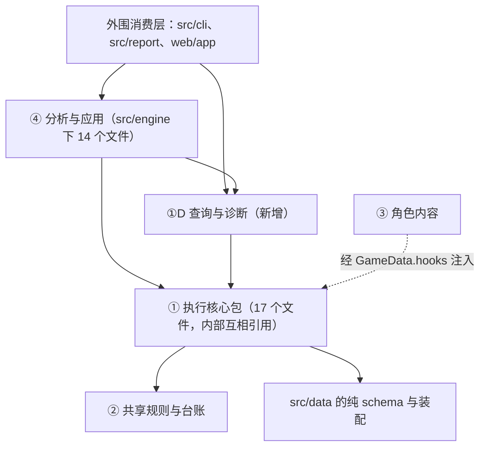

# 逐帧仿真底座：架构设计（v0.3 Final）

**版本**：
- v0.1：2026-11-11，Antigravity 初稿；
- v0.2：2026-11-13，Claude 接手定稿（用户指定）。把 [意见文件](engine-foundation-architecture-draft-feedback.md) 里 AF-01～AF-25 与 AD-01～AD-05 的结论合入正文；
- v0.3：2026-11-14，Claude。按 Codex 对 v0.2 的复核补正三处契约（AF-26～AF-28），并入 Antigravity 的三条实施细则，去掉"待 Antigravity 确认"的标记。

修订记录见附录 C，审查记录见文末。

**状态**：
- **v0.3 Final，三方审查通过。** Claude、Antigravity、Codex 均已签署 v0.3，见文末审查记录与[意见文件 §16](engine-foundation-architecture-draft-feedback.md#codex-v03-stamp)。
- **AF-01～AF-28 全部 `done`，AD-01～AD-05 已确认。** Codex 已核对 AF-26～AF-28 的修订与相邻契约，未新增架构阻塞项。
- **进入各阶段详细设计。** 后续按[路线图](engine-foundation-roadmap.md) §11，在实施相应批次时同步总设计与各 TD。
- **以后怎么改**：定稿后发现要改的地方，在详细设计或实施时提出，改本文并在附录 C 记一条，不再回到意见文件里逐项辩论。
- **都还没实现**：本文定的是接口、数据结构与验收条件。代码没有改，游戏机制也没有新证据。

**基线**：代码 `cb520f5`（相对 `6b1d7ab` 只改了文档）；装配数据 `20261019`。

## 0. 定位与约束

1. **承接路线图。** 本文落实[路线图 v3.3 Final](engine-foundation-roadmap.md) §13 的 13 项与 §13.1 的承诺交付边界，把它 §2–§6 的契约落成模块、接口、数据类型与测试。
2. **不推翻总设计 §4 的取舍。** 固定 60 fps 的世界步长、三种时钟、缺省按期望值、纯库、数据与钩子分开、只维护当前版本、单目标。
3. **代码位置用"符号名 + 基线"定位**（AF-14）。正文写函数、类型与文件名，不靠行号；基线上的行数与少量行号集中放在附录 B，只作参考，不是架构承诺。
4. **技术断言要核对**（CL-04）。本文引用的现有行为，附录 B 列了核对范围，请另外两位复核。
5. **意见与正文的对应**见附录 A。读某一项意见的来龙去脉，去意见文件里看对应的 AF 编号。

## 1. 分层与依赖方向（路线图 §13 第 1 项；AF-01、AF-15）

### 1.1 现在的代码怎么分

`src/engine/` 共 32 个文件、6,977 行（各文件行数见附录 B）。

| 层 | 内容 | 文件 | 约束 |
|---|---|---|---|
| ① 执行核心包 | 逐帧执行、装配与编译、汇总与不变量。内部按职责分三组，**但三组互相引用，现在是一个整体** | 17 个文件、3,815 行（分组见下） | 不引用 ④ 与外围消费层 |
| ①D 查询与诊断（新增） | 状态查询、事件解释、"为什么没发生"、资源账本、诊断收集 | 拟新增 `query.ts`、`diagnostics.ts` | 只读或旁路；复用 ①，不改变业务执行结果 |
| ② 共享规则与台账 | `Rules` 类型与缺省值；假设 / 命题台账 | `src/data/gamedata.ts` 的 `Rules`、`src/engine/assumptions.ts`（300 行） | 被 ① 与 ④ 只读引用 |
| ③ 角色内容 | 角色钩子、武器、声骸、判定连接 | `data/curated/characters/`（18 个模块、3,188 行）等 | 只实现 `CharacterHooks`，经 `HookContext` 读写状态 |
| ④ 分析与应用 | 对比、敏感度、搜索、排轴、套路卡、择优、矩阵、抽样、模糊测试、校准、贴合度、调试表 | `src/engine/` 下 14 个文件、2,862 行 | 只经公开入口调用 ①、① D 与 ② |
| 外围 | 数据 schema 与装配（`src/data/`）、读盘适配（`src/data/load.ts`）、命令行（`src/cli/`）、展示模型（`src/report/`）、网页（`web/app/`） | — | `src/data/` 的纯 schema 与装配在底部，被各层引用；其余是最上层的消费者 |

执行核心包内部的三组（职责说明，不是依赖层次）：
- **执行**：`kernel`、`scheduler`（运行期调度部分）、`switch`、`resources`、`triggers`、`buffs`、`enemy`、`formula`、`simulate`、`context`、`num`、`rng`；
- **入口与装配**：`resolve`、`scheduler` 里的 `compileRotation`、`portable`、`types`；
- **汇总与不变量**：`summary`、`invariants`。

三组之间现在的引用是双向的：
- `simulate`、`enemy` 引用 `summary` / `invariants`；
- `invariants`、`summary` 引用 `scheduler` / `context`；
- `resolve` 引用 `kernel` / `scheduler`；
- `scheduler.ts` 一个文件里同时有编译与运行期调度。

所以本文不画包内部的单向箭头。

### 1.2 依赖规则与检查



新建 `tests/layering.test.ts`，只断言两条现在就成立的规则。它不放进已有的 `tests/core-check.test.ts`，那是核心资源槽的核对：
1. **核心不反向依赖**：① 、①D、② 的文件不 import ④ 的 14 个文件，也不 import `src/cli/`、`src/report/`、`web/`。
2. **纯库**：`src/engine/` 下所有文件不 import `fs`、`path`、`child_process`、DOM，也不 import `src/data/load.ts`。

包内部拆成无环结构是阶段五的目标，例如把 `summarize` 的调用挪到外层、把 `compileRotation` 移出 `scheduler.ts`。那时才搬目录，现在不动。

## 2. 运行输入、完成状态与对外接口（路线图 §13 第 2 项）

### 2.1 一份归一后的运行输入：`PreparedRun`（AF-22、AD-02）

编译、运行、状态查询、历史重跑必须用同一份有效输入，否则查询解释的可能是另一条轨迹。

```ts
/** 唯一的归一入口：合并覆盖 → 校验（含严格入口的编译期检查）→ 装配 */
export function prepareRun(scenario: Scenario, data: GameData, overrides?: RunOverrides): PrepareResult

export interface PreparedRun {
  readonly runId: string                    // 整份运行身份（§9）按 §2.7 的规则转成 JSON 后的摘要
  readonly identity: RunIdentity            // §9；记归一后的有效值
  readonly resolved: ResolvedScenario
  readonly effective: {
    readonly strict: boolean
    readonly strictSource: 'scenario' | 'cli-override' | 'default'
    readonly continueAfterIntentUnmet: boolean
    readonly sample: SimOptions['sample'] | null
  }
}
```

约定：
- **合并的优先级**：命令行显式给的 > 场景文件写的 > schema 缺省值。合并发生在校验之前，校验与运行用的是同一份。
- **严格入口的声明**（AD-02）：场景 `options.strict`，命令行 `--strict` 可覆盖；实际生效的值与来源记进运行身份。`purpose: replay` 加 `strict: true` 在编译期报错。
- **"最早合法帧基线"的条件**：严格入口，并且 `inputDelay`、`inputDelayAt`、抽样抖动、手速档都没有。只要有任何一项操作延迟，这次运行就标为"操作策略试验"，不算基线，哪怕开着严格入口。轴作者手写的 `+N` 属于轴本身；`at` 在严格入口下仍然禁止（§11.2）。
- **运行与查询都收 `PreparedRun`**。结果带 `runId`；把一次运行的事件句柄拿去查另一次运行，返回明确的错误。
- **`effective` 里的每一项都进运行身份**（AF-28）：`strict` 与 `strictSource` 对应身份的 `entryMode` 与 `strictSource`，`continueAfterIntentUnmet` 与 `sample` 同名。装配结果的摘要 `resolvedDigest` 也在身份里。所以只改续跑开关、或只改最终装配内容，`runId` 都会变。
- **观察选项不进身份**：诊断开关与过滤条件可以独立变化，前提是零干扰（§4.3）。同一份执行输入只改诊断开关，`runId` 不变。

### 2.2 完成状态（AF-02）

```ts
export type RunStatus =
  | 'completed'     // 指令都执行完，场上没有在途的动作、判定、尾部
  | 'truncated'     // 到了帧数上限 options.maxFrames
  | 'axisFailed'    // 轴在所选模型下执行不下去
  | 'engineError'   // 引擎或角色模块的错；这次运行作废

export type AxisFailureKind =
  | 'intentUnmet' | 'timeout' | 'comboBroken' | 'notOnField' | 'switchSelf' | 'airEntry' | 'entrySkill'

export interface UnmetIntentDetail {
  readonly kind: 'introMissed' | 'airEntry' | 'entrySkill' | 'cancelFrameIllegal'
  readonly cmd: CommandRef
  readonly expected: string                 // 例："切出者协奏 ≥ 100"
  readonly actual: string                   // 例："协奏 92"
}
```

现有错误码与警告的归类：

| 错误码 / 警告 | 什么时候出现 | 非严格入口 | 严格入口 | 候选比较里怎么处理 |
|---|---|---|---|---|
| `introMissed`（警告） | 写了"变奏"，等完出手后协奏仍不满 | `completed`，保留警告，照常普通切人 | `axisFailed`（`intentUnmet`） | 保留："这个候选下变奏断了" |
| `airEntry` | 切进来第一下是空中动作，切出者在地面且不会离地 | `axisFailed`（`airEntry`） | `axisFailed`（`intentUnmet`） | 保留 |
| `entrySkill` | 出场技的入场条件不成立 | `axisFailed`（`entrySkill`） | `axisFailed`（`intentUnmet`） | 保留 |
| `comboBroken` | 连段或派生的前置不对 | `axisFailed` | `axisFailed` | 保留 |
| `timeout` | 一条指令等待超过 `options.maxWait`（缺省 600 帧，可配置） | `axisFailed` | `axisFailed` | 保留，见下面的限定 |
| `notOnField`、`switchSelf` | 让后台角色出招；切给自己 | `axisFailed` | `axisFailed` | 保留：轴写错了 |
| `maxFrames`（指令没发完，现在是报错） | 到帧数上限时队列里还有指令 | `truncated`（`commandsPending`） | 同左 | 标为截断，不当完整结果 |
| `maxFrames`（指令已发完，现在是警告） | 到帧数上限时还有在途的动作、判定或尾部 | `truncated`（`inFlightRemains`） | 同左 | 同上（R11） |
| `chainDepth` | 事件连锁超过 `rules.maxChainDepth`（缺省 16，可配置） | `engineError` | `engineError` | 作废，不进排名 |
| `invariant` | 不变量检查失败 | `engineError` | `engineError` | 作废 |
| 未捕获的异常 | 例如钩子里抛错 | `engineError` | `engineError` | 作废 |

几点限定：
- **`timeout` 只说明"在这次的等待预算内没放出来"**，不说明资源永远等不到。报告要带上：等待预算、被什么挡住、停下时的能量、协奏、核心资源与冷却。
- **`axisFailed` 是有效结论，`engineError` 不是。** 前者作为"这个模型下这条轴不成立"保留（RR-03）；后者的轨迹留给排错，不参加任何机制候选的排名。
- **截断时还剩什么**要列全：没执行的指令、还在放的动作、在途的判定、尾部。一个动作可以正在后摇、既没有判定也没有尾部。

### 2.3 状态边界、事件范围与停止点分开记（AF-23、AF-16）

"完整走完了几个 tick""日志记到哪""停在哪一步"是三件事，一个数表达不了。

```ts
/** 一个状态包含了哪些记录：各用自己的上界，不借用业务事件的序号。三项都是常驻的，与诊断开关无关 */
export interface StatePrefix {
  readonly eventEndExclusive: number        // 包含日志里 [0, n) 的事件
  readonly handledEndExclusive: number      // 其中处理器全部执行完的 [0, m)；在正常的 tick 边界上 m = n
  readonly interventionEndExclusive: number // 包含的外部干预记录（§4.1）
}

export interface RunCoverage {
  readonly initCompleted: boolean           // 初始化（常驻 buff、onResolve、首次 drain）走完没有
  readonly completedTicks: Frame            // 合法的状态边界是 S[0] … S[completedTicks]；初始化没走完时一个都没有
  readonly loggedEventEndExclusive: number  // 日志里已有的事件 [0, n)
  /** 循环为什么退出、在哪退出。收尾里再出错，这一项不改写 */
  readonly loopExitAt: {
    readonly reason: 'idle' | 'maxFrames' | 'axisFailed' | 'engineError'
    readonly worldFrame: Frame
    readonly phase: 'init' | 'P2' | 'P3' | 'P4' | 'P6' | 'afterP7'
    readonly inFlightEventSeq?: number      // 循环里出错时正在处理的事件
  }
  /** 循环退出之后的收尾做了什么、做完没有（AF-26） */
  readonly finalization: {
    readonly kind:
      | 'postDrain'     // 循环正常返回后再处理一次队列
      | 'failClose'     // 报错前关掉正在累计的等待段，不处理队列
      | 'none'          // 初始化失败，或出错的不是调度错误
    readonly completed: boolean
    readonly inFlightEventSeq?: number      // postDrain 中途出错时正在处理的事件
  }
  readonly terminal: {
    readonly kind:
      | 'afterPostDrain'    // 收尾的 drain 处理完了
      | 'postDrainFailed'   // 收尾的 drain 中途出错
      | 'afterFailClose'    // P7 之后报错，失败收尾做完，没有 drain
      | 'midTick'           // tick 中途停下（含这时的失败收尾）
      | 'initIncomplete'
    readonly prefix: StatePrefix
  }
}
```

**账本的上界不在 `StatePrefix` 里**（AF-27）。账本是可选诊断，诊断关着时没有；把它的上界放进常驻的完成状态，同一次运行开关诊断就会得到两份不相等的完成状态，§4.3 的零干扰检查必然失败。所以：
- **完成状态只含常驻的边界**，诊断开或关都逐字段相等，零干扰检查比整份完成状态，不设"可以不同的字段"。
- **账本上界跟着账本走**，放在诊断与查询的观察元数据里（§6.3）：每个检查点对应一个 `ledgerEndExclusive`，没开诊断就没有这一项。
- **引擎不为此常驻维护账本计数。** 业务状态不知道账本存在。

七条停止路径：

| 路径 | 合法的 `S[f]` | 循环在哪退出 | 收尾 | 终态 | 说明 |
|---|---|---|---|---|---|
| 正常结束 | `0..completedTicks` | 下一个 tick 的 P2：P1 与 `endDueActions` 已执行，判定无事可做，这个 tick 不计入 | `postDrain`，做完 | `afterPostDrain` | 终态比 `S[completedTicks]` 多了 P1（膨胀窗口扣 1 帧）、`endDueActions` 的结束事件，以及 `drain` 里钩子的反应 |
| 截断，指令已发完 | 同上 | P7 之后；先记一条 `maxFrames` 警告事件再返回 | `postDrain`，做完 | `afterPostDrain` | 警告是日志里的一条事件，`drain` 会把它交给角色钩子，所以终态与 `S[completedTicks]` 可能不同 |
| 截断，指令没发完 | 同上 | P7 之后抛出 | `failClose`，做完 | `afterFailClose` | `runLoop` 的 `fail` 先调 `closeSeg`：有等待段没关时，把 `queue.seg` 清空、追加一条 `wait` 事件，等待代码是 `settled` 时还记一次假设。所以终态与 `S[completedTicks]` 可能不同：日志多一条、队列的等待段没了、`assumed` 可能多一次计数。这条 `wait` 没有被处理，`handledEndExclusive` 比 `eventEndExclusive` 小 1。没有等待段时两者内容相同，种类仍标 `afterFailClose` |
| 收尾的 `drain` 中途出错 | 同上 | 与前两条之一相同，`loopExitAt` 照实记 `idle` 或 `maxFrames` | `postDrain`，没做完 | `postDrainFailed` | 状态是 `engineError`。循环早已退出，不能改写成 tick 中途失败；也不能报 `afterPostDrain` |
| P2 里轴失败 | 同上；这个 tick 没走完 | P2 的调度里抛出 | `failClose`，做完 | `midTick` | 这个 tick 已记下的事件可能还没处理 |
| 处理事件或计时器时出错 | 同上 | 出错的相位 | `none`：这些错误（连锁过深、不变量不成立、钩子抛错）不经调度器的 `fail`，等待段不关 | `midTick` | 正在处理的那条事件可能只跑了一部分处理器；结果作废，只供排错 |
| 初始化失败 | 没有，连 `S[0]` 都不成立 | `init` | `none` | `initIncomplete` | 不做账本闭合，不参加比较 |

约定：
- **`terminalState` 是实际停下的那一刻**，带完成度，不冒充最后一个 `S[f]`。P7 之后仍是 `S[f + 1]`（§3.1）；失败收尾发生在它之后，算在终态里，不算进 `S[f + 1]`。
- **`handledEndExclusive` 只数处理器全部跑完的事件。** 不能直接抄 `bus.cursor`：`drain` 先把游标加 1 再调处理器，处理器抛错时游标已经越过那条事件。出错时它等于 `inFlightEventSeq`。
- **收尾出错一律是 `engineError`**，不管循环原本是正常结束还是截断。基线上非调度错误会从 `simulate` 直接抛出去；新接口要接住并归类，这次运行不进任何候选排名。
- **全部已记录的事件都能取到**：按事件序号访问，范围是 `[0, loggedEventEndExclusive)`。按时间段做统计仍用左闭右开的战斗帧窗口 `[lo, hi)`。
- **`endAt` 只是统计窗口的终点**，不是运行预算；运行上限只有 `maxFrames`。
- **余额闭合按检查点自己的账本上界算**（§6.3），不靠"`f` 小于几"去猜同一帧里后面的变化。两次连续的静默同步没有新的业务事件，也能靠干预记录的上界（常驻）与账本的上界（诊断）分清"停在第几次之后"。
- **不做帧内任意位置的暂停与恢复**。上面只是把已经发生的停止点如实记下来。

### 2.4 完成状态的其余部分（AF-16）

```ts
export interface RunCompletion {
  readonly status: RunStatus
  readonly axisFailure?: { readonly kind: AxisFailureKind; readonly unmetIntent?: UnmetIntentDetail; readonly detail: string }
  readonly truncation?: {
    readonly kind: 'commandsPending' | 'inFlightRemains'
    readonly remains: { pendingCommands: number; activeActions: number; pendingJudgments: number; pendingTails: number }
  }
  readonly coverage: RunCoverage
  readonly loops: { readonly planned: number; readonly completed: number }   // 完整走完的轮数，不含残缺的轮
  /** 目标是否达成：与 status 是两个维度 */
  readonly goal: { readonly kind: 'steady' | 'kill' | 'window'; readonly reached: boolean }
  /** 有没有外部指定的状态（§4.1 的干预记录） */
  readonly conditioning: { readonly basis: 'unconditioned' | 'conditioned'; readonly firstInterventionIndex: number | null }
  /** 严格入口意图未满足后继续试跑时：从哪里起是降级试跑。业务事件本身不加标记 */
  readonly diagnosticContinuationFrom?: { readonly worldFrame: Frame; readonly prefix: StatePrefix }
}
```

`goal.reached` 的定义：
- **击杀**：取 `summary.goal.reached`，它按目标血量 `goal.hp` 算。`summary.kill` 是 1 倍血的里程碑，按 `enemy.hp` 算，两者不混用。
- **前 N 秒**：有效的战斗帧覆盖了整个窗口，且此前没有因失败停下。
- **稳态**：有稳态，且稳态包含的每一轮都完整走完。

"目标达成没有""轴跑完没有""有没有引擎错误"分开报，不合成一个布尔值。

### 2.5 对外接口（`src/engine/query.ts`）

名字是建议，签名里的要点才是契约。先做纯函数与命令行 JSON，不建服务。

| 能力 | 输入 | 输出 | 说明 |
|---|---|---|---|
| `prepareRun` | 场景、数据、覆盖项 | `PreparedRun` 或编译问题 | §2.1 |
| `runPrepared` | `PreparedRun`、诊断选项 | `SimResult`（含 `completion`、`identity`、必有记录；可选 `diag`） | §2.2–§2.4、§4 |
| `stateAt` | `PreparedRun`、世界帧 `f` | `S[f]` 的隔离拷贝与它的 `StatePrefix`；带诊断时另有账本上界 | `0 ≤ f ≤ completedTicks`；§5 |
| `terminalState` | `PreparedRun` | 终态与它的 `StatePrefix`、完成度；带诊断时另有账本上界 | §2.3 |
| `eventsBySeq` / `eventsBetween` | 运行结果；序号范围 / 战斗帧窗口 `[lo, hi)` | 事件 | 前者能取到全部已记录事件 |
| `explainEvent` | `PreparedRun`、事件序号 | `EventExplanation` | §3.4 |
| `commandCheck` | `PreparedRun`、`CommandRef` | 这条指令的检查结果 | §7.2 |
| `whyDidEventNotTrigger` | `PreparedRun`、事件序号、目标效果 | 条件检查结果 | §7.3 |
| `wouldHypotheticalEventTrigger` | `PreparedRun`、世界帧、假想事件、目标效果 | 结果，标为"假想" | §7.3 |
| `diffRuns` | 两个 `PreparedRun` 及结果、比较目标 | `RunDiff` | §2.6 |
| `compareObservations` | `PreparedRun`、观测 | 分项比较结果 | §10 |

诊断关着时，需要诊断记录的查询经同一个 `PreparedRun` 带诊断重跑取得。重跑用的严格选项、续跑策略、抽样种子都来自 `PreparedRun`，不由调用方另给。

### 2.6 跨运行比较（AF-12）

```ts
/** 运行内的句柄：只在一次运行里有意义 */
export interface EventHandle { readonly runId: string; readonly eventSeq: number }

export type CorrespondenceStatus =
  | 'matched'          // 双方都覆盖了这一段，且对应有依据
  | 'addedOrRemoved'   // 双方都覆盖了这一段，一方多了或少了这条事件
  | 'ambiguous'        // 有多个候选，定不了
  | 'unanalyzed'       // 至少一方没执行到这一段

export interface RunDiff {
  readonly base: { readonly runId: string; readonly completion: RunCompletion }
  readonly cand: { readonly runId: string; readonly completion: RunCompletion }
  readonly firstDivergence: { readonly baseEvent?: EventHandle; readonly candEvent?: EventHandle; readonly summary: string } | null
  readonly correspondences: readonly {
    readonly status: CorrespondenceStatus
    readonly base?: EventHandle
    readonly cand?: EventHandle
    readonly candidates?: readonly EventHandle[]   // ambiguous 时列出
    readonly basis: 'commandRef' | 'explicitMapping' | 'structural'
    readonly delta?: { readonly worldFrames?: number; readonly battleFrames?: number; readonly value?: number }
    readonly unanalyzedReason?: string             // 哪一方、在哪、因为什么提前停了
  }[]
}
```

怎么对应：
- **同一条轴、只换规则或配置**：按指令出处 `CommandRef`（轮、行、项）以及由它派生出来的来源对应。自动插入的谐度破坏、变奏与延奏各带自己的派生来源，不借用用户指令的编号。
- **改过轴**：调用方给出指令的对应表才能报 `matched`。没有对应表时，"同一轮、同一角色、同一动作、第几次"这种结构键只用来找候选，不单独宣告对应成立。例如删掉第一个 A，剩下的 A 序数左移，这时返回 `ambiguous`。
- **先看覆盖再对应**：至少一方没执行到就是 `unanalyzed`，不报"消失"。
- **阶段一可以只比指标**：每轮时长、合法性、完成状态。事件级的对应随后补。

### 2.7 能力说明与 JSON 输出（路线图 §4.9；AF-12、AF-25）

每一份对外的查询或比较结果都带一个信封：

```ts
export interface QueryEnvelope<T> {
  readonly schemaVersion: string
  readonly identity: RunIdentity
  readonly completion: RunCompletion
  readonly capability: CapabilityDisclosure
  readonly data: T
}

export interface CapabilityDisclosure {
  readonly capabilitiesUsed: readonly string[]
  readonly assumptionsEncountered: readonly { readonly id: string; readonly count: number }[]   // 沿用 assume() 的含义
  readonly ruleUsage: RuleUsageReport                                                           // §4.2
  readonly conditioning: RunCompletion['conditioning']
  readonly observationSummary?: { passed: number; conflicted: number; unmatchedOrAmbiguous: number; insufficientOrUnassessable: number }
  readonly unsupported: readonly string[]   // 这次查询里没覆盖、没建模的部分
}
```

JSON 的转换规则（只在对外输出的边界上做，内部照常用 `Map`、`Set`、`Infinity`）：
- **`Map`**：
  - 顺序不带含义的，编成按键排序的条目数组，空的编成 `[]`；
  - 顺序本身有含义的，编成保留顺序的数组。
- **`Set`**：编成排序、去重的数组。
- **无穷**：编成 `'inf'` / `'-inf'`，沿用现有 `buffApply.remaining` 的写法。
- **未知、不适用、零时长**：各用显式的标记，互相不混，也不和 `'inf'`、`0` 混。字段省略有固定含义（不适用），"未知"必须显式写出。
- **不输出**：钩子函数，以及整个 `ResolvedScenario`。
- **验收**：对空 `Map`、非空 `Map`、无限上限、未知值、零时长、普通数值做往返测试，比的是语义逐字段相等，不是"能解析"。

## 3. 事件模型、相位与直接来源（路线图 §13 第 3 项；RR-01、AF-04、AF-20）

### 3.1 七个相位与 `drain` 的位置

以 TD-04 §1 与 `kernel.ts` 的 `tick` 为准：

| 阶段 | 做什么 | 处理事件队列吗 |
|---|---|---|
| 初始化 | 挂常驻 buff → 三人的 `onResolve` → 处理队列。之后的状态是 `S[0]` | 是 |
| P1 | `computeRates`：由膨胀窗口算速率，每个窗口用掉 1 帧 | 否 |
| P2 | 清 `startedThisTick` → `endDueActions` 结束到期动作（剩余时间线转尾部）→ 执行指令；指令已空、三人空闲、没有判定与尾部时，`tick` 返回 false，整次仿真结束，这个 tick 不计入 | 开始动作时（扣费后、施放资源后）与切人时 |
| P3 | `advanceActions`：推进动作与尾部，处理时间线节点（资源、膨胀、生成判定、延奏） | 施放资源与延奏触发时 |
| P4 | `settleJudgments`：结算到点的判定，含伤害、命中资源、敌人量表、附加效应、命中后生成 | 每次结算后 |
| P5 | 敌人量表的概念归属；不单设一步，更新在 P4 的结算与 P6 的计时器里 | — |
| P6 | 切人冷却、技能冷却与充能按战斗速率递减 → `hooks.timers`：效应定时结算、敌人计时器、buff 到期 → 处理队列 → 清 `bus.spawned` → 采集展示轨道 → 不变量检查 | 是 |
| P7 | 战斗帧加战斗速率，世界帧加 1；之后是 `S[f + 1]` | 否 |
| 退出后 | 循环正常返回后再处理一次队列（最后一个 tick 在 P2 结束时留下的事件）。循环因调度错误抛出时不处理队列，但报错前会关掉正在累计的等待段（写一条 `wait`）。两种收尾都不属于任何 `S[f]`，见 §2.3 | 正常返回时是；抛出时否 |

冷却在 P6 扣。进入世界帧 `f` 时还剩 1 战斗帧冷却的技能（这一帧战斗速率为 1），这一帧的 P2 看到的仍是 1，下一帧才能放。

### 3.2 业务事件只补两个字段（R09）

`buffApply`、`buffExpire` 补上提供者 `owner` 与实例号 `instanceId`。这是业务字段，一直都有，进 conformance：
- 现在这两种事件只有 buff 定义 ID 与目标，两人各给的同名 buff 分不开；
- `buffUptime` 改成按"提供者、buff、目标"统计，再显式聚合。

除此之外不往日志里加事件，也不往业务事件上加诊断字段。原因：`drain` 把日志当队列，每条事件都会交给每个角色钩子的 `onEvent`。

### 3.3 事件的直接来源放在旁路表里（AD-01、AF-04）

```ts
export type OriginContext =
  | { kind: 'init'; sourceId: string }
  | { kind: 'command'; cmd: CommandRef }
  | { kind: 'autoInterject'; slot: Slot; action: ActionId }
  | { kind: 'actionLifecycle'; actionInstance: number }
  | { kind: 'timeline'; actionInstance: number; nodeIndex: number; detached?: boolean }
  | { kind: 'judgmentSettle'; judgmentId: number }
  | { kind: 'judgmentExpire'; judgmentId: number }
  | { kind: 'timer'; timerKind: 'buff' | 'effectTick' | 'enemy'; id?: number; defId?: string }
  | { kind: 'trigger'; directParentSeq: number; handlerKind: 'consume' | 'buffTrigger' | 'buffExtend' | 'resourceEffect' | 'charHook'; handlerId: string }

export interface EventMeta {              // diag.eventMeta[seq]，与日志下标一一对应
  readonly phase: 'init' | 'P2' | 'P3' | 'P4' | 'P6' | 'post'
  readonly origin: OriginContext
  readonly directParentSeq?: number       // 直接引出它的事件；延迟生效的经实体来源表查到
}
```

要点：
- **放在诊断的旁路数组里**，按事件下标索引。钩子看到的事件、日志的结构都不变。
- **运行时结构不加字段。** 延迟生效的判定与尾部，来源记在诊断里跨 tick 保留的实体来源表：判定按 `id`，尾部按 `instance`。
- **来源由生成点显式传入**，不从 `bus.current` 猜：它在 P3 时间线生成与结算后的派生里可以是空的，而且里面只有深度与业务根。基线上判定有 4 个生成点、尾部有 4 个（附录 B），每处都传 `OriginContext`。
- **业务链不动。** `bus.spawned` 仍在 P6 清空；`Link.root` 继续表示伤害与资源的业务归属（"谁引发的算谁"）。它们参与 `chainDepth` 的判断，改它们的寿命会改变运行是否成功，不是诊断功能可以顺带做的事。跨 tick 的连锁深度该不该继承，另立议题、另配回归用例。
- **诊断的直接父链与业务的 `Link.root` 是两个概念**，不混用。

做完后，`trace.ts` 的 `walkOwners` 按日志邻近关系推来源的两种错归（同帧多个到期、队列交错）就不再需要。

### 3.4 单个事件的解释（AF-20）

```ts
export interface EventExplanation {
  readonly event: EventHandle
  /** 沿诊断的直接父链回到已记录的源头；只是已建模的直接触发链 */
  readonly directCauses: readonly { readonly seq: number; readonly meta: EventMeta }[]
  /** 伤害事件：结算时实际用的输入与中间量 */
  readonly hitInputs?: {
    readonly panel: unknown                 // 结算用的面板
    readonly enemy: unknown                 // 敌人等级、防御、抗性、瘫痪、失谐
    readonly multiplier: { readonly base: number; readonly afterModifyHit: number; readonly extraFlat: number }
    readonly buffs: readonly ActiveBuffContribution[]
    readonly factors: HitFactors            // 各乘区的中间结果
    readonly output: { readonly nonCrit: number; readonly crit: number; readonly expected: number }
    readonly notRecorded: readonly string[] // 这一版没保留的上游细节，明说
  }
  readonly resourceEntries: readonly ResourceLedgerEntry[]
  readonly ruleTrace: readonly RuleTraceEntry[]   // §4.2 的逐次明细
  readonly windowMargins?: readonly BuffWindowMargin[]
  readonly scope: 'direct_causes_and_immediate_inputs_only'
}

export interface ActiveBuffContribution {   // 在结算那一刻绑定，不事后按名字找
  readonly instanceId: number
  readonly defId: string
  readonly owner: CharName | 'env'
  readonly stacks: number
  readonly zone: string
  readonly value: number
  readonly remainingBattleFrames: number | 'inf'
}
```

- **输入与输出分开**：`HitEvent.dmg` 是输出，不能拿来充当公式输入。
- **buff 贡献在结算时绑定具体实例**：现在 `HitEvent.buffs` 只有定义 ID 与层数，没有提供者。
- **按能力范围说明**：不经过同一个结算入口的伤害（例如异常效应的定时结算），说明哪些支持、哪些不支持，首版不要求全覆盖。
- **不声称是全部依赖**：规则经时序、资源带来的间接影响，由指定的反事实比较回答（路线图 §4.1）。

### 3.5 边界用例（RR-01 的关闭条件）

1. **冷却剩 1 帧**：`stateAt(f)` 里冷却是 1，这一帧 P2 放不出，`stateAt(f + 1)` 里是 0，下一帧放出。前提：这一帧战斗速率为 1，其余条件都满足。
2. **同帧命中与 buff 到期**：P4 的结算仍吃到这个 buff；`buffExpire` 在 P6，排在 `hit` 之后。
3. **同帧多个到期、交错触发**：每条派生事件的直接来源指向各自的触发者，不串到最后一个头上。

已有用例能覆盖的直接复用。

## 4. 必有的运行记录与可选诊断（路线图 §13 第 4 项；AF-03）

### 4.1 哪些一直都有，哪些可选

| 记录 | 位置 | 必有 / 可选 | 依据 |
|---|---|---|---|
| 日志、汇总、展示轨道 | `SimResult` 主体 | 必有 | 现有输出 |
| `completion` | 主体 | 必有 | §2.2–§2.4 |
| `identity` | 主体 | 必有 | §9 |
| `interventions`：外部干预记录 | 主体，**不进日志的触发队列** | 必有 | 方向第 8 条；`checkLog` 要读它 |
| `strictReport`：严格入口的检查结果、按意图的等待、提示 | 主体 | 必有 | 路线图 §3.4、路线图 §3.6 |
| `summary.assumptions`：碰到的假设 | 汇总 | 必有 | 沿用现有 `assume()` |
| `ruleUsage`：规则使用摘要与覆盖清单 | 主体 | 必有 | 方向第 6 条；§4.2 |
| `diag.eventMeta`、实体来源表 | `diag` | 可选 | §3.3 |
| `diag.resourceLedger` | `diag` | 可选 | §6 |
| `diag.ruleTrace`：规则使用的逐次明细 | `diag` | 可选 | §4.2 |
| `diag.triggerChecks` | `diag` | 可选，按目标过滤 | §7.3 |
| `diag.hitInputs`、`diag.hitMargins` | `diag` | 可选 | §3.4、§7.4 |

外部干预记录：

```ts
export interface InterventionRecord {
  readonly index: number
  readonly f: Frame
  readonly phase: string
  readonly afterEventSeq: number            // 排在哪条业务事件之后；初始化阶段还没有事件时是 -1
  readonly orderInAnchor: number            // 同一个 afterEventSeq 下的先后
  readonly kind: 'sync' | 'fill' | 'enemyDisharmony' | 'enemySwap'
  readonly target?: { readonly slot?: Slot; readonly resource?: ResourceKind }
  readonly before?: number
  readonly adopted?: number
  readonly delta?: number
  readonly firedTriggers: boolean
  readonly skippedTriggers: readonly string[]
}
```

- **为什么不能只放在诊断里**：状态同步直接改资源、不发业务事件。如果它只在诊断开着时才有记录，诊断关着时 `checkLog` 按资源事件重放会对不上，报"中间有没记日志的改动"。
- **为什么不能写进日志**：日志里的每条事件都会交给角色钩子，这违反"同步缺省不发业务触发"。
- **所以是第三种记录**：一直都有，不进触发队列；不变量检查与账本都读它，同一个锚点下按 `orderInAnchor` 重放。
- **现有的 `能量满`、`敌人 失谐 / 换`** 照旧发业务事件，同时也记一条干预记录，标明 `firedTriggers: true`。

### 4.2 用到了哪些规则

一套 ID（台账的命题 ID），三种记录，含义不同：

| 记录 | 含义 | 必有 / 可选 |
|---|---|---|
| `assumptionsEncountered` | 沿用 `assume()`：碰到了哪条已登记的假设，里面包括数据推断、去重后的警告。它不是"读了几次规则" | 必有 |
| 规则使用摘要 | 在**列明的判定点**上，读到了哪条规则、值是多少、这一处是否决定了局部分支；按命题汇总次数 | 必有 |
| 逐次明细 | 每一次的帧、事件、判定点与局部状态 | 可选 |

```ts
export interface RuleUsageReport {
  readonly byProposition: readonly {
    readonly propositionId: string
    readonly readCount: number
    readonly decisiveCount: number
    readonly firstFrame: number | null
  }[]
  /** 哪些判定点已经列入；没列入的读取是"未插桩"，不是 0 */
  readonly coverage: readonly { readonly pointId: string; readonly propositionId: string; readonly symbol: string }[]
}
```

- **怎么采集**：在列明的判定点显式调用一个小的记录函数。不用 `Proxy` 拦截属性读取，路线图 §1.3 已排除；它还会把复制配置、生成身份时的读取也记进来。
- **首版的判定点从现有调用点归类得来**：基线上 `assume()` 约 45 处调用，分布在引擎与 13 个角色模块。每处归成三类之一：碰到假设、读规则、决定分支。不要求覆盖 `Rules` 的每个字段。
- **"决定分支"的含义**：在当时的局部状态下，换成另一个已实现的候选值，这一处会走另一条分支。例如切人检查里的 `switchEndsStop`：
  - 过了写明的切人锁、还在全局时停里，它才决定放行与否；
  - 还在切人锁之内，它只是被读到。
- **"决定分支"不等于改变了结果**：局部的分叉可能被后面的等待吸收。"这条规则有没有改变这次的结论"只由指定的反事实比较回答。

### 4.3 零干扰检查

新建 `tests/zero-interference.test.ts`，并接进 `pnpm conformance`。对代表场景与小场景，诊断关与开各跑一次，比较：
- **业务输出**：日志、汇总、完成状态、必有记录、展示轨道。完成状态比整份，没有豁免字段（账本上界不在里面，§2.3）；
- **报错行为与 RNG**；
- **完整状态**：结束时以及抽样若干帧的 `stateAt`，逐字段相等。要比的字段包括：
  - 三人的动作、连段锚点、资源、冷却与充能、钩子的 `vars`；
  - 判定、尾部、buff、敌人、膨胀窗口；
  - 调度队列的游标与等待字段、`nextId`、`outroLinks`、`pendingNextIn`、`lastTrigger`、`assumed`、`rng`、`entry`。

结果暂时相同不够，会影响后续执行的状态也要相同。

## 5. 状态模型与 `stateAt`（路线图 §13 第 5 项；AF-06）

### 5.1 状态的范围

| 类别 | 字段 |
|---|---|
| 时钟与场上 | `frame`、`battleFrames`、`onField`、`entry` |
| 三人 | 动作、上一个动作、连段锚点、切人冷却、`startedThisTick`、能量、协奏、核心资源、冷却、充能、`vars` |
| 在途与环境 | 判定、尾部、buff、敌人、膨胀窗口 |
| 调度与挂起 | 队列的游标与等待字段、`nextId`、`outroLinks`、`pendingNextIn`、`lastTrigger`、`assumed`、`rng` |

展示用的共鸣回路文字与冷却轨道在 P6 采集，不是完整状态。

### 5.2 三种状态

1. **`S[0]`**：初始化完成、第 0 帧 P1 之前。
2. **`S[f]`**（`1 ≤ f ≤ completedTicks`）：第 `f − 1` 帧走完 P7、第 `f` 帧 P1 之前。
3. **终态**：实际停下的那一刻（§2.3）。正常结束时，它比 `S[completedTicks]` 多了：
   - P1：每个膨胀窗口扣 1 帧，用完的移除；
   - P2 开头：`startedThisTick` 清零，`endDueActions` 结束到期动作；
   - 退出后那次 `drain` 里钩子的反应。

   因帧数上限报错停下时，终态比 `S[completedTicks]` 多的是失败收尾：等待段关掉、多一条 `wait` 事件（§2.3）。

### 5.3 第一版靠重算

- **从同一个 `PreparedRun` 重算到指定边界**，返回隔离的拷贝与它的 `StatePrefix`（带诊断时另有账本上界）。成本要在长轴上实测；缓存是后话，键用 `runId`。
- **不支持在运行中的回调里发起重入查询。** 查询只在独立的运行实例上做。
- **`settleQueue` 要归到运行实例里。** 基线上它是 `kernel.ts` 的模块级可变变量，嵌套的试算会写进外层正在处理的队列。这也是总设计 §10.1 的要求。
- **暂停与恢复留到阶段五**，届时先审计，以"恢复续跑与从头运行逐项一致"为准。已知要带上的有：
  - 完整日志；
  - `sim.warned`；
  - `simulate` 闭包里的 `lastBattle`、两条展示轨道。

  另外不能有模块级的隐藏可变状态。"能 `structuredClone`"不算证明。

## 6. 资源只读账本（路线图 §13 第 6 项；RR-02、AF-05）

### 6.1 资源在哪里被写

- **运行中的两个写入点**：
  - `resources.ts` 的 `add`：命中资源、施放资源、扣费、资源型效果、破盾回能、角色钩子的 `ctx.addResource`、`能量满`，最后都走到这里；
  - `switch.ts` 的 `outroTrigger`：延奏触发时把协奏直接设为 0，不经过 `add`。这是"设为 0"，不是"减 100"，不为了统一接口改成减法。
- **期初余额**：`initialState` 按场景的 `initial` 赋值，不是战斗内的获得。
- **以后新增的写入点**（例如状态同步）必须同时接进账本。

### 6.2 账本条目

```ts
export interface ResourceLedgerEntry {
  readonly index: number                    // 账本自己的序号，就是检查点的 ledgerEndExclusive 用的那个（§6.3）
  readonly f: Frame
  readonly phase: 'init' | 'P2' | 'P3' | 'P4' | 'P6' | 'post'
  readonly slot: Slot
  readonly resource: ResourceKind
  readonly kind: 'initial' | 'change' | 'outroReset' | 'sync'
  readonly before: number
  readonly requestedDelta: number           // 请求的变化量，截断之前
  readonly actualDelta: number              // 实际的库存变化
  readonly clippedDelta: number             // requestedDelta − actualDelta；正数是到上限被截，负数是扣到 0 以下被截
  readonly after: number
  readonly cap: number                      // 没有上限时是 Infinity（JSON 里编成 'inf'）
  readonly cause: string
  readonly relatedEventSeq?: number         // 对应的业务事件；期初与静默同步没有
  readonly relatedInterventionIndex?: number
}
```

- **只读、旁路**：不补发业务事件。
- **请求量为 0 的不记；请求了但被截掉的要记**，并标明截了多少。这是对 CD-04"不补造零增量记录"的细化：不记的是没有发生的变化；满格时再获得是发生了的请求，记下来才能分开报"获得量"与"实际库存"两个口径。
- **`relatedEventSeq` 不是游标**：期初与静默同步没有业务事件，所以状态的截点用账本自己的序号。

### 6.3 收支闭合

对每个角色、每种资源、每个合法的状态：

```text
状态里的余额 = 期初余额 + Σ actualDelta（账本里 [0, ledgerEndExclusive) 之内、kind 不是 initial 的条目）
```

- **`ledgerEndExclusive` 从哪来**（AF-27）：它是诊断的观察元数据，不在完成状态里。
  ```ts
  /** diag.ledgerMarks：诊断开着才有 */
  export interface LedgerMarks {
    readonly terminalEndExclusive: number             // 终态包含的账本条目
    readonly continuationFromEndExclusive?: number    // 降级续跑起点（§2.4）包含的账本条目
  }
  ```
  `stateAt` 与 `terminalState` 带诊断重算时，返回体在 `StatePrefix` 之外另带一个 `ledgerEndExclusive`。同一个检查点的 `StatePrefix` 与账本上界是同一时刻取的，对账仍然精确。
- **期初只算一次**：`initial` 条目只作为期初余额，不进求和。
- **对 tick 边界上的 `S[f]`**，这个前缀是满足 `entry.phase === 'init' || entry.f < f` 的条目。这是一个集合条件：初始化阶段的条目 `f` 也是 0，分成两段相加会把它们算两次。
- **终态用它自己的上界。**
- **比较按 `num.ts` 的取整口径**，不要求浮点逐位相等。

`tests/resource-ledger.test.ts` 至少覆盖：
- 初始化阶段钩子改资源；
- 正常获得；
- 满格再获得；
- 扣到 0 以下；
- 大招扣费；
- 延奏清零；
- 运行中钩子改资源。

并验证诊断开关前后业务事件、状态、触发次数一致。

## 7. "为什么没发生"与只读求值（路线图 §13 第 7 项；AD-03、AF-11、AF-13）

### 7.1 试算会话

现有的检查函数有副作用，不能直接拿来查询：
- `firing` 通过检查时会写 `lastTrigger`（内置冷却）；
- 调度器的检查会调 `assume`（写 `s.assumed`）与 `afterInput`（写队列的等待字段，抽样时还消耗 RNG）；
- 钩子的 `ctx.stat` 也会调 `assume`；
- `canStart` 拿到的是可写的 `HookContext`。

所以所有查询都在**试算会话**里做：
- **连 `Sim` 一起隔离**：克隆状态，并配一套独立的 `Sim` 外观（事件总线、`warned`、钩子上下文）。只克隆 `SimState` 不够，钩子上下文绑在 `Sim` 上。
- **补纯检查函数**：
  - 触发检查拆出不写 `lastTrigger` 的版本；
  - 调度器的动作、切人合法性拆出不写队列、不调 `assume`、不消耗 RNG 的版本。
- **只读的钩子上下文**：`canStart`、`introAction`、`forte` 用只读的类型。钩子若尝试写状态，报"不支持的写入"，不静默忽略后返回一个看似正常的答案。基线上各角色模块的 `canStart` 都是只读的。

每个条件的结果：

```ts
export type ConditionStatus = 'met' | 'unmet' | 'shortCircuited' | 'notApplicable' | 'unmodeled'
export interface ConditionCheck {
  readonly id: string                       // 'gate.priority' | 'cooldown' | 'energyCost' | 'hook.canStart' | 'icd' …
  readonly status: ConditionStatus
  readonly expected?: string
  readonly actual?: string
  /** 真实执行里这一项被前面的条件短路了，这里是额外试算出来的 */
  readonly speculative?: boolean
}
```

返回里同时给"第一个挡住的条件"与全部条件。额外试算出来的要标明，不冒充真实执行里做过的检查。

### 7.2 这条指令为什么还没放

首版只回答一种问题：**轴里实际写的某一条指令**，按 `CommandRef` 定位。

- **检查点在实际执行路径上**：重跑到这条指令到达队首、进入 P2 求值的那一刻。这时 P1 与 `endDueActions` 已经执行，这个 tick 排在它前面的指令也已执行。在 `S[f]` 上直接调检查函数会得到相反的答案：动作在 `S[f]` 里还没结束，到 P2 时已经结束了。
- **三种返回**：
  - 已执行：给出执行时的结论与所在帧；
  - 在等：给出这一刻各条件的检查结果；
  - 这一帧还没轮到它：返回"未到达"，不报"不合法"。
- **等待上下文从实际运行继承**：`!`、`+N`、等待起点、操作延迟、入场上下文都取那一刻的实际值。同一个动作名，带不带 `!`、带不带 `+N`，开始的帧不同。
- **不顺带推进**：检查不推进这一帧的 P6。
- **低层检查另标**：需要看 P1 之前的原始条件时，另有一个标明"P1 之前、不是调度结论"的检查。

"假如此刻换一条指令"的查询（替换队首、插入）以后再做。到时必须给出完整的请求并标为假想，不借用别的指令的等待起点。

### 7.3 这条事件为什么没触发某个效果

- **"当时的状态"**：`drain` 处理这条事件、执行到目标处理器的那一刻。同一条事件的处理器有先后，依次是消耗、buff 触发与延长、资源型效果、角色钩子；排在目标前面的已经生效。
- **两种取得方式**：
  - 运行时按目标过滤记录（`diag.triggerChecks`）；
  - 没有记录时，经同一个 `PreparedRun` 带探针重跑到那一刻。
- **能解释到什么程度**：
  - 声明式的 buff 与资源型效果有触发规格，可以逐条件给出结果；
  - 任意的 `onEvent` 钩子没有这种规格：已插桩的分支给记录到的条件，没插桩的返回"钩子内部未插桩，不支持解释"。不把"没生成事件"硬归到某个门槛上。
- **假想事件**：在指定边界的试算会话里构造事件再求值，结果标为"假想"，不当作历史。

### 7.4 buff 窗口差几帧

- **针对具体实例**：对一下伤害，列出相符的 buff 实例，在场的记剩余战斗帧，刚离开的记离开了几帧。
- **记退出原因**：`timeout`、`switchOut`、`removed`。被换人移除的，不按自然到期算余量。
- **只是提示**："差 18 帧"只提示值得检查窗口，不表示早 18 帧就能吃到，更不说明游戏用同样的窗口。
- **不冒充预知**：从完整日志事后标注时可以标"之后才挂上的"；单帧的 `stateAt` 不读未来。

## 8. 规则台账（路线图 §13 第 8 项；CL-01、AF-07、AF-08、AF-10、AF-19）

### 8.1 数据结构

台账是纯数据，放在 `src/engine/assumptions.ts` 旁，文档由它生成。里面不放函数。

```ts
export type EvidencePurpose = 'given' | 'formulation' | 'selection' | 'independent_validation' | 'unspecified'
export type Conclusion = 'supported' | 'refuted' | 'ambiguous' | 'provisional' | 'unverified' | 'conflicted' | 'outOfScope'
export type CandidateChange = 'mechanism' | 'data' | 'policy' | 'input'
export type ScenarioFeature =
  | 'strictEntry' | 'hasManualTuneBreak' | 'hasAutoTuneBreak' | 'hasFillerOrOptional' | 'hasForcedIntervention'

export interface Candidate {
  readonly id: string
  readonly label: string
  readonly implemented: boolean             // 现在的代码能不能直接运行
  readonly changes: CandidateChange         // 这个候选改变的是什么
  readonly conflictsWith?: readonly ScenarioFeature[]   // 场景有其中任意一个特征就冲突
  readonly binding: { readonly kind: 'rule' | 'option' | 'curated' | 'hook' | 'unimplemented'; readonly path?: string; readonly value?: number | boolean | string }
}

export interface Evidence {
  readonly id: string
  readonly supports: readonly string[]
  readonly refutes: readonly string[]
  readonly consistentWith: readonly string[]   // 相容但区分不了
  readonly purpose: EvidencePurpose
  readonly observation: { readonly gameVersion: string; readonly recordedAt?: string; readonly condition: string }
  readonly simulationRunId?: string            // 引用完整的运行身份，不另存一份缩减的
  readonly summary: string
  readonly ref: string
}

export interface FieldProvenance {             // 只给正在研究的字段填，不铺到全库
  readonly fieldKey: string
  readonly rawSources: readonly { readonly sourceKind: 'xlsx' | 'nanoka' | 'wuwalab' | 'wuthery' | 'inGameText' | 'video'; readonly dataIdentityRef: string; readonly locator: string; readonly rawValue: string | number | null }[]
  readonly transform: { readonly buildRule?: string; readonly curatedSymbol?: string; readonly rationale: string }
}

export interface Proposition {
  readonly id: string
  readonly proposition: string                 // 一条能单独证伪的游戏事实
  readonly scope: 'shared' | 'character' | 'data' | 'policy' | 'conditioning'
  readonly executionConvention?: string        // 关联的执行约定及其可观测后果
  readonly adopted: string                     // 当前采用的候选
  readonly candidatesExhaustive: boolean       // false = 候选未列全
  readonly candidates: readonly Candidate[]
  readonly evidence: readonly Evidence[]
  readonly conclusion: Conclusion
  readonly impact: { readonly dps: Impact; readonly threshold?: 'none' | 'introOrUlt' | 'unknown'; readonly timingFrames?: number | 'unknown' }
  readonly fieldProvenance?: FieldProvenance
}
```

要点：
- **采用与证据是两个维度**：可以是"采用 A、结论分不清"。
- **按命题拆**：调用次数、说明文字的条数都不等于命题数。
- **没实现的候选照样入账**；不知道还有没有别的读法时写"候选未列全"，不编备选。
- **证据分三种关系**：支持、反驳、相容但区分不了。卜灵卦象那一局录像，切走前后都是空的，两个候选都预测为空，属于第三种。
- **用途缺省是"未标注"**：参与过提出或挑选读法的证据不能当独立检验。旧的校准点查明用途之前保持未标注，不计入独立检验。
- **字段出处**：定位用符号与数据身份，不写裸行号；它和候选、证据互相引用，不是第二套"采用值"的来源。

### 8.2 候选的兼容性（RR-03、AF-07）

- **场景的特征在编译时算出来**：有没有手写谐度破坏、是否走严格入口等。
- **判兼容的函数放在入口或分析层**，不放在台账里。规则只有一条：候选的 `conflictsWith` 里任意一项命中场景特征，就冲突。
- **两两组合要合并后重查**：
  - 把两个候选都写进配置，由最终配置重新算特征再判，不是把旧特征简单并起来；
  - 同时检查写入路径的冲突：写同一条路径而值不同，或父子路径互相覆盖。

  两个单项各自可用，不等于组合可用。

### 8.3 拆开关（AF-08、AD-04）

- **`forteKeepOnSwitch`**：保留共享的缺省值，另加按角色覆盖 `forteKeepOnSwitchBy`；读取时先看角色覆盖，没有再用缺省。共享的 `Rules` 里不出现角色名字段。台账拆成两条命题：心的照世相、卜灵的卦象。
- **嵌套路径是待实现的**：现在的 `adjusted()` 只拆两段路径，把 `rules.forteKeepOnSwitchBy.心` 交给它，会把整个覆盖表写成一个布尔值。要补按 schema 校验的多段设值，并保留缺省回退。用例：只翻心不动卜灵、只翻卜灵不动心、两个都翻时其余不变。
- **`module-guess`**：按角色模块里能单独证伪的机制点逐步拆成具名命题，没拆的留在兜底项里。

## 9. 运行身份（路线图 §13 第 9 项；CL-05、AF-10、AF-22）

```ts
export interface RunIdentity {
  /** 数据材料 */
  readonly data: {
    readonly xlsxFileDate: string             // 现有的 GameData.version；它是文件日期，不是游戏版本
    readonly xlsxSha256?: string
    readonly resourceVersion?: string
  }
  /** 代码与输入：都记归一后的有效值 */
  readonly execution: {
    readonly gitCommit: string
    readonly contentFingerprint?: string      // 工作区有改动时：相关文件实际内容的指纹
    readonly scenarioDigest: string           // 合并覆盖之后、装配之前的场景内容
    readonly resolvedDigest: string           // 装配结果里可序列化的部分（去掉钩子表，同 portable.ts）
    readonly entryMode: 'standard' | 'strict' | 'replay'
    readonly strictSource: 'scenario' | 'cli-override' | 'default'
    readonly inputTiming: 'earliest' | 'delayed'   // 有任何操作延迟、抖动、手速档就是 delayed
    readonly rules: Rules
    readonly options: ResolvedScenario['options']
    readonly sample: SimOptions['sample'] | null
    readonly continueAfterIntentUnmet: boolean     // 严格入口意图未满足后是否继续试跑（§11.3）；不在 options 里，单列
    readonly outputSchemaVersion: string
  }
}
```

- **`runId` 是整份运行身份的摘要**（AF-28），`data` 与 `execution` 都算进去。有效的执行输入各落在哪一项：

  | 输入 | 身份里的字段 |
  |---|---|
  | 场景文件与命令行覆盖合并后的内容 | `scenarioDigest` |
  | 最终装配出来的数据（动作、判定、buff、面板） | `resolvedDigest` |
  | 引擎代码与角色钩子的代码 | `gitCommit`；工作区有改动时加 `contentFingerprint` |
  | 规则开关、运行选项、抽样配置 | `rules`、`options`、`sample` |
  | 严格入口与它的来源、有没有操作延迟 | `entryMode`、`strictSource`、`inputTiming` |
  | 意图未满足后是否续跑 | `continueAfterIntentUnmet` |

  诊断开关与过滤条件不在其中。事件句柄的校验（§2.6）与状态查询的缓存（§5.3）用的都是这个 `runId`。
- **两个摘要不重复**：`scenarioDigest` 管输入写了什么，`resolvedDigest` 管装配成了什么。数据或手写覆盖变了，场景没变，前者不变、后者变。
- **运行身份里没有游戏版本。** 游戏版本属于观测，记在观测与证据条目里（§8.1、§10.1）。一次纯仿真运行没有游戏版本可填。
- **内容指纹要覆盖实际内容**：
  - 范围：`src/engine/`、`src/data/`、`data/curated/`、构建产物的清单、目标场景与库存文件；
  - 包括暂存的、未暂存的与未跟踪的相关文件；
  - 只记"有没有改动"或文件名列表，分不开两次不同的脏状态。
- **由命令行入口采集**，传给引擎。纯库不读盘、不跑 `git`。
- **不同身份的版本号不互相比大小**；不知道的写"未知"。
- **不是存档系统**：早期可以是一份运行清单加输入与结果文件，日后能知道当时跑了什么就行。

## 10. 观测、校准与比较（路线图 §13 第 10 项；CD-06、AF-09、AF-18、AF-24）

### 10.1 校准点

在现有 `CalibrationPointSchema` 上向后兼容地扩展：
- **公共字段**：
  - `gameRange`：区间读数；
  - `purpose`：缺省 `'unspecified'`，取值同 §8.1 的 `EvidencePurpose`；
  - `condition`：观测条件，以及哪些未知。
- **跳字**：`branch: 'crit' | 'nonCrit' | 'unknown'`，缺省 `'unknown'`。不知道时两支的仿真值与残差都列出，不把"离得近的那一支在容差内"说成"确认暴击"。
- **一轮时长**：`clock: 'battle' | 'world'`，缺省 `'battle'`，与现有取值一致。人造日志"600 世界帧、6 战斗秒"分别得到 10 与 6。`loopSpan` 已经带世界帧，按世界秒取值可行。

### 10.2 比较结果的状态

```ts
export type ComparisonStatus =
  | 'passed' | 'conflicted' | 'unmatched' | 'ambiguous' | 'insufficientCondition' | 'unassessable'
```

没有有效观测时是 `unassessable`，分数为空，不报 0 分。

### 10.3 贴合度的资格与排序（R03、R15、AF-24）

- **观测有固定的 ID 与通道**。每条返回：匹配、冲突、歧义、缺失、未覆盖。
- **一对一、保序的匹配按通道分别做**：前台切人、前台动作、boss 血条、后台召唤各是各的通道，不把独立的后台事件硬接进前台的顺序。
- **参照固定在观测上**：
  - 切人类型的参照，在生成变体之前从原场景冻结；
  - 或者用显式标注的"录像里看到的切人类型"。

  现在是从候选自己的指令里读，改了轴参照就跟着变。
- **评分集合固定，并进资格签名**：
  - 哪些观测参与排名（`scoreObservationIds`）是事先定好的；
  - 资格签名包括：有没有定性冲突、评分集合里匹配上的观测 ID、覆盖的通道、窗口是否完整；
  - 评分集合之外的观测只展示，不参与整体排序。
- **只在签名相同的组里比残差**。跨组不排出一个"总第一"，只展示各组的覆盖与冲突差别。
- **评分定义是比较报告身份的一部分**：观测 ID、通道、权重、量尺与时钟。评分定义不同的两份报告不能互相比。
- **规则候选与改轴候选分两张表**。

三个不能出现的结果：

| 情形 | 应当的结果 |
|---|---|
| A 只匹配 O1、B 只匹配 O2，数量相同 | 不可比（观测集合不同），不凭残差小宣告更贴合 |
| A 全覆盖但有一处切人类型冲突；B 删掉那个动作，变成没有冲突、少一条匹配 | B 不因此排到 A 前面；只在调用方显式要求时比共有子集，并列出各自被排除的观测，标明"只比共有子集，不是整体更贴合" |
| 必需的 O0 加非必需的 O1；A 两条都匹配（残差 0 与 9 秒），B 只匹配 O0 | O1 要么在评分集合里（B 就是缺失，签名不同），要么不在（A 的 9 秒不计入）。不会出现 B 因为少匹配一条而平均残差更小 |
| 没有有效锚点 | `unassessable`，不参与排序 |

### 10.4 按击杀拆分伤害（R10、AF-18）

- **致死事件绑定目标血量**：`summary.goal` 记下致死那条事件的序号、到那一下为止的原始伤害、溢出量。1 倍血的里程碑 `summary.kill` 另记自己的。
- **击杀口径按事件序号截断**：包含致死那一下，不包含同一帧里排在它后面的命中。现在 `dpsBreakdown` 用 `f >= b.hi` 排除右端，一击打死时各项贡献全是 0。
- **两个口径**：
  - 有效扣血：致死那一下只算打掉的剩余血量。各项之和等于目标血量；
  - 原始伤害：致死那一下算全额，溢出量单列。
- **伤害与 DPS 不混单位**：有效伤害之和等于血量；除以击杀时长之后的分项 DPS 之和才等于目标 DPS。
- **战斗帧 0 就击杀**：保留有效伤害，DPS 标为"零时长"，不靠给时间加 1 帧躲开除零。
- **普通的时间窗口仍是 `[lo, hi)`**，不因击杀口径改成闭区间。

## 11. 严格教学轴入口与候选报告（路线图 §13 第 11 项；CD-01、RR-03、AF-17、AF-21）

### 11.1 声明

场景 `options.strict`，命令行 `--strict` 可覆盖（§2.1）。"用途"（`purpose`）与"入口是否严格"是两个维度。

### 11.2 编译期检查

严格入口下，以下写法在编译期报错，指明行、项与原因：
- `~`、`?`、`at`；
- 录像用的外部指令：`能量满`、`敌人 失谐 / 换`；
- `options.tuneBreak: auto`；
- `purpose: replay`；
- **输入自相矛盾**：`tuneBreak: off` 而轴里有谐度破坏动作。检查按装配后的动作种类（`kind === 'tuneBreak'`）判，覆盖别名与各种谐破变体，启动轴与循环轴都查。非严格入口下给一条警告。

输入自相矛盾在编译期处理；游戏门槛不满足（例如目标一直没失谐）仍是运行结果。

### 11.3 运行期

- **按意图的等待单独记码**：变奏切人等出手，现在和默认的等就绪共用 `settled`。新增等待代码 `concertoSettle`，与 `airborne`、`entryBusy` 一起算"按意图的等待"。
- **意图没达到就是轴失败**：`axisFailed`（`intentUnmet`），带哪条指令、期望与实际。
- **可以继续试跑，但要标边界**：开了 `continueAfterIntentUnmet` 时，在完成状态里记"从哪里起是降级试跑"（§2.4）。正式的完成状态仍是失败。
- **`strictReport`（必有）**：
  - 编译期检查的结果；
  - 每一处按意图的等待及其类别；
  - 提示，例如"写了 `!`，但前一个动作其实已经自然结束，没有发生取消"。这只是提示，不算意图失败。

### 11.4 候选的分类与阶段一的报告

候选按它自己的 `changes` 与兼容性分四类（§8.2）：

| 类别 | 例子 | 报告里怎么放 |
|---|---|---|
| 机制 / 数据候选，与场景兼容 | `def-no-floor`、`ult-no-switch`、`switch-no-lock`、`switch-ends-stop`、`hitstop-in-global-stop`、`echo-input-priority` | 主表：单项与有效的两两组合。让轴失败的结果原样留在主表里 |
| 操作策略 | `earliest-frame` 的 `inputDelay: 6` | 单列为"操作容错试验" |
| 与场景输入冲突 | 轴里有手写谐破时的 `tuneBreak: off` | 运行前排除，写明原因 |
| 没实现、候选未列全 | — | 在报告末尾列出 |

```ts
export interface CandidateRef { readonly propositionId: string; readonly candidateId: string }

export interface CandidateOutcome {
  readonly candidates: readonly CandidateRef[]      // 单项 1 个，两两组合 2 个
  readonly changes: readonly CandidateChange[]
  readonly runId: string
  readonly status: RunStatus
  readonly comparedWindow: string                   // 实际比较的轮次或窗口
  readonly steadyLoopBattleSeconds: number | null
  readonly steadyDps: number | null
  readonly failureDetail?: string
}

export interface StrictCandidateReport {
  readonly baseline: { readonly runId: string; readonly completion: RunCompletion }
  readonly observedWaits: readonly { readonly cmd: CommandRef; readonly code: WaitCode; readonly intent: boolean; readonly battleFrames: number; readonly reason: string }[]
  /** 经指定对照确认改变了每轮时长的等待 */
  readonly confirmedBottlenecks: readonly { readonly cmd: CommandRef; readonly controlRunId: string; readonly window: string; readonly loopSecondsDelta: number }[]
  readonly mechanismOutcomes: readonly CandidateOutcome[]     // 主表：单项与两两
  readonly policyTrials: readonly CandidateOutcome[]
  readonly excluded: readonly { readonly candidate: CandidateRef; readonly reason: string }[]
  readonly unimplemented: readonly CandidateRef[]
  readonly nonExhaustivePropositions: readonly string[]
  readonly coverage: {
    readonly singlesPlanned: number; readonly singlesRun: number
    readonly pairsPlanned: number; readonly pairsRun: number
    readonly axisFailedCount: number; readonly engineErrorCount: number; readonly notRunCount: number
    readonly higherOrderChecked: false
  }
}
```

- **覆盖是实际跑出来的**：由计划的集合、实际运行的集合、失败与未运行的项生成，不写死"都查过了"。`engineError` 与没运行的不算已检查；`axisFailed` 是保留的结果。
- **"记录到等待"与"确认是瓶颈"分开**：后者要引用具体的对照运行与适用窗口。
- **诊断对照不是台账候选**：放宽某个门槛看轮长变不变，只说明模型对这个门槛敏感，不证明游戏里存在更快的可执行操作。

## 12. 录像输入（路线图 §13 第 12 项；CD-03、AD-05）

架构只定接口，细节在阶段四的详细设计里定。

- **三种时段**：已观测的动作、已知空闲、未观测。未观测的要显式写填法，分别运行、分别报告，不当上下界。
- **状态同步**：
  - 指令种类 `sync`：指定某人某种资源的值；
  - 缺省不发业务触发，不写日志；
  - 记一条干预记录（§4.1）与一条账本条目（`kind: 'sync'`）；
  - 从第一次干预起，完成状态标为有条件的（§2.4）。
- **外来事件**（`敌人 换` 等）是显式输入，与补状态分开。
- **旧指令照旧**：`能量满` 走 `grant`、发业务事件。它保留为旧行为，录像场景重记后再替换。
- **语法与单位**（协奏写绝对值还是比例、核心资源用哪个名字）留到阶段四。

## 13. 可移植与测试（路线图 §13 第 13 项）

### 13.1 可移植

- **沿用总设计 §10.1**：状态是纯数据；钩子状态声明在 `vars`；取整走 `num.ts`；输出顺序显式。
- **不留模块级的可变状态**（§5.3 的 `settleQueue`）。
- **新的业务字段进 conformance**：`buffApply` / `buffExpire` 的提供者与实例号、等待代码 `concertoSettle`、完成状态（整份，诊断开关两侧相同）、必有记录。
- **诊断不进 conformance 的标准输出**，但 conformance 里加一遍诊断开关的零干扰对拍。

### 13.2 测试

| 测试文件 | 覆盖 | 阶段 |
|---|---|---|
| `tests/layering.test.ts`（新） | §1.2 的两条依赖规则 | 一 |
| `tests/strict-teaching.test.ts`（新） | 路线图 §3.7 的夹具；`tuneBreak: off` 与手写谐破的矛盾；`replay` 加严格 | 一 |
| `tests/prepared-run.test.ts`（新） | §2.1 的三类例子：严格失败后的查询沿用同一套选项；带操作延迟的运行不标成基线；抽样运行的重跑复用种子。混用另一次运行的句柄报错。身份（AF-28）：只改续跑开关、只改最终装配内容，`runId` 各自不同；只改诊断开关，`runId` 相同 | 一 |
| `tests/calibration-clock-branch.test.ts`（新） | R01、R06 | 一 |
| `tests/summary-boundaries.test.ts`（新） | R09、R10（单击击杀、同帧多段击杀、0 帧击杀）、R11、没有有效观测时 `unassessable` | 一 |
| `tests/run-coverage.test.ts`（新） | §2.3 的七条停止路径，其中两条按 AF-26 的例子写：有等待段没关时到帧数上限，`S[N]` 与终态都取得到且不同；收尾时 `actionEnd` 的钩子抛错，保留原来的循环退出点与处理了一部分的前缀，状态是 `engineError`。1 帧动作的结束事件与随后的资源事件都能取到，且 `S[1]` 与终态分得开；`endAt` 只改统计窗口 | 一 / 二 |
| `tests/phase-boundary.test.ts`（新） | §3.5 的三组边界用例（R02） | 一 / 二 |
| `tests/resource-ledger.test.ts`（新） | §6.3 | 一 / 二 |
| `tests/zero-interference.test.ts`（新） | §4.3（R05）；诊断开关两侧的完成状态整份相等，账本上界只在诊断侧 | 二 |
| `tests/state-query.test.ts`（新） | §5.2 的三种状态；§7 的查询前后 `lastTrigger`、`assumed`、队列、`rng`、`vars` 不变；`commandCheck` 与真实执行一致（含 `!`、`+N`） | 二 |
| `tests/wire-json.test.ts`（新） | §2.7 的往返用例 | 二 |
| `tests/fit-eligibility.test.ts`（新） | §10.3 的四种情形 | 四 |

## 14. 待决项与未确认项

### 14.1 v0.1 的五个待决项，结论

| 编号 | 问题 | 结论 | 正文 |
|---|---|---|---|
| AD-01 | 事件的因果元数据放哪 | 放诊断的旁路表，按事件下标索引；延迟实体的来源也放旁路表；必有的记录不放进可选诊断 | §3.3、§4.1 |
| AD-02 | 严格入口怎么声明 | 场景 `options.strict`，命令行可覆盖；生效值与来源进运行身份；`replay` 加严格报错 | §2.1、§11 |
| AD-03 | 只读求值怎么做 | 触发检查与调度检查拆纯函数；钩子在连 `Sim` 一起隔离的试算会话里求值 | §7.1 |
| AD-04 | `forteKeepOnSwitch` 怎么拆 | 共享缺省加按角色覆盖；嵌套路径的设值待实现 | §8.3 |
| AD-05 | 状态同步的语法 | 架构只定指令种类与"一直都有、不进触发队列"的记录；语法留到阶段四 | §12 |

### 14.2 v0.2 标为"待 Antigravity 确认"的五处，已确认

AF-03、11、16、23、24 在 v0.2 里按 Codex 与 Claude 同意的方案写。Antigravity 2026-11-14 逐项确认，撤回了此前的提案（意见文件 §12.1）。正文里的标记已去掉，这五处与其余各项一样是三方一致的结论。

### 14.3 留给各阶段详细设计的

- 各接口的函数名、字段名的最终写法；
- 规则使用的判定点清单（约 45 处调用的逐个归类）；
- 试算会话的具体实现方式；
- 运行身份的存放方式；
- 状态同步的语法与单位；
- 伤害解释首版支持哪些伤害路径；
- **等待的"意图"标签与超时豁免分开**（Antigravity，意见文件 §12.3）：`StrictCandidateReport.observedWaits` 里 `concertoSettle`、`airborne`、`entryBusy` 标 `intent: true`，只是报告上的分类。调度器免计 `maxWait` 的仍只有基线 `INTENDED` 里的 `delay`、`wait`、`at`、`input`，否则协奏一直补不满时就没有超时保护；
- **`commandCheck` 的返回状态要分开两种"没查到"**（同上）：指令被 `?` 或 `~` 跳过；运行在到达这条指令之前就因轴失败、引擎错误或帧数上限停了。

## 附录 A：意见与正文的对应

| 意见 | 要点 | 正文 |
|---|---|---|
| AF-01 | 执行核心包按现实分组，不画虚假的单向箭头 | §1 |
| AF-02 | 四种完成状态与错误码归类表 | §2.2 |
| AF-03 | 必有记录与可选诊断分开；规则使用的三种记录 | §4.1、§4.2 |
| AF-04 | 延迟实体的来源放旁路表；业务链不动 | §3.3 |
| AF-05 | 账本闭合公式；带符号的截断量；与 CD-04 的关系 | §6.2、§6.3 |
| AF-06 | 终态多走了 P1；`settleQueue`；恢复待审计 | §5.2、§5.3 |
| AF-07 | 台账纯数据；兼容性按候选；组合合并后重查 | §8.1、§8.2 |
| AF-08 | 共享缺省加按角色覆盖；嵌套路径待实现 | §8.3 |
| AF-09 | 用途缺省"未标注" | §8.1、§10.1 |
| AF-10 | 相容但不区分；运行身份不含游戏版本；内容指纹 | §8.1、§9 |
| AF-11 | 试算会话；查实际指令 | §7.1、§7.2 |
| AF-12 | 能力说明；跨运行对应 | §2.6、§2.7 |
| AF-13 | 处理器求值时刻；不透明钩子 | §7.3 |
| AF-14 | 符号加基线定位；事实更正 | §0、附录 B |
| AF-15 | `tests/layering.test.ts`；分层图补外围 | §1 |
| AF-16 | 降级续跑边界；目标判断；帧范围 | §2.3、§2.4 |
| AF-17 | 编译期拦输入自相矛盾 | §11.2 |
| AF-18 | 按击杀拆分伤害 | §10.4 |
| AF-19 | 字段出处 | §8.1 |
| AF-20 | 事件解释的类型；伤害的实际输入 | §3.4 |
| AF-21 | 严格轴候选报告 | §11.4 |
| AF-22 | `PreparedRun` | §2.1、§9 |
| AF-23 | 状态边界、事件范围、停止点 | §2.3、§6.3 |
| AF-24 | 贴合度的资格签名 | §10.3 |
| AF-25 | JSON 转换规则 | §2.7 |
| AF-26 | 失败收尾与收尾出错各有自己的终态；循环退出点与收尾分开记 | §2.3、§3.1、§5.2 |
| AF-27 | 账本上界移出完成状态，放进诊断的观察元数据 | §2.3、§4.3、§6.3 |
| AF-28 | `runId` 是整份运行身份的摘要；续跑开关与装配摘要进身份 | §2.1、§9 |

路线图审查的 RR-01、RR-02、RR-03 分别落在 §3.1 与 §3.5、§6、§8.2 与 §11.4。

## 附录 B：基线上核对过的事实（`cb520f5`）

行数与位置只作参考，不是架构承诺。

**`src/engine/` 的 32 个文件、6,977 行**：

| 分组 | 文件（行数） | 合计 |
|---|---|---|
| 执行 | `kernel`（451）、`scheduler`（489）、`switch`（83）、`resources`（161）、`triggers`（184）、`buffs`（122）、`enemy`（308）、`formula`（261）、`simulate`（322）、`context`（49）、`num`（13）、`rng`（54） | 12 个、2,497 |
| 入口与装配 | `resolve`（369）、`portable`（10）、`types`（464） | 3 个、843 |
| 汇总与不变量 | `summary`（329）、`invariants`（146） | 2 个、475 |
| 台账 | `assumptions`（300） | 1 个、300 |
| 分析与应用 | `analysis`（145）、`calibration`（44）、`cards`（245）、`fit`（141）、`fuzz`（142）、`insight`（217）、`matrix`（170）、`optimize`（301）、`plan`（454）、`sample`（50）、`scorecard`（131）、`search`（243）、`sensitivity`（58）、`trace`（521） | 14 个、2,862 |

**核对过的行为**（本文引用到的）：

| 事实 | 位置 |
|---|---|
| 七相位；冷却在 P6；P2 无事可做时返回 false | `kernel.ts` 的 `tick` |
| 初始化后与循环退出后各处理一次队列；循环抛出时不执行后一次 | `simulate.ts` 的 try 块 |
| 帧数上限的两条路径：指令没发完抛错；指令已发完记警告后返回 | `scheduler.ts` 的 `runLoop` |
| 每条事件都交给每个角色钩子 | `triggers.ts` 的 `handle` |
| 处理器的先后：消耗、buff 触发、资源型效果、角色钩子 | `triggers.ts` 开头的注释 |
| `firing` 写 `lastTrigger`；调度检查里有 `assume` 与 `afterInput`；`ctx.stat` 调 `assume` | `triggers.ts`、`scheduler.ts`、`simulate.ts` |
| `settleQueue` 是模块级可变变量 | `kernel.ts` |
| 资源的直接写入点只有 `add` 与延奏清零；钩子、`能量满`、破盾回能都走 `grant → add` | `resources.ts`、`switch.ts`、`simulate.ts`、`enemy.ts` |
| 截断时下限是 0、上限是 `cap` | `resources.ts` 的 `clamp` |
| 判定的 4 个生成点：时间线、命中或到期后的派生、钩子的 `spawnJudgment`、震谐响应 | `kernel.ts`、`simulate.ts`、`enemy.ts` |
| 尾部的 4 个生成点：后台动作开始、自然结束、取消、延奏 | `kernel.ts`、`switch.ts` |
| `bus.spawned` 每个 tick 在 P6 清空；它与 `bus.chain` 参与 `chainDepth` 的判断 | `simulate.ts`、`triggers.ts` |
| `buffApply` / `buffExpire` 没有提供者与实例号；`HitEvent.buffs` 只有定义 ID 与层数 | `types.ts`、`buffs.ts`、`simulate.ts` |
| 变奏切人的等待与默认等就绪共用 `settled` | `scheduler.ts` 的切人检查 |
| `options.maxWait` 缺省 600；`rules.maxChainDepth` 缺省 16 | `scenario.schema.ts`、`gamedata.ts` |
| `endAt` 只用于统计窗口 | `summary.ts` 的 `windowEnd` |
| 1 倍血击杀按 `enemy.hp`，目标按 `goal.hp`；`summary.goal` 有 `reached` | `summary.ts`、`types.ts` |
| `dpsBreakdown` 排除右端 | `analysis.ts` |
| `adjusted()` 只拆两段路径 | `insight.ts` |
| `canTuneBreak` 第一项拒绝 `off`；谐破动作按 `kind === 'tuneBreak'` 识别 | `enemy.ts` |
| `flipsOf` 展开全部可翻的开关，含 `options.inputDelay` 与 `options.tuneBreak` | `sensitivity.ts` |
| 校准点 `loop` 的注释写世界秒，取值是战斗秒；`loopSpan` 带世界帧 | `calibration.schema.ts`、`calibration.ts`、`trace.ts` |
| 贴合度：10 秒窗口找最近同名动作；切人类型的参照读候选自己的指令；各项按权重折秒相加 | `fit.ts` |
| `assume()` 约 45 处调用，在引擎与 13 个角色模块里；40 条假设，14 条有可翻的路径 | `grep`、`assumptions.ts` |
| 假设 ID `switch-no-lock` 对应 `rules.invincibleLocksSwitch`（v0.1 误写成 `invincible-no-switch`） | `assumptions.ts` |

## 附录 C：修订记录

- **v0.1（2026-11-11，Antigravity）**：初稿，覆盖路线图 §13 的 13 项，列出 AD-01～AD-05。
- **v0.2（2026-11-13，Claude）**：按意见文件的结论整篇重写。
  - **结构**：
    - 运行输入、完成状态、状态边界并成 §2；
    - "必有记录与可选诊断"单列成 §4；
    - 待决项改成"结论、未确认项、留给详细设计的"三张表（§14）。
  - **改正 v0.1 的错误**：
    - 依赖方向图与代码不符；
    - 完成状态混了轴失败与引擎错误；
    - 延迟判定的来源字段与零干扰检查矛盾；
    - 账本公式漏了初始化阶段；
    - 台账里放函数；
    - 共享规则里写角色名；
    - 校准点用途缺省成独立检验；
    - 行数与若干标识符不对。
  - **新增的契约**：
    - `PreparedRun`；
    - 状态各带自己的记录上界，六条停止路径；
    - 外部干预记录；
    - 规则使用的三种记录；
    - 试算会话与查实际指令；
    - 跨运行对应；
    - JSON 转换规则；
    - 按击杀拆分伤害；
    - 贴合度的资格签名；
    - 严格轴候选报告。
  - **定位方式**：改成符号名加基线，行数集中到附录 B。

- **v0.3（2026-11-14，Claude）**：按 Codex 对 v0.2 的复核（意见文件 §13）补正三处，并入 Antigravity 的三条实施细则（意见文件 §12.3）。其余章节没有动。
  - **AF-26**（§2.3、§3.1、§5.2、§13.2）：
    - `RunCoverage` 加 `finalization`，终态种类改为五种，去掉 `atTickBoundary`；
    - 停止路径由六条改为七条：指令没发完的截断，终态是"失败收尾之后"，不再写成等于 `S[completedTicks]`；新增"收尾的 `drain` 中途出错"；
    - `handledEndExclusive` 只数处理完的事件，不抄 `bus.cursor`。
  - **AF-27**（§2.3、§4.3、§6.3、§13）：`StatePrefix` 去掉 `ledgerEndExclusive`；账本上界改放 `diag.ledgerMarks` 与带诊断的查询返回体。完成状态在诊断开关两侧整份相等。
  - **AF-28**（§2.1、§9、§13.2）：`RunIdentity.execution` 加 `continueAfterIntentUnmet` 与 `resolvedDigest`（后者从 `PreparedRun` 顶层移入）；写明 `runId` 是整份身份的摘要，附"输入落在哪个字段"的表。
  - **Antigravity 的实施细则**：§6.3 的 `S[f]` 账本前缀改写成集合条件；另两条记入 §14.3。
  - **状态同步**：去掉五处"待 Antigravity 确认"的标记，§14.2 改为已确认。
- **v0.3 Final（2026-11-14）**：三方签署齐备后定稿。架构条款与 v0.3 相同，只改了标题、开头的状态与审查记录。文件名保留 `-draft`，是为了不让路线图与意见文件里的链接失效。

<a id="review-log"></a>

## 审查记录

- **2026-11-11～12**：对 v0.1 的三方意见与逐项讨论，见[意见文件](engine-foundation-architecture-draft-feedback.md)。25 项里 20 项三方一致；5 项 Codex 与 Claude 一致，等 Antigravity 回应。
- **2026-11-13，Claude（v0.2 合稿人）**：
  - **做了什么**：按意见文件的结论合成 v0.2。意见文件 §10.3 列的 12 处互相不一致的写法，都按后来的结论统一了。
  - **Claude Stamp**：**STAMPED / APPROVED（v0.2）**。我同意以 v0.2 作为底座架构设计，进入各阶段的详细设计。这个签署有两个前提：
    - Codex 与 Antigravity 核对正文，确认与意见文件的结论一致；
    - Antigravity 对 §14.2 的五处表态。

    任何一处有异议，就在意见文件里继续讨论，正文跟着改，我的签署随之更新。
  - **签署的范围**：接口、数据结构与验收条件。代码没有改，新用例没有跑，TD 没有合入，游戏机制也没有新证据，这些都不在范围内。
- **2026-11-14，Antigravity（复核与表态）**：
  - **做了什么**：逐行核对 v0.2 正文与意见文件 `§10.3`、`附录 A`、`附录 B`（对比基线 `cb520f5` 代码），并对 `§14.2` 五处（`AF-03`、`AF-11`、`AF-16`、`AF-23`、`AF-24`）逐项确认，全部 `25` 项意见至此均已达成三方一致；3 条非阻塞实施细节记入意见文件 `§12`。
  - **Antigravity Stamp**：**STAMPED / APPROVED（v0.2）**。同意以 v0.2 作为底座架构设计进入各阶段详细设计。待 Codex 完成 v0.2 正文核对并签署 Stamp 后，即可统一移除正文中已完成的 `〔待 Antigravity 确认〕` 标记（`§2.3`、`§4.2`、`§7.2`、`§10.3`、`§14.2`）并落定 `final` 版。
  - **签署的范围**：接口、数据结构、边界契约与验收条件（同 Claude，未修改业务代码与 TD）。
- **2026-11-14，Claude（v0.3）**：
  - **做了什么**：Codex 复核 v0.2 后新提 AF-26～AF-28（意见文件 §13），没有签。我在 `cb520f5` 上核对了它引的代码（`runLoop` → `fail` → `closeSeg`、`drain` 先加游标再调处理器、`simulate` 只接调度错误），三项都成立，按它建议的最小修订改成 v0.3。改动清单见附录 C。
  - **Claude Stamp**：**STAMPED / APPROVED（v0.3）**，取代我对 v0.2 的签署。前提是 Codex 确认 AF-26～AF-28 可以关闭，Antigravity 确认 v0.3 的改动。Antigravity 上面的签署针对 v0.2，不自动延伸到 v0.3。
  - **签署的范围**：同 v0.2，只含接口、数据结构与验收条件。
- **2026-11-14，Antigravity（v0.3 复核与表态）**：
  - **做了什么**：核对 Codex 新增的 AF-26～AF-28（`cb520f5` 代码路径与两处新接口契约反例），并逐项审查 Claude 在 v0.3（§2.1、§2.3、§2.4、§3.1、§4.3、§5.2、§6、§9、§13、§14 与附录 C）的修订以及 §12.3 三条实施细则的落位，确认修正完整且前后自洽（意见文件 §15）。
  - **Antigravity Stamp**：**STAMPED / APPROVED（v0.3）**，取代此前对 v0.2 的签署。待 Codex 确认关闭 AF-26～AF-28 并签署 v0.3 Stamp 后即可定稿为 Final。
  - **签署的范围**：同 Claude，仅含接口、数据结构、边界契约与验收条件（未修改业务代码与 TD）。
- **2026-11-14，Codex（v0.3 复核与 Stamp）**：
  - **做了什么**：核对 v0.2 → v0.3 全部差异、AF-26～AF-28 的双方回复及相关代码控制流；检查完成状态与诊断元数据的边界、有效运行输入到身份的映射，以及 §13.2 对原反例的验收覆盖。三项均确认共识并关闭为 `done`，详见[意见文件 §16](engine-foundation-architecture-draft-feedback.md#codex-v03-stamp)。
  - **Codex Stamp**：**STAMPED / APPROVED（v0.3）**。没有新的架构阻塞项，三方对本版本的签署已齐备，审查状态同步为 **v0.3 Final**。标题与状态更新不改变 v0.3 的架构条款。
  - **签署的范围**：模块边界、接口、数据结构、执行与查询契约、验收条件；同意进入各阶段详细设计。新契约的实现、相应测试与游戏机制实证仍按路线图推进。
- **2026-11-14，Claude（收尾）**：
  - **签署条件已满足**：我对 v0.3 的签署带两个前提，Codex 确认 AF-26～AF-28 关闭、Antigravity 确认 v0.3 的改动。两位都已确认并签署（意见文件 §15、§16），我的签署不再带条件。
  - **核对了什么**：AF-01～AF-28 在意见文件里全部是 `done`；正文里没有剩下的待确认标记；Codex 定稿时只改了标题、状态与它自己的签章。
  - **结果**：三方对 v0.3 的签署齐备，本文定稿为 **v0.3 Final**。下一步是各阶段的详细设计，§14.3 列的事项在那里定。
