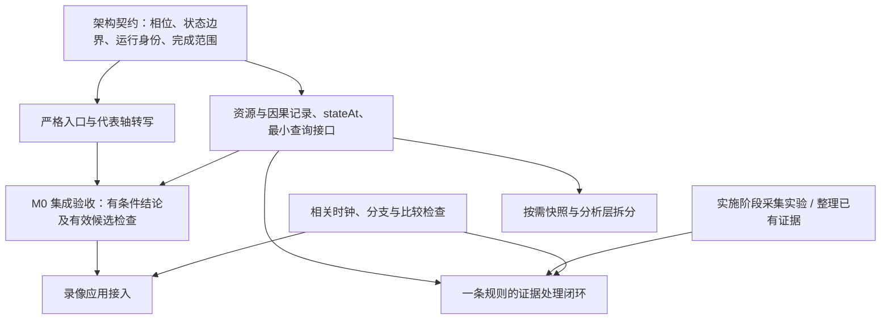

# 引擎底座路线图：Codex 独立审查与 v3.3 Stamp

首轮日期：2026-11-11。首轮对象：[engine-foundation-roadmap.md](engine-foundation-roadmap.md) 的 v3.1 工作区版本；同日对 v3.3 的复核见 §7。代码基线：`2a5e20c`，相对协同评审的 `6b1d7ab` 只有文档变化；首轮定向运行使用本机数据 `20261019`。

**最新结论（v3.3，2026-11-11）：STAMPED / APPROVED。** RR-01～RR-05 已在路线层面处理完整，全部 `done`；接受 Claude v3.3 的 7 处修订，同意进入底座架构设计草案。关闭依据与签署范围见 [§7](#codex-stamp-v33)。第 1～6 节保留 v3.1 首轮审查的论证，里面的“待处理”是当时状态。

**首轮结论（v3.1，历史）：方向认可，建议修订后再定稿。** 当时路线已经把大部分共识落成了可执行的任务，但有两处实现事实需要纠正，候选检查和阶段依赖也需要调整。它们会影响架构设计，不宜仅当作后续实现的细节。

本次只审查路线，不实施功能、不新增游戏实验。下文是 Codex 的审查意见，尚不代表另外两位接受这些修订。三方已关闭的 19 项方法议题继续有效；发现具体实现落点不完整时，应补正，而不把 `done` 当作免于复核的依据。

## 1. 已接受的前提与保留的方向

以路线图 §0.2 的用户最新决定为准：代表集已经选为 M0 EQ 严格转写与卜灵协奏未解案例；谐破位置由 Claude 读视频、用户确认；雷主首位绝息魄已经是配置事实；游戏实验安排在实施阶段。旧评审里的“待用户选轴”“雷主首位仍待确认”不再是当前阻塞项。

我认可并建议保留：

- **底座优先，以代表场景验收。** 教学轴、录像是检验执行与解释能力的使用者；先不扩展全角色内容或完整录像工具。
- **严格入口复用执行器。** 语法明确还不够，运行时要检查变奏等意图是否兑现，并如实返回失败与已执行范围。
- **查询先重算，诊断保持只读。** 固定 `stateAt(f)` 的世界帧开始边界；缓存、快照恢复和分析层搬迁后做。
- **四种输出分开。** 完整配置、执行观察、事件来源与数值输入、指定反事实比较各自承担有限承诺，父链不冒充全部依赖。
- **证据与采用分开。** 候选可以未实现，候选集可以不完整；未知状态要能交付，不能靠扩大实测量掩盖。
- **比较先判资格与覆盖。** 未观测、未知暴击、未执行到、对应歧义都应可见；总分不能替代这些判断。

依据是 [Codex 最终总结](codex-debate.md#codex-final-summary)、[Claude 最终总结](claude-debate.md#claude-final-summary)、[Antigravity 最终总结](antigravity-debate.md#antigravity-final-summary) 及 [Codex overall-review](overall-review-codex-20261108.md)。本轮重新核对了下面各项涉及的规格、实现与案例，没有把别人的评审结论直接当作代码事实。

## 2. 需要处理的审查项

编号 RR 是本次路线审查的编号，与原型缺陷 R01–R15、能力批次 P0–P4 分开。优先级“高”表示会写错执行契约或漏掉关键数据；“中”表示会误导验收或形成不必要的依赖。下列是首轮提出的问题；v3.3 的处理均已确认，当前状态见 §7。

| ID | 优先级 | 路线位置 | 需要改变的内容 |
|---|---|---|---|
| [RR-01](#rr-01) | 高 | §2.2 | 相位顺序与 TD-04、代码不符；冷却在 P6，`drain` 也不限于 P4 |
| [RR-02](#rr-02) | 高 | §4.3、§13 第 6 项 | 仅在 `resources.add` 采集，会漏掉延奏协奏清零 |
| [RR-03](#rr-03) | 中 | §9.3、§9.4 第 8 项 | 旧的 15 个替代取值不能直接作为严格轴的机制候选集 |
| [RR-04](#rr-04) | 中 | §9.1–§9.3 及依赖图 | P0 整包和代表轴确认不应挡住所有状态、资源与因果查询建设 |
| [RR-05](#rr-05) | 中 | §9.1 第 4 项、§9.3 阶段三/四 | 规则闭环需要最低限度的预测与观测比较，不能只由实验返回先后决定 |

<a id="rr-01"></a>

### RR-01：按现有规格写清相位，避免把一帧的合法性改掉

路线图 §2.2 写成了“P1 计时器与冷却 → P2 调度 → P3 动作推进与命中生成 → P4 事件队列 drain → P5 状态整理 → P6 帧末 buff 与到期”。这不是现有 TD-04 的相位定义。

[TD-04 §1](../wuwa-dps-td04-sim-kernel-v0.1.7.md) 与 [kernel.tick](../../src/engine/kernel.ts#L426) 一致：

| 相位 | 当前规格和实现 |
|---|---|
| P1 | 从时间膨胀窗口计算速率，并推进这些窗口的寿命 |
| P2 | 结束到期动作、执行指令；必要时判断仿真已经无事可做 |
| P3 | 推进动作和尾部，处理其时间线节点 |
| P4 | 结算判定；结算过程包含伤害、资源与触发 |
| P5 | 敌人量表的概念归属；当前不单设一步，更新分布在结算及计时器处理中 |
| P6 | 技能冷却、切人冷却，以及计时器钩子中的 buff、敌人状态等 |
| P7 | 推进战斗帧与世界帧 |

此外，`drain` 是在合适位置处理连锁事件，不是只在 P4 统一执行。[simulate.ts 的钩子](../../src/engine/simulate.ts#L35) 在 P2 的动作开始、P3 的资源节点、P6 的计时器处理后均会调用它。[switch.ts](../../src/engine/switch.ts#L78) 的延奏过程也有明确的调用顺序。

**为什么影响底座：** 假设进入世界帧 0 时，某技能还剩 1 战斗帧冷却，且战斗速率为 1。当前执行器在本帧 P2 看见的仍是 1；到 P6 才减成 0，下一帧才能按。如果按路线文字把它搬到 P1，就会早一帧放出。这样的偏差会直接污染 `stateAt`、`whyNot` 和严格轴的最早合法帧。

本轮用最小状态直接调用 `tick` 复核，观测为 `P2(f=0): CD=1 → 下一帧开始: CD=0 → P2(f=1): CD=0`。这是执行顺序的验证，不是游戏真实冷却时机的实测。

**建议修订：** 将 §2.2 改成上述七相位，并说明队列在哪些执行点被处理。保留已共识的 `stateAt(f) = 世界帧 f 开始、P1 之前`，不要为了迁就这段路线文字去改引擎。

**关闭条件：** 架构中的相位定义引用 TD-04；至少用“冷却剩 1 帧”“命中与 buff 到期同帧”“同帧多个触发”校验查询边界与事件顺序。已有用例能覆盖的直接复用。

<a id="rr-02"></a>

### RR-02：资源采集必须覆盖所有实际写入，`add` 不是唯一入口

路线图 §4.3 和 §13 第 6 项把采集位置定在 [resources.add](../../src/engine/resources.ts#L29)。它覆盖了许多获得与扣除，但没有覆盖全部资源变化。

具体反例是 [switch.outroTrigger](../../src/engine/switch.ts#L58)：延奏触发时直接执行 `c.concerto = 0`，随后写出已有的 `resource` 事件。这条路径不经过 `add`。大招扣费则经过 `grant → add`，不能把它也误报为遗漏。

本轮用 M0 EQ 的养成配置做最小复核：散华在场、协奏 100、只执行 `switch 椿`、关闭自动谐破。日志在世界帧 36 记录：

```text
char: 散华
resource: concerto
delta: -100
value: 0
cause: outro
```

若只监听 `add`，新的只读账本会漏掉这笔清零，与实际状态矛盾。初始资源也需要作为期初余额记录，不能凭空当作一次游戏内获得。

**这也是对先前共同方案的补正。** D-AG-04 的总结已经写过在 `add()` 采集，我此前也接受了这个落点。本轮核对表明，它只说明了主要入口，未覆盖直接清零。应补全采集范围，保留“只读、不补发业务事件”的共识；不能因为三方曾同意，就把技术遗漏带进正式架构。

**建议修订：** 路线只承诺“覆盖所有实际资源写入”，架构设计再选具体方式：可以在 `add` 与直接清零处分别旁路记录，也可以结合现有资源事件和命中资源信息构造统一视图。无论哪种方式，都要保留发生顺序、实际前后值与直接来源。不要为了统一接口，把清零随手改成 `grant(-100)`；“设为 0”与“减固定值”不是相同语义。

**关闭条件：** 对每个支持的角色/资源，在相同帧边界，`期初余额 + 实际变化量之和 = 查询状态中的余额`。至少覆盖获得、上限截断、大招扣费、延奏清零、角色钩子修改；未来状态同步另记外部调整。诊断开关前后业务事件、状态和触发次数保持一致。

<a id="rr-03"></a>

### RR-03：先确定候选在改变什么，再做严格轴的单项与两两检查

阶段一直接取 `assumptions.ts` 现有 15 个替代取值。问题不在数量，而在这组历史入口混合了机制候选与操作策略。

[flipsOf](../../src/engine/sensitivity.ts#L19) 当前直接展开所有 `adjust`，其中包含：

| 原有条目 | 实际改变的东西 | 严格轴下应怎样解释 |
|---|---|---|
| `earliest-frame → options.inputDelay: 6` | 每次符合条件的操作再晚 6 帧 | 改了执行策略，是手速/操作容错实验，不是固定最早合法执行下的机制替代 |
| `tune-break-auto → options.tuneBreak: off` | 禁止谐破，包括轴里手写的谐破 | 与包含明确谐破动作的输入冲突，不能作为“同一严格轴的机制候选” |

后者有直接证据：[canTuneBreak](../../src/engine/enemy.ts#L36) 第一项就检查 `off`。本轮构造同一个失谐、按钮可用的状态，`manual` 返回允许，`off` 返回“谐度破坏已关闭”。`off` 不只是禁止自动插入。

**建议修订：**

1. 严格基线固定轴、初态、环境及最早合法执行策略，只对明确列出的机制/数据候选做主表比较。
2. 操作延迟单列容错实验，说明改变了策略；“不放谐破”若要研究，另建明确改变动作的对照输入。
3. 在运行前按声明的含义检查配置与入口约定是否兼容，再生成有效组合；同一字段的两个取值不能配对，只是其中一条约束。
4. 因真实机制候选而导致的变奏失败、资源不足或轴无法完成，必须保留为结果。不能在运行后把这些失败删掉，再声称余下候选都稳定。
5. 报告分别列出有效候选、输入契约冲突、未实现、未列全及未检查的高阶组合。排除项写明理由。

这不削弱 CD-08 的“单项 + 有效两两组合”共识，而是在严格转写后重新确定它作用的集合。原自动谐破场景的 15/104 是历史运行的覆盖数，不是新场景的固定验收数量。

**关闭条件：** 阶段一的输出能清楚区分“机制一变，这条轴断了”和“试验本身已经改变/违背轴的输入约定”。两者都可见，但不混成一张机制稳定性结论。

<a id="rr-04"></a>

### RR-04：代表轴作为集成验收，不应成为底座所有能力的开工前提

§9.2 说能力批次不是串行工期，这点正确；但 §9.3 随后要求阶段一完成 P0 全部，并画出 `阶段一 → 阶段二`。按这条依赖执行，状态查询、资源账本和因果追问会等待：

- 致死一击的汇总修复；
- 录像 `fit` 的无观测评分修复；
- Claude 读出谐破位置并经用户确认；
- 全套严格轴单项与两两组合检查。

这些都是要做的工作，但不是所有 P1 能力的技术前置。`stateAt` 的冷却边界、延奏清零的资源账本、同帧两个到期事件的直接来源，已经可以用小场景推进。它们不需要先知道 M0 视频里在哪一帧放谐破，也不依赖击杀报告。

**建议修订：** 明确区分“可以开始开发”与“可以对外交付某种结论”。保留 M0 作为第一份集成成果，同时允许严格入口和执行查询各自从最小样例开始，在代表轴上汇合。P0 修复按影响它的消费者安排：输出击杀指标之前修 R10，输出录像评分之前修 R03，而不是把二者都作为查询执行器的先决条件。

这不是扩大并行范围或要求先搭完一套平台。首批查询仍限制在代表轴要解释的资源、切人、冷却与 buff，采用现有执行器重算。只是把实际不存在的依赖从图中拿掉。

**关闭条件：** 依赖图能说明每个阻塞项为什么必要；谐破位置尚待确认时，执行器边界、资源记录和查询测试仍有明确可推进的任务。两条线的集成验收仍使用用户已经选定的代表集。

<a id="rr-05"></a>

### RR-05：把最小证据比较放进规则闭环，不等完整录像工具

§9.1 写“哪个实验先回来，就拿哪条规则走第一次闭环”，阶段三承诺“一条共享规则走完收敛闭环”；但分项残差、匹配资格等 P2 能力全部在阶段四。这里缺的是最低交付要求，不是要求提前实现整套录像分析。

第一包可能先收到 A1 的面板/开场跳字，也可能收到角色状态保持的结果。前者可排查养成或公式，后者可以检验特定角色内容；它们不自动等价于验证了一条共享运行规则。观测即使有用，若没有候选预测、可比条件及区分能力，也不能只因“实验做过了”就称为收敛。

**建议修订：**

- 实验资料到达就登记；阶段三的验收样例按要检验的命题选择，不按回包先后选择。
- 阶段三至少交付一张简单的“候选 → 条件化预测 → 观测及误差范围 → 判断 → 采用决定 → 受影响场景重跑”记录。可以先用结构化表和少量程序比较，不要求完整视频匹配器。
- 先用已有证据走通一次处理流程，再用卜灵协奏这样的未解案例检查是否能准确交付“仍不可区分、还缺什么”。这与 §9.5 已列的已解/未解案例验收一致。
- 若阶段名保留“一条共享规则”，就选能检验共享规则的案例；角色机制或配置校准可以另作集成验收，写清实际证明了什么。
- “不可区分”可以是合格的证据处理结果，不应为了让阶段过关而强行选出赢家。它不能同时被标成“游戏机制已验证”。

§9.3 的“实验不依赖软件线修的任何东西”也应收窄为：**不依赖相关软件修复的采集与人工核查可以并行；使用仿真预测或比较工具下结论时，相关量尺必须先通过检查。** 游戏实验仍按用户决定，留到实施阶段。

**关闭条件：** 阶段三有明确的最小比较产物和适用范围；阶段四仍负责完整录像契约、匹配与残差工具。这样既不会因录像工具未完成而拖住规则收敛，也不会缺少可比依据就发布结论。

## 3. 建议的路线调整：保留目标，改细依赖

不建议重新发明一套 P 编号。保留原有能力分组，阶段的开发依赖改为下面的形状；箭头表示必要输入，不表示必须同一天开始或需要更多人。



图中的 M0 集成只需要首批查询字段，无须等全部 `whyNot` 和全事件类型解释完成。录像接入需要相应的比较能力；快照恢复不以取得游戏实验结论为前提。两者都不要求所有规则已经定案，未知范围继续显式保留。

相对于现有五阶段，我建议这样定义最小交付物：

| 交付点 | 实际可验收的产物 | 真正前提 | 可继续保留的缺口 |
|---|---|---|---|
| 架构草案 | 帧边界、状态范围、运行身份、完成状态、事件顺序；各能力落在哪阶段 | 修正 RR-01/02；明确 RR-03 的比较边界 | 具体字段和任务可在各阶段详细设计里完成 |
| 第一条严格运行 | 明确输入与意图；完整/失败/截断；固定身份下重复运行一致 | 严格入口；确认的手写谐破位置用于 M0 集成 | 不承诺游戏秒数与精确 DPS |
| 第一份可解释运行 | 支持字段的 `stateAt`、收支能对平、直接来源、最小 CLI JSON | 帧与事件语义、完整状态范围、诊断无副作用 | 全量事件解释、所有 `whyNot` 条件、缓存恢复可逐步补 |
| 第一份候选比较 | 同输入的规则候选与策略试验分列；有效单项/两两覆盖；失败保留 | 运行身份、完成范围、候选兼容性；对应输出使用的量尺正确 | 未实现、未列全、高阶未查明确披露 |
| 第一份证据闭环 | 条件化预测、观测、判断、采用与重跑关联；未解案例有下一项可区分观测 | 对应比较通道合格，相关候选可运行或注明不可运行 | 完整录像匹配器可后做；无需保证此次查明游戏机制 |
| 后续应用与效率 | 录像接入；有需要再加快照、恢复、分析层搬迁 | 已稳定的执行与查询契约；相关应用的量尺修复 | 不扩大成全角色或多版本服务 |

这条路线衡量的是底座能力：一次运行能否复现、状态能否解释、差异能否定位、证据能否改变或维持一个有条件的判断。代表轴给这些能力提供具体题目。

## 4. 架构设计前补一张“承诺 → 交付点”表

路线 §4 的目标足够清楚，但 `rulesRead / rulesDecisive`、运行身份、指定反事实比较没有在阶段表中得到同等明确的最小交付归属。若只实现表里写得最具体的项目，可能出现“能查状态、能沿父链追事件，但仍解释不出哪些规则实际参与了判断”的缺口。

建议在 §13 补下面的映射，细节留给架构设计：

| 承诺 | 最迟需要它的地方 | 初版边界 |
|---|---|---|
| 完整输入和运行身份 | 第一份候选检查报告 | 场景/初态/策略、规则与数据、实现及工作区变更身份；不要等完整台账建完才记录 |
| `rulesRead / rulesDecisive` | 第一份可解释运行 | 从列明的规则判定点做起；标明追踪覆盖。局部决定过某个分支，不等于全局反事实影响已证明 |
| 事件来源、数值输入与资源收支 | 第一份可解释运行 | 明确支持的事件/资源种类；未覆盖返回说明，不伪造完整解释 |
| 指定反事实 `diffRuns` | 第一份涉及“为什么必要/改变了什么”的结论 | 固定输入、规则差异和目标；先看双方覆盖，再对应事件。阶段一可以先只比较轮长、合法性等明确指标 |
| 观测资格与分项残差 | 第一份规则证据闭环 | 先支持少数明确观测字段；完整录像匹配、未知区间接入留给阶段四 |
| 能力说明与零干扰检查 | 每一份对外查询/比较结果 | 支持范围、缺口、失败原因可见；业务事件、完整支持状态、错误、RNG、汇总一致 |

其中“运行身份”无需先设计大型存储系统。早期可以是一份运行清单连同输入和结果文件，重点是日后能知道当时究竟跑了什么。

## 5. 其余应同步澄清的文字

这些不需要再开宏观辩论，但建议和上面几项一起修订，避免后续各自解释。

| 位置 | 建议 |
|---|---|
| §9.3 图、§9.5 “最终由用户选” | 改为“代表轴已选；谐破位置由 Claude 读出，待用户确认”。不要把已经作出的决定重新列为阻塞项 |
| §1.2 角色内容“不验收是否符合游戏” | 限定为“底座软件验收不要求全角色正确”；针对某条轴发布游戏结论时，它依赖的关键角色机制仍需证据或明确限制 |
| §0.1 “没证实的规则都能翻” | 实现承诺写成“已实现的候选可切换，未实现候选登记缺口”。未知候选不可能自动获得可执行模型，遵守 CD-05 |
| §4.4 零干扰 | 在事件、数值、错误、RNG、汇总之外，明确比较支持的完整状态，包括会影响未来的队列、ICD、钩子变量等。结果暂时相同不保证未来执行相同 |
| §5.3 焰痕“不能再拿来证明读法对” | 改为“可以作为参与模型选择的支持材料，不能再充当独立验证”。避免把校准证据误写成完全无效 |
| §7 卜灵“段中读数偏低” | 写明哪一边低。[录像复盘 §4](../replay-retro.md) 是仿真段中给得偏早/偏多，游戏较低；总量相符只提示优先查时机，不证明时机是唯一原因 |
| §9.4 输出模板“卡在 Y” | 区分“记录到等待 Y”和“Y 是轮长瓶颈”。后者需目标明确的对照，不能仅由等待次数或最长等待推出 |
| §3.4 多余 `!` 的提示 | 可以保留为信息；前动作自然结束时未发生取消，不自动等于意图失败。若未来要表达“必须在结束前取消”，应另有明确意图契约 |
| §9.5 “机制基线（游戏）” | 区分“由独立证据支持”与“在列明模型候选下结论稳定”。两者都可交付，但后者仍是有条件结论 |

## 6. 本轮验证与审查边界

除对照路线、三方收敛记录、相关 TD 与源码外，本轮执行了三个定向复核：

| 复核 | 结果 | 能证明什么 |
|---|---|---|
| `tick` 中剩余 1 帧冷却在 P2 的读数 | 本帧 P2 仍为 1，下一帧为 0 | RR-01 是规格转述错误，不需要进游戏来确定当前实现 |
| 散华满协奏切椿的最小运行 | f=36 发生 `resource: concerto -100, cause: outro`；直接清零不经 `add` | RR-02 的遗漏确实会影响实际资源收支 |
| 同一谐破可用状态切换 `manual/off` | `manual` 允许，`off` 拒绝 | RR-03 的 `off` 并非只关闭自动插入 |

按 AGENTS.md 执行了完整检查：`pnpm check && pnpm test && pnpm test:py`，全部通过；TypeScript/Svelte 检查无错误或警告，Vitest 为 54 个文件、644 项通过、37 项 todo，Python 为 71 项通过。这些检查说明当前软件回归状态，不验证路线里尚未实现的能力，更不证明游戏机制正确。

本轮没有修改引擎、数据、场景、正式 TD，也没有改写其他 agent 的回复。路线正文方案保留，只加入本审查的索引；以上五项仍需在路线中明确处理，不能把审查文件已写好视为方案已修正。

<a id="codex-stamp-v33"></a>

## 7. v3.3 复核：五项关闭，签署 Stamp

日期：2026-11-11。对象：Antigravity 合入意见后的 v3.2，以及 Claude 再修订的 v3.3。代码仍为 `2a5e20c`，没有新增游戏观测。

**确认达成共识，Codex Stamp：STAMPED / APPROVED（v3.3）。** 我同意这份路线进入底座架构设计，不再保留路线级的阻塞意见。理由是上一轮提出的行为边界、依赖调整和验收要求已落实到正文与架构交接表，而不只是写在回复中。

### 7.1 RR-01～RR-05 的关闭依据

| 项 | 本轮核对 | 决定 |
|---|---|---|
| RR-01 | 路线 §2.2 已按 TD-04 与 `kernel.tick` 写成七相位；冷却在 P6，多处 `drain` 和初始化边界有说明；§13 第 3 项补齐冷却、同帧命中/到期、同帧多个触发的验证任务 | `done` |
| RR-02 | §4.3 已覆盖期初余额、`add` 和 `outroTrigger` 清零，新增写入也须接账本；收支闭合与五类用例齐全；§4.4 以事件、支持的完整状态、错误、RNG 与汇总检查零干扰 | `done` |
| RR-03 | §9.4 第 8 项不再照搬 15 项：先区分机制/数据、操作策略、输入冲突，保留有效候选造成的失败；§13 留出兼容性声明；原 15/104 明确只属历史场景 | `done` |
| RR-04 | §9.3 的严格入口与 P1 查询可以各从微场景起步；M0 转写与不相关的 P0 报告修复不阻塞查询开发；D 集成只要首批资源/切人/冷却/buff 查询，完整 P1 后续补齐 | `done` |
| RR-05 | §9.1、§9.3 按命题而非回包先后选闭环样例；要求条件化预测、观测误差、判断、采用与重跑关联；相关量尺先合格，完整录像匹配后做，允许仍不可区分 | `done` |

上表的 `done` 关闭的是**路线如何处理审查意见**。新接口、新用例和游戏实测尚未完成，它们仍是后续阶段的验收任务。本轮没有把“设计里写了验收条件”混同为“实现已经通过验收”。

### 7.2 对 Claude v3.3 七处修订的回应

| 修订 | Codex 判断与依据 |
|---|---|
| 谐破位置恢复为待读出、用户确认 | 同意。代表轴已选不意味着位置也已转写；它是阶段一的输入任务，不阻塞 P1 微场景开发 |
| 保留“没证实的规则都能翻”，另写实现口径 | 同意。用户方向保持原意；已实现可切换、未实现登记、未知候选不编造，落实 CD-05 |
| P2 结束含义及初始化/结束 `drain` | 同意。`kernel.ts:431` 返回 false，`scheduler.runLoop` 结束；`simulate.ts:137/139` 分别处理初始化和退出循环后的队列。不能只说成“当前 tick 结束”后还继续下一 tick |
| 资源用例及写入入口 | 同意。再次搜索 `src/engine` 与角色模块，并核对 `hookContext.addResource → grant → add` 和 `fillCommand → grant`。初始化由 `initialState` 单列，运行中的直接写入仍是 `add` 与延奏清零 |
| 首批查询范围、交付点与阶段对应 | 同意。既避免整个 P1 成为首次集成的前提，也保留其余能力的后续交付要求 |
| 阶段一先经过架构和详细设计 | 同意。与用户“先理清路线，再做架构与实施”的安排一致，不因任务清单具体就提前开工 |
| 补同帧多个触发的用例要求 | 同意。与 RR-01 的关闭条件一致，能覆盖单个事件示例发现不了的顺序问题 |

本轮在路线正文仅做两处说明性勘误：冷却例子补“本 tick 战斗速率为 1、只比较冷却门槛”的前提；`tick` 注释引用更正为第 425 行。这使例子不被误读成全局时停中也会在下一世界帧冷却归零，没有改变执行语义。

### 7.3 其余意见与下一步的边界

- **首轮 §4 的承诺映射已落实于路线 §13.1。** 运行身份、`rulesRead / rulesDecisive`、来源与收支、指定反事实、最小观测比较、能力说明与零干扰都有首次交付点。
- **首轮 §5 的九处文字澄清已处理。** 代表集已定、关键角色机制仍影响游戏结论、未实现候选可登记、完整状态纳入检查、焰痕证据的用途、卜灵偏差方向、等待与瓶颈的区别、`!` 提示、机制证据与候选稳定性都没有再被混同。
- **不再要求新增一轮宏观辩论。** 类型签名、终止事件与帧查询的具体表示、完整状态字段、兼容性声明、隔离实现、测试组织均交给路线 §13 的架构设计。尤其要保留 P2 终止及最终队列处理这一事实，不能把终态直接当成该帧 P1 前的 `stateAt`。
- **Stamp 的范围是路线。** 同意底座目标、范围、开发依赖和分阶段验收；不宣称游戏已校准、TD 已合入或能力已实现。Antigravity 的 v3.2 Stamp 与 Claude 的 v3.3 回复原样保留，本确认只代表 Codex 对 v3.3 的认可。

### 7.4 本轮检查

重新执行 `pnpm check && pnpm test && pnpm test:py`，全部通过：TypeScript/Svelte 无错误或警告；Vitest 54 个文件、644 项通过、37 项 todo；Python 71 项通过。文档本地链接与 `git diff --check` 通过。与本轮开始时的副本逐项比较，只修改本文件和路线图，其他 agent 的回复原文完整保留。上述检查维持现有原型的回归基线，不代替后续新增契约的验收。
