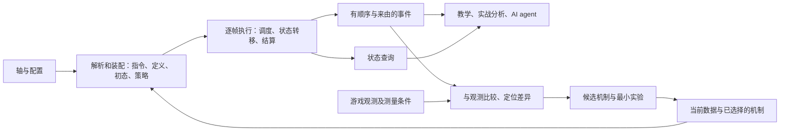
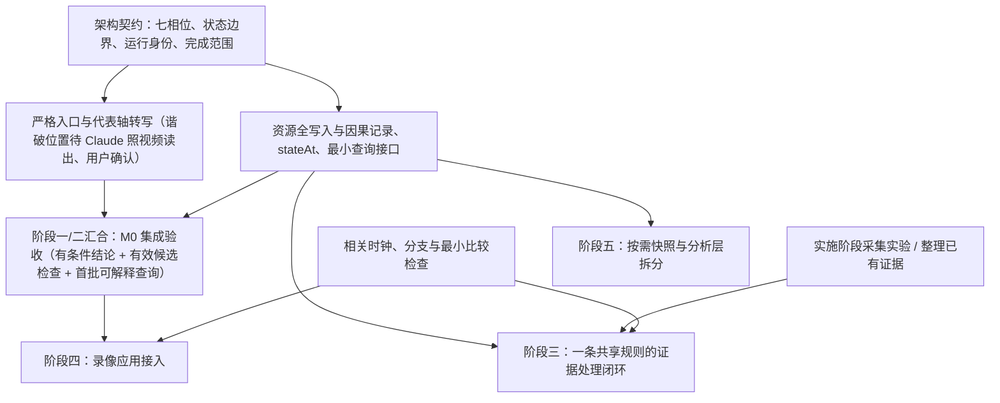

# 逐帧仿真底座：路线规划（执行契约、证据与差异收敛）

**版本**：
- v1：2026-11-07，Codex 初稿；
- v2：2026-11-11，Antigravity 合流三方评审；
- v3 / v3.1：2026-11-11，Claude 按共识重排路线、核对事实并补入用户决定；
- v3.2：2026-11-11，Antigravity 复核 v3.1（含附录 A）与 Codex 独立审查（RR-01～RR-05），合入全部修订并签署 Stamp；
- v3.3：2026-11-11，Claude 复核 v3.2，改正 7 处并签署 Stamp；Codex 复核确认 RR-01～RR-05 关闭并签署 Stamp；
- v3.3 Final：2026-11-11，Antigravity 复核确认 v3.3 全部修订并更新 Stamp，三方全票通过结为 Final 定稿版。

修订记录见附录 B，三方审查与 Stamp 状态见文末[审查记录](#review-log)。

**状态**：
- **Final 定稿版（v3.3 Final · 三方全票 Stamp）**：Antigravity、Claude、Codex 三方均已对 v3.3 签署 Stamp，Codex [路线审查](engine-foundation-roadmap-review-codex-20261111.md#codex-stamp-v33) RR-01～RR-05 在路线层面全部 `done`。本路线图正式结案，进入 §0.4 下一阶段“[底座架构设计草案](engine-foundation-architecture-draft.md)”。接口、命令和新的数据结构都还没实现，正式 TD 也还没合入。
- **Stamp**：Antigravity（v3.2 → v3.3 Final）、Claude（v3.3）、Codex（v3.3）已签。各自签署的版本与范围见文末[审查记录](#review-log)，不替其他作者扩大签署范围。
- **用户的决定**：2026-11-11 用户定了 v3 留下的几项，见 §0.2。

**基线**：代码 `6b1d7ab`（到 `2a5e20c` 之间只改了文档）；装配数据 `20261019`。

## 0. 这份文档管什么

- **管"底座怎么建"**：做什么、按什么先后、每一步怎样算完成、哪些不做。
- **契约以三方共识为准**：协同评审的 19 项议题全部 `done`，见 [Codex 辩论单](codex-debate.md#codex-final-summary)、[Claude 辩论单](claude-debate.md#claude-final-summary)、[Antigravity 辩论单](antigravity-debate.md#antigravity-final-summary)。本文只写这些契约落地的形状；合入正式 TD 以后以 TD 为准（§11）。
- **和评审的分工**：三份评审最终版（[Codex](overall-review-codex-20261108.md)、[Claude](overall-review-claude-20261108.md)、[Antigravity](overall-review-antigravity-20261108.md)）讲"为什么"，本文讲"怎么做、先做什么"。

读法：
- **方向、已定的事与文档的先后**：§0.1–§0.4；
- **目标与执行契约**：§1–§2；
- **各项契约的落地形状**：§3–§7；
- **现状与已知问题**：§8；
- **路线**：§9，包括阶段、批次、依赖、首批任务、验收、风险、要用户定的事；
- **实验线**：§10；
- **TD 合入路由**：§11；
- **工程纪律**：§12；
- **下一步，架构设计要定什么**：§13；
- **附录 A**：v3 对 v2 的更正，给 reviewer 核对。

### 0.1 路线要满足的方向（用户已确认）

1. **底座优先。** 教学轴是第一个要跑通的场景。录像剖析、深塔、矩阵是检验底座的应用，排在后面。
2. **教学轴是确定的。**
   - **一能按就按**：轴照这个假设执行；
   - **动作写明**：不用补位 `~`、可选 `?`，取消与谐度破坏都在轴里写明；
   - **出现不确定就改轴**：说明轴写得不对，不接受它。
3. **引擎自洽、确定。** 给定数据、规则、配置与轴，逐帧结果唯一；与游戏的贴合靠之后的收敛。
4. **结果变化只来自规则与数据。** 没证实的规则都能翻。
   - 实现上的口径（Codex 路线审查 §5、CD-05）：已实现的候选可以切换比较；已知但没实现的候选登记为缺口；不知道还有没有别的候选时，记"候选未列全"。不假定未知的候选自动就有可执行的模型。
5. **规则动态收敛。** 发现 → 登记 → 翻开关比较 → 针对性实验 → 证实或否定；换版后可能重开。
6. **结果说明自己用了哪些规则。** 包括全部开关的快照，以及实际影响了结果的那几条。
7. **追溯链路不丢。** AI agent 要能直接拿底座做分析。
8. **外力和核心隔开。** 钉时刻、直接改状态这类写法和核心隔开，结果里标明哪些状态是外部指定的。

原型是用来实验的，不是"沿着它改"的对象。原型里的 `~`、`?` 只用来调试，正式设计不需要。

### 0.2 用户已定的事（2026-11-11）

1. **代表轴**：`m0-video-eq.yaml`，加上卜灵协奏时机这个没解开的案例（§9.5）。
2. **代表轴的谐度破坏位置**：由 Claude 照视频读出来，用户确认（§9.4 第 9 项）。
3. **`~`、`?`、自动谐破**：留给调试和别的应用，不进底座契约（§1.3、§3.2）。
4. **中 3、中 4 雷主的首位是绝息魄**：候选 B-1 的前提成了配置事实（§7 案例、§10.2）。录像场景里现在还是天演溯心排第一，留到动工时按配置改正。
5. **实验真正动工以后再做**：做法在各阶段的详细设计里定（§0.4、§10）。现在的重点是：
   - 理清协同评审的产出；
   - 得到有共识基础的路线图；
   - 进而定下底座的架构设计。

### 0.3 协同评审的产出

| 文件 | 是什么 | 以哪部分为准 |
|---|---|---|
| [`codex-debate.md`](codex-debate.md)、[`claude-debate.md`](claude-debate.md)、[`antigravity-debate.md`](antigravity-debate.md) | 三方各自发起的辩论单，共 19 项，全部 `done` | 各单开头的最终总结，以及每项最后一轮回复；前面各轮是论证过程 |
| [`overall-review-codex-20261108.md`](overall-review-codex-20261108.md)、[`overall-review-claude-20261108.md`](overall-review-claude-20261108.md)、[`overall-review-antigravity-20261108.md`](overall-review-antigravity-20261108.md) | 三份评审的最终版：讲为什么 | 与辩论单的最终总结一致的部分；措辞不同时以辩论单为准 |
| `codex_vs_claude/`、`antigravity_vs_claude/`、`antigravity_vs_codex/` | 评审之间的两两对比 | 只作历史；其中的分歧都已进辩论单 |
| 本文 | 路线：做什么、先后、怎么算完成 | 合入正式 TD 以前，作为底座建设的依据 |

### 0.4 文档的先后

1. **路线图**（本文）：三方 review 后定稿。
2. **底座的架构设计**：下一份文档，要定的内容见 §13。建议先写成一份独立的草案，三方 review 后按 §11 合入总设计与各 TD。草案不推翻总设计 §4；要推翻时，按 AGENTS.md 先改总设计。
3. **各阶段的详细设计**：§9.3 每个阶段动工前写一份，定具体的任务、数据结构、用例；要进游戏的实验也在这里定做法。
4. **实施**。

## 1. 底座承诺什么

### 1.1 三层可信度

建议的目标：**给定明确的数据、机制、配置、初态与操作策略，确定性地执行战斗过程，允许查询状态和事件的来由；遇到游戏证据不符时，能复现、定位、排除候选原因，并明确剩下的不确定性。**

| 层面 | 可作出的承诺 | 主要验证方法 |
|---|---|---|
| 执行实现（verification） | 程序准确执行了声明的语义；输入相同时结果相同 | 微场景、手算、相位与边界测试、不变量、序列化一致性 |
| 数据与机制模型（validation） | 指定规则在列明的版本、配置和条件下得到证据支持 | 独立观测、受控实验、多个可区分条件的验证 |
| 本次分析 | 本次运行的输入、策略、误差与模型适用范围明确 | 运行记录、能力说明、相关假设与证据引用 |

- **程序确定性可以做得很强**；与游戏一致的程度，要按机制和适用条件一点点积累。
- **单一指标都不够**：测试数量、总 DPS 误差、"看起来贴视频"，都不能单独代表这三层。
- **出处**：这是成熟仿真方法里 verification（是否按规格实现）与 validation（是否在预期用途下符合真实系统）的区分，参考 [NASA 对模型验证的说明](https://public.ksc.nasa.gov/mns/faq/)。个人原型只借这个区分，按本项目规模实施。

### 1.2 四层边界（D-AG-06）

| 层 | 现在的代码（2026-11-11 核对） | 规模 | 怎么验收 |
|---|---|---|---|
| ① 执行器 | `src/engine/` 的 kernel、scheduler、switch、resources、triggers、buffs、enemy、formula、simulate、context | 10 个文件 2,430 行；另有装配 `resolve.ts` 369 行、类型 `types.ts` 464 行、不变量 `invariants.ts` 146 行 | 小用例、相位与边界测试、不变量、fuzz、conformance；几个不同角色的钩子集成 |
| ② 共享规则 | `src/data/gamedata.ts` 的 `Rules`（第 233 行）；假设表 `assumptions.ts`（40 条，14 条有 `adjust.path`）；TD-04～07 写下的规则 | 估计几十条命题 | 每条对照实验；先按一条代表轴的用途建基线 |
| ③ 角色内容 | `data/curated/characters/` 18 个模块 3,188 行，以及武器、声骸、dmg-join | 随角色增长 | 底座软件验收不要求全角色符合游戏（只验收钩子契约够用）；但针对某条轴发布游戏结论时，它依赖的关键角色机制仍需证据或明确列为限制 |
| ④ 分析与应用 | `src/engine/` 的 search、plan、cards、scorecard、insight、sensitivity、fit、optimize、matrix、analysis、sample、fuzz、calibration、trace | 14 个文件约 2,860 行 | 底座的使用者，不进底座验收 |

补充：
- **整个 `src/engine/`**：共 32 个文件、6,977 行。`summary.ts`（329 行）是报告层，介于 ① 与 ④ 之间。
- **分析层怎么切**：先定执行器的调用契约，再按需把 ④ 切到 `src/analysis/`（总设计 §10 的目录）。不先搬目录。

### 1.3 不做的事

- **不追全游戏校准**，也不追一个"引擎准确率"。
- **不建多版本游戏服务**（总设计 T15）。
- **不扩多目标、空间命中**（总设计 §4 的单目标），要扩另行设计。
- **不先为 HUD 写复杂模型**；不知道刷新规律时用读数区间。
- **不先做大重构**：不改成事件驱动的 reducer，不用 `Proxy` 追踪每次读写。
- **不先服务化**：先做纯函数与 CLI JSON，再按需包成 agent 工具。
- **不删原型里的 `~`、`?`、自动谐破**：它们留给调试和别的应用，不进底座契约（用户 2026-11-11 定）。

## 2. 执行契约

现有 `resolve / compileRotation / simulate` 已接近所需的结构：

- **编译与运行的分工**：实际执行时刻依赖资源、冷却、取消、时停和触发结果。编译阶段产出指令和约束；运行阶段推进状态、生成事件流。时刻要逐帧算出来，但对给定输入是确定的。
- **执行契约**：`(S[f + 1], E[f]) = step(S[f], Program, Model, Environment, Policy)`。
  - `S[f]` 是世界帧 f 开始时的完整运行状态，包含调度游标；
  - `E[f]` 按该帧内实际的执行顺序排列；
  - 抽样时，种子与 RNG 状态也是输入和状态的一部分。
- **候选机制在外层比较**：固定一组选定的模型，运行就是确定的；比较不同的候选机制，是在外层分别运行。

### 2.1 等待与阻挡的原因分三类

| 类 | 例子 |
|---|---|
| 所选模型下的游戏限制 | 能量不够、冷却没好、输入锁、核心资源不足、角色的 `canStart` 不满足 |
| 调度策略 | 默认等就绪（`settled`）、按意图推出的等待（§3.3）、自动谐破、`~`、`?`、手速延迟 |
| 外部给定的条件 | 录像的 `at`、`能量满`、`敌人 失谐 / 换` |

结果里按类标出，应用才分得清"游戏不允许""调度器替你选了时机""是你指定的"。

`!` 只跳过"等就绪"，照样要过 `gate()`（优先级、派生窗口、连段前置、输入锁）与 `stateVerdict()`（冷却、资源、`canStart`）。

### 2.2 同帧先后是语义的一部分（RR-01）

- **相位（以 [TD-04 §1](../wuwa-dps-td04-sim-kernel-v0.1.7.md) 与 `src/engine/kernel.ts:426` `tick` 为准）**：
  - **P1**：从时间膨胀窗口计算速率（`computeRates`），并推进这些窗口的寿命；
  - **P2**：结束到期动作（`endDueActions`）、执行调度指令（`schedule`）；若指令已空、三人空闲、没有存活的判定也没有尾部，整次仿真结束，这个 tick 不计入（`kernel.ts:425` 的注释，TD-04 §1 P2 ③）；
  - **P3**：推进动作和尾部（`advanceActions`），处理其时间线节点；
  - **P4**：结算判定（`settleJudgments`），包含伤害计算、命中资源发放与命中触发；
  - **P5**：敌人量表的概念归属（当前实现不单设一步，更新分布在结算与计时器处理中）；
  - **P6**：扣减切人冷却（`switchCd`）、技能冷却与充能（`cooldowns / charges`），并执行 `hooks.timers`（异常效应定时结算、敌人计时器、buff 寿命推进与到期）；
  - **P7**：推进战斗帧（`battleFrames += rates.battle`）与世界帧（`frame += 1`）。
- **事件队列 `drain` 的调用位置**：`drain` 不是只在 P4 跑一次，而是在多个状态跃迁点及时清空连锁事件——包括 P2 动作开始（`payCost` 后、`castResources` 后）与切人（`onSwitch`）、P3 时间线施放资源（`castGain`）与延奏触发（`outroTrigger`）、P4 判定结算（`settle`），以及 P6 计时器到期（`timers`）；另外，开局常驻 buff 与 `onResolve` 之后（`simulate.ts:137`）、仿真结束后（`simulate.ts:139`，最后一个 tick 在 P2 就结束时留下的事件）各处理一次。
- **为什么相位顺序不能写错**：以本 tick 战斗速率为 1、只比较冷却门槛为例，若误把冷却扣减当成在 P1，进入世界帧 `f` 时剩余 1 战斗帧冷却的技能，会提前在本帧 P2 通过冷却检查；按实际 P6 扣减，本帧 P2 看到的仍是 1，到 `f + 1` 帧 P2 才为 0。同一世界帧里先施加 buff 还是先命中、先回能还是先检查动作，都会改变结果，所以输出要显式带事件序号与相位/发生点，不能只靠时间戳排序。
- **状态的边界**：`stateAt(f)` 指世界帧 `f` 开始、P1 之前的状态；这一帧走完（P7 后）的状态是 `S[f + 1]`。查询某事件之前或之后，用事件引用。
- **初始化**：开局常驻 buff、`onResolve` 及其事件标为初始化阶段。`S[0]` 指初始化及其事件队列处理完成、第一个 tick（`f = 0` 的 P1）之前。
- **区间与时钟**：事件区间用左闭右开 `[from, to)`。世界帧、战斗时钟、动作局部帧按 TD-04，不另造时钟。

## 3. 严格教学轴入口（第一个场景；CD-01、D-AG-06）

严格教学轴是入口层的约定，用同一个执行器，不另造内核。

### 3.1 现在已经有的

- **`!` 与 `+N`**：`!` 跳过等就绪；`+N` 刻意晚 N 个战斗帧。
- **写了"变奏"的切人**：`switch <角色> 变奏`。
- **谐度破坏写成动作**：`<角色> 谐度破坏`，配 `tuneBreak: manual`，`xin-tower3-video.yaml` 就是这样写的。
- **通用动作可以直接写**：`闪避`、`极限闪避`等（TD-09 §2）。写打断它的动作并带 `!`，就是"用这个动作取消"。
- **等待与报错**：
  - 等待代码：`settled`、`airborne`、`entryBusy`；
  - 报错：`airEntry`、`entrySkill`；
  - 警告：`introMissed`。
- **场景的用途**：`purpose: rotation | replay`（`src/data/scenario.schema.ts:45`）。

### 3.2 编译期查写法

- **不允许的写法**：
  - `~`、`?`、`at`；
  - `tuneBreak: auto`；
  - 录像用的外部指令：`能量满`、`敌人 失谐 / 换`。
- **`tuneBreak: off` 的含义**：只表示"这条轴不打谐度破坏"，不等于还原了手写的位置。
- **怎么声明一条轴走严格入口**：在场景里声明，结果也就能带上"按严格入口跑的"。具体写法（`purpose` 加一种，还是单独一个字段）在 TD-09 定。

### 3.3 运行时查意图

调度器除了默认等就绪，还有三处按轴写的意图替轴选时机。它们算进"一能按就按"的定义，写进规格，结果里逐处列出。

| 意图 | 什么时候等 | 现在的等待代码 | 等完仍不成立时，现在怎么处理 | 严格入口 |
|---|---|---|---|---|
| 变奏切人 | 写了"变奏"、切出者协奏没满，等手上动作的判定出手（这几下可能正好补满） | `settled` | 照常普通切人，只记 `introMissed` 警告（`scheduler.ts:414`） | 意图未满足，失败 |
| 空中入场 | 切进来的第一下是空中攻击，等切出者跳起 | `airborne` | 报错 `airEntry`（`scheduler.ts:294`） | 意图未满足，失败 |
| 出场技 | 切进来的第一下是地面出场技，等切入者在后台的动作走完 | `entryBusy` | 报错 `entrySkill`（`scheduler.ts:310`、`:326`） | 意图未满足，失败 |

- **失败时给什么**：哪条指令、缺什么（例如协奏 92/100）、执行到了哪一帧。之后可以继续给带标记的诊断，但不算原轴成立。普通切入不算"变奏"成功，因为变奏动作、延奏 buff 和协奏清零都是轴的一部分。TD-09 §3.5 现在把 `introMissed` 写成警告，要改。
- **要补的区分**：变奏切人的等待和默认的等就绪现在共用 `settled`，结果里分不出哪一处是按意图等的。要加一个单独的等待代码或字段。

### 3.4 取消与谐度破坏

- **取消**（共识）：默认只写"用什么取消"，也就是写打断它的动作并带 `!`，按最早合法帧执行。可选写局部帧，那一帧不合法就报错。
- **多余 `!` 的提示**：写了 `!`、而前一个动作其实已经自然结束时，实际并未发生取消；严格入口输出一条提示信息（不自动判为意图未满足失败；若未来某条轴要强制表达"必须在自然结束前打断"，另立显式意图语法）。
- **谐度破坏**：写 `<角色> 谐度破坏`，不带 `?`。目标还没失谐就按 T7 等，等不来报错。

### 3.5 转写

- **原文写的是按键**：a / e / z / q / r / 闪 / 跳。同一个键在不同状态下出不同的动作，例如椿的 E 是 E1 / E2 / E3。
- **对应关系现在没有结构化**："按键 → 动作 ID"记在 YAML 注释和确认清单里，程序和 agent 读不到。
- **建议**：场景每一行能对回原文的哪几个记号、按什么读法。读法有疑问时，照 AGENTS.md 另存只差一处的对照场景。

### 3.6 结果里要带的

- **完整输入配置**：全部规则开关的快照、数据身份、走的是不是严格入口；
- **按意图的等待**：每一处的位置与类别；
- **叫法要附条件**：
  - **"上限"**：按最早合法帧执行的结果，不一定是时序最优。`insight` 的卡帧点里出现"晚一点反而更好"时，要作为提示列出；
  - **"必要"**：说某个动作"必要"，只指在这个起点、保留后面这些操作和目标时不能删。

### 3.7 夹具

新建 `tests/strict-teaching.test.ts`。每个夹具都写明初态、冷却、输入锁、动作定义与相位。具体帧数只在这些前提下成立（CD-01）。

1. **变奏切人成功**：等出手后协奏刚好满，成为变奏切人；
2. **变奏切人失败**：等完协奏 99/100，返回意图未满足和已执行的范围；
3. **空中入场**：能跳起时通过，不能时失败；
4. **`!` 对照**：同一初态下带不带 `!` 的帧差，以及后续命中；
5. **手写谐度破坏**：等到失谐再放；等不来时报错；
6. **编译期检查**：含 `~`、`?`、`at`、`tuneBreak: auto`、外部指令时报错。

## 4. 追溯与查询（CD-02、CD-04、CL-02、D-AG-04）

### 4.0 最小对外接口

下面是建议的能力名称，还不是已有的工具。先做纯函数与 CLI JSON，再按需包成 agent 工具，不先建服务。签名与类型在架构设计里定（§13）。

| 能力 | 输入 | 输出 |
|---|---|---|
| `compile` | 场景、所选模型、策略 | 装配后的程序、源指令映射、诊断（含严格入口的检查结果） |
| `run` | 程序、运行选项 | 结果及完成状态（完成 / 部分完成 / 意图未满足 / 报错）、有效时间范围、运行身份 |
| `stateAt` | 运行输入、世界帧 | 该边界的结构化状态与相关依据（§4.5） |
| `eventsBetween` | 运行、世界帧区间 `[from, to)` | 有稳定顺序和实例标识的事件 |
| `explainEvent` | 运行、事件引用 | 直接来源、记下的数值输入与局部规则检查、前后有关的状态；不声称是全部依赖 |
| 三种"为什么没发生" | 见 §4.6 | 见 §4.6 |
| `diffRuns` | 两次运行、比较对象 | 可比范围内最早的差异、实例对应、指定目标的变化；未执行到、歧义单列（§4.8） |
| `compareObservations` | 运行、观测案例 | 分项差异、匹配范围、不可比或歧义的原因（§6.2） |

返回值都是机器可读的数据。报错后只能查询已执行的范围。资源缺失、未知机制、没匹配到观测，都不能包装成"差异为 0"或"完整成功"。

### 4.1 对外四种输出

"这一下依赖哪些规则"不能只沿因果链往上找：规则常常通过时序、资源影响后面的事件。例如某条规则让一个动作晚了 6 帧，后面某个 buff 因此没赶上一下伤害，而这下伤害的因果链里根本没有那条规则。所以分四种输出，不宣称它们之间有包含关系，也不叫"下界 / 上界"：

| 输出 | 承诺 | 不承诺 |
|---|---|---|
| 完整输入配置 | 本次选了哪些规则、数据与策略 | 每一项都影响了结果 |
| 执行观察记录：`rulesRead`（读过）、`rulesDecisive`（在当时状态下改变了局部判定） | 某处读过规则，或改变了局部判定 | 改变了整局或某一下的结果 |
| 事件来源与数值输入 | 谁直接触发；用了哪些 buff 实例和公式因子 | 所有历史上的时序影响 |
| 指定反事实比较 | 换成列明的候选后，指定的事件、区间、指标怎样变 | 所有候选组合、所有场景都如此 |

"这一下依不依赖某条规则"，只由指定的反事实比较回答。

### 4.2 事件字段：只加字段，不加新事件

- **事件序号**：一次运行内单调递增的事件序号。
- **直接父事件**：`triggers.ts` 的 `drain` 处理第 i 条事件时，新产生的事件都由它引出，父事件就是这个下标。现在 `bus.current` 的 `Link` 只有 `{ depth, root }`，处理完就丢了。
- **总线以外的来源**：不在 `drain` 里产生的事件，另写相位、原因、对象。例如 P3 时间线生成的判定、P6 到期的 buff、调度器开始的动作。
- **延后生效的效果**：判定、尾部这类在创建时就带上来源，不能等生效时再找。
- **`Link.root` 保留**：它继续承担伤害、资源的业务归属（TD-11"谁引发的算谁"）。
- **为什么不加新事件**：`drain` 把日志当队列处理，钩子会收到每一条，加新事件会多触发钩子、改变事件链（Codex R05）。

做完这些，`trace.ts:234` `walkOwners` 的两种错归就都没有了：
- **同帧多个到期**：同一帧几个 buff 一起到期，它们引出的事件会全算到最后一个头上；
- **队列交错**：E1、E2 先后入队时，E1 引出的事件写在 E2 之后，按顺序扫会被认成 E2 引出的。

### 4.3 资源统一成只读视图（R14、RR-02）

- **现状**：
  - 绝大部分获得与扣除经过 `resources.ts:29` 的 `add`（命中给的资源写在 `hit.gains` 只有增量；其余经 `grant` 写成 `resource` 事件，有增量也有变化后的值）；
  - 但 `switch.ts:66` 的 `outroTrigger` 在延奏触发时直接写 `c.concerto = 0` 并记 `resource` 事件（`cause: 'outro'`），**不经过 `add`**（清零语义是"设为 0"，不是"减 100"，不为了凑接口把它改成 `grant(-100)`）；
  - 此外，`r.initial.{energy, concerto, core}` 是开局期初余额，不是战斗内获得。
  - 目前不变量检查（`invariants.ts:70–126`）、汇总、调试表因此各自重放一遍。
- **做法**：资源只读视图必须**覆盖所有实际的资源写入路径与期初余额**（架构设计可在 `add` 与 `outroTrigger` 清零处分别旁路采集，或结合 `initial`、`resource` 事件与 `hit.gains` 构造统一账本）：
  - **期初余额单列**：初始资源记为 `期初余额`，不当作一次战斗内获得；未来录像回放的状态同步（§6.3）另记为外部调整；
  - **只记实际修改**：不补造零增量的记录，也不多发 `resource` 业务事件；
  - **收支闭合条件**：对每个支持的角色与资源，在任意帧边界满足 `期初余额 + 实际变化量之和 = stateAt 查询状态中的余额`；
  - **报差额分两个口径**：资源获得量（未按上限截断），以及到上限后的实际库存。被上限截掉的增量不当作可见状态。
  - **用例至少覆盖**（RR-02 的关闭条件）：获得、上限截断、大招扣费、延奏清零、角色钩子修改；诊断开关前后，业务事件、状态与触发次数一致。
  - **现在的写入入口**（2026-11-11 Antigravity 与 Claude 各自核对过）：运行时直接改写能量 / 协奏 / 核心资源的只有 `resources.ts` 的 `add` 和 `switch.ts:66` 的清零。角色钩子走 `ctx.addResource → grant → add`，`能量满` 也走 `grant`。以后新增写入入口，要同时接进账本。

### 4.4 诊断旁路与零干扰

- **诊断走独立的记录通道**：状态快照、规则判定说明等诊断，走独立的只读通道，或作为不产生业务事件的附加字段。它们不能增加钩子调用、改变事件链深度，也不能消耗业务实例编号或 RNG。
- **验收（要自动化）**：开关诊断前后，去掉诊断字段再比较，业务事件、数值、报错、RNG、汇总，以及**所支持的完整运行状态（含队列游标、内置冷却 `lastTrigger`、角色钩子 `vars` 等会影响后续执行的状态）**要逐项一致。

### 4.5 `stateAt`：先靠重算

- **第一版靠重算**：从相同输入重算到指定边界，返回与运行隔离的拷贝。
- **覆盖的字段**：
  - 动作与资源：前后台的动作与局部帧、连段锚点，资源、冷却与充能；
  - 钩子与 buff：钩子的 `vars`，buff 实例与内置冷却；
  - 飞行中的：判定、尾部；
  - 环境：敌人状态、膨胀窗口；
  - 簿记：调度游标、事件队列的簿记、实例计数器、RNG。

  展示用的共鸣回路文字、冷却轨道（P6 采集）不是完整状态。
- **成本还不知道**：敏感度矩阵 24 个场景 × 15 个开关用了 180 秒，平均每次仿真约 0.47 秒；长轴上要实测。之后的缓存只是优化，缓存的键要覆盖场景、初态、数据、规则、代码与种子。
- **暂停与恢复放到最后**（§9 阶段五）：只从定义好的 tick 边界恢复，先审计 `Sim` 里的簿记。"能 `structuredClone`"不能当作恢复正确的证明。

### 4.6 三种"为什么没发生"

| 问法 | 输入 | 输出 |
|---|---|---|
| 这个动作此刻能不能放 | 边界状态、角色、动作、操作约定 | 检查过的条件、挡住的原因、相关值；写明是第一个挡住的条件还是全部条件（现在调度器多处遇到第一项就返回） |
| 这条事件为什么没触发某个效果 | 一条真实发生的事件、效果 | 在实际检查点记下的条件；不用帧末状态反推 |
| 假如此刻发生某事件会不会触发 | 隔离的状态、明确的假想事件 | 结果，标为"假想"，不能当作历史 |

- **每个条件的状态**：满足 / 不满足 / 没检查（前面的已失败）/ 不适用 / 没建模。
- **查询本身不能有副作用**：`triggers.ts:146` 的 `firing` 会写 `lastTrigger`（内置冷却），检查一下就改了状态，所以要有只读版本。角色自定义的 `canStart` 也要在只读或隔离的上下文里求值。

### 4.7 buff 窗口差几帧（`buffWindowMargin`）

- **针对具体实例**：针对和这一下相符的具体 buff 实例，记剩余帧，或刚离开了几帧。
- **记退出原因**：现有 `buffExpire` 的 `reason` 是 `timeout | switchOut | removed`。被换人移除的，不能按自然到期算余量。
- **只是提示**："余 18 帧"只提示值得检查窗口，不表示提前 18 帧就能吃到，更不说明游戏用了相同的窗口。
- **不冒充预知**：从完整日志事后标注时，可以知道"将要挂上"；只读当前状态的 `stateAt` 不能冒充知道未来。

### 4.8 跨运行比较

- **对应状态**：对应明确 / 新增或消失 / 歧义 / 未分析。
- **句柄分开**：运行内的事件句柄和跨运行的结构键分开。
- **没跑到不等于消失**：另一条运行提前停了的，对目标事件记"未分析"，附停止原因和执行范围。只有双方都覆盖了相应的逻辑段、对应又明确时，才报"新增或消失"；即便如此，也只是这次改动后的运行结果，不是游戏里的必要条件。

### 4.9 给应用和 agent 的能力说明

- **每次输出都附说明**：
  - 用了哪些模型能力；
  - 碰到了哪些假设、哪些状态是外部指定的；
  - 哪些相应的观测通过、哪些冲突；
  - 哪些行为没建模。

  数值公式、资源、时间、敌人场景的验证范围可以分开说。
- **由应用决定适不适用**：接口允许在带假设的模型上继续确定性地计算，由应用决定某个结论是否适用。底座不输出一个包办一切的"引擎准确率"。

## 5. 规则台账与版本（CL-01、CD-05、CL-05）

### 5.1 台账的四块

| 块 | 写什么 |
|---|---|
| 命题身份 | 一条能单独证伪的游戏事实，有稳定的名字；写明适用范围 |
| 候选 | 已知的几种读法，每种注明当前是否采用、能否运行。没有开关的候选也入账，记为未实现；不知道还漏了什么的，记"候选未列全"，不编备选 |
| 证据条目 | 挂在具体候选和条件上（版本、配装、敌人、初态）；带三种版本身份（§5.4）；注明用途：提出模型、挑选候选，还是独立检验。参与过挑选的证据，不能再当独立检验 |
| 当前结论 | 证实（所测条件内）/ 否定 / 分不清 / 暂定（只有建模证据）/ 未验证 / 证据冲突 / 超出模型；引用支撑它的证据条目 |

"当前采用哪个候选"和"证据到了哪一步"是两个维度，可以同时是"采用 A、分不清"。

### 5.2 怎么拆、放在哪

- **按命题拆，不按调用或文字拆。**
  - `module-guess` 在 12 个角色模块里有 17 次调用、16 种说明文字，但 16 种文字也不等于 16 条命题。心的一句说明里就有三个能分别证伪的点。
  - `rules.forteKeepOnSwitch` 同时管心的照世相和卜灵的卦象，要拆成两条（`verify-guide` B1、B2 本来就分开测）。
- **唯一的权威索引放在 `src/engine/assumptions.ts` 旁**，原始材料留在原处，文档由它生成。引用检查（`TrackedId` 一类）只能保证 ID 存在，不保证规则含义对、分支都登记了。
- **执行约定也入账**：有可观测后果的执行约定（例如同一 tick 里 P2 先于 P4），链到对应的游戏命题。
- **按影响逐步补**：不要求先补齐全游戏。现有的影响等级按 DPS 写，要补上门槛（能不能变奏、能不能开大）与容错类的影响。

### 5.3 证据要按它实际能区分的东西挂

- **转相到照世·E 的时间**：它检验的是出招优先级，挂在"心转相的 255 帧切人锁"下面只能算旁证。
- **卜灵卦象那一局录像**：切走前后卦象都是空的，"保留"和"清空"两个候选都预测为空，不能写成"录像支持清空"。
- **焰痕的两个跳字**（19482、9606）：可以作为参与模型选择的支持材料，但不能再充当独立验证（independent validation）。

### 5.4 版本更新以后

- **版本分三种身份**：
  - 观测对应的游戏版本、日期与条件；
  - 数据材料的版本（xlsx 文件名日期、SHA-256、资源版本）；
  - 运行用的代码与输入（提交号、工作区有没有未提交的改动、curated 与钩子、场景初态、实际生效的开关、种子、输出 schema、完成状态）。

  不同身份的版本号不能直接比大小；现在的 `GameData.version` 是 xlsx 文件日期，不是游戏版本；版本不详就写"未知"。
- **旧观测保留**：作为当时条件下的证据保留，当前能否沿用另行评估。
- **沿用不升级**：数据没变不等于机制没变，沿用的证据不升级成"新版已实测"。
- **结果写明来源**：写成"观察来自 V1、本次按 V2 推演、相关规则沿用待复核"。
- **自动复核是待实现的能力**：现在构建只定位 xlsx、核对哈希、输出计数、flag 与交叉核查，没有"变化的字段 → 受影响的规则"这一步。原型先对高影响规则人工维护引用与复核记录。

### 5.5 数据字段按类型看

| 字段 | 现状 | 怎么对待 |
|---|---|---|
| 倍率、基础属性 | 与 Wuthery 解包核对：已连接的伤害条目 2681/2681 倍率一致 | 基本可信 |
| 帧数 | 公开解包里找不到逐项基准；WuwaLAB 143 个有伤害的动作对上 111 个，各项都一致的 48 个，且它的帧含顿帧 | 线索，靠录像与实验复核 |
| 语义：备注、空格子、"下落"行、技能文字 | 只能人读 | 风险最高 |

- **主要风险在读法**：影响最大的几次修正多是读法或共享规则错了，不是数错了。例如雷主大招的全局时停没读出来，心队稳态从 48,470 变为 54,322。
- **修一处、扫全库、做成 flag**：每修一个错，都问"全库还有几处同样的写法"，再做成 flag。`landingUnshifted`、`priorityValueMissing`、`dilationTypeGuess` 都是这样来的。
- **消掉 flag 只说明采用了某种处理，不等于证实**。
- **其他来源也只是线索**：几个站点共享同一上游，不算独立支持。AI 整理的资料标的置信度不是证据。

### 5.6 字段的证据条目

对正在研究的字段或规则，保存一条轻量的证据条目（v1 §5.1）：

| 信息 | 用途 |
|---|---|
| 字段 / 规则的键 | 讨论的对象，例如某角色某判定的协奏到账时机 |
| 原始出处与值 | xlsx 的哈希、sheet / 行 / 列，解包条目，文本或录像片段 |
| 处理过程 | 单位换算、列映射、推断、curated 覆盖及理由 |
| 当前采用的值 / 解释 | 与实际装配结果对应 |
| 其他候选与冲突 | 保留没排除的读法，不覆盖原始证据 |
| 验证状态与范围 | 在哪个版本、形态、链数、装备、敌人条件下得到支持 |
| 实验与回归的引用 | 支持或反驳它的案例；改动后要重跑什么 |

- **先覆盖少数字段**：差异案例涉及的少数字段，以及多个队伍共用的高影响规则。已有的正常字段继续用现在的来源信息，不把整个数据仓库重写成证据系统。
- **生成数据的规矩不变**：生成数据仍只由构建脚本写，覆盖仍在 `data/curated/`。
- **来源冲突先并列和定位**，不靠多数投票决定。

## 6. 观测、比较与录像（CD-03、CD-06、CL-03、D-AG-02、D-AG-05）

教学轴阶段只用到 §6.1 和 §6.2 的报告层修复；§6.3 的录像契约在阶段四做。

### 6.1 校准观测

- **写明时钟**：每个观测按实际的量法写 `clock: world | battle`。
  - **按视频时间量**：世界秒；
  - **按深塔倒计时量**：战斗秒；
  - **`loop` 是观测的种类**，不是第三种时钟。
  - **现状是契约冲突**：`calibration.schema.ts:23` 与 `docs/calibration/README.md` 写的是世界秒，`calibration.ts:21` 实际取的 `span.endT - span.t` 是战斗秒。
  - **做法**：旧写法兼容为战斗秒；人造日志"10 世界秒 / 6 战斗秒"要分别得到 10 和 6。
- **跳字写明分支**：`branch: crit | nonCrit | unknown`，缺省 `unknown`，两支都列出。现在 `calibration.ts:40` 自动挑接近的那一支，只能找到相容的解释，证明不了那一下确实暴击了。
- **观测带条件与精度**：
  - **条件**：配装、敌人、环境、初态，未知的写未知；
  - **区间**：时刻与数值都可以是区间。资源环目测约 80%，记 `[0.75, 0.85]`；
  - **事先定判定**：容差在看到拟合结果之前定；
  - **帧率**：30 帧录像不能用秒乘 60 得到逐帧精度。
- **观测的用途**：给定条件、提出或挑选模型、独立检验。同一项读数不能既用来强制指定状态，又拿来证明模型预测对了这个状态。

### 6.2 比较与贴合度（R03、R15）

现在 `fit.ts` 的问题：
- **不是一对一**：录像动作找 10 秒内最近的同名动作（`EVENT_WINDOW`，第 30 行），两条观测可以对上同一下；
- **参照会跟着变**：切人类型的参照从候选自己的 `r.commands` 读（第 42 行），改了轴，参照也跟着变；
- **加权和掩盖问题**：总分把各项按 `FIT_WEIGHTS` 折成秒相加（第 93 行），会掩盖覆盖与冲突；
- **缺失反而得分更好**：只有一个观测时，匹配误差 9 秒大于缺失罚分 5 秒，删掉这个动作，总分从 9 降到 5；
- **其他**：全部失配时得 0 分；没有单下跳字的通道；翻开关与改轴的候选混在一张榜里。

改法：
1. **先对应，再比残差**：按同角色、同动作链局部保序、一对一匹配，参照固定在录像的观测上；有多个合理候选时保留歧义。
2. **先把关资格与覆盖，再排序**：以下几种先作为资格与覆盖信息返回：
   - 缺失、截断、已确认的类型冲突；
   - 没有有效观测、窗口没覆盖。

   只在覆盖相同、没有定性冲突的同组候选里，用总分排序。没有有效观测时"不可评估"，不报 0 分。
3. **分数只用于排序**：没有概率意义；规则候选与改轴候选分表。
4. **比较结果带状态**：至少分"通过 / 冲突 / 没匹配上 / 歧义 / 条件不足"（v1 §9.2）。

### 6.3 录像的输入与外力（阶段四）

- **录像分三种时段**：
  - **已观测的动作**：包括闪避、跳跃；
  - **已知空闲**：要有依据确认没有新的、会影响当前模型的战斗输入。"没有跳字"不够；纯跑位只有在声明的空间近似下、确认不影响所问的问题时，才能用等待表示；
  - **未观测**：显式写填法，分别报告。两种填法不当作上下界，落在它们之外只排除这两种填法。
- **状态同步**（新指令，名字在 TD-09 定）：
  - **缺省不发业务触发**；旁路记下采用值、前值、差额、相位与被跳过的触发；
  - **从第一次补全起，下游都标为有条件推演**；
  - **差额不等于机制缺口**，补满资源也恢复不了隐藏的历史（何时达满、内置冷却）。
- **外来事件与补状态分开**：`敌人 换` 这类外来事件，作为显式输入，写清触发策略。
- **不改调度器里补位的停止条件**：理由是输入缺失不能靠调度器去猜。"`~` + `at`"从输入层面淘汰；现有录像场景暂时保留，新写法落地后再替换。
- **现有指令是旧行为**：`能量满` 走 `grant()`、会发业务事件，改个名字不等于满足新契约。

## 7. 差异的收敛流程（CD-07、D-AG-03）

**读已有材料时，从上游往下查**：
1. **确认比较成立**：单位与时钟、配装与环境、起点、转写、模型覆盖范围。条件不够时返回"缺什么"。前面"10 世界秒 / 6 战斗秒"的例子，根因就在比较层，不用进游戏。
2. **先对应事件，再算误差**：按 §6.2。
3. **分通道看残差**：事件与顺序（含变奏 / 普通）、时间间隔、资源与形态、buff 覆盖、单下跳字、累计血条。先判资格，再排序。
4. **找最早有证据的偏差**：稀疏的游戏观测只能定位到"最早检测到的偏差"，不能保证此前的隐藏状态都对。

   例：卜灵协奏切走时总量相符，但段中仿真给得偏早/偏多、游戏录像读数较低（`replay-retro.md` §4）；总量相符提示应优先查到账时机或时刻对齐，而不是直接减总量（同时不预判时机是唯一原因）。
5. **缩小要解释的过程**：沿执行时记录的来源回溯，缩成仍能复现同一偏差的小场景。因果记录只覆盖已建模、已记录的关系，漏写的机制不会自己出现，要对照原文与观察。

**做实验时，自下而上隔离**：
6. **分清是哪一类未知**：

   | 未知的种类 | 怎么继续 |
   |---|---|
   | 读表、别名、单位、时钟、报告取值错误 | 修相应层，并全库扫同类写法 |
   | 行为已知、参数未知 | 在有依据的范围里扫参数 |
   | 触发条件、到账时机、叠加、时停规则不同 | 写成少量离散候选，比较各自的预测 |
   | 转写、命中次数、开局条件不同 | 另建场景候选，原场景不改 |
   | 缺空间命中、敌人阶段等能力 | 写明模型范围，或另做扩展；不用倍率抵偿 |
   | 现有观测下几个候选分不开 | 返回分不开的候选，以及需要增加的观测 |

   "调参"与"发现规则"是两回事：一个跳字满足 `伤害 = 攻击 × 倍率 × 其余乘区`，仅凭它分不清攻击和倍率各自对不对，优化器跑多少次也补不出没观察到的信息（参考 [A protocol for dynamic model calibration](https://arxiv.org/abs/2105.12008)，本项目只借"可辨识性"这个提醒）。
7. **做能区分原因的实验**：
   - **先列候选与预测**：每个候选写全触发点、时钟、时长、目标与适用条件，事先算好该看到的数；只排除写全了条件的那个候选；
   - **按问题选用隔离工具**：单人裸打对面板与跳字、逐个加 buff 看比值、低资源起点看收支、按切人分段比间隔。不是每个问题都要走完；
   - **怀疑交互时做四种组合**：都没有、只有 A、只有 B、A 和 B 都有。
8. **固化成回归资产**：
   - **留下什么**：案例、观测、条件、被否定的候选、采用的读法、修复位置、容差与适用范围、最小回归用例；
   - **快照与实测分开存**：程序当前输出的快照（`tests/scenarios.test.ts`）和游戏观测加容差（`docs/calibration/points.yaml`）分开存。

**结局有五种**：修了实现或数据的错、候选在条件内得到支持、参数范围缩小、现有观测分不清、超出模型。后两种也是进展，不硬把误差凑到零。

**案例：中 4 心第 1 轮**。方法已三方 `done`，事实转入证据台账。详见 [Claude 评审 §6 第 7 条](overall-review-claude-20261108.md)与 [CD-07](codex-debate.md#cd-07)，这里只记要点：
- **现象**：录像 / 仿真的比值，开头 1.083 / 1.077，之后 1.031 / 1.036，最后 1.000。
- **候选 B-1**：雷主首位从天演溯心换成绝息魄，没有可调参数，两类伤害的残差就变成同一个数 1.0437，照世·E-2 从 1.031 变成 0.9996。
  - **前提已确认**：用户 2026-11-11 确认首位是绝息魄，所以 b ≈ 0.119 基本可以归到场景的配置写错了。
  - **还要复核**：场景按配置改正后重跑，预期两类伤害只剩共同的约 1.044。这是预测，改正后要核对。
- **镇寰宇**：按 B-1，录像的比值（1.1222）要求两条 15 秒的 buff 在镇寰宇时都还在；仿真里它们早 18 个战斗帧就到期了。这是"B-1 的要求"，不是"已观察到游戏里还在"。
- **m ≈ 1.044 仍未知**，与 B10 分开设计。
- **窗口边界怎么读**：读心变奏入场到镇寰宇起手的深塔倒计时差 G。判法见 §10.2。
- **仿真列要能复现**：对照表的仿真列要由可复现的命令生成，附代码、数据与场景的身份；旧表把镇寰宇写成 195,198，当前代码是 180,256，旧表的"后段对上"已作废。

## 8. 现状：已知问题

编号用 [Codex 评审](overall-review-codex-20261108.md) 的 R01–R15，三份评审都按这套引用。位置是 2026-11-11 在 `2a5e20c` 上核对的。

| R | 问题 | 位置 | 批次 |
|---|---|---|---|
| R01 | `loop` 校准：注释写世界秒，实际取战斗秒 | `calibration.schema.ts:23`、`calibration.ts:21` | P0 |
| R02 | 同帧多个 buff 到期时，事后推的来源会串 | `trace.ts:234` `walkOwners` | P1 |
| R03 | 录像动作可重复匹配同一下；全部失配也得 0 分 | `fit.ts:30`、`:93` | P0（"不可评估"）、P2（一对一匹配） |
| R04 | 只有展示轨道，没有完整的状态查询 | `simulate.ts` | P1 |
| R05 | 日志同时是触发队列，新增诊断事件会改变执行 | `triggers.ts` `drain` | P1 |
| R06 | 跳字按接近的暴击分支比，没有 `unknown` | `calibration.ts:40` | P0 |
| R07 | 字段选择的依据分散在数据、模块与文档 | — | P3 |
| R08 | portable / conformance 只覆盖装配输入与运行输出，不等于运行时可恢复 | `portable.ts` | P4 |
| R09 | 两人各给的同名 buff 在汇总里混成一条 | `summary.ts:306` `buffUptime`（键是"buff→目标"）；`types.ts:309` `buffApply` 没有提供者 | P0 |
| R10 | 按击杀拆分伤害时，致死一击被窗口右端排除 | `analysis.ts:39` `dpsBreakdown` | P0 |
| R11 | 到了帧数上限只记警告，截断的窗口照常进比较 | `scheduler.ts:486` `runLoop` | P0 |
| R12 | 文档状态与"已处理的 flag"容易被当成已验证 | README、正式文档、构建 | P3 |
| R13 | 假设名、开关与独立的游戏命题不一一对应 | `assumptions.ts`、`module-guess`、`forteKeepOnSwitch` | P3 |
| R14 | 资源有两种记法，下游各自重放 | `resources.ts` / `hit.gains` | P1 |
| R15 | `fit` 不含单下跳字，开关与改轴候选混排 | `fit.ts` | P2 |

严格教学轴入口的几项（§3）不在 R 编号里，放进 P0：
- 编译期检查；
- 意图未满足即失败（`scheduler.ts:414` 的 `introMissed`）；
- 按意图的等待单独记。

## 9. 路线

### 9.1 排序的理由（RR-04、RR-05）

1. **先让量尺和报告不说谎。** 时钟、暴击分支、同名 buff、致死一击、截断，这些错会让后面所有比较一起出错，而且全是纯软件问题，不用进游戏。其中每个 P0 缺陷只阻塞依赖它的消费者（例如输出击杀指标前修 R10、输出录像评分前修 R03），不作为启动 P1 执行器状态/资源/因果查询开发的先决条件。
2. **教学轴是第一个集成验收场景**，所以严格入口和"有效机制候选的单项 + 两两组合"检查放在最前。第一份集成成果是一条代表轴的有条件结论，同时允许严格入口与 P1 查询能力在架构契约确定后各自从微场景并行起步、在代表轴上汇合。
3. **追问的能力围着同一条轴汇合验收**：因果、状态查询、"为什么没发生"先在微场景跑通，再用代表轴做第一轮集成验收，之后扩大。
4. **规则闭环按所检验的命题与最小比较要求推进（RR-05）**：
   - **什么时候做**：实验在真正动工以后才做，做法在阶段三的详细设计里定（§0.2）；
   - **和软件线的关系**：不依赖软件修复的原始录制与人工核查可以和软件线并行（D-AG-01）；但凡使用仿真预测或比较工具下结论时，相关的量尺（时钟、分支等）必须先通过校验；
   - **怎么选闭环样例与交付什么**：实验资料到达即登记，但阶段三的验收样例按**能否检验一条共享运行规则**来选（角色特化内容或面板/配装校准可另作集成验收并写明实际证明了什么），不单纯按回包先后选。阶段三至少交付一张结构化的"候选 → 条件化预测 → 观测及误差范围 → 判断 → 采用决定 → 受影响场景重跑"记录（不等待阶段四的完整录像匹配器）；"现有观测下仍不可区分、还缺哪项观测"同样是合格的闭环结论，不强行选出赢家。
5. **录像剖析放在后面**（方向第 1 条）：录像契约（§6.3）和完整的贴合度改造在阶段四做；P0 只修"没有可比数据时报 0 分"这种会误导的输出。

### 9.2 能力批次 P0–P4

批次名沿用 Codex 评审 §9.2，v3 把严格入口并进 P0。它们是能力分组，不是串行的工期。注意：这套 P0–P4 与 `engine-quality-plan.md` 原有的 P1–P6 是两套编号。

| 批次 | 内容 | 完成标准 |
|---|---|---|
| P0 量尺、结果状态与严格入口 | R01、R06、R09、R10、R11；R03 的"不可评估"；严格入口（§3） | 10 世界秒 / 6 战斗秒各自对；两份同名 buff 不丢；致死一击能解释；截断不冒充完整；没有有效观测时报"不可评估"；`strict-teaching` 夹具全过 |
| P1 执行可查 | R02、R04、R05、R14：事件序号与直接来源、诊断旁路、资源只读视图（覆盖全部实际写入与期初余额）、`stateAt` 重算、三种"为什么没发生" | 同帧两个到期不串来源；任意帧边界期初余额 + 变化量之和 = 状态余额；诊断开关前后事件、数值、状态、RNG 逐项一样；`stateAt` 与直接执行一致；查询没有副作用 |
| P2 差异可定位 | R03 的一对一匹配、R15；分通道残差、最早偏差；录像契约（§6.3） | 9 秒 → 5 秒的反例不再得高分；能区分单位错、漏动作、资源时机；分不清时保留候选 |
| P3 规则有证据（贯穿各阶段） | R07、R12、R13：台账（§5）、按命题拆开关、证据入账、有效机制候选的单项与两两组合检查口径 | 已解决的案例能追到依据；未解决的案例写得出缺哪项观测；改规则不破坏已支持的案例 |
| P4 调用与效率 | R08：统一的 CLI JSON 查询接口；按需快照与恢复；分析层切出 | 从头执行、重算查询、恢复续跑一致；agent 不用读网页、不用猜单位 |

### 9.3 阶段、开发依赖与最小交付物（RR-03、RR-04、RR-05）

| 阶段 | 目标 | 包含 | 完成后能说 | 还不能说 |
|---|---|---|---|---|
| 一 | 第一条严格教学轴交付有条件的结论 | 严格入口与相关 P0 量尺；P3 的有效机制候选检查口径（从 `assumptions.ts` 筛出与严格轴输入兼容的机制/数据候选，操作策略与输入冲突项单列，见 §9.4 第 8 项）；两两组合检查工具；代表轴转成严格轴 | 这条轴在严格入口下能执行，或在哪条意图上失败；所选模型下每轮几秒、记录到哪些等待（或经对照确认的轮长瓶颈）；在列明有效机制候选的单项与两两组合下，哪些结论不变、哪些候选会让轴断掉 | 游戏里也是这个秒数；三项以上的组合；没列出的机制；精确 DPS |
| 二 | 这条轴的每一帧都能追问 | P1 全部；P4 的最小 CLI JSON 查询 | 支持的字段在任意帧的状态（与执行一致，资源收支闭合）；首批事件的直接来源与数值输入；某个效果没触发时，哪些条件没满足 | 某一下的"全部依赖"；游戏里也如此 |
| 三 | 一条共享规则走完收敛闭环 | P3 的台账结构；能检验共享规则的已有证据或实施阶段实验（§10）及最小结构化比较表 | 这条规则在所测条件下证实、否定或分不清（明确下一项可区分观测）；受影响的结论已带版本重跑 | 推广到没测的条件或别的版本 |
| 四 | 录像剖析接入新契约 | P2 全部；把中 3、中 4 按新写法重记 | 录像与仿真的对应、覆盖、分项残差、最早偏差；哪些是有条件推演 | 贴合就是机制对；补状态就是恢复了历史 |
| 五 | 快照恢复、分析层切出、换实现对拍 | P4 剩下的部分 | 恢复续跑与从头运行一致；换语言实现时能对拍 | 没存输入的旧运行还能重跑 |

**开发依赖图（箭头表示真正的必要输入，不让代表轴转写或 R10/R03 阻塞 P1 查询开发）**：

图里的 D 只要求代表轴要解释的那一批查询字段（资源、切人、冷却、buff），不用等全部"为什么没发生"和全部事件类型的解释；阶段二表里"P1 全部"在 D 之后逐步补齐。

**六个关键交付点的最小可验收产物与真正前提**：

和上面阶段的对应：
- **阶段一**："第一条严格运行""第一份候选比较"；
- **阶段二的首批**："第一份可解释运行"；
- **阶段三**："第一份证据闭环"；
- **阶段四、五**："后续应用与效率"。

| 交付点 | 实际可验收的产物 | 真正前提 | 可继续保留的缺口 |
|---|---|---|---|
| **架构草案** | 七相位与 `drain` 边界、完整状态范围、运行身份、完成状态、事件顺序；各能力落在哪阶段 | 采纳 RR-01/02；明确 RR-03 的候选分类边界 | 具体字段细节和任务拆分可在各阶段详细设计里完成 |
| **第一条严格运行** | 明确输入与意图；完整 / 意图未满足 / 截断；固定身份下重复运行一致 | 严格入口；用户确认的手写谐破位置（用于 M0 集成） | 不承诺游戏真实秒数与精确 DPS |
| **第一份可解释运行** | 支持字段的 `stateAt`、期初+变化=余额收支对平、直接父来源、最小 CLI JSON | 帧与事件语义、完整状态范围、诊断零干扰检查通过 | 全量事件解释、所有 `whyNot` 条件、缓存与快照恢复可逐步补 |
| **第一份候选比较** | 同一严格输入下的机制/数据候选主表与策略容错试验分列；有效单项/两两覆盖；因候选导致的断轴失败原样保留 | 运行身份、完成范围、候选与严格入口的兼容性检查；对应输出量尺正确 | 未实现、未列全、三项及以上未查明确披露 |
| **第一份证据闭环** | "候选 → 条件化预测 → 观测及误差 → 判断 → 采用决定 → 重跑关联"表；未解案例给出下一项可区分观测 | 对应比较通道与量尺合格，相关候选可运行或注明未实现 | 完整录像匹配器在阶段四做；无需强行保证此次定案游戏机制 |
| **后续应用与效率** | 录像剖析接入；按需加快照恢复、分析层目录搬迁 | 已稳定的执行与查询契约；相关应用的量尺修复 | 不扩大成全角色校准或多版本服务 |

每个阶段动工前先写详细设计（§0.4）。

### 9.4 阶段一的首批任务（架构设计定稿后，按阶段一的详细设计开工）

按 §0.4 的先后，这些是阶段一详细设计的输入，不是现在就动工。都不用进游戏。每项都配用例；改了引擎的跑 `pnpm conformance`、`pnpm fuzz`。同时，不依赖 M0 手写谐破位置的 P1 微场景任务（事件序号与直接父来源、全路径资源账本、`stateAt` 重算）可在架构契约确定后并行启动。

1. **校准观测的时钟（R01）**：
   - **改什么**：`calibration.schema.ts` 加 `clock`，旧写法兼容为战斗秒；`calibration.ts` 按时钟取值；同步改 `docs/calibration/README.md`；
   - **用例**：人造日志，分别得到 10 世界秒、6 战斗秒。
2. **跳字的分支（R06）**：
   - **改什么**：加 `branch`，缺省 `unknown`，`unknown` 时两支都列出残差；
   - **用例**：一个暴击、一个不暴击、一个不知道。
3. **同名 buff 的提供者（R09）**：
   - **改什么**：`buffApply` / `buffExpire` 加提供者字段（只加字段）；`buffUptime` 按"buff→提供者→目标"统计，再显式聚合；
   - **用例**：两人各给同名 buff，先后到期。
4. **致死一击（R10）**：
   - **改什么**：`dpsBreakdown` 的右端处理；区分含溢出的伤害与有效扣血；
   - **用例**：一下打死。
5. **截断（R11）**：
   - **改什么**：把完成范围与"目标达到没有"传到汇总、对比与搜索；
   - **用例**：最后一个动作没放完就到了帧数上限。
6. **贴合度的"不可评估"（R03 的 P0 部分）**：
   - **改什么**：没有有效观测时，不再报 0 分；
   - **用例**：锚点全部失配。
7. **严格入口（§3）**：
   - **改什么**：编译期检查、意图未满足即失败、按意图的等待单独记；
   - **用例**：`tests/strict-teaching.test.ts` 的六个夹具；
   - **要同步改的规格**：TD-09 §3.5。
8. **两两组合检查工具与候选分类（RR-03）**：
   - **做什么**：`pnpm sensitivity <场景> --pairs`（写法待定）；
   - **先按改变的对象分类过滤，不把 `flipsOf()` 的 15 项不加区分混进严格轴主表**：
     - **机制 / 数据候选（进严格轴稳定性主表）**：在固定轴、固定初态、固定最早合法执行策略下，仅改变游戏机制或数据读法的候选；
     - **操作策略 / 容错试验（单列）**：如 `earliest-frame`（`options.inputDelay: 6`），改变的是操作延迟策略，归入容错分析；
     - **与严格轴输入契约冲突的项（排除并说明理由）**：如 `tune-break-auto`（`options.tuneBreak: off`），在 `enemy.ts:36` `canTuneBreak` 中会连轴里显式手写的 `<角色> 谐度破坏` 一并禁止，违反了含手写谐破严格轴的输入前提（若要研究"全程不放谐破"，应另建删掉谐破指令的对照场景）；
   - **保留失败结果**：在有效机制候选下，若某候选导致变奏失败、资源不够或轴中断，必须作为"该机制候选下此轴不成立"的结果原样保留，绝不能在跑完后删掉失败行再宣称余下候选稳定；
   - **输出**：有效机制候选集、策略试验单列项、因输入冲突排除的项（附理由）、未实现与未列全项、单项与有效两两组合的结果（含失败项），结尾写"该有效集合的单项及两两组合已查，三项及以上未查"。
9. **代表轴转成严格轴**：
   - **前提**：代表轴已由用户选定为 `m0-video-eq.yaml`；谐度破坏位置还没读，由 Claude 照视频读出、用户确认（§0.2），这一步本身就是阶段一的任务；
   - **怎么改**：另存 `m0-video-eq-手写谐破.yaml`（配 `tuneBreak: manual` 与手写谐破指令），原场景不改；
   - **产出**：用严格入口跑通，用任务 8 检查，写出第一份有条件结论，格式如下（区分"记录到等待 Y"与"经对照确认 Y 是轮长瓶颈"）：
     > 按最早合法帧执行，第 2–3 轮每轮 X 战斗秒，记录到等待 Y（其中经对照确认影响轮长的瓶颈为 Z）；按意图的等待 N 处（列表）；有效机制候选集（列表）单项及两两组合已查，结论在 {…} 下保持不变、在 {…} 下变为 …（或断轴失败）；操作容错（+6f）单列结果为 …；因输入冲突排除的项：…；三项及以上未查；未实现 / 未列出的机制：…；依赖的未证实规则：…

### 9.5 验收两级（CD-08、D-AG-01）

| 级 | 怎样算通过 | 不能据此声称 |
|---|---|---|
| 执行器与观察工具（软件） | 列明支持的状态与事件，边界小用例通过；查询与诊断不改变运行（含支持的完整状态一致）；身份、截断、外推、匹配失败不丢；几个不同角色的钩子走通；已解的真实案例（散华 E、焰痕）和一个分不清的案例（卜灵协奏时机）各走完一遍 | 所有模型都符合游戏 |
| 某一用途的机制基线（游戏） | 先按一条代表轴做：列出关键规则与条件；区分**① 由独立游戏证据支持**与**② 在已列明有效模型候选的单项与两两组合下结论保持稳定（仍属有条件结论）**；其余作为限制随结论交付 | 全角色、全版本、任意未知组合都对 |

- **两级不相乘**：不合成一个"全引擎准确率"。
- **诊断完整 ≠ 结论可发布**：一个分不清的案例诊断记录完整，可以通过第一级；但它的候选若会改变精确的切人帧，这个精确结论就不能标为已验证。
- **影响等级要补**：现有的影响等级按 DPS 写，覆盖不了"提前几帧会断变奏"这类教学轴关心的问题。

**已选定的代表集**：`m0-video-eq.yaml`（代表轴），加上卜灵协奏时机这个没解开的案例（用户 2026-11-11 已确认，§0.2）。
- **为什么选它**：轴里没有 `~`、`?`；转写已由用户逐条确认；有视频对时。
- **还差一步**：原文件用的是缺省的自动谐度破坏，关掉后稳态 DPS 40,472 → 37,577；谐度破坏位置还要由 Claude 照视频读出、用户确认，再写进严格轴，重新跑单项与有效两两组合验收。
- **现在能说的只是有前提的模型结论**：前提是原配置（自动谐破）、第 2–3 轮。
  - **单项**：原 15 个替代取值逐个翻，14 个下每轮仍是 25.00 秒；
  - **两两组合**：在原 104 个组合里查出两对"单项都不变、组合后变了"的：
    - "大招过场里的自身顿帧 × 声骸起手优先级"，25.117 秒；
    - "声骸起手优先级 × 关闭谐破"，25.233 秒；
  - **手慢一点（策略容错）**：每个决策点晚 6 帧时是 25.57 秒，25 秒的周期不再保持（第 2、3 轮仍各有 9 个世界帧在等椿 E1 的冷却）；
  - **只查了原配置的时长**：这些只查了原自动谐破配置下的每轮时长，不能外推到新写的手写谐破严格轴。
- **暂缓**：
  - 精确的稳态 DPS：C1 若成立就降 1.8%，谐度破坏的手写位置也待合入；
  - "散华重击一松手就切维里奈"的精确切人帧：依赖 `burst-release`。

**验证语料各能证明什么**（v1 §8）：

| 语料 | 检查什么 | 单独证明不了 |
|---|---|---|
| 人造微场景 | 程序是否按明确的语义执行，边界与相位对不对 | 游戏真的用这条语义 |
| 构建 / 公式对拍 | 转换与公式的实现符不符合参照 | 参照本身没有误差 |
| 短的游戏实验 | 特定条件下的资源、规则和数值 | 所有角色、所有上下文都一样 |
| 实战 / 教学回归 | 多个机制组合起来有没有新冲突、原有现象有没有保持 | 一局总量贴合，就验证了全部机制 |
| 独立实现对拍 | 两个实现遵不遵守同一套语义 | 两边没有继承同一个错误假设 |

- **先补已有用例**：给已有用例补明确的契约和缺口，不重复写同样的测试。
- **首批要查的共享边界**：
  - 同帧的施加、到期与命中顺序；
  - 施放与命中给的资源，溢出与分配；
  - 取消前后与尾部，后台动作；
  - 切人与出场技；
  - 全局时停与顿帧；
  - 冷却与充能；
  - 同时到期的触发；
  - 资源的主动指定。
- **变形测试要写明成立条件**：例如固定命中序列、其他条件不变时加攻击，伤害不应下降；加属性同时改变了形态、触发或窗口时，不能拿单调性判错。
- **每条重要机制一行验证范围**：规格明确程度、用例、游戏证据、已覆盖的条件、反例与冲突、依赖的机制。换一个参数或规则时，就知道该重跑哪些验证。

### 9.6 风险

| 风险 | 怎么应对 |
|---|---|
| 代表轴的谐度破坏位置读错，阶段一的结论跟着偏 | Claude 照视频读出、用户逐处确认；有疑问的位置另存对照场景 |
| 实验推后，阶段一、二的结论只能停在"有条件" | 结论照样带上依赖的未证实规则与已查的组合范围；阶段三再升级 |
| 诊断字段意外改变执行（钩子看到新字段、消耗编号或 RNG） | 零干扰的自动比较先于诊断功能上线（§4.4） |
| `stateAt` 重算在长轴上太慢 | 先在长录像上实测；必要时加缓存，缓存的键覆盖全部输入 |
| 台账维护成本高，变成填表 | 只为代表轴的关键规则建；按影响逐步补；候选不知道的写"未列全" |
| TD 没合入期间，三份评审、路线图、TD 各说各的 | 按 §11 合入；合入后以 TD 为准，本文只留路线 |
| AI 写的技术断言出错（v2 就有一批，见附录 A） | 作为决定依据的断言附可核对的来源，由作者以外的一方核对一次（CL-04） |

### 9.7 不在这条路线里的

- **教学轴解释**（[`rotation-explanation-plan.md`](../rotation-explanation-plan.md)）：是建在底座上的应用，阶段二之后再接；
- **新角色、新队伍的模块**：属于内容库，按需做；
- **网页的外观**：网页的外观不在这条路线里；
- **深塔、矩阵的新场景**：它们只作为检验用的场景。

### 9.8 要用户定的

v3 留下的五项，用户 2026-11-11 都定了（§0.2）。架构层面还要定的（例如严格入口怎么声明、诊断通道的形态），放进架构设计（§13），定不了的再问用户。

## 10. 实验与证据任务（候选清单；CD-07、CD-08、D-AG-01）

按用户的安排（§0.2），实验在真正动工以后才做，具体做法在各阶段的详细设计里定。这一节只是候选清单，以及分包的原则。

### 10.1 两包实验

题号与内容以 [`verify-guide.md`](../verify-guide.md) 为准。实验按账号与目的分包，不按 DPS 敏感度挑：手册开头"15 分钟先做五项"的排序是按 DPS 敏感度排的，回答的是另一个问题。

| 包 | 账号 | 项 | 对应的规则 / 假设 | 设计要点 |
|---|---|---|---|---|
| E1 | everbird（心 · 雷主 · 卜灵） | A1 心的面板 + 开场 AAA | 公式、倍率、防御抗性这几层的锚点 | 面板截图 + 跳字 |
| | | B1 心转相后切走，照世相保不保留 | `forteKeepOnSwitch` 的心那一半 | 和 B2 分开记成两条命题 |
| | | B2 卜灵的卦象切走再切回还在不在 | `forteKeepOnSwitch` 的卜灵那一半 | 同上 |
| | | B7 卜灵大招放出后最早什么时候能切人 | `ult-no-switch`（"不响应输入"挡切人） | 连按切人键，录像数帧 |
| | | B10 雷主超负荷与无归的谬误的两条"全队攻击 +10%"叠不叠 | 同类 buff 的叠加（共享规则） | 四种组合：都没有、只有超负荷、只有无归的谬误、两者都有 |
| | | B11 五雷荡煞阵的冲击波给不给心霆心域 | `summon-as-char` | 保持手册原条件（心在后台）；翻过来心队各轴约 −6% |
| E2 | Evariste（椿 · 散华 · 维里奈） | C1 烬华蔓舞转完会不会自动出第 4 段 | 椿的动作（成立的话 M0 视频轴 −1.8%） | |
| | | C4 普通切人入场后先闪避或跳一下，再按 A 还算不算出场技 | `entry-skill` | |
| | | C5 椿大招后最早什么时候能切人 | `ult-no-switch` | 做法同 B7 |
| 待设计 | — | 声骸起手优先级 | `echo-input-priority` | M0 代表轴两对组合效应的交汇点；手册里还没有这一项；对别的队伍要不要优先测还没定 |

- **算上全部成本**：每项事先写好控制条件与每种读法的预期数字。手册里的分钟数只是操作时间，换号、重置、录制、失败重做、读数与入账另计。
- **不承诺定案**：不承诺几分钟定案几条规则。

### 10.2 不用进游戏的证据任务

心第 1 轮的案例属于录像剖析，剩下的两项留到阶段四的详细设计里做。

| 任务 | 状态 | 做法 / 判法 |
|---|---|---|
| 雷主的首位（中 3、中 4） | **已定**：用户 2026-11-11 确认是绝息魄 | 动工时把 `xin-tower3-video.yaml`、`xin-tower4-video.yaml` 的雷主声骸改成绝息魄排第一（AGENTS.md：场景照配置写）。这会改场景快照与 `tower-20261026.md` 里的数，所以和重跑一起做。`xin-team.yaml` 是教学轴的配置，不跟着改（已有对照场景 `xin-team-r5-绝息魄.yaml`） |
| 窗口边界 | 阶段四 | 读心变奏入场到镇寰宇起手的深塔倒计时差 G；记两端的录像帧范围、读数区间、HUD 刷新与隐藏情况，并说明可见的入场 / 起手怎样对应 buff 施加与命中。判法见下 |
| m ≈ 1.044 的来源 | 阶段四 | 读同时段队友的跳字比值、看心的面板；与 B10 分开。"队友约 1.000"只反驳明确预测"队友同比例受影响"的候选 |

窗口边界的判法：
- **支持**：由上述依据得到的"施加到命中"间隔整个落在 15 秒以内；
- **冲突**：整个超出 15 秒；
- **分不清 / 条件不足**：跨过边界，或端点对应不了。不靠调钉点让它贴上。

还有几条限制：
- **精度另算**：显示位数不等于测量精度，±0.05～0.10 秒只是待检验的估计；
- **不用模型修正观测**：模型里的 1–2 帧不能拿来预先修正观测；
- **支持也不过度推论**：即使支持，也不单独确认首位、m 的来源或唯一的时钟错误。

## 11. 合入正式文档的路由

讨论关闭不等于已经写进正式文档。实施到相应批次时，同步改下面这些：

| 文档 | 要并入的 | 出处 |
|---|---|---|
| [总设计](../wuwa-dps-engine-tech-design-v0.2.4.md) | §2 / §10：四层边界 §3.3、§6.5：严格教学轴入口 §10.1、§11：四种输出、零干扰验收 §11、§12：两级验收与批次 §13：`forced-disharmony`、`forced-energy` 与状态同步的假设 §14：作为决定依据的断言要非作者核对 T15：证据带三种版本身份 T16：假设表扩成台账 | D-AG-06；CD-01；CD-02、CD-04、CL-02、D-AG-04；CD-08、D-AG-01；CD-03、CL-03、D-AG-02；CL-04；CL-05、CD-05；CL-01、CD-05 |
| [TD-01](../wuwa-dps-td01-data-dictionary-v0.1.11.md) | §1：以后做"版本差异 → 规则"的关联 §13–14：flag 与台账的关系、"修一处扫全库" | CL-05；CL-01 |
| [TD-02](../wuwa-dps-td02-types-schema-v0.1.12.md) | 事件序号与来源字段、`buffApply` 的提供者 资源只读视图 台账条目 输出与跨运行对应的类型 校准观测的 `clock` / `branch` 录像时段与状态同步 | CD-02、CD-04；CD-05；CD-06、D-AG-05；CD-03 |
| [TD-04](../wuwa-dps-td04-sim-kernel-v0.1.7.md) | §1：`stateAt` 与 `S[0]` 的边界、`[from, to)` 诊断旁路 | CD-04、D-AG-04 |
| [TD-06](../wuwa-dps-td06-resources-v0.2.4.md) | 资源只读视图 状态同步与差额的两个口径 | CD-03、CD-04、D-AG-02 |
| [TD-07](../wuwa-dps-td07-buff-system-v0.1.2.md) | 同名 buff 按提供者统计 触发诊断的只读版本、`buffWindowMargin` | R09；CD-04、D-AG-04 |
| [TD-09](../wuwa-dps-td09-rotation-scheduler-v0.1.11.md) | §2–§4：严格入口的声明与检查、意图未满足、取消的写法、录像时段与状态同步的写法 §3.5：`introMissed` 由警告改为失败 | CD-01、D-AG-06；CD-03、D-AG-02 |
| [TD-10](../wuwa-dps-td10-output-report-v0.1.17.md) | §2–§6：R09–R11 的报告修复 贴合度的资格与覆盖 "单项 + 两两组合"的检查口径 反事实比较 | CD-06、CD-08、D-AG-05 |
| [TD-11](../wuwa-dps-td11-debug-calibration-v0.1.3.md) | §1、§4、§5：两阶段方法、候选写全条件、观测帧与模型帧分列 §6：调试工具与查询 | CD-07、D-AG-03；CD-02 |
| [TD-12](../wuwa-dps-td12-web-v0.2.7.md) | §2.1：录像剖析的有条件标注 | CD-03 |
| 其他 | [`docs/calibration/README.md`](../calibration/README.md)：`clock`、`branch`、仿真列带身份 [`verify-guide.md`](../verify-guide.md)：按账号与目的分包、B10 四种组合 AGENTS.md："推断要打 flag / 登记假设"与台账的关系 | CD-06、CL-04；CD-08；CL-01 |

这些都没有推翻总设计 §4 的取舍。以后要推翻，按 AGENTS.md 先改总设计并记入附录 C。

## 12. 工程纪律

- **遵守既定取舍**：固定 60 fps 的世界步长、三种时钟、缺省按期望值、纯库、数据与钩子分开、只维护当前版本、单目标。查询与诊断先复用执行器。
- **非作者核对**（CL-04）：合成正式设计或回写 TD 时，错了会改变模块职责、默认执行规则、可比性或验收条件的技术断言，要附可核对的来源（代码位置、可复跑的命令），由作者以外的一方实际核对一次。只读过就同意不算核对；日常原型改动不加这个门槛。
- **改动的顺序与用例**：新增字段先改 schema；改机制配用例；改公式跑 golden；改构建或数据按 AGENTS.md 重建与校验。
- **每次任务结束**：跑 `pnpm check && pnpm test && pnpm test:py`；改了引擎再跑 `pnpm conformance`、`pnpm fuzz`。
- **快照变化要核对**：诊断字段加上后，要比较去掉诊断字段的业务结果；不因为快照变了就照单全收。

## 13. 下一步：底座的架构设计要定什么

路线图定稿以后，写底座的架构设计（§0.4）。它要把 §2–§6 的契约落成模块、接口和数据类型。下表是要定的事、依据的共识，以及现在已经确定到哪一步。

| # | 要定的 | 依据 | 已经确定的 | 还要在架构设计里定的 |
|---|---|---|---|---|
| 1 | 分层与依赖方向 | §1.2；D-AG-06 | 四层：执行器、共享规则、角色内容、分析与应用；执行器保留并修已知缺陷；先定契约再切分析层 | 报告层（`summary.ts`）与入口层放在哪；依赖只能朝哪个方向；分析层什么时候、怎样切到 `src/analysis/` |
| 2 | 对外接口 | §4.0；CD-02 | 能力清单；返回机器可读的数据；完成状态不能被包装成"成功" | 各接口的签名与类型；CLI JSON 的形态；错误与完成状态的模型 |
| 3 | 事件模型与相位 | §2.2、§4.2；CD-04、R05、RR-01 | 七相位（P1～P7，冷却在 P6）与多点 `drain`；只加字段、不加事件；直接父事件取 `drain` 的下标；保留 `Link.root` | 字段名与类型；非总线来源的分类；初始化阶段怎么标；用"冷却剩 1 帧""同帧命中与到期""同帧多个触发"校验边界（RR-01 的关闭条件；已有用例能覆盖的直接复用） |
| 4 | 诊断旁路与零干扰 | §4.4；D-AG-04 | 诊断不进业务日志；去掉诊断字段后事件、数值、错误、RNG、汇总与完整支持状态逐项一样是验收条件 | 通道的形态；零干扰检查放进哪套测试（例如随 conformance 一起跑） |
| 5 | 状态模型与 `stateAt` | §2.2、§4.5；R04 | 边界是世界帧开始、P1 之前；第一版靠重算，返回隔离的拷贝 | 完整状态的字段清单与类型；`Sim` 里的簿记怎么算进状态 |
| 6 | 资源只读视图 | §4.3；R14、RR-02 | 覆盖全部实际资源写入（`resources.add` 与 `switch.outroTrigger` 直接清零）及期初余额；不补造零增量；满足 `期初 + 变化 = 状态余额`；报差额分两个口径 | 记录的类型；和 `initial`、`hit.gains`、`resource` 事件怎么关联 |
| 7 | "为什么没发生"与只读求值 | §4.6；CD-04 | 三种问法；每个条件五种状态；`firing`、`canStart` 要有只读或隔离的版本 | 只读版本怎么实现（复制状态，还是改出无副作用的检查函数） |
| 8 | 规则台账 | §5；CL-01、CD-05 | 四块；唯一索引放在 `assumptions.ts` 旁；按命题拆 | 数据结构；和 `Rules`、`adjust.path`、`ctx.assume` 的关系；文档怎么生成 |
| 9 | 运行身份 | §5.4；CL-05 | 三种版本身份分开记 | 字段与取法（提交号、工作区有没有未提交改动、curated 与钩子的摘要） |
| 10 | 观测与比较的数据模型 | §6.1、§6.2；CD-06 | `clock`、`branch`、区间、用途；先把关资格与覆盖，结果带状态 | schema；比较结果的类型 |
| 11 | 严格入口与候选兼容性 | §3、§9.4；CD-01、RR-03 | 入口层的约定，复用执行器；编译期查写法，运行时查意图；意图未满足即失败；区分机制候选、策略试验与输入契约冲突 | 怎么声明；"意图未满足"在完成状态里的表示；按意图等待的标记；候选兼容性声明 |
| 12 | 录像输入 | §6.3；CD-03 | 三种时段；同步缺省不发业务触发；外来事件单独输入 | 架构上只留接口，细节在阶段四的详细设计里定 |
| 13 | 可移植与测试 | 总设计 §10.1；§3.7、§9.5 | 数据与钩子分开、钩子状态声明在 `vars`、取整用 `num.ts`、输出顺序显式 | 新字段怎样进 conformance；夹具与零干扰检查的组织 |

### 13.1 各项核心承诺的最迟交付点与初版边界

为防止只实现具体小任务而漏掉 §4 的对外承诺，在架构设计中按以下边界落实每项承诺的首次交付：

| 承诺 | 最迟需要它的交付点 | 初版边界 |
|---|---|---|
| **完整输入和运行身份** | 第一份候选检查报告 | 记录场景/初态/策略、规则与数据、代码提交及工作区变更身份；早期可用运行清单文件实现，不等完整台账建完才记录 |
| **`rulesRead / rulesDecisive`** | 第一份可解释运行 | 从列明的规则判定点做起，标明追踪覆盖范围；明确"局部改变了某个分支判定"不等于已证明全局反事实影响 |
| **事件来源、数值输入与资源收支** | 第一份可解释运行 | 明确支持的事件与资源种类（满足 `期初余额 + 实际变化量之和 = 状态余额`）；未覆盖处返回显式说明，不伪造完整解释 |
| **指定反事实 `diffRuns`** | 第一份涉及"为什么必要 / 改变了什么"的结论 | 固定输入、规则差异和比较目标；先看双方执行覆盖，再对应事件。阶段一可先比较轮长、合法性等明确指标 |
| **观测资格与分项残差** | 第一份规则证据闭环 | 阶段三先支持少数明确观测字段的结构化比较；完整录像匹配与未观测区间留给阶段四 |
| **能力说明与零干扰检查** | 每一份对外查询 / 比较结果 | 支持范围、缺口、失败原因可见；开关诊断前后业务事件、完整支持状态、错误、RNG、汇总一致 |

**写架构设计时要守的**：
- **不推翻总设计 §4 的取舍**；
- **技术断言要核对**：作为决定依据的技术断言附可核对的来源，由作者以外的一方核对一次（CL-04）；
- **定不了的写成待决项**：写清候选和影响，不硬定。

## 附录 A：v3 对 v2 的更正（给 reviewer 核对）

按 CL-04，下面每条都附了核对依据，请其他 agent 再核一次。

| # | v2 的写法 | 问题 | 依据 |
|---|---|---|---|
| 1 | 实验包：A1"椿红椿 E 后协奏"、B1"卜灵协奏到账时机"、B7"电磁效应结算"、B10"15s 攻击 buff 在大招时停中的走表"、B11"后台状态保持"、C1 / C4 / C5"莫特斐、达妮娅 / 露帕"；E1 账号含"椿散维"，E2 是"三火 / 景莫守" | 题号含义与账号都不对 | `verify-guide.md`：A1 心的面板与开场 AAA；B1 心照世相；B2 卜灵卦象；B7 卜灵大招后最早切人；B10 两条全队攻击 +10% 叠不叠；B11 阵给不给霆心域；C 类是椿 · 散华 · 维里奈（Evariste 账号）：C1 烬华蔓舞第 4 段、C4 出场技、C5 椿大招后切人 |
| 2 | 第三包实验含 `tuneBreak`（手写谐破时机）与 `hitstop-in-timestop` | 谐破位置是轴的输入，不是要进游戏测的规则；假设 ID 是 `hitstop-in-global-stop` | CD-08 Codex turn-4（`tuneBreak: off` ≠ 手写谐破的轴）；`assumptions.ts` |
| 3 | 心案例：引 `docs/calibration/tower-20261026-4.md`；"中段 Z1 尾段 267459 vs 234389，−12.4%"；"雷主首位 3C 绝息魄而非 4C 无妄者"；"卜灵延奏与轻云出月差 2 战斗帧"；倒计时端点"雷主切出帧到心 Z1 尾段"；B10 是"无大招 / 单大招 / 双大招时停"；"m 能否同时消除 −4.4% 与 −4.2%" | 文件不存在；数字在任何文档里都找不到；对照的首位是天演溯心；端点应是心变奏入场到镇寰宇起手；B10 含义见第 1 条 | `antigravity-debate.md` D-AG-03 与 `codex-debate.md` CD-07 的复算：1.083 / 1.077 → 1.031 / 1.036 → 1.000，B-1 下 1.0437 / 0.9996，镇寰宇 1.1222，战斗帧 1181 → 2098 |
| 4 | R01–R15 自编一套含义（R03 = buff 覆盖率、R06 = fit、R09 = 循环未完成……） | 与 Codex 评审 R01–R15 的定义冲突，三份评审都按 Codex 的编号引用 | `overall-review-codex-20261108.md` R01–R15 表 |
| 5 | 代码位置：`fit.ts:272-358`、`calibration.ts:75`、`calibration.ts:81-106`、`summary.ts:159` 按 `b.name` 聚合、`buffs.ts` 的 `expiresAtFrame`、`kernel.ts` 的 `pendingOutro`、`cards.ts:207` `slice(0, 6)`、`search.ts:135` 硬编码候选、`plan.ts` 权重 2.5 / 2.2 | `fit.ts` 只有 141 行，`calibration.ts` 只有 44 行；其余标识符或写法在代码里搜不到 | §8 表里的位置是 `2a5e20c` 上 grep 核对过的 |
| 6 | "未填实测的校准点要显式区分状态，缺证据不能报通过" | 已经有了：`game` 为空时 `status: 'todo'` | `calibration.ts:38` |
| 7 | "20 秒战斗约 1,200 帧，单次重算约数毫秒""零缓存同步 bug" | 没有测过；已有的测量是平均每次仿真约 0.47 秒 | `assumption-sensitivity.md`：24 个场景 × 15 个开关 180 秒 |
| 8 | 意图等待叫 `concertoSettle`，"在 `waitMaxFrames` 内等待" | 代码里没有这两个名字；变奏切人的等待现在就是 `settled`，正因为这样才要另加区分 | `scheduler.ts:290–300`；AGENTS 差异 14、17 |
| 9 | 引用：§1.2 四层边界引 CL-02、§4.4 `stateAt` 引 CL-03、§5.1 数据可靠度与 §5.3 版本引 D-AG-01、§7 两阶段引 CL-01、§10.2 非作者复核引 CL-05 | 议题号对不上（CL-02 是依赖，CL-03 是录像空当，CL-01 是台账，CL-05 是版本，D-AG-01 是推进顺序） | 各辩论单的议题总览 |
| 10 | 链接写成 `file:///home/…` 绝对路径 | 换台机器、在 GitHub 上都打不开，还暴露本机路径 | 改成相对路径 |
| 11 | "第二层……各社区表常差 2–10 帧" | 没有出处 | 换成已核对的 WuwaLAB 数字（143 / 111 / 48） |
| 12 | "`src/engine/` 约 5,300 行""`Rules` 约 400 行"；执行器列表含 resolve、types、invariants 却仍写约 2,400 行 | 实际 32 个文件 6,977 行；执行器 10 个文件 2,430 行，resolve、types、invariants 另计 | `wc -l` |
| 13 | `buffWindowMargin` 的退出原因写成 `timeout \| consumed \| removedOnSwitch \| removedOnAction` | 现有的是 `timeout \| switchOut \| removed` | `types.ts:310` |
| 14 | 严格入口"直接判定为意图未达成并停止该轮后续伪装执行" | 共识是失败、给出已执行范围，之后可以继续给带标记的诊断，不是一定停止 | CD-01 |

## 附录 B：修订记录

- **v1（2026-11-07，Codex）**：初稿。三层可信度、执行契约、追溯与查询、数据与证据、观测比较、收敛流程、P0–P4。
- **v2（2026-11-11，Antigravity）**：
  - **合流内容**：合流三方评审与 19 项辩论；补了四层边界、严格教学轴契约、R01–R15 汇总、事件与资源视图的字段、四块台账、录像契约、两阶段流程、实验分包、TD 合入路由；
  - **备份**：v2 原文在本机的 `out/engine-foundation-roadmap.v2-antigravity.md`（`out/` 不进 git）。
- **v3（2026-11-11，Claude）**：
  - **重排路线**：按"教学轴先跑通"排成五个阶段（§9.3），P0–P4 保留为能力批次；严格入口并进 P0，录像契约移到阶段四；
  - **补路线的内容**：依赖图、阶段一的首批任务、每阶段能说与不能说的、风险、不做的事、要用户定的事；
  - **严格入口补了现状与缺口**：
    - 现有的写法（`!`、谐度破坏动作、通用动作）；
    - 外部指令也不允许；
    - 变奏等待与等就绪要区分；
    - 两个新夹具；
  - **两两组合检查做成工具**；
  - **核对事实**：按 CL-04 核对 v2，改正附录 A 的 14 处；编号改用 Codex 的 R01–R15，链接改为相对路径。
- **v3.1（2026-11-11，Claude）**：
  - **用户的决定**：用户定了 v3 留下的五项（§0.2），实验推到动工以后、在各阶段详细设计里定做法（§10）；
  - **新增 §0.3、§0.4、§13**：协同评审产出的一览与以谁为准；文档的先后；架构设计要定的 13 件事；
  - **补回 v1 的四块共识内容**（v3 漏掉的）：
    - 最小对外接口（§4.0）；
    - 给应用与 agent 的能力说明（§4.9）；
    - 字段的证据条目（§5.6）；
    - 比较结果的状态（§6.2 第 4 点）与验证语料（§9.5）。
- **v3.2（2026-11-11，Antigravity）**：
  - **核对并确认附录 A（1～14）**：逐条核对 Claude 在 v3/v3.1 对 v2 的 14 项事实更正，全部属实，完整保留；
  - **核对并合入 Codex 独立审查（RR-01～RR-05 及 §3～§5）**：
    - **RR-01（§2.2、§13 第 3 项）**：按 TD-04 §1 与 `kernel.ts:426` 更正为 P1～P7 七相位（冷却扣减在 P6，非 P1）与多点 `drain`；
    - **RR-02（§4.3、§13 第 6 项）**：资源只读视图扩为覆盖全部实际写入（含 `resources.add` 与 `switch.outroTrigger` 的 `c.concerto = 0` 直接清零）及 `期初余额`，满足 `期初余额 + 实际变化量之和 = 状态余额`；
    - **RR-03（§9.3、§9.4 第 8 项、§13 第 11 项）**：严格轴候选检查先区分"机制/数据候选"、"操作策略/容错试验（`inputDelay`）"与"违反严格轴输入契约的项（`tuneBreak: off` 会禁掉手写谐破）"，并保留有效候选导致的断轴失败；
    - **RR-04（§9.1、§9.3 依赖图与最小交付物表）**：去掉"P0 全包及 M0 谐破位置确认阻塞 P1 查询开发"的串行假依赖，改为架构契约确定后严格入口与 P1 查询各自从微场景起步、在 M0 集成验收汇合；
    - **RR-05（§9.1 第 4 项、§9.3 阶段三）**：明确阶段三按"能否检验共享规则"选样例，交付最小结构化比较表，且使用仿真预测或比较工具前相关量尺须先通过校验；
    - **§13.1 与文字澄清**：补入"承诺 → 最迟交付点与初版边界"表，并同步 Codex 审查 §5 的 9 处边界措辞。
- **v3.3（2026-11-11，Claude）**：复核 v3.2；Codex 的 RR-01～RR-03 涉及的代码事实再核一次，都属实。改了 7 处：
  1. **谐破位置**：§9.3 依赖图、§9.4 第 9 项、§9.5 把"谐破位置已由 Claude 照视频读出"改回"待 Claude 照视频读出、用户确认"。这一步还没做，是阶段一的任务；
  2. **§0.1 第 4 条**：恢复用户确认过的原话"没证实的规则都能翻"，Codex 要的实现口径改作下面的补充，不改用户的方向；
  3. **§2.2 P2**："本 tick 结束"改为"整次仿真结束，这个 tick 不计入"；`drain` 的位置补上开局与结束两处；
  4. **§4.3**：补 RR-02 关闭条件里的用例清单，以及现在的写入入口（核对过：只有 `add` 与 `switch.ts:66`）；
  5. **§9.3**：说明依赖图的 D 只要首批查询字段，并给出六个交付点与五个阶段的对应；
  6. **§9.4 标题**："可以直接开工"改为"架构设计定稿后，按阶段一的详细设计开工"，与 §0.4 的先后一致；
  7. **§13 第 3 项**：补 RR-01 关闭条件里的"同帧多个触发"。
- **v3.3 的 Codex 复核（2026-11-11）**：逐项确认 RR-01～RR-05 的路线处理与 Claude 上述 7 处修订，签署 Stamp。正文仅补 §2.2 冷却示例的“本 tick 战斗速率为 1、只比较冷却门槛”前提，并更正注释行号；不改变执行语义和阶段安排。详细关闭依据见 [Codex 复核记录](engine-foundation-roadmap-review-codex-20261111.md#codex-stamp-v33)。

## 审查记录与 Stamp 状态

- **2026-11-11，Claude（v3 / v3.1 作者与复核）**：完成路线重排、用户决定合入（§0.2），并对 v2 完成 14 项代码与文档事实核对（见附录 A）。
- **2026-11-11，Codex 对 v3.1 的独立审查**：[完整 review](engine-foundation-roadmap-review-codex-20261111.md)。方向认可；提出 RR-01（七相位与多点 `drain`）、RR-02（资源全写入与延奏清零）、RR-03（严格轴有效候选集过滤）、RR-04（细化阶段依赖图与六个最小交付点）、RR-05（阶段三规则闭环的最小结构化比较要求），以及 §4"承诺→交付点"表与 §5 的 9 处措辞澄清，建议修订后定稿。
- **2026-11-11，Antigravity 对 v3.1 与 Codex 审查的复核及 Stamp（v3.2）**：
  - **独立代码核对结论**：在 `2a5e20c` 上逐项复核了 Claude 的附录 A（1～14 全部准确）与 Codex 的 RR-01～RR-05（对照 `kernel.ts:426-450`、`simulate.ts:35-56`、`switch.ts:58-68`、`resources.ts:29`、`invariants.ts:70-126`、`enemy.ts:36-37`、`sensitivity.ts:19-25`，5 项审查意见全部成立；全仓 `grep` 确认运行时直接改写 `CharRuntime.{energy, concerto, core}` 的位置仅有 `resources.ts:add` 与 `switch.ts:outroTrigger` 两处）。
  - **处理动作**：已将 RR-01～RR-05、六个交付点依赖图、§13.1 承诺映射表及 9 处措辞澄清全部合入本文（v3.2），三方已无剩余实质分歧。
  - **Antigravity Stamp**：**STAMPED / APPROVED（v3.2）**——同意以本路线图 v3.2 作为底座路线定稿，进入 §0.4 下一阶段"底座架构设计草案"。
- **2026-11-11，Claude 对 v3.2 的复核及 Stamp（v3.3）**：
  - **对 Codex 审查**：RR-01～RR-05 全部同意，其中 RR-01、RR-03 指出的正是我 v3 里的错（相位照抄了 v2、候选集照搬了旧的 15 项）。三处代码事实我自己复核过：
    - `kernel.ts:426–450` 是七相位，冷却在 P6；
    - `switch.ts:66` 的延奏清零不经过 `add`；
    - `sensitivity.ts:19` 的 `flipsOf` 含 `inputDelay` 与 `tuneBreak: off`，`enemy.ts:36` 第一项就拒绝 `off`。
  - **对 Antigravity 的合并**：大体准确。它说"直接改写资源的只有两处"，我把角色模块也算进去复核了一遍，属实。改正的 7 处见附录 B 的 v3.3，其中真正改变事实的是第 1 条；其余是措辞，以及补齐 Codex 的关闭条件。
  - **请另外两位确认**：
    - **Antigravity**：看 v3.3 的 7 处改动是否同意；
    - **Codex**：按 RR-01～RR-05 的关闭条件，看正文是否都处理到了。
  - **Claude Stamp**：**STAMPED / APPROVED（v3.3）**。同意以 v3.3 作为底座路线的定稿，进入 §0.4 的下一步"底座架构设计草案"。前提是另外两位对上面这 7 处没有异议；有异议就在这里继续讨论。

### Codex 对 v3.3 的复核与 Stamp（2026-11-11）

**Codex Stamp：STAMPED / APPROVED（v3.3）。** 同意按本路线进入 §0.4 的下一步“底座架构设计草案”。RR-01～RR-05 均为 `done`（路线层面的处理已完成）；我对当前路线没有剩余的实质分歧，不再要求围绕这五项继续辩论。

| 项 | 关闭依据 | 状态 |
|---|---|---|
| RR-01 | §2.2 已与 TD-04、`kernel.tick` 的七相位和多处 `drain` 对齐；§13 第 3 项列明冷却边界、同帧命中/到期和多个触发的校验要求 | `done` |
| RR-02 | §4.3 覆盖期初余额、`add` 与延奏直接清零；规定收支闭合、不补发业务事件，并补齐获得、截断、扣费、清零、钩子修改用例；§4.4 同时检查完整支持状态 | `done` |
| RR-03 | §9.4 第 8 项先区分机制/数据候选、策略试验和输入冲突；有效候选导致的断轴仍保留；历史 15/104 不再作为新严格轴的固定覆盖数量 | `done` |
| RR-04 | §9.3 去掉整包 P0/M0 转写对 P1 开发的阻塞；严格入口与查询从微场景开始，在 M0 汇合；首批查询和完整 P1 的交付范围已区分 | `done` |
| RR-05 | §9.1、§9.3 用命题选择规则闭环样例，交付最小结构化比较；使用的量尺先合格，不等完整录像工具，允许结果仍不可区分 | `done` |

我也接受 Claude v3.3 的全部 7 处修订。特别确认：谐破位置仍待读出与用户确认；P2 无事可做时结束整次仿真、该 tick 不计入，并有初始化/结束后的 `drain`；首批查询不必等全部 P1；实施遵循路线 → 架构 → 阶段详细设计的顺序。已重新核对 `kernel.ts:426`、`scheduler.ts:476`、`simulate.ts:131–160`、资源写入路径和候选展开代码。§13.1 的承诺交付映射与首轮审查的其余文字澄清也已落实。

**签署范围**：这是对路线、依赖与验收要求的认可。它不把尚未实现的接口、未运行的新用例、未合入的 TD 或未取得的游戏证据标成完成。具体类型、完整状态清单、候选兼容性声明、诊断隔离方式与测试组织，按 §13 进入架构设计；这些已有明确去处，不再阻塞路线定稿。其他 agent 的原回复与签署版本保持原样。

### Antigravity 对 v3.3 的确认与 Final 结案（2026-11-11）

- **对 Claude v3.3 的 7 处修订与 Codex 的 2 处说明性勘误**：逐条核对确认全部同意（特别是：① 代表轴谐破位置恢复为阶段一任务“待 Claude 照视频读出、用户确认”；② P2 返回 `false` 时结束整次仿真且该 tick 不计入，以及 `simulate.ts:137/139` 开局与循环结束后的两处 `drain`；③ §2.2 冷却例子显式加上“本 tick 战斗速率为 1、只比较冷却门槛”前提）。
- **Antigravity Stamp（更新至 v3.3 Final）**：**STAMPED / APPROVED（v3.3 Final）**。至此三方（Antigravity、Claude、Codex）在 v3.3 上全票达成一致，本路线图正式结为 **Final 定稿版**，并启动 §0.4 下一阶段文档《[底座架构设计草案](engine-foundation-architecture-draft.md)》。

## 参考

- [NASA：模型验证的说明](https://public.ksc.nasa.gov/mns/faq/)：verification 与 validation 的区分。
- [A protocol for dynamic model calibration](https://arxiv.org/abs/2105.12008)：动态模型校准中的可辨识性问题。
- 评审与辩论：[Codex 评审](overall-review-codex-20261108.md)、[Claude 评审](overall-review-claude-20261108.md)、[Antigravity 评审](overall-review-antigravity-20261108.md)；[Codex 辩论单](codex-debate.md)、[Claude 辩论单](claude-debate.md)、[Antigravity 辩论单](antigravity-debate.md)。
