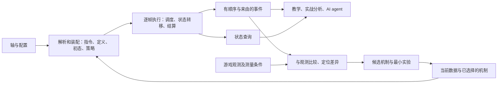

# 逐帧仿真底座：执行契约、证据与差异收敛

日期：2026-11-07；共识定稿同步：2026-11-11。状态：设计提案；接口、命令和新增数据结构尚未实现。初次代码审计基线：`6b1d7ab`；定稿复核基线：`5fe6d8d`。

2026-11-11 根据 [Codex 辩论单最终总结](codex-debate.md#codex-final-summary) 同步设计共识：CD-01～CD-08 全部为 `done`，正式评审见 [Codex overall-review 最终版](overall-review-codex-20261108.md)。未决的游戏机制、正式 TD 合入与软件实现另行推进；讨论关闭不表示它们已经完成。正式合入位置见 review §9.4 与各议题末尾。

用户澄清：项目重点是可靠、可复用的逐帧仿真引擎。教学轴、深塔、矩阵、全息分析，以及 AI agent，都是底座的使用者和验证场景。此前的 [教学轴解释提案](../rotation-explanation-plan.md) 保留为应用方向，底座建设优先按本文规划。

依据：总设计 §0.1、§4、§10.1、§11；TD-01 §13–14；TD-02；TD-04 §1–6；TD-07 §5；TD-09 §3；TD-10 §5.1；TD-11 §1–4、§6；[准确性计划](../engine-quality-plan.md)、[录像复盘](../replay-retro.md)。本提案延续当前关键取舍，未修改正式总设计或引擎行为。

## 1. 底座要承诺什么

建议的目标是：**给定明确的数据、机制、配置、初态与操作策略，确定性地执行战斗过程，允许查询状态和事件的来由；遇到游戏证据不符时，能够复现、定位、排除候选原因，并明确剩余的不确定性。**

需要分别建立三种可信度：

| 层面 | 可作出的承诺 | 主要验证方法 |
|---|---|---|
| 执行实现 | 程序准确执行了声明的语义；输入相同时结果相同 | 微场景、手算、相位与边界测试、不变量、序列化一致性 |
| 数据与机制模型 | 指定规则在列明的版本、配置和条件下得到证据支持 | 独立观测、受控实验、多个可区分条件的验证 |
| 本次分析 | 本次运行的输入、策略、误差与模型适用范围明确 | 运行记录、能力说明、相关假设与证据引用 |

程序确定性可以做到很强。与游戏一致的程度，需要按机制和适用条件积累。测试数量、总 DPS 误差或“看起来贴视频”，都不足以单独代表这三层。

这是成熟仿真方法中 verification（是否按规格实现）与 validation（是否在预期用途下符合真实系统）的区分。参考 [NASA 对模型验证的说明](https://public.ksc.nasa.gov/mns/faq/)；个人原型只借其区分方法，按本项目规模实施。

## 2. “编译器”的比喻怎样落成架构

现有 `resolve / compileRotation / simulate` 已接近所需结构：



实际执行时刻依赖资源、冷却、取消、时停和触发结果。因此编译阶段产出指令和约束，运行阶段推进状态并生成事件流；不能在执行前就无条件确定所有时间戳。

可以把执行契约写成：

`(S[f + 1], E[f]) = step(S[f], Program, Model, Environment, Policy)`

`S[f]` 是世界帧 f 开始的完整运行状态，包含调度游标；`E[f]` 按该帧内的实际执行顺序排列。抽样时种子及 RNG 状态也是输入/状态的一部分。固定一组选定的模型，运行仍然确定；比较不同候选机制是在外层分别运行。

### 2.1 游戏规则与操作策略分别记账

需要明确区分：

- 能量不够、冷却未好、输入锁未结束：在所选模型下的动作条件。
- 默认等前一招出手、自动插入谐度破坏、补位普攻、额外操作延迟：当前调度策略。
- 录像中的 `at`、补满能量、指定敌人状态：输入条件或观测辅助的状态指定。

保留总设计 T6–T7 的默认调度。诊断中标明每次等待或插入来自哪一类，应用才能判断“游戏不能做”“当前策略没有做”“用户要求在此刻做”。`!` 仍按现有语义跳过等待出手，不绕过其他合法性检查。

严格教学轴是使用同一执行器的入口约定：编译期禁用 `~`、`?`、隐式自动谐破，运行时检查作者要求的变奏、空中入场和出场技是否满足。未满足就返回意图失败与实际执行范围，不能退化为普通切人后仍算原教学轴成立。当前这些策略本来就是确定的；禁用是为了忠实表达作者打法，并非把随机执行变成确定执行。具体取消语法与失败后的诊断继续方式待设计，通用原型能力不因此全局删除，见 [CD-01](codex-debate.md#codex-turn-2-cd-01)。

### 2.2 同帧先后是语义的一部分

TD-04 已定义相位。输出需要显式带事件序号与相位/边界，不能只依靠按时间戳排序。两个事件在同一世界帧发生，先施加 buff 还是先命中、先回能还是先检查动作，可能改变结果。

新接口建议统一以 `stateAt(worldFrame: f)` 表示 f 帧开始、P1 前的状态；本帧走完后的状态是 `S[f + 1]`。查询某事件之前/之后则明确使用事件引用。继续区分世界帧、战斗时钟与动作局部进度，边界按 TD-04，不另造一套时钟规则。

开局常驻 buff、`onResolve` 和由它们产生的事件标为初始化阶段；`S[0]` 指初始化及其事件队列处理完成、首个 tick 开始前的状态。事件区间查询使用明确的左闭右开区间 `[from, to)`。

## 3. 现有实现的优势与具体缺口

已有纯库、显式钩子状态、三种时钟、资源与伤害出处、不变量、假设开关、golden、fuzz、场景回归和 conformance。这些可以直接延续。此次审计发现的重点如下：

| 位置 | 当前情况 | 对底座的影响与下一步 |
|---|---|---|
| `src/engine/types.ts` 的 `EventBase` | 有世界帧 f、战斗秒 t；缺少通用的相位、直接父事件和规则引用 | 同帧及跨时间的原因需要显式记录 |
| `src/engine/trace.ts` 的 `walkOwners` | 按日志邻近关系反推出处；注释确认同帧多个 buff 到期可归错 | 优先将关键来由在执行时记录，事后推导只作有标识的补充 |
| `simulate.ts`、`SimResult` | 每次从 `initialState` 开始；输出日志、汇总、回路文字与冷却轨道 | 尚无完整、统一的状态查询与恢复契约；展示轨道不是完整运行状态 |
| `triggers.ts`、`context.ts` | 业务日志同时是触发队列，钩子会消费事件 | 新增调试记录不能随意塞进同一队列，必须验证观测不改变执行 |
| `fit.ts` | 逐条找最近同名动作，窗口 10 秒；多种误差加权为一个分数 | 缺少一对一对应、匹配歧义和可比性说明；总分不足以判断机制原因 |
| `calibration.schema.ts`、`calibration.ts` | 点值、相对容差；时长字段的定义与取值时钟不一致 | 先校验量尺，补时钟、单位、区间、条件与分支信息 |
| `gamedata.ts`、生成数据、假设表 | 已有源文件/行、flags、规则说明 | 冲突字段仍缺少原始值→转换→覆盖→当前值的集中证据记录 |
| `portable.ts`、conformance | 装配结果去掉钩子表可 JSON 往返，导出事件与汇总 | 已验证输入可移植；尚不能推出运行时可暂停恢复、完整状态可重放 |

### 3.1 已复现的时钟契约问题

`src/data/calibration.schema.ts` 将 `kind: loop` 注释为世界秒；`docs/calibration/README.md` 也使用世界秒。`src/engine/calibration.ts` 实际取 `span.endT - span.t`，而 `EventBase.t` 是战斗秒。

2026-11-07 用如下人造日志直接调用 `simValue`：

```text
第 1 轮：f = 0，t = 0
第 2 轮：f = 600，t = 6
世界间隔 = 10 秒；战斗间隔 = 6 秒；当前 loop 校准返回 6。
```

这是契约/实现不一致的复现，不是游戏测量。当前 37 个登记点都是面板或跳字，不能据此宣称已存的某个实测时长被误判；需要在正式修复中明确时钟、补相应测试，再检查所有消费者。本次仅记录并列为首项修复。

后续复核确认 TD-11 §1.2 把“一轮几秒”通常解释为战斗秒，因此这不是已经证明应将代码改为世界秒。采用的修订方向是显式支持世界/战斗时钟，并兼容旧 `loop` 的战斗秒取值；示例应分别得到世界 10 秒、战斗 6 秒，而非静默改变旧调用结果，见 [CD-06](codex-debate.md#codex-turn-2-cd-06)。

这个例子说明：在请求更多实测之前，底座有一批能够独立推进的工作。

## 4. 可查询、可追因的运行结果

### 4.1 最小对外接口

以下是建议能力名称，不表示已有工具；先实现纯函数与 CLI JSON，再按需包成 agent 工具，不需要先建服务：

| 能力 | 输入 | 输出 |
|---|---|---|
| `compile` | 场景、所选模型、策略 | 装配后的程序、源指令映射、诊断 |
| `run` | 程序、运行选项 | 状态为完成/部分完成的运行结果、有效时间范围、运行标识 |
| `stateAt` | 运行输入/记录、世界帧 | 该边界的结构化状态与相关依据 |
| `eventsBetween` | 运行、世界帧区间 | 有稳定顺序和实例标识的事件 |
| `explainEvent` | 运行、事件引用 | 直接来源、已记录的数值输入与局部规则检查、有关前后状态；不声称全部依赖 |
| 动作合法性查询 | 指定边界状态、角色、动作与操作约定 | 已检查的条件、阻挡原因、相关值；不改变状态 |
| 历史未触发查询 | 事件实例、效果注册/持有者、实际检查位置 | 此次检查为何未触发；短路未检查与不支持分别报告 |
| 假想事件触发查询 | 隔离状态、明确的假想事件与效果 | 假设此事件此刻发生时的结果，不能当作历史事实 |
| `diffRuns` | 两次运行、比较对象 | 可比范围内最早差异、实例对应与指定目标变化；未执行到/歧义单列 |
| `compareObservations` | 运行、观测案例 | 分项差异、匹配范围、不可比或歧义原因 |

返回值应是机器可读的数据。报错后只能查询已执行的范围；资源缺失、未知机制、没有匹配到观测，均不能包装成 0 差异或完整成功。

### 4.2 执行时记录两类关系

第一类是触发关系：哪个动作实例生成判定，哪个命中触发 buff，哪个 buff 到期引出效果。第二类是数值依赖：本次计算使用了哪些倍率、属性、buff、目标条件和取整规则。触发者与所有数值贡献者并不是同一回事。

首批在动作开始、判定生成/命中、资源变更、buff 施加/到期这几个操作处补记录即可。拟议元数据包括：独立事件序号、发生相位、动作/判定实例、直接原因引用、规则引用、关键输入和变更前后值。持有者、伤害归属者、触发者保留各自含义。

迟到的效果需要将来源随计时器、判定或尾部状态一起携带；只记“当前正在处理的事件”覆盖不了它。一个结果由多个条件共同决定时，保留多个依赖引用，不能全部归到最近的一条日志。

原因有遗漏时输出“尚无记录”，而不是静默使用时间最近的动作并当作确定事实。对于没有发生的效果，诊断模式可记录相应触发条件的检查与未满足项，帮助区分“规则未触发”和“规则根本未建模”。

对外分开四类输出：完整输入配置、执行观察记录、事件来源与数值输入、指定反事实比较。父链和当前乘区不会自动涵盖远处资源/时序变化，局部起作用也可能被下游等待吸收，不能将它们称为实际依赖的上下界。`Link.root` 的业务归属保留，直接父事件另记；可补相符 buff 实例的窗口余量，但需保留退出原因与同帧相位，不用它代替反事实比较。具体边界见 [CD-02](codex-debate.md#codex-turn-2-cd-02)。

### 4.3 诊断不能改变业务事件

现有 `s.log` 被 `drain` 消费。状态快照、规则判定说明等诊断记录应进入独立的只读记录通道，或作为不产生新业务事件的附加元数据；不能增加钩子调用次数、改变事件链深度或消耗业务实例编号/RNG。

必要验证：开关诊断前后，业务事件、数值、有效状态、报错行为及 RNG 结果一致。不要在第一阶段引入所有字段读写的动态代理；优先利用已有资源/buff 操作函数和显式钩子调用边界。

统一资源的是只读变化视图：在实际修改位置采集 before/after，与原 `hit.gains`、`resource` 关联，不重新加资源或多派发一次业务事件。验收时剥离新增诊断字段，再比较业务语义；输出结构变动单独处理，不能承诺新增字段后 JSON 原字节不变，也不能仅凭“不发新事件”预先宣称绝无干扰，见 [CD-04](codex-debate.md#codex-turn-2-cd-04)。

### 4.4 状态查询先从可靠重算开始

第一版 `stateAt` 可以从相同输入重算到指定 tick 边界，保证查询值来自执行器实际状态；复杂度高于日志回放，但实现直白，也能充当以后缓存/快照的参照。

完整运行状态至少考虑：三人当前和后台动作、局部帧、连段锚点、资源、冷却/充能、钩子 vars、buff 实例及内置冷却、判定、尾部、敌人状态、膨胀窗口、调度游标、挂起的延奏/切入效果、实例计数器与 RNG。按结构化字段查询，不能只给 `forte` 的显示文字。

返回的状态必须与运行中的可变对象隔离。`whyNot` 等查询也需要只读语义，不能因为检查动作而推进计时或触发钩子副作用。

暂停/恢复放在查询与诊断跑通之后，只从定义好的 tick 边界恢复。虽然 `SimState` 大量使用纯数据，仍须审计 `Sim` 中队列游标、已发警告集合等簿记如何保存或重建；不能直接把“能 structuredClone”当恢复正确的证明。保存后继续与从头运行的事件、状态、报错须一致。

这条路线保留现有逐帧内核，暂不要求把每次状态赋值改成由事件驱动的 reducer。

## 5. 第三方数据怎样成为有依据的模型

### 5.1 数据记录追到字段和规则

对正在研究的字段/规则，保存一个轻量的证据条目：

| 信息 | 用途 |
|---|---|
| 字段/规则键 | 如某角色某判定的协奏到账时机，明确讨论对象 |
| 原始出处与值 | xlsx 文件哈希、sheet/行/列，解包条目、文本或录像片段 |
| 处理过程 | 单位换算、列映射、推断、curated 覆盖及理由 |
| 当前采用值/解释 | 与实际装配结果对应 |
| 其他候选及冲突 | 保留尚未排除的读法，不覆盖原始证据 |
| 验证状态与范围 | 哪个版本、形态、链数、装备、敌人条件下支持 |
| 实验与回归引用 | 支持/反驳它的案例，改动后要重跑什么 |

先覆盖差异案例涉及的少数字段，以及多个队伍共用的高影响规则。已有正常字段继续用当前来源信息，避免把整个数据仓库重写成证据系统。

原始资料、当前采用的解释和支持它的观测应分别保存。生成数据仍只由构建脚本写；覆盖仍在 curated。来源冲突先并列和定位，不能靠多数投票决定。

台账优先扩展 `assumptions.ts` 的稳定身份与证据引用，文档列表由其生成，原始材料仍各有出处。按规则身份、候选、关联候选及条件的证据、当前结论四块维护；“当前采用”不是证据等级，“分不清”可以与采用 A 同时成立。已知但未实现的候选标明 `implemented: false`，未知的替代机制可记为候选尚未列全，不能为了表格硬造备选。调用次数、说明文字的去重数都不等于可独立检验的命题数，见 [CD-05](codex-debate.md#codex-turn-2-cd-05)。

### 5.2 可靠性按内容判断

解包条目适合提供某个构建版本的数值线索，但条目是否被当前技能调用、运行时如何修正、何时结算，仍需要规则映射。说明文本可能准确描述作用，却不交代同帧顺序。录像能提供某次可见结果，却可能缺少后台状态或精确输入。

多个站点若共享同一上游，不算独立支持。也不建议给一个网站统一打“可靠度 95%”，然后机械传播到所有字段。保留具体证据种类、条件和冲突更有用。

对临时采用的假设继续遵守 T16。仿真使用一个明确选定的值；外层可以运行多个候选模型并返回结果集合/范围。未经建立的概率不参与平均，更不能把候选数量当统计置信度。

### 5.3 记录运行身份

运行记录包括：场景/初态、已装配数据、数据源哈希、实际规则与开关、引擎及钩子代码标识、策略、抽样种子（如有）、输出 schema、完成状态和已知缺口。只记 xlsx 版本不够，curated 与钩子同样会改变结果；工作区有未提交代码时还要识别该差异。

沿用 T15 只维护当前版本。记录身份用于解释变动与提示证据适用范围；如果没有保存可执行代码和对应输入，哈希本身并不保证以后一定能重跑。需要保留的校准案例可额外存其必要输入与观测，不建设多版本游戏服务。

观测的游戏版本、数据文件版本、运行代码/输入身份分别记录。当前 `GameData.version` 是 xlsx 文件日期，不是游戏版本。换版不删除旧观测，当前是否沿用另记理由；数据未变不能证明机制未变，尤其不能自动把旧版证据升格。变化字段到相关规则的自动复核关联尚待实现，先记录高影响规则的显式关系。

### 5.4 对应用和 agent 提供具体的能力说明

每次输出同时说明本次使用了哪些模型能力、碰到哪些假设/人工指定状态、哪些相应观测通过或冲突、哪些行为未建模。可以分别说明数值公式、资源、时间、敌人场景的验证范围。

接口允许在带假设的模型上继续确定性计算。应用据此决定某个结论是否适用；底座不输出一个包办一切的“引擎准确率”。

## 6. 先把游戏观测变成可比较的对象

### 6.1 校准案例应包含什么

建议逐步扩展当前点式校准，支持如下信息；先选一个案例需要的最小子集落地：

- 案例身份、版本/配装/敌人/环境/初始条件，以及哪些条件未知。
- 原始证据位置、独立录制/实验的分组，读数与转写方式。
- 观测类型：某次动作、跳字、资源、形态、buff 状态、冷却或时间间隔。
- 明确的时钟、单位、起止边界；时间点可以是区间，值可以是区间、布尔或候选类别。
- 观察对象与实例对应：角色、形态、动作/判定、该段的第几次；不确定时列候选。
- 绝对/相对容差或读数区间及其依据；在看到拟合结果之前决定如何判定。
- 用途：给定条件、用于提出/选择模型的观测、用于独立检验的观测。后两者按录制或实验条件拆分，不能仅随机拆相邻帧。

同一字段不能既用来强制指定状态，又作为该状态被模型预测正确的证据。例如补满能量后成功开大，只能支持以该能量为起点的后续行为。

录像输入区分已观测动作、有依据的空闲和未观测区间；后者不能默认空转，也不由“离 `at` 太近就停补位”的启发式代填。状态同步默认不发业务触发，观测约束、采用值、差额、相位与未派发事件走诊断旁路；从第一次干预起保守标记条件推演。给定满资源不能还原过去满资源的时刻、ICD 或全部隐藏状态，未覆盖的影响保留未知。环境事件输入与补状态分别标识，见 [CD-03](codex-debate.md#codex-turn-2-cd-03)。

### 6.2 引擎状态到画面读数有一层测量过程

可写成 `观测 y = observe(执行状态 S) + 读数误差`。它涉及 HUD 显示精度、时间定位、取整、遮挡以及跳字的暴击分支等。

因此：

- 资源环读为约 80% 时，不能默认真实资源精确等于 0.8000。
- 跳字应对相应的非暴击/暴击分支；新增观测入口缺省为 `unknown`，不默认填暴击，两支的残差与相容性分别列出。当前 `calibrate` 选最接近的一支可用于发现一致候选，但不能据此声称暴击状态已被观测确认。
- 期望伤害不能被要求逐次等于一局录像的实际伤害。比较累计血条时需要考虑已观察的暴击、无法观察的分支或合适的误差范围；不要搜索一个“最贴合种子”就宣布机制正确。
- 同时跳出的多个数字、HUD 聚合显示，可以显式使用聚合观测；不能偷偷拿其中一条模拟命中重复配对。
- 时刻区间与量值误差分别保留。30 fps、变速、剪辑、掉帧、HUD 刷新等问题，不能用秒乘 60 获得额外精度。

不需要立即为 HUD 写复杂模型。不知道刷新规律时使用合理的观测区间，避免编造平滑/延迟机制。

## 7. 数值差异的收敛流程

目标是让每次差异都进入同一条可重复的诊断链。第一版先用小案例及人工候选，后面再自动化。

### 第一步：确认比较成立

检查单位与时钟、装备和环境、起点、动作转写、模型覆盖范围。条件不够时返回“缺少哪些条件”；版本明显不匹配时保留证据记录，但不直接用它修改当前规则。

尤其先排除量法错误。§3.1 的 10 世界秒/6 战斗秒案例，根因就在比较层，不需要让玩家进游戏。

### 第二步：先匹配事件，再计算误差

依据角色、形态、动作、时间顺序、清晰锚点和出现次数匹配。时间窗内有多个合理候选时保留歧义；按对象与通道采用有依据的局部保序、一对一对应，不强加前台与后台并行事件的全局顺序，聚合观测显式声明组成。运行内整数句柄不充当万能跨运行 ID；另一运行未执行到目标时单列执行覆盖，不报事件消失。

匹配过程不能以“哪个伤害数更接近”作为验证该伤害的唯一依据。当前 `fit.ts` 的最近同名匹配适合初筛；正式诊断需要显示匹配依据、未匹配项和歧义，防止同一模拟事件被反复使用。

### 第三步：把误差展开为多个通道

至少分别给：

- 事件是否存在、顺序、动作/切人类别；
- 世界时间、战斗时间与持续间隔；
- 协奏、能量、核心资源及形态；
- buff 施加/到期及相关命中是否受益；
- 逐下伤害、乘区、段数；
- 累计血条与总伤害，作为整体检查。

当前 `Fit.score` 可以继续作浏览候选的排序工具。不同量纲加权后的总分不能覆盖这些证据，尤其不能用一项变好抵消关键机制的反证。没有观测不是误差为零。

固定观测集合与分母还不够：一个 9 秒误差改成 5 秒缺失惩罚，数值仍可能“更好”。先返回比较资格、必需观测覆盖和硬冲突，再在同组可比候选内排序；不完整候选的诊断分数不能冒充验证通过。规则候选与改轴候选分别列出，不把任意带噪读数的小恶化都当硬冲突。

### 第四步：定位最早有证据的偏差

两份完整模拟轨迹可按序号/状态边界精确找第一处分歧。稀疏游戏观测只能定位到“最早检测到的偏差”及相关区间，不能保证此前所有隐藏状态正确。

例如切走时协奏总量正确，段中读数提前升高，则应先研究到账时机或时刻对齐；直接减少总量会破坏已经满足的切人条件。这个形状在 `replay-retro.md` 的卜灵协奏问题中已有记录。

### 第五步：缩小需要解释的执行过程

从偏差字段沿执行时记录的依赖回溯：最近何时改变、由哪个动作/效果引起、使用哪个数据字段和规则。保留必要前置，缩短到仍能复现同一偏差的小场景。

缩短场景时保持相同的判定问题、观测对应和初始条件。随意删除铺垫，或把未知后台状态设成模型当前值，可能制造另一个问题。自动缩减必须有明确的失败判据，先从人工缩减开始即可。

因果记录只覆盖已经建模并实际记录的关系；即使规则已经实现，未记录的历史时序影响也可能不在父链里。漏写的机制更不会自己出现在图里，因此还要对照原文/观察中的事件数量、条件与缺失效果，必要时比较明确的替代候选。

### 第六步：分清是哪一类未知

| 候选原因 | 如何继续 |
|---|---|
| 读表、别名、单位、时钟或报告取值错误 | 用原始值与小用例验证转换链，修相应层 |
| 行为模型已知，数值参数未知 | 在有依据的范围内扫描参数，检查是否能被现有观测约束 |
| 触发条件、到账时机、叠加或时停规则不同 | 将机制写成少量离散候选，比较各自可见预测 |
| 操作转写、命中次数或开局条件不同 | 分别建立场景候选，保留原录像与原场景 |
| 缺少空间命中、敌人阶段等能力 | 明确模型范围；另建外部条件或扩展模型，避免用倍率抵偿 |
| 多个原因在已有观测下表现相同 | 返回无法区分的候选以及需要增加的观测 |

“校准参数”与“发现规则”是不同任务。例如一次跳字满足 `伤害 = 攻击 × 倍率 × 其余乘区`，仅凭这一个数通常无法判断攻击和倍率分别是否正确。再多跑优化器也无法补出未观察的信息。这类可辨识性问题是动态模型校准的常见难点，参考 [A protocol for dynamic model calibration](https://arxiv.org/abs/2105.12008)；本项目先用有限候选与简单代数检查，不直接套用其连续动力学算法。

### 第七步：做能区分原因的下一次实验

建立“候选 × 观测”的表：各候选能解释什么、与什么冲突、尚未被什么约束。先检查现有其他片段，再设计额外实验。

选实验时考虑：候选预测是否明显分开、画面能否读出差别、准备和重置成本。若候选结果的差别小于观测误差，先换观测量或实验条件。

例如针对“额外攻击加成是否生效”，面板与固定判定跳字是不同的约束；针对“资源总量还是时机”，低资源起点的短片段与末尾门槛检查可以同时约束两者。若怀疑两个效果的交互，比较无效果、A、B、A+B；单独测 A、B 不能证明同时存在时的规则。

已经用于拟合的片段不能再被称为独立检验。新机制还要检查未参与选择的片段/条件；当前没有独立材料时，保留暂定状态。

比值拟合支持的是条件下的候选解释。心队首位绝息魄候选值得优先核对，但模型给出的 2 战斗帧间隔不能直接证明游戏两条 buff 同时到期；只排除触发点、时钟、时长及适用条件已给全的解释，不扩大成整个时钟类别。[CD-07](codex-debate.md#codex-turn-5-cd-07) 已就这些边界确认共识，实际首位、buff 窗口与共同残差乘数 `m` 的来源分别移交取证。可读录像倒计时调查窗口，但显示位数不等于测量精度，模型端点差也不直接作为游戏观测的修正值；读数区间跨过候选边界或端点对应未知时，保留分不清/条件不足。

### 第八步：将结果固化为可回归资产

每个关闭的问题留下：案例、真实观测、必要条件、被反驳的候选、采用的规则/参数、修复位置、容差与适用范围，以及最小回归。

修复后同时检查该案例和已支持的相关案例。程序当前输出的精确快照与游戏观测加容差分别保存，避免将仿真数字写成实测。

一个问题允许收敛到五种结果：修复了实现/数据错误；候选机制得到条件内支持；参数范围缩小；明确现有观测无法区分；确认超出当前模型范围。后两种也提供了明确进展，不能强行归零误差。

## 8. 用应用发现问题，用机制案例积累底座能力

应用负责提供覆盖真实使用方式的场景；底座维护可独立运行的机制案例。验证组织如下：

| 语料 | 检查内容 | 不能单独证明的内容 |
|---|---|---|
| 人造微场景 | 程序是否按明确语义执行，边界与相位是否正确 | 游戏真实采用这条语义 |
| 构建/公式对拍 | 转换与公式实现是否符合参照 | 参照本身没有误差 |
| 短游戏实验 | 特定条件下的资源、规则和数值 | 所有角色与所有上下文都相同 |
| 实战/教学回归 | 多机制组合是否出现新冲突、原有现象是否保持 | 一局总量贴合即可验证全部机制 |
| 独立实现对拍 | 两个实现是否遵守相同语义 | 两边没有继承同一个错误假设 |

优先给已有用例补明确契约和缺口，避免重复写同样的测试。首批检查共享边界：同帧施加/到期/命中顺序；施放与命中资源；溢出与分配；取消前后与尾部；后台动作；切人/出场技；全局时停与顿帧；冷却/充能；同时到期的触发；资源主动指定。

变形测试要注明成立条件。例如在固定命中序列和其他条件不变时增加攻击，伤害不应下降；若加属性同时改变形态、触发或窗口，则不能无条件用单调性判错。

每条重要机制维护一行验证范围：规格明确程度、用例、游戏证据、已覆盖条件、反例/冲突、依赖机制。共享内核与角色特殊规则分别说明。这样更换一个参数或规则时，能够知道该重跑哪些验证。

## 9. 实施顺序与可验收里程碑

这是一条逐步增强现有实现的路线，避免先进行大规模架构替换。每一批都用少量案例走通完整输入输出。P0–P4 是能力批次，不是严格串行的工期；证据整理从第一批开始，软件检查与不依赖其读数的短实验可以并行。

| 批次 | 最小交付 | 完成标准 | 主要接入点 |
|---|---|---|---|
| P0：量尺与使用边界可信 | 显式校准时钟/单位；保留 buff 实例身份、统计边界、完成范围与观测缺失状态 | §3.1 世界秒返回 10、战斗秒返回 6，旧 `loop` 兼容；同名效果不丢，未达到目标不冒充完成，缺证据不报通过 | 校准、实例/日志、汇总与比较层；对应 review R01、R03、R09–R11 |
| P1：执行可查 | 关键业务事件的直接原因/相位；独立诊断记录；通过重算提供结构化 `stateAt` | 同帧两个到期效果来源不串；读取状态/开关诊断不改变运行；同一时钟不同边界查询无歧义 | `types.ts`、`kernel.ts`、`triggers.ts`、`simulate.ts`、`trace.ts` |
| P2：差异可定位 | 事件匹配、分项残差、最早偏差、依赖回溯；一份 JSON/Markdown 诊断报告 | 可定位已知的单位错误、漏段与资源时机错误；故意给无法区分的证据时能保留候选 | `fit.ts` 或新的纯诊断模块、报告模型 |
| P3：规则有证据 | 整理首批字段/规则证据；候选—观测表；真实案例的独立检验与回归 | 一处已解决案例能追到来源/修复/实测；一处未解决案例能明确缺哪项观测；修改不会破坏已支持案例 | curated、假设表、校准记录、机制测试 |
| P4：调用与效率 | 统一 JSON 查询接口；按需要做 tick 边界快照/恢复与分支 | 从头运行、查询重算、恢复续跑一致；agent 能查询具体事件/状态与证据，无需解析网页或猜测单位 | 纯库接口、CLI；有必要时再包工具协议 |

实施顺序按案例可交叉推进：P0 先选一个真实资源案例作为目标，P1 只补该案例缺的来由，P2 用它检查报告，再扩大覆盖。不要等待所有字段都有证据、所有状态都能快照以后才做第一次诊断。

机制实验按当前用途、账号与重置条件组织，不以首包几个实验代替全共享规则基线。建议 everbird 的 A1/B1/B2/B7/B10/B11 与 Evariste 的 C1/C4/C5 分包；B10 保留无/A/B/A+B 对照，B11 保持心在后台并记录基线。换号、准备、失败重录与读数计入成本，题号以当前验证手册为准，不承诺固定分钟数定案。

### 9.1 建议第一组案例

1. **纯量法案例：世界秒与战斗秒不同。** 已有最小复现，无需进游戏；用它把单位/时钟契约补实。
2. **执行追因案例：同帧两个 buff 到期。** 人造场景分别引出不同资源或判定，检查父来源与结果，同时比较诊断开关；针对当前明确记录的局限。
3. **已解决游戏案例：三火武器 buff 延长。** 复用 `tests/fire.test.ts` 和已有录像数字，保存实际观测与程序值，展示不同时间窗口如何排除原读法；独立证据是否充分另行标明。
4. **未解决游戏案例：卜灵协奏时机。** 复用当前读数，先区分对时、总量、到账方式与补位转写；交付候选表和最小实验，不要求凭现有材料强行选定原因。

这一组能检验底座是否真的有“发现问题—定位—验证—保留不确定性”的能力，比只增加一个总 DPS 对齐的场景更适合本轮目标。

### 9.2 第一批可以直接开工的任务

- 将校准时钟写成明确字段/类型，补世界时间与战斗时间分离的测试；确认旧字段的迁移/默认语义。
- 定义观测与比较结果的最小 schema，至少区分通过、冲突、未匹配、匹配歧义、条件不足。
- 给两个同帧到期效果建立人造复现，为直接来源记录定验收。
- 针对一类资源变更接通原因与规则引用，以及一份“变化前→原因→变化后”的机器可读输出。
- 在 tick 起点提供有限字段的真实状态查询；明确未覆盖字段，逐步覆盖全部运行状态。

首批完成不需要新增角色、界面或大量实测。之后由诊断报告提出少量可区分候选的游戏实验。

### 9.3 底座第一阶段的完成标准

- 对声明支持的字段，可查询任意已运行帧的明确边界状态；结果来自执行器，与直接执行一致。
- 对首批覆盖的关键事件，能指出触发来源、规则、数据及有关状态，不依靠未标识的邻近推断。
- 比较工具自身通过单位、时钟、匹配和误差处理的用例；能够拒绝无效比较。
- 至少走完一个已有真实案例的诊断闭环，并保留一个无法区分的案例，明确下一项观测。
- 数据或规则更新后，可重跑相关机制与游戏证据，解释发生变化的位置。
- 应用与 agent 收到确定的计算结果时，同时拿到其条件、完成范围和模型依据。

这是一组工具与验证能力的完成标准，不代表全游戏模型已经校准。

另行维护“指定用途的机制基线”：为要发布的结论列出关键规则、已检查候选和适用条件。某个未解案例的诊断记录完整，可以通过工具验收；若它的不同候选会改变精确切人帧，就不能把这条精确结论一并标成已验证。

推荐 `m0-video-eq.yaml` 作为贯通案例起点，配一个卜灵协奏未解案例；这是建议，尚非用户选定的首条轴。原文件仍有自动谐破，严格输入的谐破位置与意图需先明确。原配置的 25 秒周期与 14/15 单项替代值不变只在其已测范围成立：单独关自动谐破、单独关声骸输入优先级特例均为 25 秒，两项合用则为 25.233 秒（第 2–3 轮）。这不是未来手写谐破轴的预测，却足以说明不能跨输入沿用旧单翻结论。严格输入定下后须重新验收，三方已在 [CD-08](codex-debate.md#codex-turn-4-cd-08) 明确确认。

代表轴发布某项结论时，标准检查包括列明可执行候选集的单项与有效两两组合，记录排除项、实际覆盖与指标。定稿复核在原 M0 配置上运行 15 个单项与 104 个不同路径的两两组合，还确认了“大招全局时停中计自身顿帧 × 关闭声骸起手优先级特例”使轮长变为 25.117 秒。104 是当前候选表的规模，不是固定指标；未实现、未列出及三项以上组合另记未知，成本受限而未查的组合也要声明。轮长的检查不能代替伤害与精确容错的检查。两处交互支持将声骸起手优先级列入共享规则实验候选。

## 10. 本次工作范围及后续工程约束

初稿新增底座规划、调整上一版提案的定位，并用人造日志复现校准时钟不一致。2026-11-11 根据讨论同步合同与验收范围；未修改运行语义或新增上述接口。这里的共识状态不是实现完成状态，正式 TD 尚待按各议题列明的位置合入。

接受限定范围的独立复核：合成正式总体设计时，作为架构或机制决定依据的技术断言附出处，并由非作者实际检查一次；不变成每句描述或日常原型迭代的签字门槛。代码核对与游戏证据分别说明。

实施时保持总设计 §4 的既定取舍：固定 60fps 世界步长、三种时钟、期望值默认、纯库、数据与钩子分离、当前版本、单目标模型。查询与诊断先复用执行器；多目标/空间命中等范围扩展单独设计。如要改变既定取舍，按 AGENTS.md 先修改总设计并记录附录 C。

新增字段先改 schema；机制变化配用例；每次任务执行 `pnpm check && pnpm test && pnpm test:py`。改引擎执行 `pnpm conformance`、`pnpm fuzz`；改公式运行 golden；改构建或数据按 AGENTS.md 重建与校验。新增诊断元数据要对比业务结果，不因快照变了就无条件接受所有变化。
