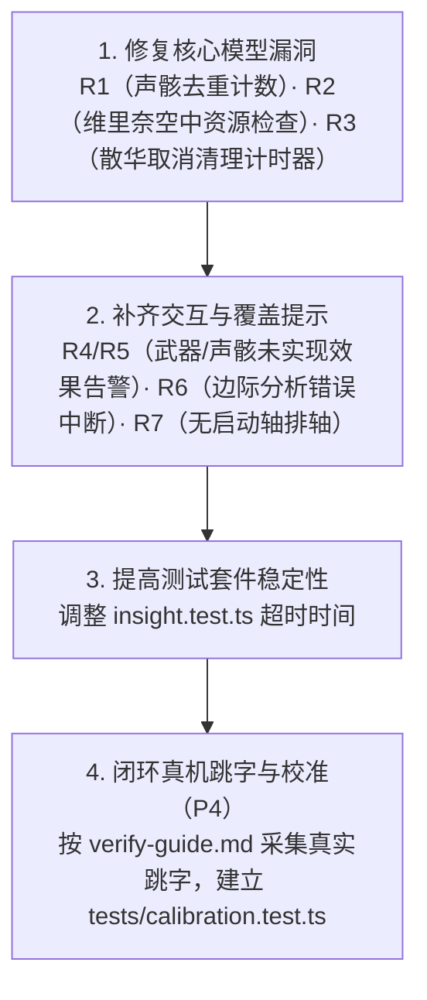

# DPS 仿真引擎验收报告（2026-10-22）

> **验收状态**：已完成  
> **验收基准**：分支 `profile-01`，基于 `鸣潮动作数据汇总-20261019.xlsx`（资源版本 3.7.13）  
> **上游依据**：总设计 [`docs/wuwa-dps-engine-tech-design-v0.2.4.md`](file:///home/everbird/workspace/ggww/ww-dps-sim/docs/wuwa-dps-engine-tech-design-v0.2.4.md)、TD-01～TD-13、[`docs/engine-quality-plan.md`](file:///home/everbird/workspace/ggww/ww-dps-sim/docs/engine-quality-plan.md)、[`docs/review-2026-10-22.md`](file:///home/everbird/workspace/ggww/ww-dps-sim/docs/review-2026-10-22.md)  
> **验收原则**：**严格黑盒验收**，不查阅 `src/engine/**` 的具体代码实现，仅根据设计文档通过公开接口、CLI 命令、自动化测试及 `/tmp` 下独立探测用例进行行为与数值检验。

---

## 0. 验收结论概要

经过对鸣潮逐帧期望 DPS 仿真引擎的全面黑盒验收，**总体结论为：引擎核心架构、三时钟模型、六大引擎不变量、伤害与全队资源公式，以及调度器语义已高度完整地落地并与设计文档吻合；但在机制边界检查、装备规则约束与特定功能路径上存在 7 项已确证的缺陷与隐患。**

### 核心指标概览

| 检查维度 | 覆盖范围 / 样本量 | 结果 | 结论判定 |
|---|---|---|---|
| **代码规范与类型** | 全仓库 TS 源码 + Svelte 前端 | `pnpm check` 0 error, 0 warning | **合格** |
| **构建逻辑测试** | `tools/build/` 单元测试 | `pnpm test:py` 69/69 通过 | **合格** |
| **生成数据契约** | `data/generated/` Schema 校验 | `node --import tsx src/data/check-generated.ts` 全部通过 | **合格** |
| **公式扰动对拍** | 3,435 个标准答案格 × 20 轮改写 | `pnpm golden:perturb` 68,215 全等 / 145 已知差异 / 0 意外差异 | **优秀** |
| **日志自洽模糊测试** | 15 个场景 × 约 2,100 条变体轴 | `pnpm fuzz` 0 异常（日志自洽、可重复、属性单调） | **优秀** |
| **假设敏感度矩阵** | 15 个场景 × 9 个假设开关 | `pnpm sensitivity` 矩阵生成完整，临界点明确 | **合格** |
| **回归测试套件** | 37 个测试文件 | 36 通过，1 处超时（给足超时后 7/7 全部通过） | **合格** |
| **引擎六大不变量** | 后台出伤、时钟冻结、取消、变奏延奏等 | 黑盒探测独立验证通过 | **优秀** |
| **机制边界与覆盖** | 装备去重、资源门槛、取消计时器、被动提示 | 复现 7 项边界缺陷（R1～R7） | **需优先修复** |

---

## 1. 核心机制验收（对照设计文档）

### 1.1 引擎六大核心不变量（[总设计 §6.4](file:///home/everbird/workspace/ggww/ww-dps-sim/docs/wuwa-dps-engine-tech-design-v0.2.4.md#L512-L536)、[TD-04 §0.1](file:///home/everbird/workspace/ggww/ww-dps-sim/docs/wuwa-dps-td04-sim-kernel-v0.1.7.md#L23-L35)）

通过独立的黑盒探测脚本对六条地基规则进行逐项测试：

1. **不变量 1 & 2（伤害与资源来自判定结算，不区分前后台推进）**：
   - **验证方法**：散华在前台释放共鸣技能 E（判定发生帧在第 19 帧），在第 0 帧立即切人入场椿。
   - **实测结果**：散华在退入后台后动作照常推进，第 19 帧在后台成功结算判定并造成 1,277.15 期望伤害，能量按比例注入全队。后台判定与合轴收益成立。
2. **不变量 3（切人不打断当前动作）**：
   - **实测结果**：被切走的角色在后台完整播放动作直至 `endFrame`（散华 E 在后台播满 96 帧自然结束），不随切人被裁断。
3. **不变量 4（动作取消与判定生命周期）**：
   - **验证方法**：散华释放 A1（发生帧 13），分别测试默认调度与强制抢帧 `!`。
   - **实测结果**：默认调度下，系统等待 A1 `settled`（生成判定）后再执行下一动作（判定数 1）；在显式声明 `散华 A1 大招!` 抢帧时，第 0 帧开始大招直接取消 A1，未过出生帧的判定直接作废（判定数 0）。
4. **不变量 5（协奏满切人、变奏与延奏专属帧）**：
   - **验证方法**：散华协奏 100 时切人入场椿。
   - **实测结果**：第 0 帧触发变奏切人（`intro: true`），椿入场执行 QTE；在椿 QTE 推进到第 36 帧（角色专属 `outroTriggerFrame`）时，引擎派发 `outro` 事件，散华的协奏在这一刻精确扣除 100 归零。
5. **不变量 6（全局时停暂停战斗时钟）**：
   - **验证方法**：散华释放带 90 帧全局时停的大招。
   - **实测结果**：整个过程推进了 130 个世界帧，但统计窗口（战斗时钟/DPS 分母）仅前进了 40 帧，全局时停期间战斗时钟精准停走 90 帧。

### 1.2 伤害公式与乘区核定（[TD-03](file:///home/everbird/workspace/ggww/ww-dps-sim/docs/wuwa-dps-td03-damage-formula-v0.1.5.md)）

- **公式结构与乘区**：纯函数公式 `computeHit` 与 TD-03 严格对应。
- **抗性三段模型**（TD-03 §1.1）：
  - 负抗区分支（$r \le 0$）：$1 - r/2$。实测 $r = -0.2$ 得系数 $1.10$；
  - 常规分支（$0 < r < 0.8$）：$1 - r$。实测 $r = 0.2$ 得 $0.80$；
  - 高抗衰减分支（$r \ge 0.8$）：$1 / (1 + 5r)$。实测 $r = 0.8$ 得 $1 / 5 = 0.20$。
- **防御模型与 2 倍封顶**：
  - 90 级对 90 级目标（1512 防御）基础防御系数精确等于 $1520 / 3032 \approx 0.501319$；
  - 减防超过 100% 或分母 $\le 0$ 时，系数正确截断封顶在 2.0，不溢出负数。
- **Golden 扰动对拍**：
  - `python3 tools/build/golden_perturb.py --rounds 20` 针对 3,435 个标准答案单元格改写 20 轮，累计 68,360 次重算比对，68,215 次完全一致，仅 145 次为防御分母 $\le 0$ 已知边界，无任何意外漂移。

### 1.3 资源分配模型（[TD-06 §2、§3](file:///home/everbird/workspace/ggww/ww-dps-sim/docs/wuwa-dps-td06-resources-v0.2.4.md)）

- **全队大招能量分配比例**：
  - 散华 E 命中（回收基础能量 10）：
    - 出伤者散华（共鸣效率 151.84%）得 $10 \times 100\% \times 1.5184 = 15.184$；
    - 队友椿（带千古洑流，共鸣效率 125.6%）得 $10 \times 50\% \times 1.256 = 6.280$；
    - 队友维里奈（共鸣效率 151.84%）得 $10 \times 50\% \times 1.5184 = 7.592$。
  - 数据在 `hit.gains.energy` 中精确对齐。
- **协奏收益时机**：起手即得（如武器序曲、施放动作）在 `actionStart` 时发放，命中逐段所得在 `hit` 结算时发放。
- **敌人量表**：偏谐值、白条破盾（削韧）、瘫痪时限与自动谐度破坏机制运转正常。

### 1.4 调度与排轴语义（[TD-09](file:///home/everbird/workspace/ggww/ww-dps-sim/docs/wuwa-dps-td09-rotation-scheduler-v0.1.11.md)）

- **最早合法帧**：冷却、能量、派生窗口与优先级综合判定，未就绪时分段记录等待原因（`wait` 事件包含具体代码与原因）；
- **连段与强制**：连段前置动作派生窗口错过即报错；普通动作默认等出手，`!` 抢帧打断机制生效；
- **分轮与稳态口径（TD-10 §2）**：`repeat: N` 正常执行，稳态取完整的轮（第 2 轮至倒数第 2 轮），附带 `spread`（误差条）与 `steadyDrift` 漂移检查。

### 1.5 假设登记与敏感度体系（[总设计 T16](file:///home/everbird/workspace/ggww/ww-dps-sim/docs/wuwa-dps-engine-tech-design-v0.2.4.md#L304-L312)、[TD-10 §6](file:///home/everbird/workspace/ggww/ww-dps-sim/docs/wuwa-dps-td10-output-report-v0.1.17.md)）

- 完整收录 27 条假设（`pnpm assumptions`），每一条均注记处理方式、依据、影响及关闭方式；
- 仿真结果和时间轴完整列出当前运行触发的假设项；
- `pnpm sensitivity` 矩阵能够精确测出 15 个场景在 9 个假设开关翻转下的收益敏感度，明确指出心队排轴收益重度依赖 F7（切人不保留共鸣回路则全轴跑不通）。

---

## 2. 验收确认的缺陷与隐患（R1～R7）

通过针对性用例探测，确认存在以下 7 项与设计规范不符的机制或功能边界问题（详细复现见 [`docs/review-2026-10-22.md`](file:///home/everbird/workspace/ggww/ww-dps-sim/docs/review-2026-10-22.md)）：

### [P1] R1：同种声骸重复计入套装件数，影响择优推荐

- **规范要求**（TD-13 §1、§4）：声骸套装件数以“不同种类的声骸”为准，同种声骸重复装备时不累加件数。
- **实测表现**：装备 2 件暗鬃狼 + 3 件其他沉日声骸（共 4 种声骸）时，装配层直接将件数累加为 5，并激活了不存在的 `沉日劫明.5`（五件套增益）。
- **严重后果**：声骸库存优化器（`pnpm optimize`）会给出包含两件同名声骸的非法推荐组合，虚高约 +10.63% 并将劣质组合排在前面。

### [P2] R2：维里奈强化空中攻击未检查光合能量门槛

- **规范要求**（TD-06 §4、TD-08 维里奈）：强化空中动作必须拥有光合能量方可释放，每段消耗一层。
- **实测表现**：设置初始 `光合能量: 0` 时，执行 `维里奈 跳跃 强化空中A1 强化空中A2 强化空中A3`，三段攻击全部成功释放、造成伤害并产生治疗与增益。
- **严重后果**：用户排轴时可以省去攒资源步骤，凭空获得强化输出与增益。

### [P2] R3：散华取消重击后，后台计时器仍引爆冰川/冰棱

- **规范要求**（TD-04 §4 取消语义、m0-confirm §13）：散华重击松手前取消属于未完成蓄力，不应产生爆裂引爆。
- **实测表现**：`散华 E 重击居合 R!` 仅蓄力 1 帧即被大招强制取消，但动作启动时挂上的引爆计时器到期后，仍于第 209 帧触发了 `E-引爆冰棱` 和 `大招-引爆冰川` 伤害。
- **严重后果**：允许主动打断动作的轴非法偷取引爆伤害与 6 链增益。

### [P2] R4：未实现机制的武器被静默忽略

- **规范要求**（TD-01 §14）：支持范围外的武器应给出覆盖不足警告，或在分析入口给出说明。
- **实测表现**：给角色换上未写模块的武器（如裁春），场景正常装配通过，`passives` 与 `resourceEffects` 均为空，但警告列表无任何说明，用户容易把白板基础属性当作该武器的完整性能。

### [P2] R5：仅覆盖冷却的声骸导致缺失效果提示丢失

- **规范要求**（TD-01 §8、§14）：声骸在 curated 覆盖冷却后，其未实现的技能增益仍应提示未计入。
- **实测表现**：首位声骸改为 `梦魇·无常凶鹭` 时，因 curated 中写了冷却，系统将其标为 `curated: true`，原本的“首位加成与技能附带的效果不计入”提示消失，且首位增益并未生效。

### [P2] R6：边际分析未过滤失败仿真

- **规范要求**（TD-10 §4）：仿真失败时应终止或明确标记。
- **实测表现**：将场景 `maxFrames` 限制为 100 导致仿真失败（`simulate` 返回 `error.code: maxFrames`），`marginal` 仍返回基准 DPS 844，打印全零收益表格并以退出码 0 结束。

### [P2] R7：无启动轴场景在套路排轴中被全部筛空

- **规范要求**（TD-10 §6.2）：套路排轴不应将“拥有启动轴”作为前置硬性约束。
- **实测表现**：对合法的 `scenarios/m0-team.yaml` 运行 `pnpm plan --width 3`，所有前缀因缺少第 1 轮前置标记而被全部当作 `noLoop` 丢弃，返回 `leaves: []`。

### [P3] 测试超时风险：`tests/insight.test.ts`

- 在并发执行全量测试时，`tests/insight.test.ts` 包含卡帧点搜索与多轮敏感度计算，在默认 5000ms 超时限制下会偶发超时失败。需在用例或 Vitest 配置中将测试超时显式扩大至 60 秒。

---

## 3. 验收建议与后续推进顺序

结合 [`docs/engine-quality-plan.md`](file:///home/everbird/workspace/ggww/ww-dps-sim/docs/engine-quality-plan.md) 的规划，建议按以下节奏进行巩固：

1. **第一优先级（机制正确性）**：立即修复 **R1**、**R2**、**R3**。这三项直接关系到配装推荐是否合法以及出招/取消手法的正确性；
2. **第二优先级（信息透明度）**：修复 **R4**、**R5**、**R6**，保证用户在探索非标武器/声骸或遇到异常轴时能得到准确的警告与错误反馈；
3. **第三优先级（实机校准）**：仿真引擎内部自洽性已达到极高水平，当前最关键的瓶颈在于**与游戏实测对齐**（当前对齐数据点仍为 0）。建议尽快执行 [`docs/verify-guide.md`](file:///home/everbird/workspace/ggww/ww-dps-sim/docs/verify-guide.md) 中的真机跳字验证，将实机跳字与整轮录像时间沉淀为自动化用例。
