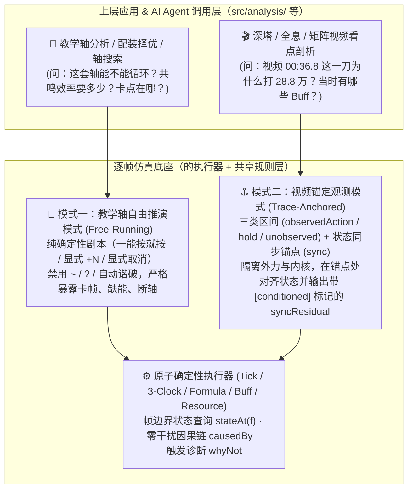
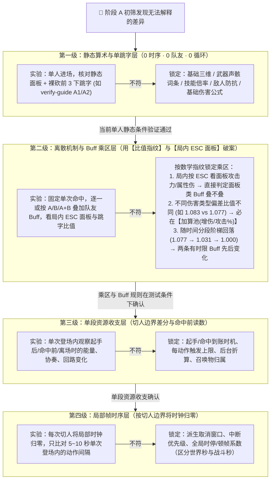

# 总体评审：逐帧仿真引擎的底座定位、代码体检与校准收敛路线（Antigravity）

日期：2026-11-11（v6：完成 `docs/antigravity-debate.md` 第 2 轮收口确认，`D-AG-01` ～ `D-AG-06` 全量达成三方共识 `done` 后同步更新）  
作者：Antigravity  
状态：架构与代码深度评审、思路规划（不涉及代码修改）  
关联讨论：跨 Agent 辩论与收敛记录见 [`docs/antigravity-debate.md`](antigravity-debate.md)、[`docs/codex-debate.md`](codex-debate.md) 与 [`docs/claude-debate.md`](claude-debate.md)  
审阅覆盖范围：
- **引擎内核与分析全量代码**：[`src/engine/types.ts`](../src/engine/types.ts)、[`resolve.ts`](../src/engine/resolve.ts)、[`simulate.ts`](../src/engine/simulate.ts)、[`kernel.ts`](../src/engine/kernel.ts)、[`scheduler.ts`](../src/engine/scheduler.ts)、[`switch.ts`](../src/engine/switch.ts)、[`resources.ts`](../src/engine/resources.ts)、[`triggers.ts`](../src/engine/triggers.ts)、[`buffs.ts`](../src/engine/buffs.ts)、[`enemy.ts`](../src/engine/enemy.ts)、[`formula.ts`](../src/engine/formula.ts)、[`summary.ts`](../src/engine/summary.ts)、[`analysis.ts`](../src/engine/analysis.ts)、[`trace.ts`](../src/engine/trace.ts)、[`insight.ts`](../src/engine/insight.ts)、[`sensitivity.ts`](../src/engine/sensitivity.ts)、[`fit.ts`](../src/engine/fit.ts)、[`calibration.ts`](../src/engine/calibration.ts)、[`invariants.ts`](../src/engine/invariants.ts)、[`assumptions.ts`](../src/engine/assumptions.ts)
- **数据装配、校验与手写模块**：[`src/data/registry.ts`](../src/data/registry.ts)、[`assemble-action.ts`](../src/data/assemble-action.ts)、[`scenario.schema.ts`](../src/data/scenario.schema.ts)、[`calibration.schema.ts`](../src/data/calibration.schema.ts)、[`nanoka-check.ts`](../src/data/nanoka-check.ts)、[`wuwalab-check.ts`](../src/data/wuwalab-check.ts)、[`src/report/timeline.ts`](../src/report/timeline.ts)、[`data/curated/`](../data/curated/)
- **同行评审与对比文档**：[Claude 评审](overall-review-claude-20261108.md)、[Codex 评审](overall-review-codex-20261108.md)、[`antigravity_vs_claude/`](antigravity_vs_claude/)、[`antigravity_vs_codex/`](antigravity_vs_codex/)、[`codex_vs_claude/`](codex_vs_claude/)

---

## 0. 核心结论摘要

1. **战略定位与底座四层切分（吸收 Claude §2 与 Codex §2.1）**：
   - 将逐帧仿真引擎定位为**“底座（编译器 + 执行器 + 调试器）”**，教学轴分析、深塔/矩阵/全息视频剖析、配装择优、AI Agent 定量推理定位为**“上层应用”**，教学轴作为首个优先验证场景。
   - **底座的物理边界**：严格区分 ① **执行器内核**（约 2,400 行，时钟/Tick/调度/事件/结算，靠单测/不变量/fuzz/conformance 验证，不进游戏）+ ② **共享机制规则**（几十条全角色通用规则，每条靠一个靶场对照实验定案，测一次全队受用）——**“把底座做好”仅指前两层**；③ **角色内容库**（18 个模块约 3,200 行，随新角色持续增长，按需验证，不纳入底座完成度验收）；④ **上层分析模块**（目前混放在 `src/engine/` 下的搜索、排轴、套路卡、择优、矩阵等约 2,900 行代码，应在架构契约上与执行器内核切开）。
   - **三层可信度解耦**：严格区分 **实现是否符合规格（Verification）**、**模型是否符合游戏（Validation）**、**本次场景输入是否适用（Applicability）**。
2. **代码体检的真实结论——内核骨架扎实，但存在“录像凑帧反噬调度”与“报告/量尺层契约断裂”两类具体病灶**：
   - 现有内核的**三时钟模型**（[`kernel.ts`](../src/engine/kernel.ts)）、**伤害公式层**（[`formula.ts`](../src/engine/formula.ts)）、**不变量护栏**（[`invariants.ts`](../src/engine/invariants.ts)）和**三方数据对账**（[`nanoka-check.ts`](../src/data/nanoka-check.ts) / [`wuwalab-check.ts`](../src/data/wuwalab-check.ts)）完成度非常高，无需推倒重写。
   - **输入侧反噬**：在缺少外部观测锚定机制的情况下，用自由推演去硬拟合 3 分钟深塔录像（[`scenarios/xin-tower4-video.yaml`](../scenarios/xin-tower4-video.yaml)），导致排轴与调度器被 `A1~ A2~ A3~ A4~` 假补位、`!` 强制打断、`敌人 失谐` / `能量满` 等写法污染，形成“加补位凑时间 → 假补位多给资源且挡住 `at` 指令 → 被迫加 `!` 强断并去录像里逐帧抠回路条删补位”的恶性循环。
   - **输出与量尺侧断裂（结合本评审与 Claude、Codex 发现）**：存在校准时钟口径冲突（R01）、事后线性扫描猜出处串归属（R02）、`fit.ts` 漏算跳字且允许非一对一重复匹配与全失配得 0 分（R03）、跨提供者同名 Buff 覆盖率丢失（R09）、击杀目标评分与伤害拆分区间不一致（R10）、截断与外推状态在对比中丢失（R11），以及 `assumptions.ts` 开关覆盖率低（14/40）与粒度捆绑（`forteKeepOnSwitch`、`module-guess`）等问题。
3. **破局的四大支柱**：
   - **底座双模化与纯确定性教学轴（吸收 Claude §0.2/§1.5）**：区分 **自由推演模式（Free-Running，服务教学轴：禁用 `~`、`?` 与自动谐破，补齐显式取消语法与按键转写映射）** 与 **锚定观测模式（Trace-Anchored，服务视频剖析：用空转等待 `hold` 与状态同步原语 `sync` 隔离外力，输出带条件标记的 `syncResidual` 残差）**。
   - **底座输出与状态查询一等公民化（吸收 Codex R04/R05 與 Claude §4）**：在不污染 `s.log` 触发器总线的前提下记录运行时直接因果链（`causedBy`）；区分**全部输入规则快照**与**实际反事实依赖清单**；以帧边界确定性重算为基础提供 `stateAt(f)`（世界帧 $f$ 开始、P1 前）与未触发诊断 `whyNot`。
   - **信源按字段类型分级（吸收 Claude §5 与 Codex §5.1）**：修正此前对“动作帧数免测”的乐观判断——倍率与基础属性经解包互证可定为高可信，但**动作帧数、取消窗口、资源到账时机及表格空格/备注语义**属于高风险项，互证仅作线索，需结合靶场或录像确认；模块 `applyOverride` 消掉 flag 仅代表“已采用（Adopted）”，不等于“已实测证实（Verified）”。
   - **差异排查二维收敛体系（融合“顺时间因果初筛”与“四级靶场隔离漏斗”）**：读已有录像时顺着“验尺子 → 时序与动作一对一匹配 → 资源 → 状态 → 单下跳字 → 血条”找最早分叉点；进靶场做定案实验时按“静态裸跳字 → 乘区比值指纹与局内面板 → 单段切人资源收支 → 切人归零的局部帧时序”逐层隔离（怀疑机制交互时补充无、A、B、A+B 最小组合实验）。

---

## 1. 现状诊断：为什么“想专心做底座，却陷在应用与实测里出不来”？

### 1.1 你的核心诉求与三层问题解耦

在本次讨论中，你明确提出了两个核心纠结：
1. **底座与应用的拉扯**：逐帧仿真引擎是底座（把轴与配置转换成按时间排序的逐帧事件流与确定性状态，供教学轴分析、深塔/矩阵/全息视频分析或 AI Agent 定量调用）。你想把精力放在把底座做好，但验证底座又不得不跑具体场景和应用。
2. **数据不可靠与差异不收敛**：一方面，上游数据来自社区表格（xlsx）、解包（Wuthery）、社区站（Nanoka / WuwaLAB），并非 100% 原始游戏规则真值；另一方面，当仿真结果和游戏/视频对不上时，缺乏成熟可靠的机制来快速收敛差异并锁定原因。

借鉴 Codex 引入的 V&V 视角与 Claude 的模拟器测试 ROM 类比，我们首先要把混在一起的三个问题拆开：

| 问题层级 | 含义与例子 | 负责发现/解决的手段 |
|---|---|---|
| **1. 实现是否符合规格（Verification）** | 规格要求 E 命中加 10 协奏、两个角色的同名 Buff 各自计时，代码是否算对、汇总是否丢数据？ | 纯软件单测、不变量（`invariants.ts`）、人造边界小用例（**0 游戏实测成本**） |
| **2. 模型是否符合游戏（Validation）** | 协奏到底是起手给还是命中给？切人保不保留卦象？五雷荡煞阵算不算角色附加异常？ | 应用场景（教学轴/录像）负责**暴露哪里缺旋钮**；训练场短平快对照实验（测试 ROM）负责**把旋钮拧到正确位置** |
| **3. 本次分析输入是否适用（Applicability）** | 录像里玩家少按了一下普攻、武器阶数不同（如奇幻变奏 R1 vs R5）、或者 Boss 换阶段清了 Buff | 核对输入配置，或在观测轴中显式标注外部给定条件（不归咎于引擎底座 Bug） |

### 1.2 症结剖析：“拿《毁灭战士》长录像去校准 CPU”的陷阱

当你试图直接用一局 3 分钟的深塔/全息实战录像去同时解决上面三个问题时，必然撞上三座大山：

1. **蝴蝶效应（跨段误差滚雪球）**  
   在自由推演中，**时间、资源、状态是强耦合的**。假设第 15 秒某个动作的协奏数据差了 1.5 点，或者玩家手慢了 6 帧，到了第 22 秒切人时，协奏从 `100` 变成 `98.5`——**变奏切人瞬间退化为普通切入**。一旦少了变奏，后续核心回路攒不满、延奏 Buff 没挂上、大招晚开 5 秒，后面 2 分钟的时间轴彻底面目全非。
2. **多变量混淆与正负抵消（方程比未知数少）**  
   正如你在 [replay-retro.md](replay-retro.md#L42) 中总结的深刻教训：
   > *“心的直接伤害偏低 8%、踏月归心偏高 2 倍，两者互相抵消，所以中 4 血条才差 2.4%。血条贴合不等于机制对，跳字才是最锋利的尺子。”*
   
   当未知的规则旋钮还没识别出来时，强行在长录像里调已有参数（就像地图少画了一座桥，却去调各段路的限速），不仅会出现“一处贴上另一处变差”（如 `summonCountsAsChar` 翻转在中 3 和中 4 给出相反的血条信号），还会把程序或机制错误写进模型参数里。
3. **把“应用层的输入噪音”当成了“底座层的规则误差”**  
   视频里玩家临场多走了一步、Boss 后退导致晚命中 3 帧、或者空挥了一下普攻，这些属于第 3 层（输入剧本的噪音），根本不是引擎底座的 Bug。

---

## 2. 全仓代码与文档深度体检（综合本评审与 Claude、Codex 发现）

### 2.1 现有底座必须保留的五大核心资产

1. **三层纯函数架构与零副作用内核**（[`registry.ts`](../src/data/registry.ts) → [`resolve.ts`](../src/engine/resolve.ts) → [`simulate.ts`](../src/engine/simulate.ts)）：[`src/engine/`](../src/engine/) 100% 纯内存计算；角色逻辑抽离在 `GameData.hooks`，运行时可变状态显式声明在 `CharRuntime.vars`（[`types.ts`](../src/engine/types.ts#L106)，总设计 §10.1）。
2. **七相位 Tick 循环与三时钟速率表**（[`src/engine/kernel.ts`](../src/engine/kernel.ts#L101-L132) `computeRates` & [`tick`](../src/engine/kernel.ts#L426-L450)）：世界帧（`s.frame`）、战斗帧（`s.battleFrames`，`stopsBattleClock` 期间为 `0`）、角色局部帧（`act.localFrame`，`snap4` 吸附）解耦清晰。
3. **经过 Golden 扰动验证的纯数学公式层**（[`src/engine/formula.ts`](../src/engine/formula.ts)）：3418 条乘区夹具逐位对拍通过，单人无 Buff 裸跳字与实机误差 `< 0.05%`。
4. **逐帧与日志级不变量护栏**（[`src/engine/invariants.ts`](../src/engine/invariants.ts) `checkTick` / `checkLog`）。
5. **三方数据自动化交叉校验**（[`nanoka-check.ts`](../src/data/nanoka-check.ts) & [`wuwalab-check.ts`](../src/data/wuwalab-check.ts)）。

---

### 2.2 代码深潜暴露出的 8 个具体症结与 Bug

以下将我们独立发现的 5 个代码级症结，与 Claude、Codex 在审查中定位的互补缺陷汇总为完整体检表：

#### 症结一（输入与调度层反噬）：录像剖析的“凑帧黑魔法”污染了排轴语法与核心调度器
- **代码位置**：[`scenarios/xin-tower4-video.yaml`](../scenarios/xin-tower4-video.yaml#L52-L123)、[`src/engine/scheduler.ts`](../src/engine/scheduler.ts#L53-L345)（`fillerTarget`、`settled`、`evaluateAct`、`fillCommand`）、[`src/data/scenario.schema.ts`](../src/data/scenario.schema.ts#L156-L250)。
- **代码级根因剖析**：
  1. 在 [`xin-tower4-video.yaml`](../scenarios/xin-tower4-video.yaml#L88-L103) 中，几乎每个 `at <秒>` 前后都被迫塞了 12 下 `A1~ A2~ A3~ A4~`，并在技能后加 `!`（如 `心 镇红尘!`、`心 转相!`）。
  2. 原因在于 [`scheduler.ts`](../src/engine/scheduler.ts#L53-L64) 的 `fillerTarget()` 只检查**紧邻的下一条非补位指令**（如 `at 32.20` 或 `心 镇红尘!`）当前帧满不满足。只要世界时间还差 1–2 帧没到 `32.20` 秒（或 `at` 之后资源差一点未满足），调度器就会启动下一记补位普攻 `A3~`；这记 `A3~` 一旦启动，默认的“等就绪”（[`scheduler.ts#L335`](../src/engine/scheduler.ts#L335) `if (!force && !settled(s, slot))`，等补位那一下判定出手；此外高优先级动作如 `E` 也会在优先级门槛上挡住低优先级声骸 `Q`）就会挡住紧随其后的 `镇红尘` 等钉帧动作，逼着写轴人给几乎所有技能加上 `!`（令 `force = true` 跳过 `settled` 等待，在 `startAction` 中直接打断未打完的补位普攻）！
  3. **更致命的副作用**：这塞进去的 12 下假补位在引擎里是真实结算的，凭空生成了录像里根本不存在的**核心回路、协奏值和共鸣能量**（见 [replay-retro.md](replay-retro.md#L54)），反过来逼着你去录像里逐帧 OCR 读回路条（`video.core`）来反推删掉哪几下 `A~`！同时，`能量满`、`敌人 失谐`、`敌人 换` 等外部状态干预直接混入了玩家排轴指令。

#### 症结二（因果追溯层断裂）：事后线性扫描猜出处（`walkOwners`）在多 Buff 到期与 BFS 队列交错时会错归
- **代码位置**：[`src/engine/trace.ts`](../src/engine/trace.ts#L233-L293)（`walkOwners`）、[`src/engine/triggers.ts`](../src/engine/triggers.ts#L29-L55)（`drain`、`s.bus.chain`）、[`src/engine/buffs.ts`](../src/engine/buffs.ts#L247-L270)（`tickBuffs`）。
- **代码级根因剖析**：
  - `SimEvent` 在生成时未记录直接因果父节点。`walkOwners` 在跑完后对 `res.log` 做单遍线性扫描，只用单个可变变量 `let anchor` 猜归属。
  - 这在两种情况下会张冠李戴：① **同帧多 Buff 到期**（[`buffs.ts`](../src/engine/buffs.ts#L247-L270) 的 `tickBuffs`——由 [`simulate.ts`](../src/engine/simulate.ts) 的 `timers` 在 P6 调用——先把同帧所有到期 Buff 的 `buffExpire` 推入日志再统一 `drain`，后面的 `buffExpire` 覆盖 `anchor`）；② **BFS 队列交错**（`drain` 是先进先出队列，同相位先入队的 $E_1, E_2$ 中，$E_1$ 触发的子事件 $C_1$ 排在 $E_2$ 后面，线性扫描扫过 $E_2$ 后把 $C_1$ 错认成 $E_2$ 的产物）。
  - 同时（吸收 Claude §4.3 #8）：当预期 Buff **未触发**时，[`triggers.ts`](../src/engine/triggers.ts) 的 `matches()` 检查失败后不留任何记录，无法回答“为什么某条加成没生效”。

#### 症结三（状态与资源层割裂）：资源变动双轨制与缺少明确帧边界的 `stateAt(frame)`
- **代码位置**：[`src/engine/resources.ts`](../src/engine/resources.ts#L118-L162)（`settleGains` vs `addEnergy`/`addConcerto`）、[`timeline.ts`](../src/report/timeline.ts#L41-L45)。
- **代码级根因剖析**：
  1. **资源双轨账本**：起手/钩子给资源发 `{ type: 'resource', value, delta }`，而判定命中调用 [`settleGains()`](../src/engine/resources.ts#L118) 只把增量塞进 `HitEvent.gains` 且无变动后绝对值 `value`，导致 [`invariants.ts`](../src/engine/invariants.ts#L117)、[`summary.ts`](../src/engine/summary.ts#L231)、[`trace.ts`](../src/engine/trace.ts#L305) 四处重复手写状态重放循环。
  2. **展示轨道不等于完整运行状态（吸收 Codex R04/D11 修正）**：我们在 v2 曾设想用 `timeline.ts` 的轨道拼装 `inspectStateAt`。Codex 准确指出：**同一世界帧内 P1–P6 有严格先后**（例如 P2 检查指令，P4 结算命中；满协奏切人后，离场角色的协奏在切人帧并未清零，而是到入场角色变奏推进至触发延奏帧才清零；且内核先记 `actionStart` 日志再扣能量调 `drain`），而现有的 `ForteStep` / `CooldownStep` 是在 P6 采集的展示文字，不包含飞行中的未结算判定（`JudgmentRuntime`）、尾部（`TailRuntime`）和完整 `vars`。因此，真正的 `stateAt(f)` 必须**明确帧内相位边界（统一为世界帧 $f$ 开始、P1 之前）**，并以执行器确定性重算为基础，而非简单拼装展示轨道。

#### 症结四（校准量尺冲突，R01）：`calibration.ts` 的 `loop` 时钟口径与 Schema / TD-11 存在双向冲突
- **代码位置**：[`src/data/calibration.schema.ts`](../src/data/calibration.schema.ts#L23-L24)、[`src/engine/calibration.ts`](../src/engine/calibration.ts#L19-L22)、[`docs/calibration/points.yaml`](calibration/points.yaml#L66-L77)、[TD-11 §1.2](wuwa-dps-td11-debug-calibration-v0.1.3.md)。
- **代码级根因剖析（吸收 Codex R01 补充）**：
  - `calibration.schema.ts` 注释与 `points.yaml` 说明将 `kind: loop` 定义为**世界秒（含时停、顿帧）**（因为训练场打桩没有深塔倒计时，只能按视频秒表量世界秒）；
  - 但 `calibration.ts` 的 `simValue` 返回的是 `roundTo(span.endT - span.t, 100)`（扣除大招时停的**战斗秒**），而 TD-11 §1.2 与 `summary.ts` 分轮统计又习惯按战斗秒算“一轮几秒”。
  - 心队一轮有 4 个大招/转相动画（约 13 秒全局时停），战斗秒 `30.57s` 对应世界秒约 `43.5s`。如果不把 `loop` 显式拆成 `loopWorld`（`(span.endF - span.f) / 60`）与 `loopBattle`（`span.endT - span.t`），量尺就会差出 13 秒。
  - 此外（吸收 Codex R06 与 `CD-06` 共识）：`calibration.ts` 核对跳字时自动在“非暴击”与“暴击”中挑离实测最近的一支；应在观测 schema 中支持 `crit | nonCrit | unknown`（缺省为 `unknown`，未确认暴击状态时同时列出两支残差，绝不默认填成 `crit`）。

#### 症结五（拟合工具缺陷，结合本评审症结五与 Codex R03 / `CD-06`）：`fit.ts` 秒当量加权和掩盖冲突、漏跳字、非一对一匹配且全失配得 0 分
- **代码位置**：[`src/engine/fit.ts`](../src/engine/fit.ts#L25-L196)。
- **四重缺陷汇总**：
  1. **漏算单下跳字（`video.hits`）且加权总分掩盖通道冲突**：`replayFit` 通过 `FIT_WEIGHTS` 将切人秒差、切人类型错（每次 2 秒）、过场秒差、血条 `hp.rmse`、协奏/回路 `rmse` 折成秒当量相加，但未纳入单下跳字，且标量总分允许用血条改善抵消定性冲突（如把变奏切入变成普通切入），也导致心直接伤害 `-8%` 与踏月归心 `+100%` 在累计血条上互相抵消。
  2. **“改剧本动作”与“翻机制开关”混排**：`fitVariants` 把 `flipsOf()`（翻全局规则）与 `neighborIter()`（随机删/挪/换动作）放在同一个总分榜里排序，删一下补位带来的时间平移直接掩盖了机制开关信号。
  3. **动作匹配缺少同通道局部保序的一对一约束，且评分参照随候选剧本漂移（Codex R03 / Claude `D-AG-05`）**：在 10 秒窗口内找最近同名动作时，两条录像观测可重复匹配同一次仿真动作，导致漏放动作却显示 `matched: 2`；且 [`fit.ts:42, 134`](../src/engine/fit.ts#L42) 从候选自己编译出的 `r.commands` 读取 `expectIntro` 作为切人类型参照（若候选删/挪了写“变奏”的行，评分参照也随之被改写）。应改为同角色、同动作链/同通道局部保序的一对一匹配，并将切人类型与锚点参照固定在录像观测集上。
  4. **全锚点失配返回 `score: 0`（Codex R03）**：当传入的 `marks` 全部失配、没有任何有效比较项时，`replayFit` 返回 `0` 分，把“无数据可比”包装成了“0 误差完美贴合”（应明确区分 `noObservations | allUnmatched | windowNotCovered`）。

#### 症结六（假设与开关体系缺陷，吸收 Claude §4.3 #1–5 与 `CD-05` / `CL-01`）：开关覆盖不全、粒度捆绑与触碰定义混用
- **代码位置**：[`src/engine/assumptions.ts`](../src/engine/assumptions.ts)、[`src/data/gamedata.ts`](../src/data/gamedata.ts)（`Rules`）、[`src/engine/sensitivity.ts`](../src/engine/sensitivity.ts)（`flipsOf`）、各角色模块。
- **五处具体差距**：
  1. **仅 35% 假设可自动翻转，未接开关的候选缺乏显式未测标记**：`ASSUMPTIONS` 共 40 条，其中仅 14 条挂有 `adjust.path`（在 `flipsOf()` 中展开为 15 个替代取值，因 `effect-owner` 有两个备选值），其余 26 条（含 `echo-cd-zero`、`burst-release`、`tunability-base`、`white-bar`、`module-guess` 等）无 `adjust.path`，导致 `pnpm sensitivity` 完全测不到它们，容易把“尚未接运行时开关（`implemented: false`，敏感度未测）”误读为“不敏感”。
  2. **`module-guess` 大杂烩**：12 个角色模块的 17 次调用（16 种不同说明文本，其中莫宁两处调用共用同一说明但处于不同动作入口，而心的一条说明内含多个可独立检验的子命题）共用同一个 `module-guess` ID，应按**可独立反驳的游戏命题**拆分，而非机械按调用次数切开关。
  3. **`rules.forteKeepOnSwitch` 一刀切捆绑**：同时控制心的照世相（验证手册 B1）和卜灵的卦象（B2），两项实测结果可能一保一清（如中 4 录像里卜灵需设为 `false`，同时把心的照世相也改成了切走清空），却只能绑在一起翻。
  4. **“碰到（touched）”混用两种粒度**：`ult-no-switch`、`wait-settled` 等是“实际发生该等待或阻挡才记”，而 `dilation-rules`、`crit-expected` 等是“代码一经过就记（未区分局部读取与局部改变判定）”。
  5. **仅汇总到整局**：只记整局触碰次数，缺少局部决策观察（`rulesRead / rulesDecisive`）与单次命中的来源/窗口余量诊断。

#### 症结七（汇总与对比边界缺陷，吸收 Codex R09、R10、R11）：同名 Buff 丢提供者、击杀拆分漏致死一击、截断/外推状态丢失
- **代码位置**：[`src/engine/buffs.ts`](../src/engine/buffs.ts)、[`src/engine/summary.ts`](../src/engine/summary.ts)、[`src/engine/analysis.ts`](../src/engine/analysis.ts)、[`src/report/timeline.ts`](../src/report/timeline.ts)。
- **三处契约断裂**：
  1. **R09**：运行时按 `(defId, owner, target)` 区分两个角色提供的同名 Buff 实例，但 `buffApply` / `buffExpire` 日志未记提供者或实例 ID，`summary.ts` 的 `buffUptime` 与网页 `buffOwners` 把它们合并成一条，导致第一位角色提供的 Buff 到期时直接关掉统计，覆盖率与归属算错。
  2. **R10**：`goal: kill` 模式下，`goalSummary` 用“目标血量 ÷ 击杀帧”算 DPS，但 `dpsBreakdown` 按左闭右开 `[lo, hi)` 过滤命中，恰好把落在右端点 `hi` 的**致死一击**排除在外（单击击杀时 `byChar` 为空表）。
  3. **R11**：指令发完但末招尚未命中就达到 `maxFrames` 时，不报 `res.error` 仅记 warning；`basisOf`、`compareRuns` 与轴搜索未传递“窗口截断”或“未达击杀目标外推（`goalNotReached`）”状态，将残缺结果当作完整结果比较。

#### 症结八（目录边界混放，吸收 Claude §2）：`src/engine/` 混放了 2,400 行执行器与 2,900 行上层分析
- **代码位置**：[`src/engine/`](../src/engine/)。
- 总设计 §2 与 §10 规划了第 ④ 层 `src/analysis/`，但目前轴搜索（`search.ts`）、套路排轴（`plan.ts`）、套路卡（`cards.ts`）、轴卡片（`scorecard.ts`）、结论（`insight.ts`）、敏感度（`sensitivity.ts`）、贴合度（`fit.ts`）、择优（`optimize.ts`）、矩阵（`matrix.ts`）全部与内核混在 `src/engine/` 下。应在架构上明确切分**执行器核心契约**与**分析应用层**。

---

## 3. 底座的清晰 Vision：同一个确定性内核之上的“双模状态机”

### 3.1 模式一：教学轴自由推演模式（Free-Running —— 吸收 Claude §0.2/§1.5 强化确定性规格）

- **适用场景**：分析给定教学轴、计算配装边际收益、评估共鸣效率门槛与操作容错。
- **严格确定性契约**：
  1. **“一能按就按”的精确定义**：同时满足 ① 动作层面合法（优先级、派生窗口、连段前置、输入锁）；② 状态条件满足（冷却、资源、角色 `canStart`）；③ 当前动作已就绪（`settled`，打断不丢判定/资源/延奏；显式写 `!` 则跳过就绪按最早合法帧取消）。
  2. **显式化调度器的 3 种“按意图等待”并统一失败口径（吸收 `CD-01` 共识）**：① 写 `变奏` 切人但切出者协奏未满时等手上动作判定出手；② 切入首招为空中攻击时等切出者跳起（`airborne`）；③ 切入首招为地面出场技时等切入者后台动作走完（`entryBusy`）。在严格教学轴入口中，若等待结束后协奏仍不满 100（当前 `scheduler.ts:395-417` 仅记 `introMissed` 警告并静默退化为普通切人），必须与 `airEntry`、`entrySkill` 一样**作为“意图未满足”失败返回**（附差额与已执行范围），绝不把退化后的普通切人当成原教学轴成立。
  3. **在入口校验层禁用替轴做主的策略（区分“引擎确定性”与“严格教学轴操作约定”）**：引擎本身对任意输入均确定；教学轴模式在入口层**禁用补位 `~`、可选 `?` 和自动谐度破坏**（底层复用同一执行器），消除“晚按 6 帧因为自动谐破换了时机反而 DPS 变高”的伪象。
  4. **补齐取消方式与转写映射**：默认声明取消方式（由模型求合法窗口，`!` 仅代表跳过 `settled` 等待而不代表闪避/跳跃动作本身），并将原文按键记号（如 `zaaa处决`）转写映射留在输入层。

### 3.2 模式二：视频锚定观测模式（Trace-Anchored —— 区分三类区间与无副作用同步）

- **核心洞察**：结合深塔或全息视频理解某个时间点的看点时，需要的是在明确外部条件下继续推演并记录残差，而不是靠塞满 `A1~ A2~ A3~ A4~` 假普攻去硬凑时间。
- **外力与核心严格隔离的三大机制（吸收 `CD-03` 共识）**：
  1. **区分三类录像区间（`observedAction | hold | unobserved`）**：确认没有新按键的区间用已知空闲等待（不打假补位普攻污染回路与能量；闪避、跳跃算输入不算空闲）；画面遮挡或连段次数未读清的区间标为 `unobserved`（显式标注所选候选填法与未知范围，不默认等同于空转，也不假定两种极端填法必然单调包住真值）。
  2. **区分“场景环境输入”与“缺省不发业务触发的状态补全 `sync`”**：将 `敌人 换`（换波次/Boss 登场）归为场景环境输入（作为场景条件记来源，不产生补状态残差 $\Delta$，也不标 `conditioned`）；将为弥补残差而做的 `能量满`、`敌人 失谐` 或切人前协奏对齐收口为状态补全原语 `sync`——**缺省只修改状态数值、不向 `s.log` 发射业务级 `resource` / `resourceFull` 触发事件**，并在旁路记录中显式列出 `{ simBefore, observedConstraint, anchoredTo, residual, phase, skippedTriggers }`（未分析钩子标“未分析”）。
  3. **一等公民的残差账单（`syncResidual`）与条件标记（`basis: 'conditioned'`）**：首次状态补全干预起保守标记下游结果为 `conditioned`（有条件推演），承认同步只对齐当前时刻数值而不能恢复历史何时满资源或未观测的内部冷却，绝不用被外部强制指定的同一个量反过来宣称模型自证。

---

## 4. 破局难题一：信源按字段类型分级与“证据台账 + 开关解耦”

### 4.1 按字段类型而非网站整体评估信源（吸收 Claude §5 与 Codex §5.1 修正）

我们在 v2 中曾把“动作发生帧/结束帧”与“倍率”一起归为多源吻合即可免测，这一判断过于乐观。结合 Claude 对历史高影响错案的统计与 Codex 的数据溯源，修正为以下三档分级：

| 字段/内容类型 | 上游信源现状与独立性 | 风险评级与底座应对策略 |
|---|---|---|
| **1. 技能倍率、基础三维、能量消耗、协奏总量** | Wuthery 解包与 Nanoka 高度一致（已连伤害条目 2681/2681 倍率吻合） | **低风险（`Tier-1`）**：自动化交叉核对（`nanoka-check`）吻合即直接采用，无需专门进游戏测倍率。 |
| **2. 动作帧数、取消窗口、资源到账时机（起手 vs 命中）** | 缺少公开解包逐项基准；WuwaLAB 帧数含顿帧且部分来自人工实测（143 个动作仅 48 个各项全一致）；表格只写总量不保时机 | **中/高风险（`Tier-2`）**：多源互证仅作为**排查线索**，不能当成免测真值；涉及卡帧点或变奏门槛时需靠录像或靶场短实验核实。 |
| **3. 表格语义（空格子、备注、落地行）与共享交互规则** | 历史前 5 大 DPS 偏差（雷主大招漏时停 +12%、心转相优先级空格 +8.7%、声骸起手优先级 +8%、椿落地段 −3.8%、切人冷却各算 +3.7%）全出于此 | **最高风险（`Tier-3`）**：① 每修一处表格读法错误，必须**全库扫描同类写法并固化为构建 flag**；② 共享交互规则必须登记为**独立命名的可切换开关**。 |

> **警示（吸收 Claude §5 与 Codex R12）**：
> - **AI 整理的资料只是线索，其自标的“高可信度”不是证据**（如 `m3-verify-answers-gemini.md` 曾把“协奏出手给全额”标为高可信度，次日被实测证伪）。
> - **模块 `applyOverride` 消掉 flag 不等于“已实测确认”**：必须在规则与关键字段台账中区分 **“已采用（Adopted）”、“有旁证（Corroborated）”、“列明条件下已实测支持（Verified）”** 三种状态。

### 4.2 改造假设表（`assumptions.ts`）与敏感度筛选准则

1. **一条游戏规则一个独立开关**：立即拆开 `rules.forteKeepOnSwitch`（拆为按角色/资源独立配置或独立开关），拆解 `module-guess` 的 17 处调用为各自具名的假设 ID。
2. **区分“全部输入快照”与“实际反事实依赖清单”**：结果不仅附上全部 `Rules` 快照，还应精确记录哪些未证实开关**真的改变了本次分支决定**（“起作用才记”，而非“代码经过就记”）。
3. **敏感度筛选准则（修正 v2 的“< 0.5% 永远不测”）**：
   - 优先实测：会导致**断轴/变奏失败**、改变**配装/打法相对排名**、或显著改变**教学轴绝对伤害上限**（如 `summonCountsAsChar` 影响心队绝对伤害约 6%）的共享规则与高影响角色规则；
   - 当怀疑两条规则存在**组合交互**时，补充少量组合检查（无、A、B、A+B）；
   - 当前影响 `< 0.5%` 且不改门槛的未知项，状态标为 **“延后实测 / 允许悬置（Deferred）”** 并保留开关。

---

## 5. 破局难题二：二维差异收敛体系（融合“顺时间因果初筛”与“四级靶场隔离漏斗”）

在对比本评审与 Claude、Codex 的排查顺序后，我们发现双方的顺序之所以不同，是因为针对的是**两个互补的阶段**：

1. **阶段 A：面对已有录像或两份运行结果时的“观测初筛（Observational Triage —— 采纳 Codex/Claude 顺序）”**  
   当你在对比一段录像和仿真输出时，必须**先验尺子、顺着时间与因果链往下查**：
   - **Step 1 确认可比与验尺子**：核对版本、配装、初态、时钟口径（世界秒 vs 战斗秒）；
   - **Step 2 一对一匹配动作与切人时序**：先对齐切人与动作实例，找出**最早有证据的时序或资源偏差**（因为上游动作晚了 2 秒会直接导致下游 Buff 过期，此时直接看下游跳字会误判）；
   - **Step 3 分开各通道残差**：分别看时序、资源、Buff 覆盖、单下跳字、累计血条，绝不让总分隐藏正负抵消。

2. **阶段 B：针对暴露出的疑点，设计靶场短实验定案时的“四级正交隔离漏斗（Experimental Isolation —— 本评审方法）”**  
   一旦从录像或教学轴里发现了现有已知旋钮解释不了的偏差，**严禁继续在长录像里多变量盲猜**，而是切入训练场木桩，按从底层到上层的顺序做单变量（或最小 $A / B / A+B$ 交互）隔离实验：

### 5.1 实例验证：心队第 1 轮跳字比值的“两因子拆解”与实跑战斗帧新发现（`CD-07`）

在 [`docs/tower-20261026.md`](tower-20261026.md#L216-L233) 中，心第 1 轮跳字（录像暴击 ÷ 仿真暴击）呈现出一组极具规律的数字：
- **开场单人（3.9–4.5s）**：`心召唤-6` 录像 `8444` vs 仿真 `8448`（**`0.9995`**）→ 单人静态条件下面板与基础公式吻合。
- **第 1 轮应世相（31–37s）**：
  - `心召唤-1~6`、`电磁 QTE-3`（仿真增伤底数 `3.195`）：`22061 / 20373 = 1.08285`
  - `应世 E-1~4`、`E-落地`、`镇红尘`（仿真增伤底数 `3.766`）：`288240 / 267644 = 1.07695`
- **第 1 轮照世相（转相之后）**：
  - `照世·E-2`（43.6s，仿真增伤底数 `3.766`）：`49516 / 48007 = 1.03143`
  - `镇寰宇`（51.5s，2026-10-27 第一版表记仿真 `195198`、增伤底数 `3.266`）：`202284 / 195198 = 1.03630`
  - `万阙垂天`（58.2s，仿真 `298137`、增伤底数 `3.016`）：`298012 / 298137 = 0.99958`

**候选拆解、实跑核查与可证伪预测（综合三方复算与本轮实跑新发现）**：
1. **“共同乘数 $m \approx 1.04393$ + 增伤 $b \approx 0.11913$”优先候选**：
   - 联立应世相两类伤害方程解得 $m = 1.04393$、$b = 0.11913$（约 `+12%` 增伤）。当转相后共同乘数 $m$ 消失、仅剩 $b$ 时，对 `照世·E-2` 的预测比值为 $1 + 0.11913 / 3.766 = 1.03163$（实录 `1.03143`），对 `镇寰宇`（底数 `3.266` 时）的预测比值为 $1 + 0.11913 / 3.266 = 1.03648$（实录 `1.03630`），两处仅差万分之二。
2. **$m$ 与 B10（全队攻击叠加）必须分开验证（采纳 Claude 指正）**：
   - 实跑当前 `xin-tower4-video.yaml` 确认：心在第 1 轮各次命中时，仿真里**已经挂着 `雷主·男.超负荷`（`+10% atkPct`）与 `隐世回光.5`（`+15% atkPct`）**。因此 $m$ 是游戏比仿真多出的一项乘数，而 B10（第 2 轮卜灵放 `无归的谬误` 全队攻击 `+10%`）是仿真比游戏高 4.4%，两者方向相反，必须分开排查（先从已有录像读同时段队友跳字比值区分 $m$ 是心专属还是全队/目标乘区，再在靶场看心入场后 vs 转相后的面板）。
3. **本轮实跑当前代码发现的关键时序事实与零参数对调检验（`D-AG-03` & `CD-07`）**：
   - 在当前代码（`bebd9f8` / `f6f21a7`，数据 `20261019`）实跑 `xin-tower4-video.yaml` 时：雷主在 `f=1635 / bf=1180f` 执行 `switch 心 变奏`，`镜影流电之瞬.5延奏`（`+0.25` 导电加成，持续 `900` 战斗帧 = 15.0 秒）在 **`f=1636 / bf=1181f` 记录 `buffApply`**，并在 **`f=2819 / bf=2080f` 记录 `buffExpire` 到期**——比 `f=2948 / bf=2098f` 命中的 `镇寰宇` **早了 18 个模型战斗帧（0.30 秒）**，导致当前代码跑出的 `镇寰宇` 仿真暴击实为 **`180,256`**（`bonus = 3.016`），而非 10-27 旧表里的 `195,198`（`bonus = 3.266`；吸取此教训，今后所有跳字对照表与台账引用的仿真列均须附 git commit 与数据版本号）。
   - 更进一步：在当前模型输出中，从 `镇寰宇`（`f=2948, bf=2098f`）经过 `照世·谐度破坏` 到 `万阙垂天`（`f=3305, bf=2100f`），虽然世界时间过了 `5.95` 秒，但因三段连续处于全局时停过场中，**模型战斗时间总共只走了 `2` 帧（`0.033` 战斗秒）**。
   - **候选解释与严格推理边界（三方独立复算确认）**：
     - **候选 B-1（雷主首位 3C `绝息魄` 配置假说——第一优先级核查项）**：查 [`scenarios/xin-tower4-video.yaml:28-29`](../scenarios/xin-tower4-video.yaml#L28-L29)，雷主第 2 件声骸恰为 **3C `绝息魄`**（首位效果：延奏后使下一位变奏登场角色 **`+12.00%` 导电伤害加成，持续 900 战斗帧**，与 `镜影流电之瞬.5延奏` 同在 `f=1636/bf=1181` 挂上、同在 `f=2819/bf=2080` 到期）。Claude 与 Codex 独立运行了仅对调雷主第 1、第 2 件声骸的零参数对照实验：`电磁 QTE-3`（`21,138`）与 `镇红尘大字`（`276,172`）的录像/仿真比值从 `1.0829 / 1.0770` 直接收束为**同一个数 `1.0437`**，`照世·E-2`（`49,537`）的比值从 `1.0314` 收束为 **`0.9996`**！下一步请用户确认或回看录像 14.5s 雷主按 Q 画面验明（确认前作为高优先级候选解释而非已证实装备事实；确认后保留原场景并另存对照场景）。
     - **18 战斗帧窗口边界（区分模型战斗帧输出与游戏真实时钟）**：录像里 `镇寰宇` 似仍在两条 15s 加成窗口内（`1 + (0.25 + 0.12) / 3.016 = 1.1227` vs 实录 `202284 / 180256 = 1.1222`），而当前模型早 18 战斗帧到期。这既可能是场景中 `镇寰宇` 的 `at` 钉点偏差（录像记 51.5s vs 仿真 51.88s），也可能是过场/时停计时边界差异，两者并列为待核实的窗口边界假设，不直接拿模型输出的 2 战斗帧当成游戏已观测事实。
     - **候选 B-2（万阙垂天起手退出 `心相心生` 时移除）** 与 **候选 B-3（世界时钟计时）的范围界定**：`镇寰宇`（`f=2948`）证伪的是“在 `f=1635/1636` 变奏入场触发、固定持续 15 世界秒”这一具体世界时钟候选；其余无数据出处的假想世界时钟设定标为 `未优先检验（无信源依据）`。

---

## 6. 面向应用与 AI Agent 的底座接口契约（综合 `CD-02`、`CD-04`、`CD-06` 共识）

为了确保观察过程绝不改变执行结果（Codex R05），并让 AI Agent 无需解析网页或猜单位，底座对外暴露以下结构化纯函数契约：

| 接口能力 | 核心契约与实现边界 |
|---|---|
| **1. 四层规则输出与零干扰因果链** （`CD-02` & `CD-04`） | ① **因果字段与零干扰验收条件**：保留 `Link.root` 根因归属，新增 `drain` 直接父事件下标 `parentEventId` 与非 `drain` 相位来源（`P3 spawn / P6 expire`）；资源账本在 `add()` 旁路或只读视图统一，不向 `s.log` 额外发业务事件（**验收条件**：剥离新增诊断元数据后，业务事件序列、状态、报错、RNG 消耗与汇总数值完全相同；`pnpm conformance` 快照结构变更显式版本化）。 ② **四项分离（不宣称包含关系）**：**完整输入配置**、**执行观察记录**（`rulesRead / rulesDecisive` 局部判断）、**事件来源与数值输入**（含单次命中距相符在场/近邻 Buff 边界的战斗帧余量 `buffWindowMargin`，携带实例 ID、持有者/目标、退出原因及同帧相位）、**指定反事实比较**（区分运行内句柄与跨运行匹配状态：先查执行覆盖，另一运行提前停止时标 `未分析: runStoppedBeforeTarget`，覆盖对应段时区分 `对应明确 | 新增或消失 | 歧义`）。 |
| **2. 明确相位边界的状态查询** `stateAt(scenario, frame)` | 统一定义为**世界帧 `f` 开始、P1 之前**的完整执行状态（初始化完成后的首个 Tick 起点记为 `S[0]`）。第一版采用**从初态确定性重算至目标边界并返回深拷贝快照**（包含动作局部进度、飞行中判定、带提供者实例 ID 的 Buff、资源、内部冷却与当时刻合成面板；结合敏感度矩阵 24 场景 × 15 开关耗时 180.4s 的基线，在长轴上实测重算耗时并按完整输入键缓存）。 |
| **3. 三类无副作用未触发诊断** （`CD-04`） | 拆分为三个显式只读接口：① `canActionExecuteAt(state, slot, action)`（当前动作能否执行及阻塞原因）、② `whyDidEventNotTrigger(eventId, effectId)`（历史事件在实际发生点为何未触发某效果，不写 `lastTrigger`）、③ `wouldHypotheticalEventTrigger(state, fakeEvent, effectId)`（隔离状态下的假想事件触发检查）；逐路径返回 `满足 | 不满足 | 未检查 | 不适用 | 未建模`。 |
| **4. 观测比对与锚定推演** `compareObservations` & `simulateAnchored` | 先按**同角色、同动作链/同通道局部保序**做一对一匹配，将切人类型与锚点参照固定在录像观测集上（不随候选轴改写），显式报告 `noObservations | allUnmatched | windowNotCovered`、定性冲突与各通道残差；锚定模式区分场景环境输入与补状态 `sync`（缺省只改值不发业务触发，输出带 `conditioned` 标记的 `syncResidual` 与 `skippedTriggers`）。 |

---

## 7. 务实的推进路线图与双维验收标准（融合 `CD-08` & `D-AG-01` 共识）

我们将第一阶段的验收标准拆分为两个正交维度：**① 执行器与观察工具能力验收（纯软件，含代表性角色钩子集成）** 与 **② 指定代表轴与用途下的机制基线验收（有条件交付 vs 暂缓精确结论）**，并按互不阻塞的四批推进：

### 批次一（P0，纯软件修尺子与台账整理）：修好量尺、汇总边界与开关耦合
1. **修校准时钟与暴击分支（R01、R06、`CD-06`、`D-AG-05`）**：`kind: 'loop'` 校准点按实际测量方法显式指定 `clock: 'world' | 'battle'`（`loop` 是观察类型 `kind` 而非第三种时钟，旧点兼容须公开说明）；`kind: 'hit'` 校准点暴击分支支持 `crit | nonCrit | unknown`（缺省 `unknown`）。
2. **修汇总与对比的误导性 Bug（R03、R09、R10、R11）**：
   - `buffApply`/`buffExpire` 与 `buffUptime` 保留 `(defId, owner, target)` 实例身份（R09）；
   - 修复 `goal: kill` 下 `dpsBreakdown` 右开区间漏掉致死一击的问题（R10）；
   - 将 `maxFrames` 截断与 `goalNotReached` 外推状态传递到 `Basis`、`compareRuns` 与搜索（R11）；
   - 修复 `fit.ts` 零有效观测得 0 分、同名动作重复匹配与 `expectIntro` 参照随候选轴变动的问题（改为同角色/同通道局部保序一对一匹配，固定录像观测参照），加入 `video.hits` 跳字通道，将规则候选与改轴变体分表展示并单列定性冲突。
3. **建立四块式规则证据台账与按命题解耦开关（`CD-05`、`D-AG-06`）**：按“命题身份 / 候选解释与采用状态（含 `implemented: false` 标明未实现开关的候选及 `候选未列全`）/ 证据条目（含条件、游戏/数据/仿真版本与 `usedInModeling`）/ 派生当前结论”扩展 `assumptions.ts`；将产生可观测后果的执行约定（如 `P2 先于 P4`）链接到对应游戏命题；拆开心与卜灵的切人状态保留开关，按可独立反驳的命题拆解 `module-guess`；优先盘点既有录像证据（含回看中 4 录像 14.5s 雷主首位声骸是否为 `绝息魄` 及同时段队友跳字）。

### 批次二（P1，按账号分包的靶场受控实验）：并行定案代表轴关键命题
- 按账号条件分两包执行（预先写清控制条件，计入换号、重置、录屏与读数入账成本）：
  - **`everbird` 账号包**：`A1`（心面板与开场 AAA 公式锚点）、`B1 & B2`（心照世相、卜灵卦象切人保留）、`B7`（大招不响应输入是否挡切人）、`B10`（无 / 仅超负荷 A / 仅无归的谬误 B / A+B 四态面板对照，与 $m$ 的入场 vs 转相面板核查分开进行）、`B11`（严格保持验证手册**心留在后台**的原条件，记录开阵前基线层数，测五雷荡煞阵冲击波是否叠霆心域）；
  - **`Evariste` 账号包**：`C1`（椿烬华蔓舞后是否自动出第 4 段）、`C4`（出场技条件）、`C5`（大招后切人锁）。

### 批次三（P2，筑基）：严格教学轴入口、零干扰因果链与状态/未触发查询
1. **落地严格教学轴入口（`CD-01`、`CD-08`）**：入口层禁用 `~`、`?`、`at` 与 `tuneBreak: auto`，运行时将等待后仍不满协奏的 `introMissed` 统一为“意图未满足”失败；推荐以 [`scenarios/m0-video-eq.yaml`](../scenarios/m0-video-eq.yaml)（补齐照录像手写的谐度破坏位置，交用户最终拍板）作为首条代表性教学轴——注意原配置下的“14/15 单翻 25.00s 不变”存在组合效应（同时关自动谐破与声骸优先级特例时轮长变为 `25.233s`），故在手写谐破的严格输入定稿后需重跑单翻与交互组合以确定有条件可交付结论的范围，同时暂缓依赖 C1 与 `burst-release` 的精确帧/DPS 结论，并保留心队卜灵协奏时机作为未解多候选案例。
2. **落地零干扰因果链与四层规则输出（`CD-02`、`CD-04`）**：记录 `parentEventId`、非 `drain` 相位来源、`add()` 资源旁路视图以及单次命中的 `buffWindowMargin`。
3. **落地 `stateAt(f)` 与三类 `whyNot` 接口（`CD-04`）**：基于 P1 前边界确定性重算提供深拷贝状态快照与三类无副作用未触发诊断。

### 批次四（P3，赋能视频应用）：锚定观测模式（`hold` + `sync`）与目录边界切分
1. **提供视频锚定观测能力（`CD-03`）**：支持 `observedAction | hold | unobserved` 区间表达与缺省不发业务触发的 `sync` 状态同步，输出带 `conditioned` 标记的 `syncResidual` 与 `skippedTriggers`。
2. **切清代码目录边界**：将 `src/engine/` 下的上层分析模块与约 2,400 行执行器内核在架构契约上切开。

---

## 修订记录
- **2026-11-08 v1**：基于与用户的初步讨论及核心文档整理概念框架。
- **2026-11-08 v2**：在未读取其他 Agent 评审的前提下，完成全仓源码与文档独立深潜，新增 5 项代码级症结与心 8% 伤害悬案的阶梯比值拆解。
- **2026-11-09 v3**：阅读 Claude、Codex 总体评审及三组 `vs` 对比文档后更新。
- **2026-11-09 v4**：完成 [`docs/codex-debate.md`](codex-debate.md)（`CD-01` ～ `CD-08`）跨 Agent 复核后更新：
  1. 确认 `CD-01`、`CD-02`、`CD-04`、`CD-06` 四项三方共识（严格教学轴 `introMissed` 升级为意图未满足失败、四层规则输出分离并补充单次命中 `buffWindowMargin`、`whyNot` 拆为三类只读签名、`hit` 暴击分支缺省 `unknown` 与同通道局部保序一对一匹配）；
  2. 吸收 `CD-03`、`CD-05`、`CD-08` 共识（`sync` 缺省不发业务触发并列 `skippedTriggers`、台账登记未实现运行时开关的替代候选、双维验收与按 `everbird / Evariste` 账号分包实验）；
  3. 在 §5.1（`CD-07`）更正“把 $m$ 与 B10 合并”的旧说法，并补充实跑当前代码发现的 `bf = 2080f / 2098f / 2100f` 战斗帧冻结事实与 $b \approx 0.12$ 的三个精确候选（含雷主首位 3C 绝息魄假说）。
- **2026-11-09 v5**：完成 [`docs/claude-debate.md`](claude-debate.md)（`CL-01` ～ `CL-05`）跨 Agent 复核后更新：
  1. 采纳 `CL-04` §2 对本评审的 5 项代码级校准（修正症结一 `A~ -> 镇红尘!` 的阻塞机制为 `scheduler.ts:335` 默认等就绪 `!force && !settled(s, slot)` 而非普攻起手优先级，统一 `CharRuntime.vars` / `buffExpire` / `buffs.ts tickBuffs` / `fit.ts replayFit` 等符号引用，将因果埋点零干扰表述为显式验收条件）；
  2. 确认 `CL-02` 与 `CL-05` 达成三方共识（`done`），`CL-01` 与 `CD-05` 合流；在 `CL-03` 确认三类录像区间（`observedAction | hold | unobserved`）共识的同时，基于 `scheduler.ts` 与 `xin-tower4-video.yaml` 实码分析说明为何不应修改补位 `~` 在 `at` 前的停止条件。
- **2026-11-11 v6**：完成 [`docs/antigravity-debate.md`](antigravity-debate.md)（`D-AG-01` ～ `D-AG-06`）第 2 轮收口确认（6 项全部达成三方共识 `done`）后同步更新：
  1. 在 §5.1（`D-AG-03`）补充 Claude 与 Codex 独立复算确认的“雷主首位对调为 3C `绝息魄` 零参数消除早段分组差（收束为 `1.0437`）与 `照世·E-2` 残差（`0.9996`）”结果、标注 `buffApply f=1636 / bf=1181` 精度，并采纳 Codex 的三项严谨推理边界（区分高优先级配置候选与已证实装备事实、区分模型战斗帧输出与游戏观测帧、将 B-3 的排除范围严格限定在“入场触发且固定 15 世界秒”具体候选、对照表仿真列记版本）；
  2. 同步 `D-AG-01 / 02 / 04 / 05 / 06` 收口细节（区分场景环境输入与补状态 `sync`、固定 `fit.ts` 录像观测参照、校正 `kind: loop` 的 `clock: 'world' | 'battle'` 字段语义、跨运行 `runStoppedBeforeTarget` 状态、有可观测后果的执行约定链接游戏命题、以及 M0 关自动谐破与声骸优先级特例的组合效应）。
