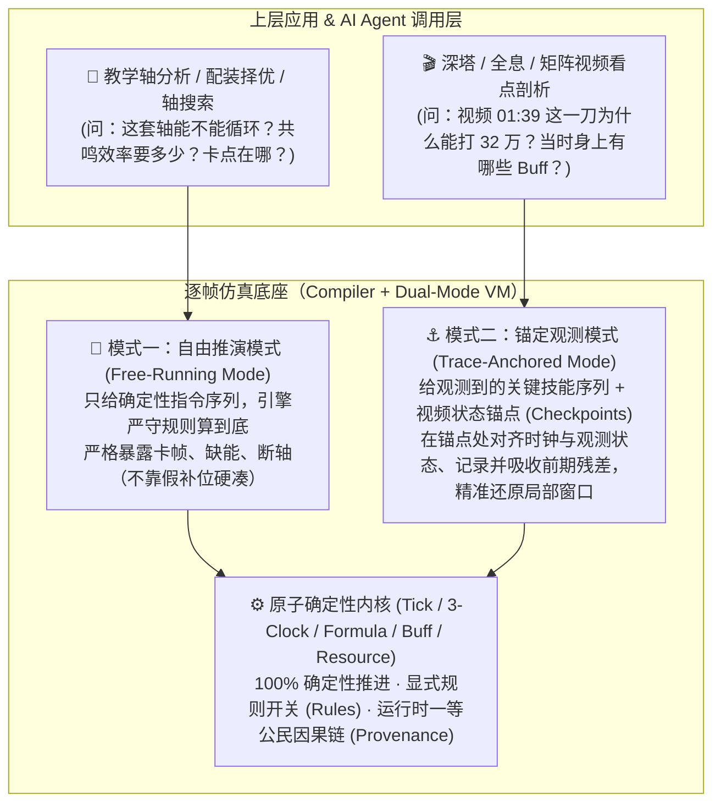
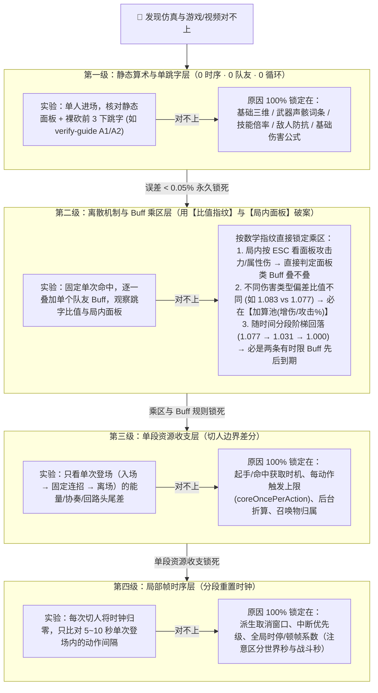

# 总体评审：逐帧仿真引擎的底座定位、代码体检与校准收敛路线（Antigravity）

日期：2026-11-08（v2：完成全仓代码与设计文档独立深潜后更新）  
作者：Antigravity（独立审阅，未读取其他 Agent 的 `overall-review-*` 文档）  
状态：架构与代码深度评审、思路规划（不涉及代码修改）  
审阅覆盖范围：
- **引擎内核与分析全量代码**：[`src/engine/types.ts`](../src/engine/types.ts)、[`resolve.ts`](../src/engine/resolve.ts)、[`simulate.ts`](../src/engine/simulate.ts)、[`kernel.ts`](../src/engine/kernel.ts)、[`scheduler.ts`](../src/engine/scheduler.ts)、[`switch.ts`](../src/engine/switch.ts)、[`resources.ts`](../src/engine/resources.ts)、[`triggers.ts`](../src/engine/triggers.ts)、[`buffs.ts`](../src/engine/buffs.ts)、[`enemy.ts`](../src/engine/enemy.ts)、[`formula.ts`](../src/engine/formula.ts)、[`summary.ts`](../src/engine/summary.ts)、[`trace.ts`](../src/engine/trace.ts)、[`insight.ts`](../src/engine/insight.ts)、[`sensitivity.ts`](../src/engine/sensitivity.ts)、[`fit.ts`](../src/engine/fit.ts)、[`calibration.ts`](../src/engine/calibration.ts)、[`invariants.ts`](../src/engine/invariants.ts)、[`assumptions.ts`](../src/engine/assumptions.ts)
- **数据装配、校验与手写模块**：[`src/data/registry.ts`](../src/data/registry.ts)、[`assemble-action.ts`](../src/data/assemble-action.ts)、[`scenario.schema.ts`](../src/data/scenario.schema.ts)、[`calibration.schema.ts`](../src/data/calibration.schema.ts)、[`nanoka-check.ts`](../src/data/nanoka-check.ts)、[`wuwalab-check.ts`](../src/data/wuwalab-check.ts)、[`src/report/timeline.ts`](../src/report/timeline.ts)、[`data/curated/`](../data/curated/)（含 [`心.ts`](../data/curated/characters/心.ts)、[`卜灵.ts`](../data/curated/characters/卜灵.ts)、[`雷主·男.ts`](../data/curated/characters/雷主·男.ts)、[`weapons.ts`](../data/curated/weapons.ts)、[`echoes.ts`](../data/curated/echoes.ts)、[`echo-sets.ts`](../data/curated/echo-sets.ts)、[`env-buffs.ts`](../data/curated/env-buffs.ts)）
- **设计、复盘与校准文档**：[技术总体设计 v0.2.4](wuwa-dps-engine-tech-design-v0.2.4.md)、[TD-04 仿真内核](wuwa-dps-td04-sim-kernel-v0.1.7.md)、[TD-09 排轴与调度](wuwa-dps-td09-rotation-scheduler-v0.1.11.md)、[TD-11 调试与校准手册](wuwa-dps-td11-debug-calibration-v0.1.3.md)、[engine-quality-plan.md](engine-quality-plan.md)、[replay-retro.md](replay-retro.md)、[verify-guide.md](verify-guide.md)、[tower-20261026.md](tower-20261026.md)、[xin-confirm.md](xin-confirm.md)、[rotation-video.md](rotation-video.md)、[calibration/points.yaml](calibration/points.yaml)

---

## 0. 核心结论摘要

1. **你的架构直觉完全正确**：将逐帧仿真引擎定位为**“底座（编译器 + 确定性状态机）”**，将教学轴分析、深塔/矩阵/全息视频剖析、配装择优、AI Agent 定量推理定位为**“上层应用”**，完全契合当前 [`src/engine/`](../src/engine/) 的纯函数设计。
2. **代码体检的真实结论——内核已经很扎实，卡住你的是“用单一前向推演模式硬扛实战录像”带来的架构反噬**：
   - 现有内核的**三时钟模型**（[`kernel.ts`](../src/engine/kernel.ts)）、**伤害公式层**（[`formula.ts`](../src/engine/formula.ts)）、**不变量护栏**（[`invariants.ts`](../src/engine/invariants.ts)）和**三方数据对账**（[`nanoka-check.ts`](../src/data/nanoka-check.ts) / [`wuwalab-check.ts`](../src/data/wuwalab-check.ts)）完成度非常高。
   - 真正让你陷入“实测校准泥潭”的，是在没有**状态锚定（Checkpointing）**机制的情况下，试图用自由推演去拟合 3 分钟的深塔实战录像（如 [`scenarios/xin-tower4-video.yaml`](../scenarios/xin-tower4-video.yaml)），导致排轴语法和调度器被成百上千个 `A1~ A2~ A3~ A4~` 假补位、`!` 强制打断、`敌人 失谐` / `能量满` 等**录像黑魔法（Replay Workarounds）**污染，形成“加补位凑时间 → 假补位多给资源且挡住 `at` 指令 → 被迫加 `!` 强断并去录像里逐帧抠回路条删补位”的恶性循环。
3. **破局的三大支柱**：
   - **底座双模化（解除底座对长视频零漂移的强耦合）**：把“玩家操作指令”和“外部状态观测同步”彻底分开。区分 **自由推演模式（Free-Running，服务教学轴与理论计算）** 与 **锚定观测模式（Trace-Anchored，服务深塔/全息视频看点剖析）**，在观测锚点处对齐状态并记录残差（Residuals），阻断前期误差向后传染。
   - **底座输出一等公民化（服务上层应用与 AI Agent）**：补齐运行时直接因果链（取代 [`trace.ts`](../src/engine/trace.ts) 里易串味的线性扫描 `walkOwners`）、统一资源变动事件、提供任意帧全量状态切片 `inspectStateAt(frame)`。
   - **差异排查正交化（解决数值对不上时无法收敛）**：修复 [`calibration.ts`](../src/engine/calibration.ts) 的世界秒/战斗秒口径 Bug，拆分 [`fit.ts`](../src/engine/fit.ts) 混为一谈的标量损失函数，严格执行 **“四级万用表收敛漏斗”**（① 静态面板与单下裸跳字 → ② 乘区比值指纹与局内面板 → ③ 单段切人边界资源收支 → ④ 分段重置的局部帧时序），每次只解单变量方程。

---

## 1. 现状诊断：为什么“想专心做底座，却陷在应用与实测里出不来”？

### 1.1 你的核心诉求与纠结

在本次讨论中，你明确提出了两个核心纠结：
1. **底座与应用的拉扯**：逐帧仿真引擎是底座（像编译器一样把轴编译成按时间排序的逐帧事件流，算出每一帧的确定性状态，供上层应用或 AI Agent 定量调用）；教学轴分析、深塔/矩阵/全息视频分析是上层应用。你想把精力放在把底座做好，但验证底座又不得不跑具体场景和应用。
2. **数据不可靠与差异不收敛**：一方面，上游数据来自社区表格（xlsx）、解包（Wuthery）、社区站（Nanoka / WuwaLAB），并非 100% 原始游戏规则真值；另一方面，当仿真结果和游戏/视频对不上时，缺乏成熟可靠的机制来快速收敛差异并锁定原因。

### 1.2 症结剖析：“拿《毁灭战士》录像去校准 CPU”的陷阱

顺着你的**“编译器 / 虚拟机”**类比来看：
- **引擎底座** = 一台 CPU 的指令集架构（ISA）：规定了加法怎么算（伤害乘区公式）、状态寄存器怎么改（切人保不保留回路、Buff 叠不叠）、每个指令占几个时钟周期（发生帧、派生窗口、顿帧、全局时停）。
- **一局 3 分钟的深塔/全息实战视频**（如 [tower-20261026.md](tower-20261026.md) 中的中 1–4 录像） = 在这台尚未完全校准的 CPU 上跑了一局 **10,000 行代码的《毁灭战士》（复杂上层应用）**。

当你试图用“整局实战录像”或“复杂长轴”去校准底座时，必然撞上三座大山：

1. **蝴蝶效应（跨段误差滚雪球）**  
   在自由推演中，**时间、资源、状态是强耦合的**。假设第 15 秒某个动作的协奏数据差了 1.5 点，或者玩家手慢了 6 帧，到了第 22 秒切人时，协奏从 `100` 变成 `98.5`——**变奏切人瞬间退化为普通切入**。一旦少了变奏，后续核心回路攒不满、延奏 Buff 没挂上、大招晚开 5 秒，后面 2 分钟的时间轴彻底面目全非。
2. **多变量混淆与正负抵消（方程比未知数少）**  
   正如你在 [replay-retro.md](replay-retro.md#L42) 中总结的深刻教训：
   > *“心的直接伤害偏低 8%、踏月归心偏高 2 倍，两者互相抵消，所以中 4 血条才差 2.4%。血条贴合不等于机制对，跳字才是最锋利的尺子。”*
   
   在实战录像中，十几个未知机制开关（[`assumptions.ts`](../src/engine/assumptions.ts)）同时生效。这就像解一个方程 $x + y - z = 10$，你只观测到最终结果偏了 8%，根本无法唯一确定是 $x$ 错了还是 $y$ 错了；甚至在中 3 和中 4 两局录像里，同一个假设开关翻转会给出相反的贴合信号（[replay-retro.md](replay-retro.md#L57)）。
3. **把“应用层的输入噪音”当成了“底座层的规则误差”**  
   视频里玩家临场多走了一步、Boss 后退导致晚命中 3 帧、或者空挥了一下普攻，这些属于**输入剧本的噪音**，根本不是引擎底座的 Bug。但如果不把它们剥离开，你就会在底座调参里陷入死循环。

---

## 2. 全仓代码与文档深度体检（First-Hand Codebase Audit）

通读全部引擎源码（[`src/engine/`](../src/engine/)）、数据装配层（[`src/data/`](../src/data/)）、手写模块（[`data/curated/`](../data/curated/)）与场景文件后，我们可以非常客观地给当前代码库做一次画像：**内核骨架极其优秀，但边界处有 5 个具体的代码级症结正在拖慢你。**

### 2.1 现有底座已经做对、极其扎实的核心资产（必须保留的基石）

1. **三层纯函数架构与零副作用内核**（[`registry.ts`](../src/data/registry.ts) → [`resolve.ts`](../src/engine/resolve.ts) → [`simulate.ts`](../src/engine/simulate.ts)）：
   - [`src/engine/`](../src/engine/) 100% 纯内存计算，不碰文件、DOM 与网络；角色模块唯一的逻辑代码抽离在 `GameData.hooks` 表中，运行时可变状态全部显式声明在 `CharState.vars` 里（总设计 §10.1）。这种设计天生就是为 AI Agent 高并发调用和未来 Rust 移植（`pnpm conformance`）准备的。
2. **七相位 Tick 循环与三时钟速率表**（[`src/engine/kernel.ts`](../src/engine/kernel.ts#L101-L132) `computeRates` & [`tick`](../src/engine/kernel.ts#L426-L450)）：
   - 将**世界帧**（`s.frame`，含大招过场与顿帧）、**战斗帧**（`s.battleFrames`，`stopsBattleClock` 大招全局时停期间速率为 `0`，用于 Buff 时长、冷却、深塔倒计时）和**角色局部帧**（`act.localFrame`，按 `DilationRuntime` 缩放并用 `snap4` 吸附浮点精度）分得清清楚楚。
3. **经过 Golden 扰动验证的纯数学公式层**（[`src/engine/formula.ts`](../src/engine/formula.ts)）：
   - [`calcDamage()`](../src/engine/formula.ts#L101-L130) 与 [`calcAbnormalDamage()`](../src/engine/formula.ts#L166-L185) 严格对齐表格 Golden 夹具，单人无 Buff 裸跳字与实机误差 `< 0.05%`（如 [tower-20261026.md](tower-20261026.md#L218) 中开场心召唤-6 实机 `8444` vs 仿真 `8448`）。
4. **逐帧与日志级不变量护栏**（[`src/engine/invariants.ts`](../src/engine/invariants.ts)）：
   - [`checkTick()`](../src/engine/invariants.ts#L28-L82) 每帧检查时钟单调性、资源上下界、动作与 Buff 合法性；[`checkLog()`](../src/engine/invariants.ts#L86-L192) 在跑完后重放日志核对最终状态。这是底座最宝贵的防回归护城河。
5. **三方数据自动化交叉校验**（[`nanoka-check.ts`](../src/data/nanoka-check.ts) & [`wuwalab-check.ts`](../src/data/wuwalab-check.ts)）：
   - 用“有伤害判定的倍率多重集”自动配对我们的动作与 Nanoka / WuwaLAB，已经成功揪出了多处上游数据缺失（如雷主大招漏填全局时停、照世 A1 第一段倍率写错、椿 E2 漏第 4 击）。

---

### 2.2 代码深潜暴露出的 5 个核心瓶颈与具体 Bug

#### 症结一（最严重的架构反噬）：录像剖析的“凑帧黑魔法”污染了排轴语法与核心调度器
- **代码位置**：
  - [`scenarios/xin-tower4-video.yaml`](../scenarios/xin-tower4-video.yaml#L52-L123)
  - [`src/engine/scheduler.ts`](../src/engine/scheduler.ts#L53-L125)（`fillerTarget`、`forceCancel`、`fillCommand`）
  - [`src/data/scenario.schema.ts`](../src/data/scenario.schema.ts#L156-L250)（`at <秒>`、`!`、`~`、`敌人 失谐`、`敌人 换`、`能量满`）
  - [`src/engine/enemy.ts`](../src/engine/enemy.ts#L118-L157)（`forceDisharmony`、`swapEnemy`）
- **发生了什么**：
  打开 [`scenarios/xin-tower4-video.yaml`](../scenarios/xin-tower4-video.yaml#L88-L103)，你会看到几乎每一个技能前后都塞满了这样的代码：
  ```yaml
  - 心 A1~ A2~ A3~ A4~
  - at 32.20                                            # 视频 34.95
  - 心 A1~ A2~ A3~ A4~ A1~ A2~ A3~ A4~ A1~ A2~ A3~ A4~
  - 心 镇红尘!
  - 心 A1~ A2~ A3~ A4~
  - at 34.16                                            # 视频 36.91
  - 心 A1~ A2~ A3~ A4~ A1~ A2~ A3~ A4~ A1~ A2~ A3~ A4~
  - 心 转相!
  ```
- **代码级根因剖析**：
  1. 在 [`src/engine/scheduler.ts`](../src/engine/scheduler.ts#L53-L64) 中，`fillerTarget()` 只检查**紧邻的下一条非补位指令**（在这里是 `at 32.20`）当前帧满不满足。
  2. 只要世界时间还没到 `32.20` 秒（哪怕只差 2 帧！），`at 32.20` 返回 `wait`，调度器就会以为“目标条件还不满足”，于是立刻启动下一记补位普攻 `A3~`！
  3. 这记 `A3~` 一旦启动，它的动作优先级就会挡住 2 帧后到达的 `镇红尘`，逼着写轴人不得不给几乎所有钉了时刻的技能加上 `!`（`force: true`，在 [`scheduler.ts#L229`](../src/engine/scheduler.ts#L229) 触发 `forceCancel` 强行打断正在打的补位普攻）！
  4. **更致命的副作用**：这塞进去的 12 下 `A1~ A2~ A3~ A4~` 在引擎里是真刀真枪结算的！它们不仅造成伤害，还凭空生成了录像里根本不存在的**核心回路、协奏值和共鸣能量**（见 [replay-retro.md](replay-retro.md#L54)）。为了消除这些假补位带来的假资源，你又被迫写脚本去录像里逐帧 OCR 读回路条（`video.core`）来反推删掉哪几下 `A~`！
  5. 同时，为了跨过小怪段或对不上的偏谐值，排轴语法里还混入了 `能量满`（`fillCommand`）、`敌人 失谐`（`forceDisharmony`）、`敌人 换`（`swapEnemy`）等上帝视角指令，让原本应该纯粹描述“玩家按键序列”的排轴 DSL 变成了混杂着状态补丁的胶水脚本。

#### 症结二（因果链断裂）：事后线性扫描猜出处（`walkOwners`）vs 运行时真实因果链
- **代码位置**：
  - [`src/engine/trace.ts`](../src/engine/trace.ts#L233-L293)（`walkOwners`）
  - [`src/engine/triggers.ts`](../src/engine/triggers.ts#L29-L55)（`drain`、`s.bus.chain`）
  - [`src/engine/kernel.ts`](../src/engine/kernel.ts#L442-L443)（`tickBuffs` → `drain`）
- **代码级根因剖析**：
  - 当上层应用或时间轴检查器追问“这笔能量/协奏/Buff 是谁引发的？”时，目前 `SimEvent` 在产生时**没有记录直接因果父节点**（如 `causedByEventIdx` 或 `sourceActionInstance`）。
  - 相反，[`trace.ts`](../src/engine/trace.ts#L234) 的 `walkOwners(res)` 在仿真结束后对扁平数组 `res.log` 做**单遍线性扫描**，只维护一个可变变量 `let anchor: EventOwner | null = null`，看到 `actionStart` / `hit` / `switch` / `buffEnd` 就覆盖 `anchor`，后面的 `resource` 和 `buffApply` 全算在当前 `anchor` 头上。
  - 这在两个场景下会发生**因果张冠李戴**：
    1. **同帧多 Buff 到期或同帧多判定生成**（[`trace.ts#L233`](../src/engine/trace.ts#L233) 注释也已指出）：在 [`kernel.ts#L442`](../src/engine/kernel.ts#L442) 中，`tickBuffs(s)` 会先把本帧到期的所有 `buffEnd` 依次推入 `s.log`，然后才调 `drain(s)` 集中触发后续效果。线性扫描时，`anchor` 会被最后一个 `buffEnd` 覆盖，导致前面 Buff 到期引发的事件全部被错算到最后一个 Buff 头上。
    2. **BFS 事件队列交错**：[`triggers.ts#L31`](../src/engine/triggers.ts#L31) 的 `drain(s)` 是一个先进先出的 **广度优先队列（`while (bus.cursor < s.log.length)`）**。如果同一相位内先推入了事件 $E_1$ 和 $E_2$，再调 `drain(s)`，那么 $E_1$ 触发的子事件 $C_1$ 会排在 $E_2$ **后面**！线性扫描扫过 $E_2$ 时已经把 `anchor` 改成了 $E_2$，于是 $E_1$ 的亲生子事件 $C_1$ 就被错认成了 $E_2$ 的产物。
  - **其实修复极其简单**：在 [`triggers.ts#L39`](../src/engine/triggers.ts#L39) 中，`s.bus.chain` 在运行时本来就已经维护了 `{ depth, root }`！只要在 `s.log.push` 时把当前触发源索引或 `ActionRuntime.instance` 作为一等字段写进事件，就能 100% 精确溯源，完全不需要事后猜。

#### 症结三（状态表示割裂）：资源变动双轨制与缺少一等公民 `stateAt(frame)`
- **代码位置**：
  - [`src/engine/resources.ts`](../src/engine/resources.ts#L118-L162)（`settleGains` vs `addEnergy` / `addConcerto` / `addCore`）
  - [`src/engine/invariants.ts`](../src/engine/invariants.ts#L110-L157)、[`src/engine/summary.ts`](../src/engine/summary.ts#L228-L237)、[`src/engine/trace.ts`](../src/engine/trace.ts#L298-L333)、[`src/report/timeline.ts`](../src/report/timeline.ts#L41-L45)
- **代码级根因剖析**：
  - 目前引擎里的资源变动分成了两套不兼容的账本：起手/钩子/资源型效果调用 `addEnergy`/`addConcerto` 时会发出 `{ type: 'resource', value, delta }`（带变动后的绝对值 `value`）；而判定命中调用 [`settleGains()`](../src/engine/resources.ts#L118) 时**不发 `resource` 事件**，只把增量塞进 `HitEvent.gains` 里（且没有变动后的绝对值 `value`）。
  - 结果全仓有 **4 个地方**（[`invariants.ts`](../src/engine/invariants.ts#L117)、[`summary.ts` 的 `loops`](../src/engine/summary.ts#L231)、[`summary.ts` 的 `resourceTimeline`](../src/engine/summary.ts#L292)、[`trace.ts` 的 `gainSteps`](../src/engine/trace.ts#L305)）各自重复写了一遍 `if (e.type === 'hit') ... else if (e.type === 'resource') ...` 的重放逻辑。
  - 同时，引擎尚未提供一个标准的 `inspectStateAt(frame)` 函数：虽然 [`kernel.ts#L444`](../src/engine/kernel.ts#L444) 每帧都在记录 `ForteStep` 和 `CooldownStep`，但上层应用（如 [`timeline.ts`](../src/report/timeline.ts) 或 AI Agent）想要知道“第 $f$ 帧这一刻的全量状态（场上谁在做什么动作的第几局部帧、三人各自资源、生效 Buff 列表与剩余时间、敌人异常层数、实时合成面板）”时，还得自己从多个局部数组里拼图。

#### 症结四（校准工具的具体 Bug）：`calibration.ts` 的 `loop` 时钟口径与 Schema 定义写反了
- **代码位置**：
  - [`src/data/calibration.schema.ts`](../src/data/calibration.schema.ts#L23-L24)
  - [`src/engine/calibration.ts`](../src/engine/calibration.ts#L19-L22)
  - [`docs/calibration/points.yaml`](calibration/points.yaml#L66-L77)
- **代码级根因剖析**：
  - 在 [`src/data/calibration.schema.ts`](../src/data/calibration.schema.ts#L23-L24) 中，类型契约明确规定：
    ```ts
    kind: z.enum(['panel', 'hit', 'loop', 'kill']), // 面板属性 / 一击跳字（暴击） / 一轮的时长（世界秒，含时停、顿帧） / 打死敌人的战斗秒
    ```
    而且 [`docs/calibration/points.yaml`](calibration/points.yaml#L71) 的操作说明也是让用户去训练场录打桩视频，直接量视频里的秒数（训练场没有深塔倒计时，量出来的必然是**含大招时停的世界秒**）。
  - 然而在 [`src/engine/calibration.ts`](../src/engine/calibration.ts#L19-L22) 中，`simValue` 却写成了：
    ```ts
    if (pt.kind === 'loop') {
      const span = loopSpan(res.log, r, pt.loop)
      if (!span) throw new Error(`${pt.id}：场景没有第 ${pt.loop} 轮`)
      return roundTo(span.endT - span.t, 100) // <-- BUG：span.t 是不含全局时停的【战斗秒】，不是世界秒！
    }
    ```
  - **后果**：在 [`trace.ts#L81-L97`](../src/engine/trace.ts#L81-L97) 中，`span.endT - span.t` 是扣除大招过场后的**战斗秒**（例如心队 `xin-r5-loop2` 是 `30.57` 战斗秒），而包含卜灵大招、雷主大招、心转相、万阙垂天 4 个过场动画的**世界秒** `(span.endF - span.f) / 60` 长达 **约 43 秒**！一旦你真去训练场按说明量回世界秒填进 `points.yaml`，`pnpm calibrate` 就会平白无故报出 **13 秒的巨额偏差**！这里必须改成 `roundTo((span.endF - span.f) / 60, 100)`（或者显式区分 `loopWorld` 与 `loopBattle`）。

#### 症结五（为什么 `pnpm fit` 无法帮机制收敛）：不同量纲与不同层级的改动混成了单一标量分数
- **代码位置**：[`src/engine/fit.ts`](../src/engine/fit.ts#L50-L138)
- **代码级根因剖析**：
  1. **损失函数量纲混杂且漏掉了最关键的跳字**：[`scoreOf(d)`](../src/engine/fit.ts#L50-L56) 把 `switches.mae`（秒）、`typeMiss * 2`（次数）、`events.mae`（秒）、`hp.rmse`（0~1 比例）、`concerto.rmse`、`core.rmse` 直接相加，却**完全没有把 `video.hits`（单下跳字误差）算进贴合度**！结果只看 Boss 血条 `hp.rmse` 时，心直接伤害偏低 8% 和踏月归心偏高 100% 正好互相抵消（[tower-20261026.md](tower-20261026.md#L248)）。
  2. **把“改剧本（删挪动作）”和“改物理定律（翻转假设开关）”混在一起排名**：[`fitVariants()`](../src/engine/fit.ts#L108-L138) 把 `flipsOf()`（翻全局规则）与 `neighborIter()`（在轴里随机删/挪/换动作）放在同一个列表里按同一个总分排序。在充满 `A1~ A2~ A3~ A4~` 补位的录像轴里，随便删掉一下普攻带来的 0.4 秒时间平移，就会掩盖掉翻转底层机制开关的信号。

---

## 3. 底座的清晰 Vision：从“单向编译器”升级为“双模确定性状态机”

要同时满足**“算教学轴（理论推演）”**和**“看深塔/全息视频（看点剖析）”**，并且把上述“录像凑帧黑魔法”从排轴语法里彻底清理出去，引擎底座应当被定义为**同一个确定性内核之上的两种运行模式**：

- **类比**：它既是**“自动驾驶沙盒（给你方向盘指令，预测车会开到哪）”**，又是**“飞机黑匣子复盘仪（结合雷达观测锚点，还原任意时刻的仪表盘状态）”**。



### 3.1 模式一：自由推演模式（Free-Running —— 服务教学轴与配装对比）

- **适用场景**：分析给定教学轴、计算配装边际收益、评估共鸣效率门槛（`pnpm sim`、`pnpm compare`、`pnpm insight`）。
- **核心契约**：
  - 教学轴本身是**确定的剧本**（一合法就按，或者显式写明延迟 `+N`）。
  - 引擎像最严格的编译器一样，从第 0 帧一路推演下去。如果差 1.1 点协奏导致变奏失败（如 [xin-confirm.md](xin-confirm.md#L26) X1 中 1 阶奇幻变奏攒到 `98.9` 断变奏），或者差 18 点能量开不出大招（X2），**直接报错或暴露等待时间**——这正是教学轴分析最核心的价值。

### 3.2 模式二：锚定观测模式（Trace-Anchored —— 彻底告别 `A1~ A2~ A3~ A4~` 凑帧地狱）

- **核心洞察**：当你结合深塔或全息视频去理解某个时间点的看点（例如：“为什么视频 `00:36.8` 心的镇红尘暴击 `288,240`？当时卜灵的延奏和深塔 Buff 叠了几层？”）时，**你真正需要的是 `00:30 ~ 00:58` 这一段窗口内的精确状态，而根本不需要在每个 `at` 前面塞 12 下 `A1~ A2~ A3~ A4~` 并加 `!` 强行打断！**
- **工作机制（用“结构化观测锚点”取代“塞假普攻 + `!` 强断”）**：
  - 在录像剖析场景中，不再靠塞满 `A1~ A2~ A3~ A4~` 去填补两个已知技能之间的时间空白，也不再把 `敌人 失谐` / `能量满` 混进普通排轴指令。
  - 而是将视频里直接看清的硬事实作为**观测锚点（Checkpoints）**：
    1. **时间锚点（Time Hold / Idle Gap）**：当上一个动作打完、距离下一个观测动作 `at 32.20` 还有空当（或者视频里玩家在走位/躲技能/发呆）时，调度器直接进入**空转等待（Idle / Walk）**，既不乱打多余的假普攻污染回路与能量，更不会在 `32.20` 秒前 2 帧启动一下普攻把后面的技能卡死（从而彻底干掉满屏的 `!` 强制打断）！
    2. **状态同步锚点（State Sync Checkpoint）**：当推演到 `01:26.6` 视频确认是**变奏切人**或**大招起手**时，哪怕因为前面漏记了 2 下普攻导致仿真协奏只有 `88/100` 或能量只有 `108/125`，锚定模式**绝不让变奏降级或大招卡住**，而是：
       - 自动将状态对齐到观测事实（补齐协奏触发变奏 / 补齐能量开大 / 触发观测到的失谐）；
       - 同时向日志输出一条一等公民的 **`syncResidual`（同步残差事件）**：
         `[27.25s 锚点同步] 观测：雷主→心 变奏切入 | 仿真协奏 88.0 → 补齐 +12.0`。
- **带来的三大质变**：
  1. **录像场景文件瞬间瘦身 70%**：[`scenarios/xin-tower4-video.yaml`](../scenarios/xin-tower4-video.yaml) 里那几百行 `A1~ A2~ A3~ A4~` 和 `!` 全部消失，只留下干净的真实观测动作与锚点。
  2. **彻底解耦“视频看点分析”与“全剧完美校准”**：哪怕前 1 分钟有小怪段或走位空当，只要在 Boss 战切人点打上锚点，今天就能 **100% 干净地还原视频任意看点时刻的 Buff 列表与伤害乘区**（不被假补位污染）。
  3. **残差列表就是最精准的校准清单**：跑完一遍录像，直接看 `syncResidual` 汇总——哪一段每次都稳定缺 `17` 点能量或某个固定比例的偏谐值，哪一段就有机制或数据缺口，一目了然。

---

## 4. 破局难题一：第三方与解包信源不完美，如何把底座做扎实？

面对“社区 xlsx、解包数据、第三方 Wiki 都不是绝对真值”的现实，如果试图靠人工进游戏把所有角色、所有动作逐一实测一遍，项目必然会被拖垮。

正确的工程策略是：**将静态数据与隐式规则分层，用“三角互证 + 显式开关 + 敏感度驱动的懒加载实测”代替全量校准。**

### 4.1 区分“数（Numbers）”与“规则（Rules）”

| 维度 | 具体内容 | 上游信源现状 | 底座应对策略 |
|---|---|---|---|
| **静态数值（Numbers）** | 基础三维、技能倍率、能量消耗、协奏值、动作发生帧/结束帧 | 倍率有解包（Wuthery）和 Nanoka；帧数有 xlsx 和 WuwaLAB | **自动化三角互证**（[`nanoka-check.ts`](../src/data/nanoka-check.ts) 与 [`wuwalab-check.ts`](../src/data/wuwalab-check.ts)）。三方吻合的直接定为 `Tier-1 可信`，**零人工实测**。 |
| **交互规则（Rules）** | 切人冷却怎么算、大招时停里顿帧走不走、召唤物算不算角色、切人保不保留回路 | 没有任何现成表格直接给出，靠文本推断与实验归纳 | **显式参数化（Rule Flags）**。凡是有两种读法的规则，一律在 [`assumptions.ts`](../src/engine/assumptions.ts) 中做成可切换的开关。 |

### 4.2 显式假设开关让底座“在未完全校准前依然 100% 可靠”

对 AI Agent 或上层分析应用来说，“可靠”不等于“我已经测完了游戏的每一个角落”，而是**“确定性 + 前提透明”**：
- 底座给出的每一次输出，都附带本次运行触碰到的 **规则快照（`Summary.assumptions`）**。
- 引擎的回答永远是严格的逻辑命题：**“在 `forteKeepOnSwitch = true`、`summonCountsAsChar = true` 的前提下，第 720 帧的状态严格是 X”**。
- 当你在评估某个未知规则要不要进游戏实测时，先看 [`sensitivity.ts`](../src/engine/sensitivity.ts)（`pnpm sensitivity` 假设敏感度矩阵）：
  - 如果某个未知帧数或机制翻转后，既不导致断轴，对照场景的收益差变化又 `< 0.5%`，**直接放过，永远不进游戏测它**；
  - 只有当翻转该开关会导致**“原本能循环的轴断掉”**或**“配装/打法结论反转”**时，才将它提入 [`verify-guide.md`](verify-guide.md) 实测队列。

---

## 5. 破局难题二：数值对不上时，如何建立成熟、可收敛的定位机制？

当仿真与游戏/视频出现差异时，之所以觉得“找不到原因、改一处坏一处”，是因为把四个不同维度的误差混在了一起。

我们需要借鉴硬件工程师用**万用表检修电路板**的方法，建立一套标准化的**“四级正交收敛漏斗（4-Stage Convergence Funnel）”**。核心铁律是：**上一级没锁死之前，绝不看下一级；永远用单变量切片替代整局猜测。**



### 5.1 结合代码与实测数据：用“四级收敛漏斗”拆解你项目里的三个核心悬案

在这次代码与文档深潜中，我把 [`docs/tower-20261026.md`](tower-20261026.md#L214-L255) 的跳字表和 [`data/curated/characters/心.ts`](../data/curated/characters/心.ts)、[`卜灵.ts`](../data/curated/characters/卜灵.ts)、[`雷主·男.ts`](../data/curated/characters/雷主·男.ts)、[`env-buffs.ts`](../data/curated/env-buffs.ts) 对照算了一遍，发现了几个极具启发性的关键线索：

#### 悬案一：为什么心第 1 轮伤害比值从应世相的 `1.083 / 1.077`，在转相后降到 `1.031 / 1.036`，到万阙垂天变成 `1.000`？
- **看一眼 [`tower-20261026.md`](tower-20261026.md#L216-L233) 的精确数字**：
  - 开场单人（3.9–4.5s）：`心召唤-6` 录像 `8444` vs 仿真 `8448`（**`0.9995`**）→ **第一级 100% 锁死**，心自身面板、词条、公式零误差。
  - 第 1 轮应世相（31–37s）：
    - `心召唤-1~6`、`电磁 QTE-3`（仿真伤害加成 `3.195`）：录像/仿真 = **`1.0829 ~ 1.0830`**
    - `应世 E-1~4`、`E-落地`、`镇红尘`（仿真伤害加成 `3.766`）：录像/仿真 = **`1.0768 ~ 1.0770`**
  - 第 1 轮照世相（转相之后）：
    - `照世·E-2`（43.6s，仿真伤害加成 `3.766`）：录像/仿真 = **`1.031`**
    - `镇寰宇`（51.5s，仿真伤害加成 `3.266`）：录像/仿真 = **`1.036`**
    - `万阙垂天`（58.2s，仿真伤害加成 `3.016`）：录像/仿真 = **`1.000`**（`298012` vs `298137`）
- **用比值指纹做一次数学分解**：
  1. **看应世相内部（`1.0830` vs `1.0770`）**：为什么 `QTE/声骸` 的偏差（`+8.30%`）比 `E/镇红尘`（`+7.70%`）略大一点？  
     因为 `E/镇红尘` 带有 `共鸣技能` 标签，比 `QTE/声骸` 多吃了 `卜灵.6链`（`+50%` 共鸣技能加成）和副词条（`+7.1%`），所以分母更大（`3.766` vs `3.195`）！这直接证明：**多出来的其中一项加成位于【伤害加成（DamageChange）】或【攻击百分比（atkPct）】这类加算池中**，分母越大，相对涨幅就越被稀释！
  2. **看时间轴上的三级台阶（`1.077~1.083` $\xrightarrow{-4.4\%}$ `1.031~1.036` $\xrightarrow{-3.5\%}$ `1.000`）**：
     注意看这两个台阶的差值：
     - 从应世相（31–37s）到照世·E-2（43.6s），比值从 `1.077` 掉到了 `1.031`，**刚好掉了 `4.4%`**（$1.077 / 1.031 = 1.0446$）！而从 `1.083` 到 `1.036`，也**刚好掉了 `4.5%`**（$1.083 / 1.036 = 1.0453$）！
     - 为什么 `4.4%` 这个数字这么眼熟？！翻看同一页下方第 2 条（[tower-20261026.md](tower-20261026.md#L242)）：**`+10% 攻击力` 对心造成的伤害提升，不多不少正好就是 `4.4%`！**
     - 再从 `51.5s`（`镇寰宇`，`1.036`）到 `58.2s`（`万阙垂天`，`1.000`），又掉了最后 **`3.5%`**，在 `58.2s` 完美归零（`1.000`）！
  3. **结论呼之欲出**：这所谓的“8% 谜团”，**根本不是单一的一条 `+26.5%` 神秘 Buff**（所以你在 [tower-20261026.md](tower-20261026.md#L237) 里试图用单条 Buff 同时拟合 `1.083` 和 `1.077` 才会解不出合理数值），而是 **两条不同乘区/不同到期时间的 Buff 叠加的结果**（一条约 `+4.4%` 在转相期间/43.6s 前变化，另一条约 `+3.5%` 在 51.5s~58.2s 之间到期）！
  4. **靶场 2 分钟验证法**：进训练场，心入场后**按 ESC 打开角色属性面板**，分别在“刚变奏入场”、“放完 E/镇红尘”、“刚转相完”三个时刻截屏对比面板的**攻击力**与**导电/共鸣技能伤害加成**数字，2 分钟内就能把这两条相差项抓个正着。

#### 悬案二：踏月归心（心 E 最后一段结算的电磁效应伤害）为什么仿真比录像高一倍？
- **代码位置**：[`data/curated/characters/心.ts`](../data/curated/characters/心.ts#L194-L216)（`onEffectApplied`）与 [`src/engine/assumptions.ts`](../src/engine/assumptions.ts#L221-L230)（`summon-counts-as-char`）。
- **收敛定位**：在 [`心.ts#L197`](../data/curated/characters/心.ts#L197) 中，无论是谁附加的电磁效应溢出成电磁爆发（包括卜灵五雷荡煞阵每 2 秒一次的后台冲击波），都会给心叠 `霆心域`。而在第 3 级收敛漏斗（单段资源收支）里，根本不用打深塔：只要在训练场用雷主把木桩挂满 10 层电磁效应，切卜灵开大招起阵，切心出来站着不动看一眼或者隔 6 秒按一下 E 看踏月归心跳字，当场就能锁死 `summonCountsAsChar` 开关。

---

## 6. 面向应用与 AI Agent 的底座接口设计（Inspector & What-If API）

既然底座的目标是像编译器一样为上层应用（教学轴解读、视频看点分析、AI Agent）提供**定量、确定性的底层工具**，那么底座向上暴露的就不应仅仅是一份流水账 `SimEvent[]` 和一个总 `Summary`，而应在现有 [`trace.ts`](../src/engine/trace.ts) 与 [`timeline.ts`](../src/report/timeline.ts) 的基础上，收敛为四个标准化的查询与诊断原语：

| 接口能力 | 解决什么问题（以人类 / AI Agent 视角） | 基于现有代码的演进方式 |
|---|---|---|
| **1. 运行时一等公民因果链**<br/>`SimEvent.causedBy` | “这 15 点协奏 / 这个 Buff 到底是谁触发的？” | 在 [`triggers.ts`](../src/engine/triggers.ts#L39) `drain()` 与 [`kernel.ts`](../src/engine/kernel.ts) 推入日志时，直接把 `s.bus.chain.root` 或 `ActionRuntime.instance` 写入事件，取代 [`trace.ts`](../src/engine/trace.ts#L234) 事后线性扫描的 `walkOwners`。 |
| **2. 时间点全量状态切片**<br/>`inspectStateAt(res, frame)` | “视频 `01:39.4` 这一刻，场上具体是什么状态？” | 将 [`timeline.ts`](../src/report/timeline.ts) 中分散重构的 `resourceTracks`、`forte`、`cooldowns`、生效 Buff 实例（含层数与剩余帧）、敌人异常层数与当时刻合成面板封装为引擎标准纯函数。 |
| **3. 调度阻塞与卡手诊断**<br/>`explainWait(res, cmdIndex)` | “为什么这里大招按不出来，卡了 45 帧？” | 基于 [`scheduler.ts`](../src/engine/scheduler.ts) 的 `WaitEvent`，输出按帧拆解的阻塞链（如：前 13 帧 `settled` 等上一招出手 → 后 32 帧 `resource` 等能量差 4.2 点）。 |
| **4. 锚定观测与残差诊断**<br/>`simulateAnchored(scenario, checkpoints)` | “不塞假补位普攻，直接对齐这段深塔视频，看差在哪？” | 在切人/大招锚点处对齐时钟与最小必需状态（如变奏所需的协奏、开大所需的能量），输出结构化的 `syncResidual` 残差表。 |

---

## 7. 务实的推进路线图（Roadmap）

为了让你立刻从“无休止的实测校准泥潭”和“手写 `A1~ A2~ A3~ A4~` 凑帧”中解脱出来，建议按以下四个优先级推进：

### P0：修掉校准工具本身的口径 Bug 与混杂评分（立竿见影）
1. **修复 [`src/engine/calibration.ts`](../src/engine/calibration.ts#L21) 的 `loop` 时钟口径**：将 `span.endT - span.t`（战斗秒）修正为世界秒 `(span.endF - span.f) / 60`（或同时输出世界秒与战斗秒），与 [`calibration.schema.ts`](../src/data/calibration.schema.ts#L23) 定义保持严格一致。
2. **拆分 [`src/engine/fit.ts`](../src/engine/fit.ts) 的评估维度**：将 `video.hits`（跳字比值误差）加入评估，并将“翻转引擎假设开关（`flipsOf`）”与“局部改动剧本动作（`neighborIter`）”分开展示、分维度打分（跳字误差 / 切人时序误差 / 资源误差互不相加抵消）。

### P1：收口实测范围，用“靶场 2 分钟单变量实验”终结深塔录像悬案（止血）
1. **停止在深塔整局录像里盲猜多变量组合**：用 [`docs/verify-guide.md`](verify-guide.md) 里的木桩单变量实验（特别是局内按 ESC 看面板攻击力/增伤，直接拆解心应世相 8% 的两级台阶、无归的谬误叠加、五雷荡煞阵叠霆心域），一次性结案现有高敏感度开关。
2. **严格按 [`pnpm sensitivity`](../src/engine/sensitivity.ts) 排序实测**：只测会让配装/打法结论反转或导致断轴的假设；测完一项就在 [`assumptions.ts`](../src/engine/assumptions.ts) 与 `tests/calibration.test.ts` 中永久钉死。

### P2：补齐运行时因果链与统一状态查询接口（筑基）
1. **运行时直接记录事件因果（Provenance）**：利用 [`triggers.ts`](../src/engine/triggers.ts) 现有的 `s.bus.chain` 在事件生成时写入因果源，彻底消除同帧多 Buff 到期或 BFS 队列交错时的归属错位。
2. **统一资源变动记录与 `inspectStateAt(frame)`**：消除 `HitEvent.gains` 与 `ResourceEvent` 的双轨重放重复代码，向上层应用和 AI Agent 暴露统一的帧状态快照查询。

### P3：分离“自由推演（教学轴）”与“锚定观测（视频剖析）”（赋能应用）
1. **对教学轴应用**：保持纯粹的**自由推演模式**，严守规则暴露断轴、缺能与卡帧点（[`insight.ts`](../src/engine/insight.ts)）。
2. **对深塔/矩阵/全息视频应用**：引入**观测锚点与空转等待（Time Hold & State Sync Checkpoints）**，彻底淘汰在每个 `at` 前塞 12 下 `A1~ A2~ A3~ A4~` 加 `!` 强断的做法，让视频看点分析既干净准确，又能自动产出残差诊断报告。
