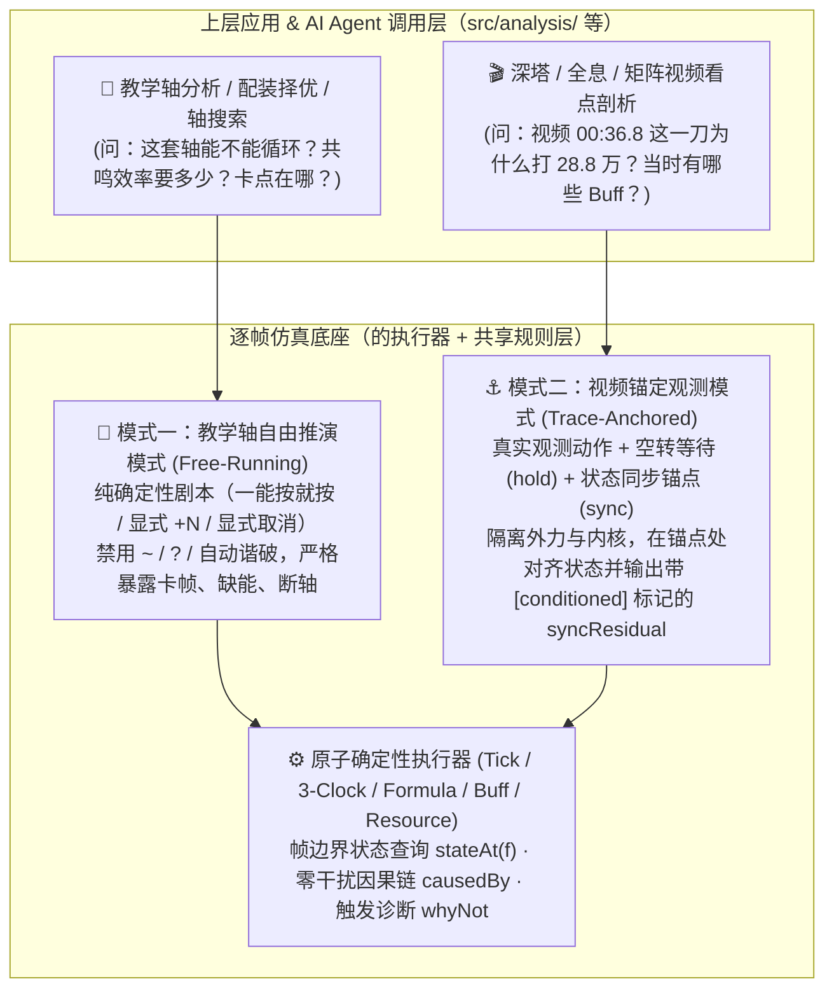
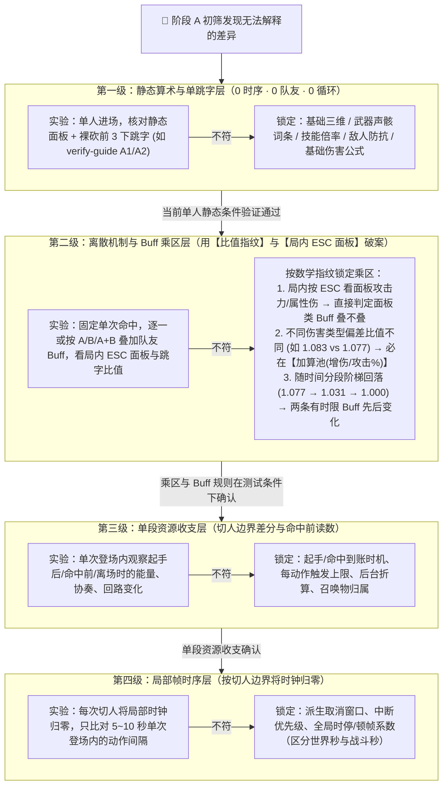

# 总体评审：逐帧仿真引擎的底座定位、代码体检与校准收敛路线（Antigravity）

日期：2026-11-09（v3：通读 Claude、Codex 总体评审及三组 `vs` 对比文档后，吸收各方洞见并修正更新）  
作者：Antigravity  
状态：架构与代码深度评审、思路规划（不涉及代码修改）  
关联讨论：剩余需三方深入辩论与对齐的议题见 [`docs/antigravity-debate.md`](antigravity-debate.md)  
审阅覆盖范围：
- **引擎内核与分析全量代码**：[`src/engine/types.ts`](../src/engine/types.ts)、[`resolve.ts`](../src/engine/resolve.ts)、[`simulate.ts`](../src/engine/simulate.ts)、[`kernel.ts`](../src/engine/kernel.ts)、[`scheduler.ts`](../src/engine/scheduler.ts)、[`switch.ts`](../src/engine/switch.ts)、[`resources.ts`](../src/engine/resources.ts)、[`triggers.ts`](../src/engine/triggers.ts)、[`buffs.ts`](../src/engine/buffs.ts)、[`enemy.ts`](../src/engine/enemy.ts)、[`formula.ts`](../src/engine/formula.ts)、[`summary.ts`](../src/engine/summary.ts)、[`analysis.ts`](../src/engine/analysis.ts)、[`trace.ts`](../src/engine/trace.ts)、[`insight.ts`](../src/engine/insight.ts)、[`sensitivity.ts`](../src/engine/sensitivity.ts)、[`fit.ts`](../src/engine/fit.ts)、[`calibration.ts`](../src/engine/calibration.ts)、[`invariants.ts`](../src/engine/invariants.ts)、[`assumptions.ts`](../src/engine/assumptions.ts)
- **数据装配、校验与手写模块**：[`src/data/registry.ts`](../src/data/registry.ts)、[`assemble-action.ts`](../src/data/assemble-action.ts)、[`scenario.schema.ts`](../src/data/scenario.schema.ts)、[`calibration.schema.ts`](../src/data/calibration.schema.ts)、[`nanoka-check.ts`](../src/data/nanoka-check.ts)、[`wuwalab-check.ts`](../src/data/wuwalab-check.ts)、[`src/report/timeline.ts`](../src/report/timeline.ts)、[`data/curated/`](../data/curated/)
- **同行评审与对比文档**：[Claude 评审](overall-review-claude-20261108.md)、[Codex 评审](overall-review-codex-20261108.md)、[`antigravity_vs_claude/`](antigravity_vs_claude/)、[`antigravity_vs_codex/`](antigravity_vs_codex/)、[`codex_vs_claude/`](codex_vs_claude/)

---

## 0. 核心结论摘要

1. **战略定位与底座四层切分（吸收 Claude §2 与 Codex §2.1）**：
   - 将逐帧仿真引擎定位为**“底座（编译器 + 执行器 + 调试器）”**，教学轴分析、深塔/矩阵/全息视频剖析、配装择优、AI Agent 定量推理定位为**“上层应用”**，教学轴作为首个优先验证场景。
   - **底座的物理边界**：严格区分 ① **执行器内核**（约 2,400 行，时钟/Tick/调度/事件/结算，靠单测/不变量/fuzz/conformance 验证，不进游戏）+ ② **共享机制规则**（几十条全角色通用规则，每条靠一个靶场对照实验定案，测一次全队受用）——**“把底座做好”仅指前两层**；③ **角色内容库**（18 个模块约 3,200 行，随新角色持续增长，按需验证，不纳入底座完成度验收）；④ **上层分析模块**（目前混放在 `src/engine/` 下的搜索、排轴、套路卡、择优、矩阵等约 2,900 行代码，应在架构契约上与执行器内核切开）。
   - **三层可信度解耦**：严格区分 **实现是否符合规格（Verification）**、**模型是否符合游戏（Validation）**、**本次场景输入是否适用（Applicability）**。
2. **代码体检的真实结论——内核骨架扎实，但存在“录像凑帧反噬调度”与“报告/量尺层契约断裂”两类具体病灶**：
   - 现有内核的**三时钟模型**（[`kernel.ts`](../src/engine/kernel.ts)）、**伤害公式层**（[`formula.ts`](../src/engine/formula.ts)）、**不变量护栏**（[`invariants.ts`](../src/engine/invariants.ts)）和**三方数据对账**（[`nanoka-check.ts`](../src/data/nanoka-check.ts) / [`wuwalab-check.ts`](../src/data/wuwalab-check.ts)）完成度非常高，无需推倒重写。
   - **输入侧反噬**：在缺少外部观测锚定机制的情况下，用自由推演去硬拟合 3 分钟深塔录像（[`scenarios/xin-tower4-video.yaml`](../scenarios/xin-tower4-video.yaml)），导致排轴与调度器被 `A1~ A2~ A3~ A4~` 假补位、`!` 强制打断、`敌人 失谐` / `能量满` 等写法污染，形成“加补位凑时间 → 假补位多给资源且挡住 `at` 指令 → 被迫加 `!` 强断并去录像里逐帧抠回路条删补位”的恶性循环。
   - **输出与量尺侧断裂（结合本评审与 Claude、Codex 发现）**：存在校准时钟口径冲突（R01）、事后线性扫描猜出处串归属（R02）、`fit.ts` 漏算跳字且允许非一对一重复匹配与全失配得 0 分（R03）、跨提供者同名 Buff 覆盖率丢失（R09）、击杀目标评分与伤害拆分区间不一致（R10）、截断与外推状态在对比中丢失（R11），以及 `assumptions.ts` 开关覆盖率低（14/40）与粒度捆绑（`forteKeepOnSwitch`、`module-guess`）等问题。
3. **破局的四大支柱**：
   - **底座双模化与纯确定性教学轴（吸收 Claude §0.2/§1.5）**：区分 **自由推演模式（Free-Running，服务教学轴：禁用 `~`、`?` 与自动谐破，补齐显式取消语法与按键转写映射）** 与 **锚定观测模式（Trace-Anchored，服务视频剖析：用空转等待 `hold` 与状态同步原语 `sync` 隔离外力，输出带条件标记的 `syncResidual` 残差）**。
   - **底座输出与状态查询一等公民化（吸收 Codex R04/R05 與 Claude §4）**：在不污染 `s.log` 触发器总线的前提下记录运行时直接因果链（`causedBy`）；区分**全部输入规则快照**与**实际反事实依赖清单**；以帧边界确定性重算为基础提供 `stateAt(f)`（世界帧 $f$ 开始、P1 前）与未触发诊断 `whyNot`。
   - **信源按字段类型分级（吸收 Claude §5 与 Codex §5.1）**：修正此前对“动作帧数免测”的乐观判断——倍率与基础属性经解包互证可定为高可信，但**动作帧数、取消窗口、资源到账时机及表格空格/备注语义**属于高风险项，互证仅作线索，需结合靶场或录像确认；模块 `applyOverride` 消掉 flag 仅代表“已采用（Adopted）”，不等于“已实测证实（Verified）”。
   - **差异排查二维收敛体系（融合“顺时间因果初筛”与“四级靶场隔离漏斗”）**：读已有录像时顺着“验尺子 → 时序与动作一对一匹配 → 资源 → 状态 → 单下跳字 → 血条”找最早分叉点；进靶场做定案实验时按“静态裸跳字 → 乘区比值指纹与局内面板 → 单段切人资源收支 → 切人归零的局部帧时序”逐层隔离（怀疑机制交互时补充无、A、B、A+B 最小组合实验）。

---

## 1. 现状诊断：为什么“想专心做底座，却陷在应用与实测里出不来”？

### 1.1 你的核心诉求与三层问题解耦

在本次讨论中，你明确提出了两个核心纠结：
1. **底座与应用的拉扯**：逐帧仿真引擎是底座（把轴与配置转换成按时间排序的逐帧事件流与确定性状态，供教学轴分析、深塔/矩阵/全息视频分析或 AI Agent 定量调用）。你想把精力放在把底座做好，但验证底座又不得不跑具体场景和应用。
2. **数据不可靠与差异不收敛**：一方面，上游数据来自社区表格（xlsx）、解包（Wuthery）、社区站（Nanoka / WuwaLAB），并非 100% 原始游戏规则真值；另一方面，当仿真结果和游戏/视频对不上时，缺乏成熟可靠的机制来快速收敛差异并锁定原因。

借鉴 Codex 引入的 V&V 视角与 Claude 的模拟器测试 ROM 类比，我们首先要把混在一起的三个问题拆开：

| 问题层级 | 含义与例子 | 负责发现/解决的手段 |
|---|---|---|
| **1. 实现是否符合规格（Verification）** | 规格要求 E 命中加 10 协奏、两个角色的同名 Buff 各自计时，代码是否算对、汇总是否丢数据？ | 纯软件单测、不变量（`invariants.ts`）、人造边界小用例（**0 游戏实测成本**） |
| **2. 模型是否符合游戏（Validation）** | 协奏到底是起手给还是命中给？切人保不保留卦象？五雷荡煞阵算不算角色附加异常？ | 应用场景（教学轴/录像）负责**暴露哪里缺旋钮**；训练场短平快对照实验（测试 ROM）负责**把旋钮拧到正确位置** |
| **3. 本次分析输入是否适用（Applicability）** | 录像里玩家少按了一下普攻、武器阶数不同（如奇幻变奏 R1 vs R5）、或者 Boss 换阶段清了 Buff | 核对输入配置，或在观测轴中显式标注外部给定条件（不归咎于引擎底座 Bug） |

### 1.2 症结剖析：“拿《毁灭战士》长录像去校准 CPU”的陷阱

当你试图直接用一局 3 分钟的深塔/全息实战录像去同时解决上面三个问题时，必然撞上三座大山：

1. **蝴蝶效应（跨段误差滚雪球）**  
   在自由推演中，**时间、资源、状态是强耦合的**。假设第 15 秒某个动作的协奏数据差了 1.5 点，或者玩家手慢了 6 帧，到了第 22 秒切人时，协奏从 `100` 变成 `98.5`——**变奏切人瞬间退化为普通切入**。一旦少了变奏，后续核心回路攒不满、延奏 Buff 没挂上、大招晚开 5 秒，后面 2 分钟的时间轴彻底面目全非。
2. **多变量混淆与正负抵消（方程比未知数少）**  
   正如你在 [replay-retro.md](replay-retro.md#L42) 中总结的深刻教训：
   > *“心的直接伤害偏低 8%、踏月归心偏高 2 倍，两者互相抵消，所以中 4 血条才差 2.4%。血条贴合不等于机制对，跳字才是最锋利的尺子。”*
   
   当未知的规则旋钮还没识别出来时，强行在长录像里调已有参数（就像地图少画了一座桥，却去调各段路的限速），不仅会出现“一处贴上另一处变差”（如 `summonCountsAsChar` 翻转在中 3 和中 4 给出相反的血条信号），还会把程序或机制错误写进模型参数里。
3. **把“应用层的输入噪音”当成了“底座层的规则误差”**  
   视频里玩家临场多走了一步、Boss 后退导致晚命中 3 帧、或者空挥了一下普攻，这些属于第 3 层（输入剧本的噪音），根本不是引擎底座的 Bug。

---

## 2. 全仓代码与文档深度体检（综合本评审与 Claude、Codex 发现）

### 2.1 现有底座必须保留的五大核心资产

1. **三层纯函数架构与零副作用内核**（[`registry.ts`](../src/data/registry.ts) → [`resolve.ts`](../src/engine/resolve.ts) → [`simulate.ts`](../src/engine/simulate.ts)）：[`src/engine/`](../src/engine/) 100% 纯内存计算；角色逻辑抽离在 `GameData.hooks`，运行时可变状态显式声明在 `CharState.vars`（总设计 §10.1）。
2. **七相位 Tick 循环与三时钟速率表**（[`src/engine/kernel.ts`](../src/engine/kernel.ts#L101-L132) `computeRates` & [`tick`](../src/engine/kernel.ts#L426-L450)）：世界帧（`s.frame`）、战斗帧（`s.battleFrames`，`stopsBattleClock` 期间为 `0`）、角色局部帧（`act.localFrame`，`snap4` 吸附）解耦清晰。
3. **经过 Golden 扰动验证的纯数学公式层**（[`src/engine/formula.ts`](../src/engine/formula.ts)）：3418 条乘区夹具逐位对拍通过，单人无 Buff 裸跳字与实机误差 `< 0.05%`。
4. **逐帧与日志级不变量护栏**（[`src/engine/invariants.ts`](../src/engine/invariants.ts) `checkTick` / `checkLog`）。
5. **三方数据自动化交叉校验**（[`nanoka-check.ts`](../src/data/nanoka-check.ts) & [`wuwalab-check.ts`](../src/data/wuwalab-check.ts)）。

---

### 2.2 代码深潜暴露出的 8 个具体症结与 Bug

以下将我们独立发现的 5 个代码级症结，与 Claude、Codex 在审查中定位的互补缺陷汇总为完整体检表：

#### 症结一（输入与调度层反噬）：录像剖析的“凑帧黑魔法”污染了排轴语法与核心调度器
- **代码位置**：[`scenarios/xin-tower4-video.yaml`](../scenarios/xin-tower4-video.yaml#L52-L123)、[`src/engine/scheduler.ts`](../src/engine/scheduler.ts#L53-L125)（`fillerTarget`、`forceCancel`、`fillCommand`）、[`src/data/scenario.schema.ts`](../src/data/scenario.schema.ts#L156-L250)。
- **代码级根因剖析**：
  1. 在 [`xin-tower4-video.yaml`](../scenarios/xin-tower4-video.yaml#L88-L103) 中，几乎每个 `at <秒>` 前后都被迫塞了 12 下 `A1~ A2~ A3~ A4~`，并在技能后加 `!`（如 `心 镇红尘!`、`心 转相!`）。
  2. 原因在于 [`scheduler.ts`](../src/engine/scheduler.ts#L53-L64) 的 `fillerTarget()` 只检查**紧邻的下一条非补位指令**（`at 32.20`）当前帧满不满足。只要世界时间还差 1–2 帧没到 `32.20` 秒，调度器就会启动下一记补位普攻 `A3~`；这记 `A3~` 一旦启动，其动作优先级就会挡住 2 帧后到达的 `镇红尘`，逼着写轴人给几乎所有技能加上 `!`（触发 `forceCancel` 强行打断正在打的补位普攻）！
  3. **更致命的副作用**：这塞进去的 12 下假补位在引擎里是真实结算的，凭空生成了录像里根本不存在的**核心回路、协奏值和共鸣能量**（见 [replay-retro.md](replay-retro.md#L54)），反过来逼着你去录像里逐帧 OCR 读回路条（`video.core`）来反推删掉哪几下 `A~`！同时，`能量满`、`敌人 失谐`、`敌人 换` 等外部状态干预直接混入了玩家排轴指令。

#### 症结二（因果追溯层断裂）：事后线性扫描猜出处（`walkOwners`）在多 Buff 到期与 BFS 队列交错时会错归
- **代码位置**：[`src/engine/trace.ts`](../src/engine/trace.ts#L233-L293)（`walkOwners`）、[`src/engine/triggers.ts`](../src/engine/triggers.ts#L29-L55)（`drain`、`s.bus.chain`）。
- **代码级根因剖析**：
  - `SimEvent` 在生成时未记录直接因果父节点。`walkOwners` 在跑完后对 `res.log` 做单遍线性扫描，只用单个可变变量 `let anchor` 猜归属。
  - 这在两种情况下会张冠李戴：① **同帧多 Buff 到期**（[`kernel.ts#L442`](../src/engine/kernel.ts#L442) `tickBuffs` 先把同帧所有 `buffEnd` 推入日志再统一 `drain`，后面的 `buffEnd` 覆盖 `anchor`）；② **BFS 队列交错**（`drain` 是先进先出队列，同相位先入队的 $E_1, E_2$ 中，$E_1$ 触发的子事件 $C_1$ 排在 $E_2$ 后面，线性扫描扫过 $E_2$ 后把 $C_1$ 错认成 $E_2$ 的产物）。
  - 同时（吸收 Claude §4.3 #8）：当预期 Buff **未触发**时，[`triggers.ts`](../src/engine/triggers.ts) 的 `matches()` 检查失败后不留任何记录，无法回答“为什么某条加成没生效”。

#### 症结三（状态与资源层割裂）：资源变动双轨制与缺少明确帧边界的 `stateAt(frame)`
- **代码位置**：[`src/engine/resources.ts`](../src/engine/resources.ts#L118-L162)（`settleGains` vs `addEnergy`/`addConcerto`）、[`timeline.ts`](../src/report/timeline.ts#L41-L45)。
- **代码级根因剖析**：
  1. **资源双轨账本**：起手/钩子给资源发 `{ type: 'resource', value, delta }`，而判定命中调用 [`settleGains()`](../src/engine/resources.ts#L118) 只把增量塞进 `HitEvent.gains` 且无变动后绝对值 `value`，导致 [`invariants.ts`](../src/engine/invariants.ts#L117)、[`summary.ts`](../src/engine/summary.ts#L231)、[`trace.ts`](../src/engine/trace.ts#L305) 四处重复手写状态重放循环。
  2. **展示轨道不等于完整运行状态（吸收 Codex R04/D11 修正）**：我们在 v2 曾设想用 `timeline.ts` 的轨道拼装 `inspectStateAt`。Codex 准确指出：**同一世界帧内 P1–P6 有严格先后**（例如 P2 检查指令，P4 结算命中；满协奏切人后，离场角色的协奏在切人帧并未清零，而是到入场角色变奏推进至触发延奏帧才清零；且内核先记 `actionStart` 日志再扣能量调 `drain`），而现有的 `ForteStep` / `CooldownStep` 是在 P6 采集的展示文字，不包含飞行中的未结算判定（`JudgmentRuntime`）、尾部（`TailRuntime`）和完整 `vars`。因此，真正的 `stateAt(f)` 必须**明确帧内相位边界（统一为世界帧 $f$ 开始、P1 之前）**，并以执行器确定性重算为基础，而非简单拼装展示轨道。

#### 症结四（校准量尺冲突，R01）：`calibration.ts` 的 `loop` 时钟口径与 Schema / TD-11 存在双向冲突
- **代码位置**：[`src/data/calibration.schema.ts`](../src/data/calibration.schema.ts#L23-L24)、[`src/engine/calibration.ts`](../src/engine/calibration.ts#L19-L22)、[`docs/calibration/points.yaml`](calibration/points.yaml#L66-L77)、[TD-11 §1.2](wuwa-dps-td11-debug-calibration-v0.1.3.md)。
- **代码级根因剖析（吸收 Codex R01 补充）**：
  - `calibration.schema.ts` 注释与 `points.yaml` 说明将 `kind: loop` 定义为**世界秒（含时停、顿帧）**（因为训练场打桩没有深塔倒计时，只能按视频秒表量世界秒）；
  - 但 `calibration.ts` 的 `simValue` 返回的是 `roundTo(span.endT - span.t, 100)`（扣除大招时停的**战斗秒**），而 TD-11 §1.2 与 `summary.ts` 分轮统计又习惯按战斗秒算“一轮几秒”。
  - 心队一轮有 4 个大招/转相动画（约 13 秒全局时停），战斗秒 `30.57s` 对应世界秒约 `43.5s`。如果不把 `loop` 显式拆成 `loopWorld`（`(span.endF - span.f) / 60`）与 `loopBattle`（`span.endT - span.t`），量尺就会差出 13 秒。
  - 此外（吸收 Codex R06）：`calibration.ts` 核对跳字时自动在“非暴击”与“暴击”中挑离实测最近的一支，这只能找相容解释，应在观测 schema 中显式声明是否暴击。

#### 症结五（拟合工具缺陷，结合本评审症结五与 Codex R03）：`fit.ts` 评分混杂、漏跳字、非一对一匹配且全失配得 0 分
- **代码位置**：[`src/engine/fit.ts`](../src/engine/fit.ts#L50-L138)。
- **四重缺陷汇总**：
  1. **漏算单下跳字（`video.hits`）且多量纲直接相加**：`scoreOf(d)` 把切人秒差、切人类型错、过场秒差、血条 `hp.rmse`、协奏/回路 `rmse` 直接相加，完全没把 `video.hits` 算进贴合度，导致心直接伤害 `-8%` 与踏月归心 `+100%` 在累计血条上互相抵消。
  2. **“改剧本动作”与“翻机制开关”混排**：`fitVariants` 把 `flipsOf()`（翻全局规则）与 `neighborIter()`（随机删/挪/换动作）放在同一个总分榜里排序，删一下补位带来的时间平移直接掩盖了机制开关信号。
  3. **动作匹配缺少一对一约束（Codex R03）**：在 10 秒窗口内找最近同名动作时，两条录像观测可重复匹配同一次仿真动作，导致漏放动作却显示 `matched: 2`。
  4. **全锚点失配返回 `score: 0`（Codex R03）**：当传入的 `marks` 全部失配、没有任何有效比较项时，`replayFit` 返回 `0` 分，把“无数据可比”包装成了“0 误差完美贴合”。

#### 症结六（假设与开关体系缺陷，吸收 Claude §4.3 #1–5）：开关覆盖不全、粒度捆绑与触碰定义混用
- **代码位置**：[`src/engine/assumptions.ts`](../src/engine/assumptions.ts)、[`src/data/gamedata.ts`](../src/data/gamedata.ts)（`Rules`）、各角色模块。
- **五处具体差距**：
  1. **仅 35% 假设可自动翻转**：假设表 40 条中只有 14 条有 `adjust.path`，其余 26 条需改代码才能测试另一读法。
  2. **`module-guess` 大杂烩**：12 个角色模块的 17 处完全不同的机制推断（卜灵阵何时生成、守岸人星域升阶、渊武锋芒清空等）共用同一个 `module-guess` ID，无法单独翻转和追溯。
  3. **`rules.forteKeepOnSwitch` 一刀切捆绑**：同时控制心的照世相（验证手册 B1）和卜灵的卦象（B2），两项实测结果可能一保一清（如中 4 录像里卜灵需设为 `false`），却只能绑在一起翻。
  4. **“碰到（touched）”混用两种粒度**：`ult-no-switch` 等是“开关真的改变了本次调度决定才记”，而 `dilation-rules`、`wait-settled` 等是“代码一经过就记（仅代表上界）”。
  5. **仅汇总到整局**：只记整局触碰次数，无法回答“第 $k$ 下跳字或某次切人具体依赖哪几条未证实规则”。

#### 症结七（汇总与对比边界缺陷，吸收 Codex R09、R10、R11）：同名 Buff 丢提供者、击杀拆分漏致死一击、截断/外推状态丢失
- **代码位置**：[`src/engine/buffs.ts`](../src/engine/buffs.ts)、[`src/engine/summary.ts`](../src/engine/summary.ts)、[`src/engine/analysis.ts`](../src/engine/analysis.ts)、[`src/report/timeline.ts`](../src/report/timeline.ts)。
- **三处契约断裂**：
  1. **R09**：运行时按 `(defId, owner, target)` 区分两个角色提供的同名 Buff 实例，但 `buffApply` / `buffExpire` 日志未记提供者或实例 ID，`summary.ts` 的 `buffUptime` 与网页 `buffOwners` 把它们合并成一条，导致第一位角色提供的 Buff 到期时直接关掉统计，覆盖率与归属算错。
  2. **R10**：`goal: kill` 模式下，`goalSummary` 用“目标血量 ÷ 击杀帧”算 DPS，但 `dpsBreakdown` 按左闭右开 `[lo, hi)` 过滤命中，恰好把落在右端点 `hi` 的**致死一击**排除在外（单击击杀时 `byChar` 为空表）。
  3. **R11**：指令发完但末招尚未命中就达到 `maxFrames` 时，不报 `res.error` 仅记 warning；`basisOf`、`compareRuns` 与轴搜索未传递“窗口截断”或“未达击杀目标外推（`goalNotReached`）”状态，将残缺结果当作完整结果比较。

#### 症结八（目录边界混放，吸收 Claude §2）：`src/engine/` 混放了 2,400 行执行器与 2,900 行上层分析
- **代码位置**：[`src/engine/`](../src/engine/)。
- 总设计 §2 与 §10 规划了第 ④ 层 `src/analysis/`，但目前轴搜索（`search.ts`）、套路排轴（`plan.ts`）、套路卡（`cards.ts`）、轴卡片（`scorecard.ts`）、结论（`insight.ts`）、敏感度（`sensitivity.ts`）、贴合度（`fit.ts`）、择优（`optimize.ts`）、矩阵（`matrix.ts`）全部与内核混在 `src/engine/` 下。应在架构上明确切分**执行器核心契约**与**分析应用层**。

---

## 3. 底座的清晰 Vision：同一个确定性内核之上的“双模状态机”

### 3.1 模式一：教学轴自由推演模式（Free-Running —— 吸收 Claude §0.2/§1.5 强化确定性规格）

- **适用场景**：分析给定教学轴、计算配装边际收益、评估共鸣效率门槛与操作容错。
- **严格确定性契约**：
  1. **“一能按就按”的精确定义**：同时满足 ① 动作层面合法（优先级、派生窗口、连段前置、输入锁）；② 状态条件满足（冷却、资源、角色 `canStart`）；③ 当前动作已就绪（`settled`，打断不丢判定/资源/延奏；显式写 `!` 则跳过就绪按最早合法帧取消）。
  2. **显式化调度器的 3 种“按意图等待”**：① 写 `变奏` 切人但切出者协奏未满时等手上动作判定出手；② 切入首招为空中攻击时等切出者跳起（`airborne`）；③ 切入首招为地面出场技时等切入者后台动作走完（`entryBusy`）。这三项保留在规格中，并在输出中明确标注“此处由调度器按意图推导等待时机”。
  3. **禁用不确定与替轴做主的语法**：教学轴模式下**禁用补位 `~`、可选 `?` 和自动谐度破坏**（谐度破坏必须按轴写明的位置释放，消除“晚按 6 帧因为自动谐破换了时机反而 DPS 变高”的伪象）。
  4. **补齐取消方式与转写映射**：支持在轴里写明取消方式（闪避/跳跃/大招/声骸/谐度破坏取消），并保留每一行指令对回“原文按键记号（如 `zaaa处决`）及转写读法”的机器可读映射。

### 3.2 模式二：视频锚定观测模式（Trace-Anchored —— 彻底告别 `A1~ A2~ A3~ A4~` 凑帧地狱）

- **核心洞察**：结合深塔或全息视频理解某个时间点的看点时，需要的是局部窗口内的干净状态，以及录像与当前模型之间的真实残差，而不是靠塞满 `A1~ A2~ A3~ A4~` 假普攻去硬凑时间。
- **外力与核心严格隔离的三大机制**：
  1. **空转等待（Time Hold / Idle Gap）**：当上一个观测动作打完、距离下一个观测动作 `at 32.20` 还有空当（走位/躲技能/发呆）时，调度器直接空转等待，**不打假补位普攻污染回路与能量，更不会在 `32.20` 秒前 2 帧启动普攻卡死后续技能（彻底干掉满屏的 `!` 强断）**。
  2. **显式状态同步原语（`sync` Checkpoints）**：将 `能量满`、`敌人 失谐`、`敌人 换` 以及“视频确认变奏切人/开大但仿真差一点协奏/能量”统一收口为外部状态同步原语，与玩家操作指令分开。
  3. **一等公民的残差账单（`syncResidual`）与条件标记（`conditioned`）**：每次外部同步在日志中生成 `syncResidual`（如 `[27.25s 锚点同步] 观测：变奏切心 | 仿真协奏 88.0 → 外部补齐 +12.0`），并将此后受影响的下游结果标记为 `conditioned: true`（遵循 Codex/Claude 共识：**绝不用被外部强制指定的同一个量反过来宣称模型自主预测正确**；而残差本身直接指出哪一段缺了资源或机制）。

---

## 4. 破局难题一：信源按字段类型分级与“证据台账 + 开关解耦”

### 4.1 按字段类型而非网站整体评估信源（吸收 Claude §5 与 Codex §5.1 修正）

我们在 v2 中曾把“动作发生帧/结束帧”与“倍率”一起归为多源吻合即可免测，这一判断过于乐观。结合 Claude 对历史高影响错案的统计与 Codex 的数据溯源，修正为以下三档分级：

| 字段/内容类型 | 上游信源现状与独立性 | 风险评级与底座应对策略 |
|---|---|---|
| **1. 技能倍率、基础三维、能量消耗、协奏总量** | Wuthery 解包与 Nanoka 高度一致（已连伤害条目 2681/2681 倍率吻合） | **低风险（`Tier-1`）**：自动化交叉核对（`nanoka-check`）吻合即直接采用，无需专门进游戏测倍率。 |
| **2. 动作帧数、取消窗口、资源到账时机（起手 vs 命中）** | 缺少公开解包逐项基准；WuwaLAB 帧数含顿帧且部分来自人工实测（143 个动作仅 48 个各项全一致）；表格只写总量不保时机 | **中/高风险（`Tier-2`）**：多源互证仅作为**排查线索**，不能当成免测真值；涉及卡帧点或变奏门槛时需靠录像或靶场短实验核实。 |
| **3. 表格语义（空格子、备注、落地行）与共享交互规则** | 历史前 5 大 DPS 偏差（雷主大招漏时停 +12%、心转相优先级空格 +8.7%、声骸起手优先级 +8%、椿落地段 −3.8%、切人冷却各算 +3.7%）全出于此 | **最高风险（`Tier-3`）**：① 每修一处表格读法错误，必须**全库扫描同类写法并固化为构建 flag**；② 共享交互规则必须登记为**独立命名的可切换开关**。 |

> **警示（吸收 Claude §5 与 Codex R12）**：
> - **AI 整理的资料只是线索，其自标的“高可信度”不是证据**（如 `m3-verify-answers-gemini.md` 曾把“协奏出手给全额”标为高可信度，次日被实测证伪）。
> - **模块 `applyOverride` 消掉 flag 不等于“已实测确认”**：必须在规则与关键字段台账中区分 **“已采用（Adopted）”、“有旁证（Corroborated）”、“列明条件下已实测支持（Verified）”** 三种状态。

### 4.2 改造假设表（`assumptions.ts`）与敏感度筛选准则

1. **一条游戏规则一个独立开关**：立即拆开 `rules.forteKeepOnSwitch`（拆为按角色/资源独立配置或独立开关），拆解 `module-guess` 的 17 处调用为各自具名的假设 ID。
2. **区分“全部输入快照”与“实际反事实依赖清单”**：结果不仅附上全部 `Rules` 快照，还应精确记录哪些未证实开关**真的改变了本次分支决定**（“起作用才记”，而非“代码经过就记”）。
3. **敏感度筛选准则（修正 v2 的“< 0.5% 永远不测”）**：
   - 优先实测：会导致**断轴/变奏失败**、改变**配装/打法相对排名**、或显著改变**教学轴绝对伤害上限**（如 `summonCountsAsChar` 影响心队绝对伤害约 6%）的共享规则与高影响角色规则；
   - 当怀疑两条规则存在**组合交互**时，补充少量组合检查（无、A、B、A+B）；
   - 当前影响 `< 0.5%` 且不改门槛的未知项，状态标为 **“延后实测 / 允许悬置（Deferred）”** 并保留开关。

---

## 5. 破局难题二：二维差异收敛体系（融合“顺时间因果初筛”与“四级靶场隔离漏斗”）

在对比本评审与 Claude、Codex 的排查顺序后，我们发现双方的顺序之所以不同，是因为针对的是**两个互补的阶段**：

1. **阶段 A：面对已有录像或两份运行结果时的“观测初筛（Observational Triage —— 采纳 Codex/Claude 顺序）”**  
   当你在对比一段录像和仿真输出时，必须**先验尺子、顺着时间与因果链往下查**：
   - **Step 1 确认可比与验尺子**：核对版本、配装、初态、时钟口径（世界秒 vs 战斗秒）；
   - **Step 2 一对一匹配动作与切人时序**：先对齐切人与动作实例，找出**最早有证据的时序或资源偏差**（因为上游动作晚了 2 秒会直接导致下游 Buff 过期，此时直接看下游跳字会误判）；
   - **Step 3 分开各通道残差**：分别看时序、资源、Buff 覆盖、单下跳字、累计血条，绝不让总分隐藏正负抵消。

2. **阶段 B：针对暴露出的疑点，设计靶场短实验定案时的“四级正交隔离漏斗（Experimental Isolation —— 本评审方法）”**  
   一旦从录像或教学轴里发现了现有已知旋钮解释不了的偏差，**严禁继续在长录像里多变量盲猜**，而是切入训练场木桩，按从底层到上层的顺序做单变量（或最小 $A / B / A+B$ 交互）隔离实验：

### 5.1 实例验证：用心队第 1 轮跳字比值的“三级台阶”展示二维收敛

在 [`docs/tower-20261026.md`](tower-20261026.md#L216-L233) 中，心第 1 轮跳字（录像暴击 ÷ 仿真暴击）呈现出一组极其规律的数字：
- **开场单人（3.9–4.5s）**：`心召唤-6` 录像 `8444` vs 仿真 `8448`（**`0.9995`**）→ 单人静态条件下面板与基础公式吻合。
- **第 1 轮应世相（31–37s）**：
  - `心召唤-1~6`、`电磁 QTE-3`（仿真增伤底数 `3.195`）：比值恒为 **`1.0829 ~ 1.0830`**
  - `应世 E-1~4`、`E-落地`、`镇红尘`（仿真增伤底数 `3.766`）：比值恒为 **`1.0768 ~ 1.0770`**
- **第 1 轮照世相（转相之后）**：
  - `照世·E-2`（43.6s，仿真增伤底数 `3.766`）：比值降为 **`1.031`**
  - `镇寰宇`（51.5s，仿真增伤底数 `3.266`）：比值降为 **`1.036`**
  - `万阙垂天`（58.2s，仿真增伤底数 `3.016`）：比值降为 **`1.000`**（`298012` vs `298137`）

**候选假设与可区分预测**：
1. 为什么在应世相内部，`QTE/声骸`（`+8.30%`）与 `E/镇红尘`（`+7.70%`）比值不同？因为 `E/镇红尘` 多了 `卜灵.6链`（`+50%` 共鸣技能加成），增伤区基数更大（`3.766` vs `3.195`），说明至少有一项差异位于**加算池（增伤区或攻击百分比区）**。
2. 为什么从应世相（31–37s）到照世相（43.6–51.5s），两类技能的比值**同步回落了约 `4.4%`**（$1.0770 / 1.031 = 1.0446$，$1.0830 / 1.036 = 1.0453$），而在同一页第 2 条中已算出 **`+10% 攻击力` 对心造成的伤害提升恰好就是 `4.4%`**？随后在 `51.5s ~ 58.2s` 之间又回落了最后的 **`3.5%`** 归零？
3. 这给出了一个极清晰的可证伪预测：所谓“8% 偏差”很可能是**两条不同到期时间/不同乘区的 Buff 叠加**（一条约 `+4.4%` 在转相期间变化，一条约 `+3.5%` 在 51.5–58.2s 消失）。进训练场在“心刚变奏入场”、“放完镇红尘”、“刚转相完”三个时刻**按 ESC 查看局内面板攻击力与伤害加成**，即可直接检验该候选解释。

---

## 6. 面向应用与 AI Agent 的底座接口契约（综合三方设计）

为了确保观察过程绝不改变执行结果（Codex R05），并让 AI Agent 无需解析网页或猜单位，底座对外暴露以下结构化纯函数契约：

| 接口能力 | 核心契约与实现边界 |
|---|---|
| **1. 零干扰运行时因果与依赖** `SimEvent.causedBy` & `dependencies` | 在 [`triggers.ts`](../src/engine/triggers.ts#L39) 与 [`kernel.ts`](../src/engine/kernel.ts) 推入日志时，直接在既有 `SimEvent` 上挂载只读属性 `causedBy?: number`（父事件索引）与 `actionInstance?: number`（**不往 `s.log` 插入新事件，保证 `drain`、钩子与 RNG 100% 零干扰**）；输出同时区分“全部输入规则快照”与“本次实际起作用的依赖清单”。 |
| **2. 明确相位边界的状态查询** `stateAt(scenario, frame, phase)` | 默认统一定义为**世界帧 `f` 开始、P1 之前**的完整执行状态（初始化完成后的首个 Tick 起点记为 `S[0]`）。第一版采用**从初态确定性重算至目标边界并返回深拷贝快照**（包含动作局部进度、飞行中判定、带提供者实例 ID 的 Buff、资源、内部冷却与当时刻合成面板），避免展示轨道（P6）的信息损失。 |
| **3. 阻塞拆解与未触发诊断** `explainWait` & `whyNot` | `explainWait(res, cmdIdx)` 按帧拆解动作等待原因（区分游戏限制 / 调度策略 / 外部给定条件）；`whyNot(state, buffOrActionId)` 作为只读查询函数，返回当前时刻某动作不可执行或某 Buff 触发条件未满足的具体原因（如前置状态已于 3 秒前到期）。 |
| **4. 观测比对与锚定推演** `compareObservations` & `simulateAnchored` | 先做一对一动作实例匹配并显式报告缺失/歧义与完成度（禁止全失配返回 0 分，禁止吞掉截断/外推警告）；在锚定模式下支持 `hold` 空转等待与 `sync` 状态同步，输出带 `conditioned` 标记的 `syncResidual` 残差表。 |

---

## 7. 务实的推进路线图（融合纯软件修尺子与首包打包实验）

吸收 Claude 的“规则台账 + 15 分钟打包实验”与 Codex 的“P0 修软件边界 Bug”，我们将第一阶段任务组织为**软件修尺子与靶场打包实验并行推进**的四个批次（关于串行 vs 并行的讨论见 [`docs/antigravity-debate.md`](antigravity-debate.md) DEBATE-01）：

### 批次一（P0，纯软件 1–2 小时）：修好量尺、汇总边界与开关耦合
1. **修校准时钟（R01）**：在校准 schema 中显式区分 `loopWorld`（世界秒 `(endF - f) / 60`）与 `loopBattle`（战斗秒 `endT - t`），跳字校准显式注明暴击分支（R06）。
2. **修汇总与对比的误导性 Bug（R03、R09、R10、R11）**：
   - `buffApply`/`buffExpire` 与 `buffUptime` 保留 `(defId, owner, target)` 实例身份（R09）；
   - 修复 `goal: kill` 下 `dpsBreakdown` 右开区间漏掉致死一击的问题（R10）；
   - 将 `maxFrames` 截断与 `goalNotReached` 外推状态传递到 `Basis`、`compareRuns` 与搜索（R11）；
   - 修复 `fit.ts` 全锚点失配得 0 分与同名动作重复匹配（R03），加入 `video.hits` 跳字误差，并将“翻转规则（`flipsOf`）”与“改剧本动作（`neighborIter`）”分榜展示。
3. **解耦捆绑开关与盘点既有证据**：将 `forteKeepOnSwitch` 按角色/资源拆开，将 `module-guess` 拆为独立命名假设；把 `fire.test.ts`（三火跳字）与历史已证实的规则整理入账，区分“已采用 / 有旁证 / 已实测支持”。

### 批次二（P1，进游戏 15 分钟）：执行首包高价值打包实验（止血定案）
- 一次进训练场集中完成 **6 项短实验（约 15–20 分钟，只录屏与截 ESC 面板）**：
  - **B1 & B2**：心照世相、卜灵卦象切人是否保留；
  - **A1 & C1**：散华/椿基础校准点与切人锁验证；
  - **B11**：卜灵五雷荡煞阵冲击波在心后台时是否给心叠霆心域（定案 `summonCountsAsChar`，影响心队绝对伤害约 6%）；
  - **B10+（新增）**：心在雷主超负荷 + 卜灵无归的谬误下的局内 ESC 面板攻击力，以及心刚变奏入场 / 镇红尘 / 转相后的 ESC 面板对比（一次性定案“无归的谬误叠加”与“应世相 8% 两级台阶”）。
- 实验结果当场写入回归测试与规则台账。

### 批次三（P2，筑基）：零干扰因果链、教学轴确定性模式与状态查询
1. **落地零干扰运行时因果链**：在 `SimEvent` 上挂载只读 `causedBy` 与实际起作用的规则依赖清单。
2. **落地教学轴确定性模式**：对教学轴禁用 `~`、`?` 与自动谐破，补齐显式取消语法与按键转写映射。
3. **落地 `stateAt(f)` 与 `whyNot`**：基于 P1 前边界确定性重算提供完整状态快照与未触发诊断。

### 批次四（P3，赋能视频应用）：锚定观测模式（`hold` + `syncResidual`）与目录切分
1. **提供视频锚定观测能力**：支持空转等待与状态同步锚点，淘汰录像场景里的 `A1~ A2~ A3~ A4~` + `!` 凑帧写法，自动输出 `syncResidual` 残差清单。
2. **切清代码目录边界**：将 `src/engine/` 下的上层分析模块逐步迁出或明确划分为 `src/analysis/`，固化约 2,400 行执行器内核的稳定契约。

---

## 修订记录
- **2026-11-08 v1**：基于与用户的初步讨论及核心文档整理概念框架。
- **2026-11-08 v2**：在未读取其他 Agent 评审的前提下，完成全仓源码与文档独立深潜，新增 5 项代码级症结与心 8% 伤害悬案的阶梯比值拆解。
- **2026-11-09 v3**：阅读 Claude、Codex 总体评审及三组 `vs` 对比文档后更新：
  1. 吸收 Claude 的“底座四层范围划分”、“`src/engine/` 内核与分析模块切分”、“`assumptions.ts` 5 处结构缺陷剖析”、“教学轴禁用 `~`/`?`/自动谐破及补齐取消/转写层”、“未触发条件诊断 `whyNot`”与“15 分钟打包实验”；
  2. 吸收 Codex 的“三层问题划分（实现/模型/适用性）”、“帧内相位边界（P1 前）与从初态重算的 `stateAt`（修正 v2 的轨道拼装设想）”、“诊断不干扰 `s.log` 原则（R05）”、“R03/R09/R10/R11 四项具体代码 Bug”与“区分已采用/有旁证/已实测”；
  3. 修正 v2 中关于“动作帧数三方吻合免测”和“敏感度 < 0.5% 永远不测”的过度绝对化表述，融合“顺时间因果初筛”与“四级靶场隔离漏斗”。
