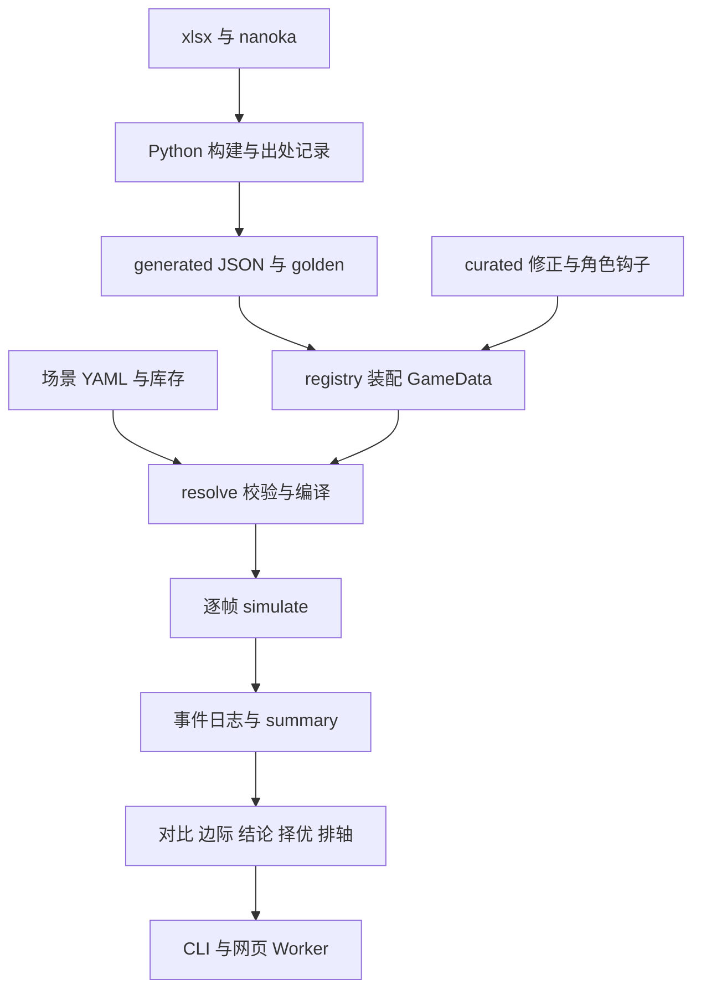

# 项目全面审查记录（2026-10-22）

## 0. 审查基准与结论

审查基准为 `e6e0296`（`accuracy-plan`，已包含手速评分、心队 10 轮统计修正、准确性计划与验证手册），另包含审查开始时工作区尚未提交的声骸冷却与 nanoka 核对改动。审查期间分支有推进，已核对上述新增提交。报告整理末期，工作区又开始增加不变量检查代码；这部分仍在开发，不纳入本轮完整审查的结论。

本次阅读了总设计、TD-01～13、冻结的机制设计及变更记录、两队确认与结论、校准和数据研究记录，并沿数据构建、装配、仿真、分析、CLI、网页调用链检查实现。重点验证会改变伤害、动作合法性、排名或解释结果的问题。没有修改业务代码、原场景或现有快照。

**总体判断：架构和调试基础适合这个原型继续发展；当前最需要补的是机制边界与结论的验证。** 生成数据与手写机制分离、逐帧事件日志、假设登记、对照场景、公式 golden 都有实际价值。但“完整跑了一次仿真”只能验证候选在当前模型里能运行；装配或动作合法性共同出错时，择优和完整仿真会一起认可错误结果。

本次确认 **7 项可复现缺陷**。其中 R1 已出现在现有真实库存的择优推荐中；R2～R7 需要特定动作、装备或功能入口触发。没有证据据此断言当前两队所有代表轴的 DPS 都错误，也没有将已登记的原型近似列为新缺陷。

优先级：P1 为应优先修复的实际推荐错误；P2 为明确的机制或功能缺陷。编号用于本报告，与 `engine-quality-plan.md` 的 P1～P6 任务编号无关。

| 编号 | 优先级 | 发现 | 主要位置 |
|---|---|---|---|
| R1 | P1 | 同种声骸重复计入套装件数，择优推荐了不存在的五件套增益 | `src/engine/resolve.ts:168`；`src/engine/optimize.ts:180–205` |
| R2 | P2 | 维里奈光合能量为零仍可使用强化空中三连 | `data/curated/characters/维里奈.ts:72–76` |
| R3 | P2 | 散华重击在蓄力阶段取消，计时器仍触发重击引爆 | `data/curated/characters/散华.ts:51–54,145–150` |
| R4 | P2 | 未实现被动的武器被正常接受，结果没有覆盖不足提示 | `src/data/registry.ts:253–260`；`src/engine/resolve.ts:136–179` |
| R5 | P2 | 仅修正冷却的声骸被当成效果已实现，原有缺失提示消失 | `src/data/registry.ts:242`；`data/curated/echoes.ts:122–141` |
| R6 | P2 | 副词条边际分析把失败仿真的部分结果作为有效排名 | `src/engine/analysis.ts:125–133` |
| R7 | P2 | 没有启动轴的合法场景无法进入套路排轴候选 | `src/engine/plan.ts:174,201–205`；`src/engine/summary.ts:123` |

## 1. 已确认的问题

### R1：同种声骸重复计入套装，影响实际库存推荐

**触发与证据。** 使用仓库已有库存与场景：

```bash
pnpm optimize scenarios/m0-video-eq.yaml --inv inventory/Evariste-bag.yaml --char 椿 --keep 4 --top 3
```

第 3 名为以下组合，报告稳态 DPS **43,642.99708**，相对原配装约 **+2.75%**：

| 库存 ID | 声骸 |
|---|---|
| scan-echo-43 | 异相·梦魇·无冠者 |
| scan-echo-128 | 暗鬃狼 |
| scan-echo-127 | 暗鬃狼 |
| scan-echo-251 | 遁地鼠 |
| scan-echo-247 | 刺玫菇（稚形） |

这是五件物品、四种声骸。重复装备同种声骸不会重复贡献套装件数，规则可参见 [Prydwen 的声骸系统说明](https://www.prydwen.gg/wuthering-waves/guides/echoes-explained) 中 Sonata Effects / Set Bonuses。本次没有另做游戏内实测。

当前 `resolve` 对每件直接 `sets + 1`，因而同时登记了 `沉日劫明.2` 和 `沉日劫明.5`。优化器只去重物品 `id`，其枚举剪枝与 `valid()` 也按物品数量计套装，最终完整仿真仍使用同一错误装配逻辑。

**影响量化。** 保持这套物品、全部词条、轴与其他机制不变，只从装配结果移除错误登记的 `沉日劫明.5`，再完整仿真，得到 **39,449.11308 DPS**。这是隔离该增益影响的对照实验，不是游戏实测值。错误增益使这套配装高报约 **10.63%**，并把低于原配装的组合报成提升。

**建议。** 将“某套装下的不同声骸种类数”作为共同规则供装配、枚举和最终候选校验使用。同种不同物品的主副词条仍正常计入；异相沿用本体身份。不要把所有同名物品一概当作不能装备，也不要只在展示层过滤。

**最小回归。** 两件不同 ID 的同种声骸不能凑出五件套；异相与本体的身份归一；不同种类的合法五件套保持结果；用上述真实库存候选检查优化器约束。TD-13 §1、§4 的套装约束也应补充这一规则。

### R2：维里奈强化空中攻击没有检查光合能量

**触发。** 使用 `tests/helpers/m0.ts` 的 M0 队伍，维里奈 3 链、奇幻变奏 5 阶，无声骸；自定义 90 级敌人，关闭自动谐度破坏。场景关键字段：

```yaml
initial:
  onField: 2
  core:
    维里奈: { 光合能量: 0 }
rotation:
  - 维里奈 跳跃 强化空中A1 强化空中A2 强化空中A3
options:
  tuneBreak: off
```

**实际。** 全轴成功，无仿真错误；三段都造成伤害并各产生治疗事件，触发 `维里奈.固有1`。三段共计期望伤害 **667.2**、协奏收益 **10.85**。将初始光合能量分别改为 0、1、3，三次都能完成同样的强化三连。

**原因。** `canStart()` 只检查强化重击与普通重击，对 `强化空中A1–A3` 返回 `true`。资源结算将负数钳位到零，不能代替出招条件。仓库 `data/generated/nanoka.json` 的“星星花绽放”原文明确以拥有光合能量为强化空中攻击的条件，每次消耗一层。

**影响。** 用户编辑轴或增删套路时，可以省去攒资源步骤，仍获得强化攻击、治疗与增益。没有证明现有视频代表轴触发了这条漏洞。

**建议与回归。** 在角色模块补齐强化空中动作的资源门槛，沿用 TD-08 P3、TD-06 §4 的分工。覆盖初始 0、1、3 层，以及连续攻击耗尽后的行为；检查治疗和增益也不会在被拒绝的强化动作上发生。普通空中攻击与强化攻击的选择应保持明确。

### R3：散华取消重击后仍由计时器引爆冰

**触发。** 同一 M0 队伍，开场散华在场，自定义 90 级敌人，`tuneBreak: off`：

```yaml
rotation:
  - 散华 E 重击居合 R!
  - wait 160
```

关键日志（`f` 为世界帧；这里的大招会使世界时钟与战斗时钟不同）：

| 世界帧 | 事件 |
|---|---|
| 60 | 开始 `重击居合` |
| 61 | 大招取消重击，`dropped` 包含 `重击居合-1`、`重击居合-2` |
| 208 | 仍生成 `E-引爆冰棱`、`大招-引爆冰川`，原因写为“重击爆裂引爆” |

**原因。** 动作开始就挂上 `HOLD + 29` 帧的 `散华.引爆计时`。动作取消没有使计时器失效，到期处理也不检查重击是否已经成功释放。此次重击只进行了 1 帧，远不足当前模型规定的 30 帧蓄力。

这与模块自身“松手前没有重击爆裂”的约定、`m0-confirm §13`、TD-04 的取消语义不符。`!` 允许主动丢弃尚未生成的判定，并不使已经取消的重击继续成功释放。

**影响。** 提前获得冰绽伤害、相关资源和 6 链增益；可污染主动取消动作的轴。

**建议与回归。** 将重击引爆计时与本次动作的释放状态、取消事件关联；区分蓄力未完成、释放后后台继续和取消后的自然冰消失。保留 5 链“冰到时自爆”的独立逻辑。用例应同时覆盖这三条路径，避免修复时误伤正常后台引爆。

### R4：武器被动未实现时静默忽略

**触发。** 复制 `scenarios/m0-video-eq.yaml`，仅把椿的武器改成：

```yaml
weapon: { name: 裁春, rank: 1 }
```

**实际。** 场景正常装配。`裁春.effects` 中有攻击提升 12%、普攻叠层加成、消耗协奏后的普攻加成；但 `passives`、`resourceEffects` 都为空，结果中没有说明这些效果未计算。装配警告只有原有的角色数据推断项。

**原因。** 注册层收录全部 125 把武器，只有少数武器有 curated 机制。`buildWeapon()` 对无模块武器使用空数组，`resolveMember()` 只校验存在性和武器类型，没有覆盖状态检查。

**影响。** 用户替换一把数据表里存在的武器后，会得到外观完整、实际只算基础属性的比较结果。即使暂时只实现四把武器符合原型范围，静默接受其他武器仍会误导使用者。

**建议与回归。** 显式记录被动覆盖状态。未覆盖时给出具体警告，或在需要可信排名的入口拒绝使用；无需为了修这个问题立即实现全部武器。至少覆盖“有被动数据但无模块”和当前四把受支持武器。

### R5：冷却覆盖使未实现的声骸效果丢失提示

**范围。** 此项由当前工作区的冷却修正新增模块触发；冷却修正的数值本身没有被本报告否定。

**触发。** 在 `m0-team.yaml` 的副本中，将椿首位声骸分别改为 `梦魇·无常凶鹭`、`梦魇·赫卡忒`、`角鳄`。

**实际。** 三者 `mainSlotBuffs` 均为空，但 `curated: true`，不再出现“首位加成与技能附带的效果不计入”的提示。其说明文本分别包含首位元素／类型加成；梦魇·无常凶鹭还包含延奏后给下位角色的增益。角鳄仍有一条泛化数据 flag 提示，但没有说明这些效果完全未实现。

**原因。** 新模块只写了 `actionOverrides.cooldown`，`buildEcho()` 却以 `mod !== undefined` 代表已 curated；`resolve` 用这个布尔值决定是否提示效果缺失。

**建议与回归。** 分开表示“已覆盖冷却”和“首位／技能附带效果已实现”，或为部分模块显式保留未覆盖状态。验证修正后冷却仍正确、效果缺失提示仍在。四个冷却模块中的 `霁息兽尊` 没有相应首位增益文本，本次不把它列为漏算该类增益的实例。现有场景没有将这几个新增模块装在首位，快照不变无法覆盖此问题。

### R6：失败仿真被边际分析当成有效结果

**触发。** 复制 `scenarios/m0-team.yaml`，只设 `options.maxFrames: 100`，运行 `marginal --char 椿`。

**实际。** `simulate()` 明确返回 `error.code: maxFrames`，第 1 条第 4 个指令尚未执行；`marginal()` 却返回基准 DPS **844.3296**，13 个词条的收益全为零。CLI 正常打印表格并以 **退出码 0** 结束。

**原因。** `analysis.ts` 的基准和每个变体都直接把 `runScenario(...).res` 交给 `basisOf()`，没有检查 `res.error`。部分日志的汇总仍有数值，不能据此认定仿真成功。

**影响。** 能量不足、调度超时或窗口上限造成的失败，可能被解释成“加这个词条没收益”。如果只有一部分变体成功，还会把不同完整程度的窗口直接比较。

**建议与回归。** 基准失败时停止分析并报告原错误；变体失败时明确标为失败或停止，不进入普通排名。检查 CLI 和 Worker 两个入口。`optimize.ts:209–210` 的基准也有未经错误检查就进入 `basisOf()` 的同类代码路径，修复时一并核对。`compare` 等已有错误检查的入口不在本项指控范围内。

### R7：无启动轴场景在套路排轴中被全部筛掉

**触发。** 原样运行仓库合法场景：

```bash
pnpm plan scenarios/m0-team.yaml --width 3
```

**实际。** 原轴成功，参考稳态 DPS **29,735.12112**；但 `leaves: []`、`refRank: null`。6 次前缀仿真中，2 次因 `noLoop` 被筛掉，另有 3 次 `entrySkill`、1 次 `timeout`。

**原因。** 前缀固定以 `repeat: 1` 运行，随后强制读取 `summary.perLoop` 中的第 1 轮。`summary.loops()` 在轮标记少于两个时返回空对象；没有启动轴的一轮仿真正是这种情况。因此能成功跑完的前缀也被当成没有完成一轮。

还有相关初始状态约束：`renderRoutines()` 总在第一个套路前插入切人，搜索又跳过当前在场角色作为第一个套路。无启动轴时，这会排除原本合法的开场套路。单独给 `loop1` 加 fallback 还不足以恢复完整语义。

**建议与回归。** 明确区分首轮初始状态、启动轴结束状态和循环边界，支持无启动轴的一轮评分与首个套路。用 `m0-team.yaml` 验证可以产生候选并保留合法的原轴；同时保持有启动轴的视频轴行为。TD-10 §6.2 当前并未将“必须有启动轴”声明为使用前提。

## 2. 对项目目标与架构的理解

### 2.1 真正需要保证的结果

项目要回答的是：在指定队伍、装备、敌人和打法下，伤害从哪里来；资源能否续上；换装备或调整轴是否有价值；结论依赖哪些假设。总设计 §0.1、第 4 节规定的原型取舍合理：固定 60 帧、单目标、默认期望值、最早合法帧调度、数据加少量角色钩子、一次打通一队。

这些取舍决定了审查重点：动作合法性、计时与取消、乘区归属、资源与 buff、统计窗口。现阶段没有必要为了代码形式统一、复杂扩展框架、网页外观或提前移植 Rust 分散精力。

### 2.2 数据怎样变成结论



这里几条边界值得保留：

- **generated 保留抽取结果，curated 承担修正。** 构建错误、数据推断、机制解释可以分别追踪；不能直接修改 generated 来“对上结果”。
- **动作与判定分别拥有生命周期。** 后台动作、脱手判定、切人后的伤害与收益，都依赖这一点。R3 正是独立计时器与动作取消关系遗漏的例子。
- **三种时钟服务不同问题。** 世界时钟对录像，战斗时钟对计时与 DPS，角色局部时间对动作进度。把它们简化成动作时长相加会丢掉合轴的关键性质。
- **引擎与 I/O 分开。** 纯数据的装配结果、独立钩子表、声明式 `vars`、统一数值函数和显式输出顺序，给当前测试与未来 Rust 对拍都提供了基础。
- **展示从同一事件日志取材。** 逐下伤害、资源出处、等待原因、检查器和分段表能支持定位；应继续避免 CLI 和网页各自重新解释机制。

覆盖范围要区别于数据规模：当前生成数据包含 65 个角色条目、125 把武器、85 个声骸、75 个动作块，但只有六位角色接入模块。数据表里“存在”不等于机制“已支持”；R4、R5 就是这条边界没有表达完整。

## 3. 设计历程与其中的思考

| 阶段 | 推动变化的问题 | 得到的设计认识 |
|---|---|---|
| 早期机制规格 → 总设计 | 协奏归属、切人是否终止动作、后台判定和资源时机容易凭印象理解错误 | 先确立对象、时钟、事件与出处，再谈 DPS；冻结规格只作为历史，当前总设计和 TD 为准 |
| TD-01～04、M0 核心落地 | xlsx 的合并格、公式缓存、出生帧、技能归类和伤害归类并不相同 | 精确连接和显式覆盖比模糊推断可靠；公式 golden 与逐帧内核分开验证 |
| M0 三人机制、资源与 buff | 起手所得与命中所得不同，冰引爆、协同攻击和角色形态不能只靠一张倍率表 | 通用数据处理常规机制，少量钩子处理角色特例；关键前置条件需要独立检查 |
| 声骸、敌人量表与配装分析 | 首位声骸同时改变动作和增益；白条、韧性、偏谐与谐度破坏容易混淆 | 先按真实职责拆量表，保留来源与版本；完整仿真确认用于校验快速估算 |
| 2026-10-05～20 视频轴反复核对 | 散华 ERZ、AQ/EQ、地面出场技、武器阶数、重击蓄力等细节改变资源和时长 | 轴能跑通不代表转写正确；一次只改一处、按层定位、保留被否掉的解释，避免通过改规则迁就错误转写 |
| v0.2 原型方向明确 | 功能增长之后，需要知道误差在哪里、未来是否能换实现 | 假设登记和敏感度优先；TS 先做清楚，输入输出与钩子状态为可移植性服务 |
| 心 · 雷主 · 卜灵 | 多形态同名动作、落地段、异常效应、前台限定 buff、切人锁进入实际链路 | 第二队是在检验抽象能否成立；前缀并入、ownerOnField、主动触发异常效应等是由真实需求产生的扩展 |
| 局部搜索 → 套路卡 → 套路排轴 | 单步挪动找不到需要多人同时改顺序的方案，卡片又依赖入场和前置状态 | 套路需要带上下文；当前直接仿真前缀的 beam search 是实用选择，无需先造完整抽象模型 |
| 2026-10-22 手速与稳态修正 | 机器最早帧排序不完全代表真人；谐度破坏相位会夸大小窗口收益 | 排名必须绑定手速、窗口和假设；测量口径本身也要验证 |
| 准确性计划 | 搜索已能给出很大的收益，实测校准尚未闭环 | 暂停功能扩张、优先验证是有依据的方向；本次 R1～R3 进一步说明搜索前要补齐模型边界 |

文档里有价值的部分包括承认和更正先前解释。比如 TD-11 的“一日花前补位”曾被认为解释了视频，后来明确更正为转写误解；散华隔轮变奏曾被说成与视频一致，后来也注明没有真正逐项核对。这种修订应保留，避免把历史推断重新当成已确认事实。

另一个例子是心队 C2：四轮窗口曾给出 **+19.77%**，十轮口径更正为 **+9.28%**。这不是扩大测试数量就自动能发现的问题，而是要检查统计窗口与机制周期的关系。当前 `steadyPhase` 提示和延长到十轮改善了这一点，但十轮也不是普遍的收敛证明。

## 4. 分层评价与剩余风险

| 层 | 本次检查与判断 | 下一步重点 |
|---|---|---|
| 数据构建 | 版本清单／hash、按表头定位、精确 dmg 连接、nanoka 补充、flags 和 curated 覆盖能保留依据；Python 用例与现有数据 schema 通过 | 保持“倍率一致”和“动作时机正确”的区分；优先清理实际运行路径上的 flag |
| 公式 | 直接伤害、异常效应、谐破、治疗的乘区职责明确；golden 与扰动校验提供较强的公式一致性证据 | 用面板和单下跳字接上外部参照，避免把 xlsx 自洽当作实机证明 |
| 内核与调度 | 三时钟、取消、尾部、切人、最早合法帧有专门测试；未找到足以推翻这些架构取舍的依据 | 增补模块钩子与内核生命周期交界处的用例，尤其 R2、R3 |
| buff／资源／角色模块 | 来源跟踪和受控钩子便于追查；通用资源钳位不承担动作可用性校验 | 检查“成功发动就已满足条件”的假设是否真的成立；资源耗尽、取消、形态变化是高价值边界 |
| 装配／支持范围 | 首位声骸缺失机制、未实现套装有提示，角色必须有模块；武器与部分声骸的状态表达不完整 | R1、R4、R5；让用户能判断当前结果算了哪些效果 |
| 汇总／分析 | 分轮、稳态、因果归属、逐下伤害、边际和敏感度已经能支持诊断 | R6；统计窗口敏感度；小收益不要脱离误差和假设解释 |
| 搜索／择优 | 完整仿真排序、保留对照场景、明确启发式边界符合原型目标 | R1、R7；合法性与共同模型缺陷优先于加宽搜索；“完整仿真”不应被当成独立正确性证据 |
| CLI／网页／报告 | 共享引擎与 Worker handler 测试、类型检查和网页构建通过；检查了主要调用和展示数据链路 | 将仿真错误、覆盖不足信息传到底；本次没有浏览器触摸、全屏或真机交互验收 |

### 4.1 现有结论应该怎样使用

- **两队已支持配装下的相对分析仍有用途。** 前提是配置、轴、机制开关和统计口径一致；不要将本次特定路径缺陷外推成所有已有数字都无效。
- **心队 C4～C8 的大收益依赖已登记、尚待实测的形态保留与操作条件。** 当前 C8 的约 +25.75% 是模型结果，`xin-confirm.md` 和 `verify-guide.md` 的验证项仍是采用打法前的必要依据。
- **“心先堆共鸣效率”有适用轴。** 原轴存在补位瓶颈，换成 C6 一类轴后，能量需求和边际排序明显变化。当前结论文档已记录这种区别，用户入口应继续保留场景关联。
- **手速评分与手速分布是两种实验。** search/plan 的 `--hand` 用固定平均延迟快速评分，最终抽样再检查分布；它们都依赖尚未用录像校准的 `hand-speed`。固定延迟得分不能直接称为真实玩家平均表现。
- **既有外部数据核对提供的是字段级证据。** `wuthery-data-crosscheck-2026-10-21.md` 记录的倍率等一致性值得保留，但不验证完整武器被动、动作帧、取消窗口或整轮 DPS。本次没有重新执行该整套跨源核对。

### 4.2 本次没有列为缺陷的事项

- 单目标、无限生命敌人、治疗只记录事件、部分低影响细节采用已登记假设，符合原型范围。
- beam search、预筛和局部搜索不保证全局最优，文档已明确用途与限制。
- 结束窗口取最后动作结束、切人、等待等的最大值，有 TD-09 §3.9 的明确语义依据，不仅凭某处简写措辞判错。
- 私有 generated 数据不随公开仓库发布、缺数据时相关测试跳过，是已说明的安排。本次本机数据齐备，相关集成测试实际运行了。
- 没有发现需要因此推翻总设计第 4 节取舍、立即改用 Rust 或扩大前端设计工作的理由。

## 5. 对准确性计划的具体建议

新增的 `engine-quality-plan.md` 已覆盖大方向。建议把本次结果接到现有计划中，先做小而明确的修正，避免先建立一个很大的验证框架。

1. **先封住已复现的七条路径。** 每个修复附最小回归；R1 要同时检查通用装配与优化器，R2／R3 要检查事件和资源，不能只更新总 DPS 快照。R4／R5 先补覆盖提示即可。
2. **不变量先定义“记什么账”。** 资源守恒要用实际入账／扣除量，并明确初值、上限溢出、清零、尾部和窗口；伤害求和要统一窗口及期望／抽样分支。动作取消后已有脱手判定继续存在是合法行为。否则检查器会把模型允许的情况报成错误。
3. **区分硬性不变量和需要解释的变化。** 固定面板下 `computeHit` 对攻击的关系可以直接检查；全轴插入等待可能让冷却、buff 或谐破对齐而提高 DPS，不能一律判错。出现变化时保留机制解释和缩减后的复现轴。
4. **假设依赖不能只做 ID 集合相减。** 基准和候选可能都用到了同一个假设，但受它影响的动作、时机和收益不同。应优先比较两条轴在同一假设开关翻转前后的收益差，再用来源记录解释原因。
5. **量法先做有限窗口稳定性检查。** 对全部周期过程严格对齐可能很难，资源等待也会改变周期。先比较多个长度和起点的窗口，给出敏感度范围；它是窗口误差范围，不是统计置信区间。小于这个范围的排名差异应保守解释。
6. **校准按层闭环。** 先补两份面板／跳字表，再测切人、资源耗尽和动作取消，最后对整轮时间与手速。现有记录有用户确认的机制，但 `calibration/` 的两份数值表仍待实测；不能把“尚无闭环数值夹具”误写成“所有机制都没有任何实测依据”。

建议在验证手册中补上维里奈零／一层光合能量的空中攻击，以及散华蓄力未完成就放大招的对照。心队现有的形态保留、空中入场、大招切人锁项目仍应按它们对结论的影响排优先级。

## 6. 验证记录与边界

数据：`鸣潮动作数据汇总-20261019.xlsx`，资源版本 `3.7.13`；generated 的 SHA-256 为 `8b8c9c077aff34b1c1f7ca855945b060482e77fe76d7afd5da7ce65ba7c528f1`。现有 generated 构建时间为 `2026-10-21T15:01:47+00:00`。

| 检查 | 结果 | 能说明什么 |
|---|---|---|
| `pnpm check` | 通过；Svelte 0 errors、0 warnings | 类型与静态检查 |
| `pnpm test` | 32 个文件、429 个用例通过 | 现有机制、场景、分析、Worker 等回归；包括依赖本地 generated 的用例 |
| `pnpm test:py` | 68 个用例通过 | 构建解析与数据处理单元测试 |
| generated schema 检查 | 通过，含 75 个动作文件及两份 golden 夹具 | 现有产物结构符合 schema |
| `pnpm golden:perturb -- --rounds 20` | 68,360 次比较：68,215 次全等，145 次已知差异，无意外差异 | xlsx 扰动重算与构建侧公式拆分一致性；145 次均为 TD-03 已说明的防御分母 ≤ 0 边界 |
| `pnpm web:build` | 成功 | 网页能够打包；构建有依赖包注释提示，不影响完成 |
| 定向复现 | R1～R7 如上；另跑了两账号库存择优路径 | 现有测试没有覆盖的边界缺陷确实能触发 |

`pnpm check:data` 的 tsx CLI 在沙箱内因 IPC 管道 `EPERM` 无法启动，因此使用 `node --import tsx src/data/check-generated.ts` 执行相同校验入口并通过。定向复现也使用 `node --import tsx`，不是跳过校验逻辑。

扰动对拍运行的是构建侧 Python 校验，不是把 20 轮扰动逐一喂给 TypeScript 引擎；TS 公式与生成夹具的对拍由 Vitest 的 TD-03 用例覆盖。这两层证据不能合并声称为实机伤害已验证。

本次未重新构建或修改 generated，未重做游戏内数值／录像校准，未做手机和 iPad 的手工交互测试。没有修改引擎，因此没有重新生成 conformance 产物；现有 portable 用例已运行，不能将同实现生成的对拍样例视为独立正确性证明。

本机复现脚本与输出放在 `out/review-2026-10-22/`（不进 git）：`probes.ts`、`duplicate.json`、`verina.json`、`cancel.json`、`weapon.json`、`echo.json`、`analysis.json`、`plan.json`、两份 `optimize-*.txt` 及校验日志。`probes.ts` 可分别传 `duplicate`、`verina`、`cancel`、`weapon`、`echo`、`analysis`、`plan` 重跑；部分输出是连续 JSON 对象。

## 7. 建议的处理顺序

1. 修 R1 的套装计数，并重新确认受影响的库存推荐。
2. 修 R2／R3 的出招与取消边界，补行为回归；再让搜索结果作为模糊测试语料。
3. 修 R4／R5 的机制覆盖提示、R6 的失败结果处理，保证用户能解释当前计算范围。
4. 修 R7 的无启动轴排轴路径。
5. 接着执行既有准确性计划：窗口稳定性、关键假设收益敏感度、实测校准闭环。

涉及机制修复时按 AGENTS.md 同步对应 TD、用例和必要的 conformance；保留原场景，以对照场景重算受影响结论。现阶段这些工作比扩展新队伍或继续扩大搜索空间更直接地提高结果质量。
