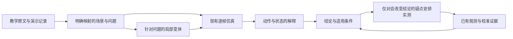

# 教学轴解释与按需校准：下一阶段提案

日期：2026-11-06。状态：规划，新增接口与命令均未实现。

2026-11-07 定位更新：用户进一步明确优先建设可复用、可验证的逐帧仿真底座；教学轴是其应用与验证场景。底座建设以 [执行契约、证据与差异收敛路线](engine-foundation-roadmap.md) 为本轮提案，本文保留为后续应用设计。

用户优先选择的应用：**读懂教学轴，并解释每个操作的必要性和容错。** 后续再扩展到深塔、矩阵、全息录像中的具体时刻。

依据：总设计 §0.1、§4（尤其 T1–T4、T6–T10、T15–T16）、§10.1；TD-04 §1–6；TD-09 §3；TD-10 §5.1、§6、§6.2；TD-11 §1–4；[录像复盘](replay-retro.md)；[准确性计划](engine-quality-plan.md)；现有 `trace`、`cards`、`insight`、`fit` 和时间轴代码。代码核查基线：`6b1d7ab`。

建议继续使用现有原型，在分析层补上“为什么要做这一步”的证据链和对照实验。第一版的交付单位是一条轴的解释报告：用户能指出要练的几个动作、能放宽的几个地方，以及哪些说法仍有条件。

## 1. 校准困境的来源

### 1.1 实战录像提供的约束不足以唯一确定所有机制

`replay-retro.md` §2–4 已有直接例子：心队一部分伤害偏低、另一部分偏高，累计血条仍然很接近。装备、环境、漏招、命中、暴击、资源时机、buff 归属都可能影响同一观测。继续增加相似的整局录像，未必能区分这些解释。

因此需要分别回答：

- 当前程序是否自洽：由单元测试、不变量、fuzz、conformance 检查。
- 当前模型是否解释了某项游戏证据：由条件匹配的观测检查。
- 某个教学结论是否依赖尚未确定的机制：由针对结论的变体检查。

这三项不能互相替代。尤其不能用总伤害贴合，证明每个资源时点和 buff 都正确。

### 1.2 复现、解释、预测所需的精度不同

| 要回答的问题 | 最需要确定的内容 | 可以保留的不确定性 |
|---|---|---|
| 这一招为什么放在这里 | 资源门槛、形态、触发条件、前后动作关系 | 不影响关系的微小伤害取整 |
| 这一招能否删掉 | 删掉后目标是否仍达成、是否改变入场方式、下一轮是否欠资源 | 精确总 DPS，除非它就是比较目标 |
| 晚按一点会怎样 | 取消、输入锁、派生窗口、buff 到期、冷却与资源到账 | 不改变窗口的倍率误差 |
| 视频此刻有哪些状态 | 可见状态、已知起点、动作记录、相应规则 | 遮挡期间的状态可保留候选或未知 |
| 换轴后伤害高多少、几秒打死 | 上述各项，以及伤害乘区、命中、敌人和环境 | 容忍度更低，需要独立校准 |

第一目标可以在精确伤害尚未全部校准时产生价值。但“逐帧推进”只描述计算粒度，并不代表每个游戏事件都已经测准到一帧。

### 1.3 现有验证资产需要整理，不能从零再测

`docs/calibration/points.yaml` 中 37 个点目前仍为 `game: null`；这不等于项目没有实测证据。`tests/fire.test.ts` 和录像记录已有游戏跳字、机制修复及回归断言。

下一步先把已有证据关联到结论，补齐来源与条件。程序当前算出的 19490 和录像读到的 19482 应分别保存，不能把前者当实测填入登记表。未满足记录条件的旧证据保留线索身份。

### 1.4 校准的完成标准应落在具体结论上

为教学解释增加独立的发布条件：某个结论在列明的配置、目标和候选机制下是否稳定。`replay-retro.md` §6 对精确伤害结论、scorecard 重算的稳定标准继续保留；本提案不把它们当成教学报告的全局前置条件。

## 2. 第一版应交付什么

选择已有的 `scenarios/m0-video-eq.yaml` 作为第一份案例：角色模块和教学材料已经存在，包含启动、两次入场、协奏、后台出伤和不同资源门槛。选它是为了复用材料，不表示它的所有机制已经被独立验证。

每个动作或小连段给出六项内容：

| 项目 | 应显示的内容 |
|---|---|
| 前置 | 当前形态、资源、冷却、入场方式；此刻还缺什么 |
| 直接作用 | 实际获得/消耗的资源、命中、生成的后台判定、施加的 buff |
| 后续用途 | 哪个切人、强化招、爆发窗口或下一轮使用了这些条件 |
| 改动后果 | 删掉、延后、提前切走、换顺序时，第一次发生的有意义变化 |
| 容错 | 在指定测试范围内哪些延迟可接受，最先损失什么 |
| 依据 | 数据出处、观测、模型推导、相关假设、适用配装与轮次 |

必要性使用有条件的措辞，例如“保持本轮这次变奏时需要”“用于让这几下吃到加成”“目前只发现直接伤害收益”“存在可替换动作”“暂未解释”。动作可以有多个用途。

一次删除导致失败，只能证明**在这个起点和其余操作固定时**不能直接删。它不能证明所有打法都必须使用该动作。缺少解释时也不能直接标成多余。

第一份报告先回答以下问题，不必覆盖轴中每一个同类普攻：

1. 为什么有的切人是普通入场，有的需要变奏？前面的哪些操作参与了协奏门槛？
2. 为什么同一角色要分两次上场？两次之间有哪些冷却、资源和后台攻击在继续？
3. 哪些动作主要在铺条件，收益由后面的角色兑现？
4. 哪些等待是动作本身的衔接，哪些由冷却或资源不足造成？
5. 哪些晚按会被后续等待吸收，哪些会改变下一次爆发或下一轮？

## 3. 可以直接复用什么

| 已有能力 | 复用方式 | 需要补的部分 |
|---|---|---|
| `kernel.ts`、`scheduler.ts`，TD-04、TD-09 | 继续按世界帧推进，按最早合法时刻调度 | 第一阶段不改推进语义 |
| `trace.ts` 的 `gainSteps`、`actionGains`、`hitCauses` | 资源与伤害从哪里来 | 从“来源”进一步找到“服务于哪个目标” |
| `cards.ts`，TD-10 §6.2 | 小连段的资源、buff、前后台占用和上下文 | 连回原队伍中的具体动作实例，避免把孤立套路卡当通用规则 |
| `insight.ts`，TD-10 §6 | 等待、共鸣效率需求、延迟和假设扫描 | 启动轴、单次失误、多档延迟、变化原因与结论稳定性 |
| `search.ts` | 生成删除、移动、交换等局部变体 | 按指定问题对照，保留原动作到变体的映射 |
| `SimResult.forte`、`cooldowns`、资源轨道 | 暂停时看状态 | 在关键事件前后解释变化；显示依据和未知 |
| `purpose: rotation / replay`、视图 E/F | 教学轴与录像各保留自己的含义 | 将解释卡连接到动作和视频片段 |
| 假设表、校准点、不变量、fuzz、conformance | 延续已有质量流程 | 给解释结论增加依赖和适用范围 |

继续遵守总设计 §4：固定步长、三种时钟、期望值、纯引擎、数据与钩子分离、单目标、当前数据版本。网页仍为现有本机原型。新增工作主要在分析与报告层。

## 4. 最小数据流与接口

### 4.1 保留三种输入

- 作者推荐的轴及其说明。
- 视频实际演示的操作和可见状态。
- 用用户配装运行的适配轴。

三者分别记录。未知配装不能悄悄补成用户装备，作者文字中漏写的操作也不能由模型自动补全后称为原轴。已有 [视频资料流水线提案](video-feedback-pipeline-design.md) §5、§8 已提出相同分工；本阶段只复用这种资料约定，不以自动视频流水线完成为前提。

### 4.2 首批新增结构只需服务一份解释报告

建议先在分析层定义三类纯数据，名称为提议：

- `StudyQuestion`：动作/连段引用、问题、目标检查点、要看的后果、可接受范围。
- `ActionExplanation`：前后状态、资源和 buff 来源、后续使用处、等待、相关假设、证据引用。
- `VariantComparison`：改了哪一处、是否运行成功、第一处差异、目标是否达成、后续影响。

动作引用复用 `CommandRef`、启动/循环标识、轮次和 `actionStart.instance`。生成变体时另保留“原指令 → 变体指令”映射；不能拿变体的新行号或最近的同名动作充当原动作。重复普攻和重复上场尤其需要区分。

研究记录先用文件保存，与运行场景分开。确认确需写入场景的新字段时，按 AGENTS.md 的顺序改 schema、产出方、使用方。无需先设计覆盖整个游戏的规则语言或证据数据库。

### 4.3 状态与依据分别表达

对一个值要能区分：画面读到、模型算出、人工指定、未知；模型值再附相关假设。它们不是一条从低到高的置信度排名：画面也可能读错，模型输出也可能在某个已验证条件下很可靠。

候选机制产生不同结果时，保留分别运行的结果或范围，不用任意概率把它们平均成一个貌似精确的值。模型自评的“高置信”不能代替实测。

关键帧查看应遵循 TD-04 的相位约定：明确展示本事件前还是后。同帧的施放、命中、回能、buff 触发可能先后发生；单纯读取“这一帧最后一个值”，不能直接证明动作起手时条件已满足。日志不足时只补相应的诊断记录，不必保存每一帧的完整状态副本。

## 5. 如何推出“为什么需要这一步”

### 5.1 先组织已有事件，再做反事实对照

沿现有出处关系连接：动作 → 资源到账 / buff / 形态 → 后续门槛或实际受益的命中。例如解释一次延奏，要展示切走前的协奏来源，以及后续实际吃到它的命中，而不只展示该 buff 的总覆盖率。

需要注意：

- 资源可能溢出，区分名义获得和实际到账。
- 多个动作都可能给同一种资源。来源贡献不等于不可替代性，不能按任意分账顺序宣称“这一点能量唯一来自这一下”。
- buff 是否有用需要看受益对象、伤害标签、层数和结算时刻。
- 前台切走后，后台动作和独立判定仍可能结算（总设计 T3）；不能以在场伤害归零就判定动作无用。
- 等待期间可能还在出伤，`wait` 不自动等于浪费时间。

### 5.2 每个问题只生成少量有含义的变体

| 变体 | 回答的问题 |
|---|---|
| 去掉这一动作或可独立处理的小连段 | 是伤害、资源、形态还是后续衔接需要它？ |
| 用等长等待替换 | 将动作效果与占用时间部分区分；有顿帧时需分别报告世界/战斗时长 |
| 只在一次出现时晚 3/6/10/15 帧 | 一次失误造成什么，何时恢复？ |
| 每轮该处都延迟 | 循环打法对持续操作偏差有多敏感？ |
| 相邻两个可交换动作调序 | 顺序来自硬条件、buff 窗口还是习惯？ |
| 在合法范围内提前切走/取消 | 损失哪些尚未生成或不可脱手的判定，获得多少时间？ |
| 降低相关开局资源或共鸣效率 | 教学前提对配装、起手条件有多强依赖？ |

等长等待不是通用的纯因果隔离：动作自身可能改变顿帧、触发或时钟。它是辅助对照，要连同这些差别一起解释。

提前操作只能使用合法窗口；基准已经按最早合法时刻执行时，“提前 6 帧”并没有可执行含义。研究提前输入需要另有按键/预输入证据。当前 `!` 跳过的是等待出手的保守策略，仍走合法性检查，不是任意绕过能量、冷却或输入锁。

连段中间直接删一招导致编译/前置失败时，先报告原因，再另建“去掉整段”或显式替换的实验。不能把语法失败包装成游戏内唯一解。

### 5.3 比较目标状态，防止“跑通”掩盖问题

建议的目标检查点包括：指定切人确实发生变奏、某招保持强化形态、爆发中的指定命中仍吃到 buff、下一轮在要求的窗口内能启动。

现有调度器可能等到条件满足才继续，写了“变奏”的切人也可能出现实际普通入场的警告。因此成功返回结果不等于教学目标达成：必须单独检查实际事件、额外等待和警告。

报告先给第一处差异，再看下一次关键爆发和下一轮资源。用相同语义的检查点比较资源与命中，用共同时间窗口比较吞吐；变体没有到达目标时明确报未达成。需要评价稳态时另用 TD-10 §2 的口径，不把截断造成的高 DPS 当改进。

原轴和原场景保留。变体只改指定处；既有 `~` 补位因此多打了几下也要显示，不能静默增加修复动作。

## 6. 容错需要比一个 DPS 百分数多做什么

现有 `insight --tight N` 已有价值，但它主要检查循环轴中每个决策点每轮晚 N 帧；连段后续按可预输入处理。它不是对所有实际按键窗口的测量。

本次基线运行：`m0-video-eq.yaml`，默认场景与当前数据，`6b1d7ab`；使用 `node --import tsx src/cli/insight.ts scenarios/m0-video-eq.yaml --tight 6` 执行。

| 当前模型的结果 | 能推出什么 |
|---|---|
| 32 个被分析的决策点，31 个单独每轮晚 6 帧归为“有余量” | 存在可被后续等待吸收的延迟 |
| 维里奈大招单独晚 6 帧：每轮 +6 帧、DPS 约 −0.44% | 这一处会把循环推长，值得解释冷却约束 |
| 所有决策点晚 6 帧：每轮 25.00 → 25.57 战斗秒、DPS 约 −1.79% | 不同位置可能共用余量，单点结果不能相加 |
| 所有决策点晚 3 帧：DPS 约 +0.50% | 指标可能非单调；需要检查窗口和事件，不能直接教用户故意慢按 |

这些是模型内演示，默认稳态窗口为第 2–3 轮，不能据此宣布游戏实测容错或精确提升。

第一版容错扫描建议：

1. 给选中的操作扫描 0–30 帧的一个有上限的范围，先粗扫，再在发生状态变化处逐帧细扫。
2. 分别列出：动作合法、目标变奏/强化保留、关键 buff 命中保留、下一轮资源可持续、时间和伤害变化。
3. 不假设延迟越大结果必然越差；不能对未证明单调的问题直接二分。
4. 同一段相邻操作做少量联合延迟实验，找出共用余量；先聚焦用户要练的段，不枚举整局全部组合。
5. 写明“扫描范围内均可接受”或列出多个可行区间，不能把扫到的最大值叫全局极限。
6. 对预输入、取消帧或顿帧存疑的地方，用候选参数重跑。结果一致时可给条件内稳定的建议，边界冲突时保留范围并指向最小实验。

用户最终看到的练习建议应类似：“这段前半部分的延迟通常能被冷却等待吸收；到大招就绪后继续等，会把下一轮推迟。”具体数值必须来自本轴的分析和相应依据。

## 7. 把实测量压到真正影响教学的问题上

### 7.1 给结论做敏感度，再安排实验

当前敏感度主要比较 DPS。本阶段增加“结论会不会翻”：删除后还能否变奏、切走后形态是否保留、窗口内有几下吃到 buff、循环是否欠资源。

只研究当前问题实际依赖的候选规则。先单项变化；同一条依赖链上有多个不确定条件时，再检查少量组合。不能仅凭单项扫描推断组合也稳健，也不能把“所有现有候选均同意”说成穷尽了未知机制。

| 结果 | 处理 |
|---|---|
| 所有列明的候选下解释相同 | 发布条件内的解释，保留假设链接，暂不追加实测 |
| 用途相同，具体时刻不同 | 发布用途，容错用范围或定性描述 |
| 删除建议、先后顺序或变奏/形态结论翻转 | 排入实测优先项 |
| 只影响少量伤害、当前教学问题不变 | 登记，延后到伤害预测任务 |
| 缺少关键规则，连候选范围也无法给出 | 标未知，先补资料；不制造数值区间 |

优先级按“改变多少当前问题 × 区分候选的能力 ÷ 准备和读数成本”作人工排序即可，不必给未经校准的概率。倍率误差小也可能改变一个关键资源门槛；总 DPS 变化大也未必影响当前教学结论。

这种先定目标、筛出主要因素再深入的做法与 [NIST 的实验设计说明](https://www.itl.nist.gov/div898/handbook/pri/section1/pri12.htm)一致。这里把响应变量选为“教学目标是否成立”；不是直接套用工业实验的数值阈值。

### 7.2 一张实验卡只区分一个清楚的问题

每张卡包含：受影响的解释、候选 A/B、共同条件、改变的因素、两个模型会出现的可见结果、判读方法、哪些情况算本次无效、测完可以关闭哪项疑问。

| 实验类别 | 优先观测 | 避免混入的因素 |
|---|---|---|
| 切人后资源/形态是否保留 | 切前和切回后的图标、资源、可用动作 | 后台继续回资源、计时自然到期 |
| 某招的资源何时到账 | 起手/命中附近 HUD 的变化、门槛动作是否可用 | 资源已满、队友回能、装备额外触发 |
| 能否提前切走或取消 | 尝试的输入、实际动作开始、尾部判定是否继续 | 只测成功的一次就宣称最早帧 |
| 两个效果是否叠加 | 无效果、A、B、A+B 四种条件 | 初始状态不同、旧 buff 未清除、暴击分支不同 |

涉及交互时要设计四组条件；“一次只改一个因素”本身不能保证识别叠加关系。可参考 [NIST 的设计选择流程](https://www.itl.nist.gov/div898/handbook/pri/section3/pri3.htm)，先确定要区分什么，再选择比较方式。

实验前先计算或列出 A/B 的不同预期。如果两者在可读精度内没有区别，这段录像就不值得录，先换观测或条件。采用短片段、清空/确认起点、必要重复；成功切走时刻只给最早可切时刻的一个上界，配合更早的失败尝试及输入证据才能夹出边界。

建议每轮最多新增 1–3 个短实验，作为控制个人项目投入的工作上限。已有材料能回答时不要求重录；多次结果仍冲突时先保留未知、回查条件，而不无限追加整局录像。

### 7.3 用独立证据确认，不重复使用同一目标自证

- 用来选规则或调参数的片段，与最终检验片段分开；同一视频相邻帧不算独立实验。
- 强制补满能量后顺利放大招，不能验证之前的回能机制。
- `at` 钉住的时刻是给定条件，不能再次作为自由时序预测正确的证据。
- `!` 是取消策略，要检查实际丢失的判定；与人工补资源分别记录。
- 多处数据网站若源自同一份表，不算多份独立证据。
- 未知作者配装时，优先看状态关系和操作事实；伤害和能量门槛暂不当强校准点。

保留实际游戏值、读数区间、版本/配装/环境和证据位置。程序快照用于回归，实测值加容差用于对游戏的验证；两者同时保留。

## 8. 视频与深塔、矩阵、全息怎样接入

教学解释阶段，每条轴先标几处有意义的片段：关键变奏、后台攻击、buff 铺设和爆发、刻意等待或取消。先用人工标注或已有资料，不以全自动动作识别为前提。

| 内容 | 接入方式 | 结论范围 |
|---|---|---|
| 视频画面 | 证据片段、观察到的动作与状态 | 看不清时留候选；不靠仿真补成事实 |
| 深塔环境与多波 | 当前环境 buff，加敌人切换和片段起点记录 | 多目标回能未建模的部分给定条件，并标出受影响的解释 |
| 矩阵接力/转场 | 单段战斗解释，加队伍入场与转场记录 | 现有矩阵估分可复用，不能据此推断真实整局资源连续性 |
| 全息出招、闪避、离场 | 标注敌人攻击、无敌/不可命中时段和玩家响应 | 可解释“视频这里在躲招”，命中与生存预测需另有模型 |

第一版把未建模的空间、碰撞和敌人行为作为场景证据/外部条件；若要让这些条件实际改变命中和状态，单独设计扩展并新增机制测试。当前单目标模型的缺口不能靠统一伤害系数消除。

时间保留视频时间、世界帧、战斗时钟和动作局部进度。视频时间与世界时间只在连续、无变速且映射明确的片段内对应；剪辑分段，不能跨段拉伸。播放可以逐点对齐，研究时长误差则使用未拉伸的映射（`rotation-video.md` §3–4）。30 fps、掉帧或模糊定位不能通过乘 60 获得一帧精度。

观察只能约束可见字段；不能拿一个“协奏满”的画面推导所有后台 buff 都已知。解释后续片段时，初始状态不明就保留多种可行起点，或明确由观测指定某一字段。

## 9. 四个可交付批次

以下按已有队伍、已有材料安排。先完成一份有用报告再扩展；不把所有机制校准完作为开始条件。

| 批次 | 工作与主要接入点 | 完成标准 |
|---|---|---|
| A：整理一条教学轴 | 复用 M0 场景、`trace`、`cards`、`insight`，手写 5–10 个重点解释；整理证据索引 | 每个解释都有目标、模型内依据和适用条件；至少一个不确定问题明确保持未知；无需新增实测才能交付 |
| B：自动生成对照 | 分析层新增解释/变体结果；复用现有仿真，从头重跑；先 CLI/Markdown | 对删除、延迟和调序能指出第一处差异、实际变奏/形态与下一轮影响；错误明确输出 |
| C：容错与最小实测 | 多档/单次/联合延迟；对少量候选机制比较结论；只挑会翻转的实验 | 每个重点有可练习建议、依赖和实测必要性；未实测的精确边界不会变成肯定结论 |
| D：接入现有时间轴 | 在 E 的检查器显示解释和变体，在 F 连接视频证据；第二条已有轴验证复用 | 点动作能看用途、前后状态、对照后果、证据；第二条轴可复用而不新增一套特例流程 |

建议在 A 完成后再判断是否值得继续 B。A 的评估问题很具体：用户能否说出至少三个原先不理解的操作原因，以及一个可以放宽的操作段。如果只增加了更多表格，却仍然不知道怎么练，先改解释内容。

可选的第二条轴是已有心队教学轴，用来检验“结论受假设影响”的表达。它有未解决的机制，适合作为条件化报告的案例；不要求先把心队所有伤害误差消掉。

## 10. 编码任务顺序与验收细节

1. **问题与目标检查点。** 先定义结构和少量案例，接 `CommandRef`；区分启动/循环、单次/每轮。目标从实际日志检查，不根据“没有抛异常”判成功。
2. **动作解释。** 在分析层复用资源出处、buff 命中和套路量表；先覆盖资源门槛、buff 窗口、后台出伤、冷却等待四类。钩子没有足够出处时输出未知，再按需要补诊断。
3. **局部对照。** 保留源映射，生成少量变体，从头跑现有 `simulate`。第一阶段不做任意状态恢复：当前 `simulate` 从 `initialState` 开始，显示轨道也不是可完整恢复的运行时快照。
4. **容错扫描。** 按目标分别判定，报告非单调区间和共享余量；区分实际输入时刻与“合法之后额外延迟”。
5. **证据与假设关联。** 先人工给重点解释关联精确假设/模块推断，逐步从日志补自动关系；不把“本局碰到过的所有假设”都当成每句话的依赖，也不因日志没记就断言没有依赖。
6. **输出。** 可新增提议命令 `pnpm explain <场景> --md`，但当前不存在；先一份报告，确认有用后再把相同模型接进网页。若用语言模型组织文案，只让它复述结构化结果并引用证据，机制裁决仍由规则、对照和观测承担。

有意义的测试应覆盖：后台到账影响后续门槛；删除后等到能量但错过原目标；普通入场与变奏的语义变化；延迟导致 buff 少覆盖最后一下；单点余量不能相加；重复动作的对应关系；强制给定状态不被当成独立验证。选择少量专门案例即可，不为文案逐字写测试。

每次实施仍执行 `pnpm check && pnpm test && pnpm test:py`；改引擎跑 `pnpm conformance`、`pnpm fuzz`，改数据/构建按 AGENTS.md 重建并校验。更改机制需有对应测试；涉及公式遵守 golden 流程。提案阶段不修改原场景、机制、总设计关键取舍或现有结论数值。

## 11. 何时可以结束一轮研究

一条教学问题满足以下之一即可收口：

- 在明确配置和列明的候选机制下，解释及练习建议一致，证据足够支撑当前说法。
- 只有精确边界不确定，已给范围/定性建议，而且不会改变用户当前练法。
- 候选解释会改变练法，已设计一个能区分它们的短实验，等待该项即可，其他解释照常发布。
- 目前观测无法区分，明确标为未知，停止给这条问题补无信息量的录像。

完成的是一条可用、可追查的解释，精度与该问题匹配。以后新证据或数据更新影响它时，再沿依赖更新。记录当前数据哈希与条件用于排查和提醒重算，沿用总设计 T15，不因此引入多版本引擎。
