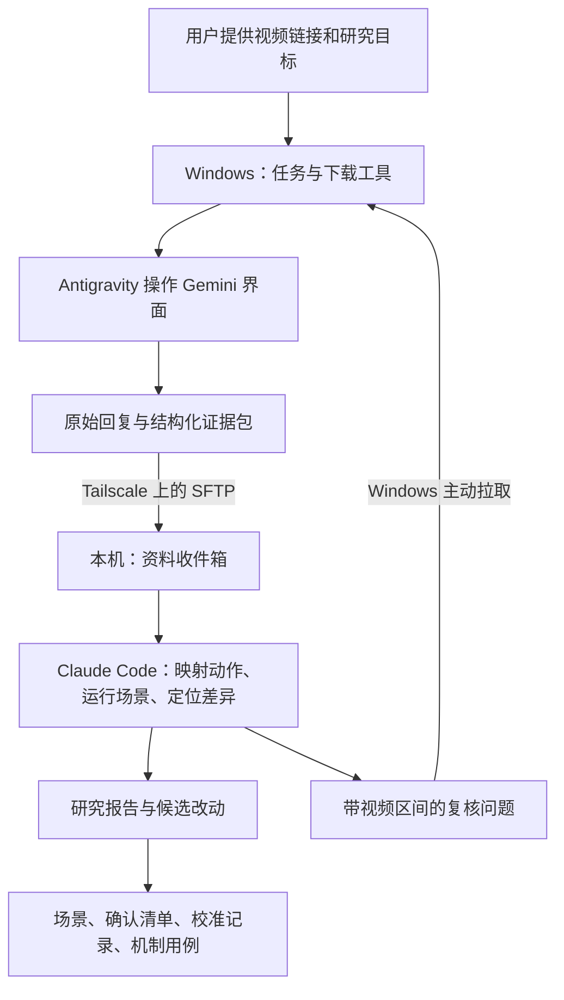

# 轴教学视频反馈流水线：设计提案

日期：2026-10-25。状态：提案，尚未实现或在 Windows 上验收。

依据：总设计 §0.1、§4、T9、T16；TD-09 的排轴语义；TD-11 §1–4、§6.3；`docs/rotation-video.md`；`docs/calibration/README.md`；`docs/jys-videos.md`。

## 1. 目标与约束

把已经选好的攻略视频变成可追溯的资料，送入本机 Claude Code，用来完善场景、发现机制和数据问题、积累校准证据，再将具体疑问送回视频分析端复核。

希望最终只需提供链接与研究目标，例如“整理这条轴，重点看切人和取消手法”。下载、命名、保存原始回复、传输、检查遗漏和回问都由流程承担。

当前约束：

- 视频交给 Gemini 原生多模态能力分析；沿用已经跑通的 Windows Gemini 窗口与 Antigravity / windows-mcp。
- 不在本地抽帧、OCR 或另跑 ASR。读取容器信息、下载后的音画合并不属于视频内容识别。
- 只使用现有订阅与已配置的本机 Claude Code；不引入 Gemini API Key、Vertex AI 或额外按量付费的模型调用。
- 不把 Windows 桌面、mini PC、DPS 仿真服务器的可用时间绑在一起；任务应能保存、暂停和继续。
- 保留用户已确认的机制和原场景；新解释以对照场景、假设和有证据的改动进入项目。

本文暂按“第一版自动送达，Claude 产出分析与改动建议”设计。自动建立修复分支和 PR 可作为独立的执行选项；Gemini 窗口是 PWA、官方独立客户端还是第三方壳，需在部署时确认。

## 2. 推荐的第一版

**一个版本化任务包、一条可恢复的 Windows 流程、一条本机检查流程，加上双向传输。**



第一版可以只用文件和小脚本实现。任务规模很小，先不需要常驻数据库、分布式任务框架或额外的网页控制台。后续若要统一展示状态，可让现有网页增加“视频研究”入口，读取同一套任务元数据。

mini PC 的角色是可选的：当两端经常不同时在线，或希望统一保存大视频时，承担常驻收件箱、排队和媒体缓存。它不会替代仍需要交互桌面的 Windows Gemini 执行端。

## 3. 订阅与接口：已确认的能力边界

截至 2026-10-25，官方资料提供了以下信息：

| 路线 | 已确认的能力 | 本提案的选择 |
|---|---|---|
| Gemini Apps | 支持视频上传；帮助页列出单视频最多 2 GB，Pro / Ultra 总视频时长上限可扩展到 1 小时 | 作为当前视频解析端；具体桌面客户端还需实测上传方式与限制 |
| Antigravity CLI | 个人账号登录、缓存凭据、非交互文本调用、JSON / 流式输出；交互界面支持粘贴视频 | 可试作 Windows 调度入口，通过 MCP 操作 Gemini；需验证本机版本与 windows-mcp 的配合 |
| Antigravity SDK | 产品页列出多模态附件；具体认证章节列出 API Key、云账号和本地模型 | 当前不作为 Pro 订阅方案，尚无足够依据证明这一 SDK 路线使用个人 Pro 额度 |
| Gemini CLI | Google 账号可使用 Pro 对应权益；文件工具文档列出文本、图片、音频和 PDF | 暂不承担本项目的视频上传，不能仅凭模型支持视频就认定该入口传入了视频 |

依据：[Gemini 上传限制](https://support.google.com/gemini/answer/14903178?hl=en)、[Antigravity 认证](https://antigravity.google/docs/install)、[Antigravity 非交互模式](https://antigravity.google/docs/cli/headless/)、[CLI 附件](https://antigravity.google/docs/cli/prompting/)、[SDK 入门](https://antigravity.google/docs/sdk/overview)、[Gemini CLI 认证](https://geminicli.com/docs/get-started/authentication/)、[文件工具](https://geminicli.com/docs/tools/file-system/)。

需要核对的不是“能不能调用某个模型”这一个问题，而是账号登录、原始视频附件、选用模型、额度归属和输出质量五件事。第一版使用现有成功路径，未来只更换视频分析适配器。

若安装版本提供 Antigravity 的 `AI Credit Overages` 设置，设为 `Never`；额度用尽时保存任务、等待恢复。依据：[Antigravity Plans](https://antigravity.google/docs/plans)。Gemini Apps 与 Antigravity 分别记录界面实际给出的额度提示，不能假定它们是一个统一预算。

## 4. 任务与产物

### 4.1 稳定身份

视频身份记录平台、BVID、分 P / cid，下载内容另记录 SHA-256。不要把容易改动的中文标题当作目录主键。每次分析都有自己的 run ID；重新提问保留前一份原文。

示意目录：

```text
wuthering-waves/                         # Windows 的现有工作区
  downloads/<video-id>/<media-sha>.mp4
  jobs/<case-id>/
    request.yaml                        # 用户想研究什么
    runs/<run-id>/
      manifest.json                     # 来源、文件校验和、版本、执行记录
      gemini.raw.md                     # Gemini 完整原始回复
      observations.yaml                 # 可检查的观测与文字轴
      READY.json                        # 发布清单
    feedback/<round-id>/
      questions.yaml
      gemini.raw.md
      observations.yaml

data/raw/video-feedback/                # 仿真机器：已有 .gitignore 覆盖
  media/<media-sha>.mp4
  inbox/<case-id>/<run-id>/...
  reviews/<case-id>/<review-id>/
    review.md
    questions.yaml
    result.json
```

这是协议草案，不是已经存在的命令或目录。

第一版核心产物只有四类：任务清单、原始回复、结构化观测、Claude 研究报告。`READY.json` 和反馈文件负责可靠交接。视频原件首次传一次，之后同一内容只传新的文字与元数据。

Windows 绝对路径保存在该机器的本地配置；跨机器以媒体 hash 和相对路径引用。本机接收后生成适用于本机的链接。标题保留在元数据和报告中；文件名使用稳定 ID，避开方括号和 PowerShell 通配符问题。

### 4.2 manifest 的最小信息

- 来源 URL、平台视频 ID、cid / 分 P、标题、作者、下载时间、已知的游戏版本；不知道的字段写 `null`。
- 原视频 hash、文件字节数、时长、实际分辨率、帧率信息；可用 ffprobe 读取，不抽取内容帧。
- 若将来允许裁剪整段视频，另记原视频 hash、片段起点与时间换算；第一版使用整段或选定分 P。
- 分析使用的客户端、可辨认的模型名称、分析时间、提示词版本及 hash、会话标识或可恢复的会话线索。
- 每个产物的路径、字节数与 hash；解析完成、传输完成和研究完成分别记录。
- 本机研究时的仓库提交、数据版本及 xlsx hash、目标场景、研究提示词版本。

客户端没有提供的信息不要伪造，例如精确后端模型版本和 token 数量。会话链接含私人信息时保存在本地元数据，不随公开研究记录发布。

## 5. Gemini 应该提取什么

### 5.1 三条需要分别保留的记录

| 记录 | 例子 | 用途 |
|---|---|---|
| 作者讲的推荐轴 | 口播、攻略图、字幕写的顺序 | 保留作者打法与条件 |
| 画面实际演示 | 实际切人、跳跃、普攻、取消、等待 | 检查推荐与演示是否一致，提取时间证据 |
| 针对用户账号的适配轴 | 换首位声骸、加补位、改变共鸣效率 | 由 Claude 建立独立对照场景 |

一份攻略里可能有多条轴、两种手法或不同装备版本，应分别编号。字幕出现的时刻和它描述的动作发生时刻也可能不同，需要分别记录。

### 5.2 输出内容

1. 队伍与配装：角色、链数、武器与阶数、首位声骸、套装、共鸣效率、敌人、环境和开局资源。只填视频实际提供的内容。
2. 启动轴、循环轴、循环边界、收尾；另列普通切人 / 变奏、空中入场、长按 / 点按、取消方式和补位条件。
3. 关键说明：为什么这么打，依赖哪些资源、buff、形态或时间窗口；保留口播或字幕的短原文。
4. 关键时间锚点：至少尝试找启动开始、循环首尾、每次切人、重要大招。画面不连续、加速或剪辑要明确标出。
5. 未知与冲突：看不清的动作、符号含义不明、口播与画面不一致、同一符号在不同形态的含义。

不要让 Gemini 第一遍直接生成可执行场景 YAML。`A`、`AAA`、`Z`、`处决` 等记号要先保留原文，再由项目的动作词典解释；普通切人后的第一下也未必是 `A1`。角色名与动作 ID 的映射须显式记录。

### 5.3 观测格式示例

下面是格式演示，数字与文字均为虚构，不表示已经分析用户提供的视频。

```yaml
schema_version: 1
case_id: example
run_id: r01
source_media_sha256: <sha256>
strategies:
  - id: strategy-1
    label: 作者推荐的循环
    opening_raw: null
    rotation_raw: "尤诺 E → 景燃 A → 守岸人 E"
observations:
  - id: obs-001
    strategy_id: strategy-1
    kind: switch
    actor: 尤诺
    target: 景燃
    evidence:
      channel: visible_action
      video_span_s: [120.2, 121.1]
      note: 角色头像与前台模型发生切换
    time_quality: approximate
    uncertainty_s: null
    confidence: medium
    canonical_action: null
    alternatives: []
questions:
  - id: q-001
    about: obs-001
    text: 这次切人是普通切人还是变奏？能否从入场动画确认？
```

`confidence` 用于人工筛选；模型的自评不会自动变成可靠的统计置信度。缺少可靠测时方法时，`uncertainty_s` 留空，不为了凑格式补出精度。

### 5.4 第一遍保持独立

第一遍只给视频、研究目标和基本术语，不提供仿真“期待发生什么”。需要映射动作时，第二遍给当前角色的别名、形态与动作词典，并记录词典版本。

这样可以保留视频与模型真正不一致的地方。若一开始把仿真输出都给 Gemini，容易让后续文字轴沿着模型预期补全。

## 6. Windows 执行端

### 6.1 确定的步骤交给程序

下载、文件路径、hash、命名、manifest、传输与完成条件都由小工具处理。Antigravity 负责需要理解界面的步骤：进入目标 Gemini 会话、附视频、提问和取得回答。

适合第一版的工具目录为 `tools/video-feedback/`，与本仓库一起管理协议、提示词和示例。Windows 只需要辅助工具及当前任务，不必复制整份私有 generated 数据。给 Gemini 的动作词典可由仿真机器按当前队伍导出。

用户入口可以是一条可复用的 Antigravity workflow / skill：提供链接与研究目标，读取任务文件后执行固定流程。实际安装技能与编写 MCP 工具属于后续实现。

若本机 Antigravity CLI 能用个人 Pro 登录、加载 windows-mcp，并在交互会话中操作桌面，可进一步由脚本给 CLI 发送文本任务并捕获结构化状态。这里的视频仍通过 Gemini 界面上传。这个组合需要在 Windows 做一次端到端验证，不能只凭 CLI 有非交互模式就认定整条链路已经可用。

### 6.2 UI 步骤的完成条件

| 步骤 | 完成条件 |
|---|---|
| 进入会话 | 确认任务标识，保存会话线索；新任务建新会话，复核沿用该任务会话 |
| 附加视频 | 文件名正确、附件处理结束；仅出现一个缩略图还不能证明已可分析 |
| 提交 | 回复所在会话与任务匹配；记录已经发送，后续恢复先检查现有回复 |
| 等待 | 使用界面生成状态、回答稳定性和回复操作控件共同判断；输入框可用本身不够 |
| 复制 | 剪贴板文本包含本次任务标识与约定结束标记，排除旧回复；原文先落盘 |
| 归档 | 原文与结构化结果齐全且能校验，再发布任务包 |

桌面操作一次只处理一个任务，避免窗口、焦点与剪贴板互相覆盖。轮询采用逐渐延长的间隔，并设置总超时；超时保存现场，恢复时先查看已发送的请求，减少重复消费额度。

若 Gemini 是 PWA，可验证通过浏览器可访问性 / DOM 定位控件、标准文件选择器是否更稳；现有 windows-mcp 路径作为适配器保留。先不把固定坐标写成整个流程的唯一依据。

### 6.3 允许等待是正常行为

状态至少包括：`queued`、`downloaded`、`attached`、`submitted`、`extracted`、`delivered`、`reviewed`、`needs_followup`，另有 `waiting_for_quota`、`waiting_for_desktop`、`needs_login`、`failed`。

Windows UI 自动化依赖可用的交互用户会话。执行端应在用户登录时启动；锁屏或桌面不可访问时转为等待。不能指望 Linux 经 SSH 启动一个后台进程，就自然获得当前 Windows 桌面。Windows 的交互任务机制见 [Microsoft 的 LogonType 文档](https://learn.microsoft.com/en-us/windows/win32/taskschd/principal-logontype)。

mini PC 可以继续下载、接收资料和排队，等 Windows 可用再执行界面步骤。第一版不需要为此改变 Windows 的登录或锁屏习惯。

## 7. 传输与任务交接

### 7.1 首选 Tailscale + SFTP

现有 scp 工作流可以保留底层 SSH，只把手动操作封装掉。Windows 主动连接本机或 mini PC；它既推送新资料，也拉取待复核问题，因此不需要为 Windows 额外开 SSH 服务。

Tailscale 提供机器互通；Linux 端既可用现有 OpenSSH，也可按环境配置 Tailscale SSH。Tailscale SSH 自带服务端目前面向 Linux 和特定 macOS 安装方式，Windows 可以作为客户端。依据：[SSH over Tailscale](https://tailscale.com/docs/reference/ssh-over-tailscale)、[Tailscale SSH](https://tailscale.com/docs/features/tailscale-ssh)。

交接流程：

1. 本地生成完整任务包和文件清单。
2. 先传到接收端暂存路径。视频按内容 hash 去重，传输客户端可独立重试。
3. 接收端检查所有声明文件、长度和 hash 后，在同一文件系统内将该批资料发布到 inbox，写入接收回执。
4. 消费端只处理校验成功的 run ID；重复送达只返回同一个回执。
5. Windows 只在收到回执后把本地状态记为 `delivered`。Claude 是否已经研究是另一个状态。

`READY.json` 是校验清单，收到它不代表其他文件必然已到齐。若以单个归档文件发布，使用 `.partial` 上传、完成后改名；大视频可独立首次传输，清单必须验证它已经存在。

Windows 写原始 run，Linux 写 review 与反馈，各自单独保存状态；不要让两台机器同时改一个 `status.json`。

### 7.2 可替换方式

| 方式 | 适用情况 | 注意点 |
|---|---|---|
| SFTP / 已有 SSH | 当前最少新增组件、希望收发与回执由工具统一处理 | 断点续传取决于客户端，不能假定普通 scp 自动续传 |
| Syncthing | 更希望文件自动出现、离线后自然补齐 | 两个单向文件夹分别传资料和问题；接收后复制到本机研究区再编辑；仍要校验清单，标记文件可能先到 |
| Taildrop | 临时人工投递或备用 | 官方仍标 alpha，设备身份有约束，不作为第一版任务状态系统 |

依据：[Syncthing 文件夹类型](https://docs.syncthing.net/users/foldertypes.html)、[Taildrop](https://tailscale.com/docs/features/taildrop)。收发机制只负责送达，研究协议不应依赖其中某一种工具。

## 8. 本机 Claude Code 怎样消费资料

第一版收到资料后，生成一份短的处理入口：任务 ID、原视频、原始回复、结构化观测、研究目标与当前仓库版本。用户在当前 Claude Code 会话调用约定的处理 workflow 即可，不再手动说明目录和背景。

需要无人值守时，再用本机已登录的 Claude Code 调用方式启动专用研究任务；沿用现有账号与计费配置。文件送达本身不会自动让一个已经打开的会话执行任务，需显式的消费入口或轮询任务。部署时核验实际身份与是否启用了额外用量。

### 8.1 处理顺序

1. **检查条件。** 哪条轴、哪套配装、哪个版本、哪种敌人、画面是否连续、原始视频和回复是否齐全。
2. **映射动作。** 原始记号 → 项目动作 ID，列明形态、普通 / 变奏、连段起点和取消方式。不认识的记号留在待确认表里。
3. **还原作者轴。** 作者配置未知则明确保留未知；不能把用户配装填进去后仍称为作者伤害验证。
4. **建立账号适配版。** 沿用用户装备与现有模块，变化另存场景；资源不足时记录差额、动作位置和等待原因。
5. **跑仿真并按层定位。** 先比较语义、动作数量、资源与时长，再在条件匹配时比伤害。用 TD-11 的转写、数据、规则、假设、引擎分层。
6. **输出复核问题或候选改动。** 每个建议附观测 ID、涉及的文档、最小用例和预计影响。

不能为了让轴跑通就静默插入普攻、调整开局资源、修改模块或更新快照。补位本身可以是合理的账号适配，但应保留原文轴、适配理由和只差这一处的对照。

### 8.2 一份研究报告应回答

- 这条视频提供了哪些新的事实，哪些只是作者的推荐或模型推断？
- 已支持的模块是否足够运行？缺的是角色、声骸效果、动作变体还是配置？
- 跑不通或对不上的第一个位置在哪里，差多少，属于 TD-11 哪一层？
- 哪些结论可以直接形成场景，哪些需问 Gemini，哪些需用户进游戏验证？
- 若建议改代码，最小回归是什么，会影响哪些已有场景？

## 9. 反馈闭环：只追问具体差异

第一遍全文整理后，只对影响结论的疑点复核。每次问题记录视频范围、观测 ID、想辨认的动作和期望输出形式，不把仿真的预期答案塞进问题。

例如仓库已有景尤守案例，真正有用的问题是：

> 请复核连续演示中“尤诺 → 景燃 → 守岸人”这一小段。分别记录两次切人的视频时刻、普通 / 变奏的可见依据；检查中间是否剪辑或加速。看不清时保留时间区间，不补出精确帧数。

`docs/jys-videos.md` 的这类对照最终引出了“切人冷却按角色分别计”的更正，比再次生成一份整篇文字攻略更直接。

复核继续使用原视频和该任务会话；客户端无法恢复附件时，明确重新附加，不假装仍能看到视频。每份新回复按轮次保存，不覆盖第一次整理。默认至多自动复核两轮；没有新增证据时进入待人工核实，避免在同一个不清晰画面上循环消费额度。

报告中可以同时保留“作者口播是 X”“画面似乎是 Y”“仿真当前需要 Z”，暂不强行合并成一个结论。

## 10. 时间、证据与现有项目的连接

### 10.1 时间有不同来源

| 时间 | 来源 | 能做什么 |
|---|---|---|
| 原视频播放器秒数 | 媒体时间 | 定位证据区间，对世界时间；剪辑会破坏连续对应 |
| Gemini 给出的动作时间 | 模型定位 | 导航和粗分段；需记录精度与是否复核 |
| 画面战斗倒计时 | Gemini 阅读原视频，附原始读数 | 检查世界时间与战斗时间的差；读不清时不能补数字 |
| 仿真世界帧 / 战斗帧 | 事件日志 | 按 TD-11 §1.2 分别比较 |

上传日期不能直接作为游戏版本。30 fps 或可变帧率视频也不能提供每一个 60 fps 输入帧的独立证据。将秒数乘 60 只是换单位，不会增加测量精度。

### 10.2 接入点

| 项目位置 | 放什么 |
|---|---|
| `data/raw/video-feedback/` | 原视频、原始回复、完整提取、执行记录，保持不进 git |
| `scenarios/<队伍>-video-<差异>.yaml` | 已明确映射的候选轴与账号适配对照 |
| 场景 `video.url / loop / marks` | 同一连续演示中，能映射到某轮指令开始的时间锚点 |
| `pnpm trace`、视图 E | 看分段差、等待原因、世界帧；校准时使用只按第一个锚点的映射 |
| `docs/<队伍>-confirm.md` | 待确认问题、已接受的机制解释和依据 |
| `docs/calibration/<日期>-<主题>.md` | 可复核的数值对照及条件 |
| `docs/calibration/points.yaml` | 已合格的测量点；未测 `game: null` |
| `src/engine/assumptions.ts` | 尚未关闭且会影响结论的处理假设 |
| 机制用例与 curated | 有依据的修复；按 AGENTS.md 验证 |

`video.marks` 当前绑定到某一轮的指令行号，不是任意事件存储。任意动作观测先保留在证据包；转换场景时建立“观测 ID → 行号 / 动作项”的映射。轴变化后应重新检查映射，不能让旧锚点无声地指向别的动作。

逐点拉伸适合播放时看对应动作；研究哪段仿真快慢时使用“只按第一个点”，否则中间的时间差会被人为对齐隐藏。多段剪辑或重放要建立独立片段与锚点组，不能跨剪辑插值。

现有 calibration schema 的循环点是世界秒，且 `tolerance` 为相对误差。粗略模型时间、任意区间和战斗倒计时先保存在研究记录中；不要向 `points.yaml` 填它不支持的字段，也不要把“模型大约读到的时间”直接升格成精确回归标准。将来确需区间或绝对容差，再按“schema → 产出方 → 使用方”扩展。

作者与用户装备不同时，先用动作顺序和分段时长检查机制。共鸣效率仍可能改变等待时间，不能把任何时长差都归为帧数据错误。伤害校准需要匹配装备、敌人、环境和开局条件。

## 11. 提示词的调整方向

现有提示词可以继续承担界面操作，但把可复用的分析要求固定成文件，避免每次自由生成。

建议 Gemini 的内容提示词包含：

```text
任务：从已上传的鸣潮轴教学视频整理可复核的文字轴。
任务 ID：<case-id>/<run-id>；输出格式版本：1。

请分别记录：作者明确推荐的打法、画面实际演示的动作、你推断的解释。
若有多个流程或装备分支，分别编号。保留原始符号，不自行补全按键。

输出：
1. 视频明确给出的队伍配置；未提供的字段写“未知”。
2. 每个流程的启动轴、循环轴、边界及手法说明。
3. 切人方式、空中入场、长按与点按、取消、补位条件。
4. 关键观测表：ID、视频时间范围、观测内容、依据（画面/口播/字幕）、疑点。
5. 口播、字幕和演示不一致的地方，以及需要再次确认的问题。
6. 按约定格式给出 observations YAML，引用相同观测 ID。

视频时间用于定位证据；看不清就给区间或未知，不声称精确到游戏帧。
配置、机制和数值只记录视频提供的内容；推断单列并说明理由。
若视频尚未成功加载，直接说明，停止内容推断。

回复最后输出：END-OF-EXTRACTION <case-id>/<run-id>
```

先保存完整回复，再解析其中的 YAML。结构不合法时，只要求重排已经得到的内容，保留上一版原文；不能借“格式修复”补出新的观测。

给 Claude 的处理提示词则围绕第 8 节：读取 AGENTS.md 和相关 TD，核对来源、显式映射、保留原场景、分层定位、产生具体追问与最小修复建议。Gemini 的视频内容和作者口播作为研究资料，程序执行与项目修改遵循工具本身的既定流程。

## 12. 实现顺序与验收

### 第一步：用现有成功路径建立稳定交接

- 固定任务、manifest、原始回复和观测格式。
- 封装 yt-dlp 与元数据读取、hash 和发布；给现有 Antigravity 流程一个短入口。
- Windows 自动推送、本机校验和回执；Claude 读取一份任务入口即可开始研究。
- 用用户已经分析过的一条视频比较：内容有无丢失，来源能否定位，是否还需要手动 scp 或解释目录。

### 第二步：跑通一次有价值的回问

- 从仿真差异产生一个带观测 ID 的具体问题。
- Windows 接收问题，在原视频会话复核，回复自动送回。
- Claude 说明新证据改变了什么，形成对照场景、待确认项或有回归的修复建议。

### 第三步：按实际使用增加无人值守能力

- 验证 Antigravity CLI + 个人登录 + windows-mcp 的调度方式。
- 增加额度等待、会话恢复、队列展示与可选 mini PC 缓存。
- 按用户选择，让 Claude 自动建立修复分支 / PR；实际采用的机制仍以证据和项目约定为准。
- 若未来有已验证使用订阅的视频程序接口，替换解析适配器，沿用所有任务包与研究记录。

验收重点：

| 情况 | 期望行为 |
|---|---|
| 同一个包重复送达 | 同一 run 不重复研究、重复上传 |
| 附件还在处理 / Gemini 只见到了文本 | 保持等待或报告未读到视频，不发布成功提取 |
| 上传后网络断开 / 桌面锁定 | 保留已提交状态，恢复后检查原会话再决定是否重试 |
| 用尽订阅额度 | 在相应步骤等待，不切到付费 API |
| 原视频有剪辑、加速或多个流程 | 分开记录，时间锚点不跨不连续片段 |
| “AAA”无法明确映射到动作 | 保留原记号和候选，发起具体问题 |
| 作者配装不全 / 与用户账号不同 | 语义检查继续，伤害比较注明条件不足 |
| 不能准确读时间或跳字 | 留作待核实，不写成精确校准点 |
| 新轴需要修改机制才跑得通 | 给出差异证据、最小复现和对照，遵循总设计与确认清单 |

完整流程上线前需要在 Windows 真机验收上传、会话恢复、锁屏恢复和复制完整性。本设计阶段只核对了仓库接入点与官方能力说明，没有下载或分析本次链接的视频，也没有调用用户的 Gemini、Antigravity 或 Claude Code 会话。
